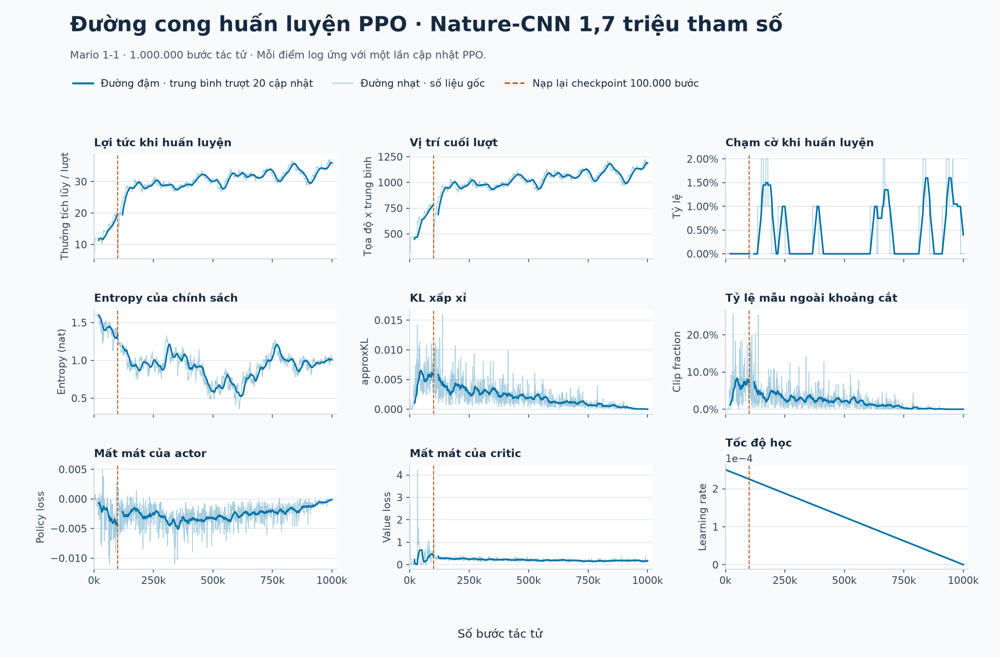
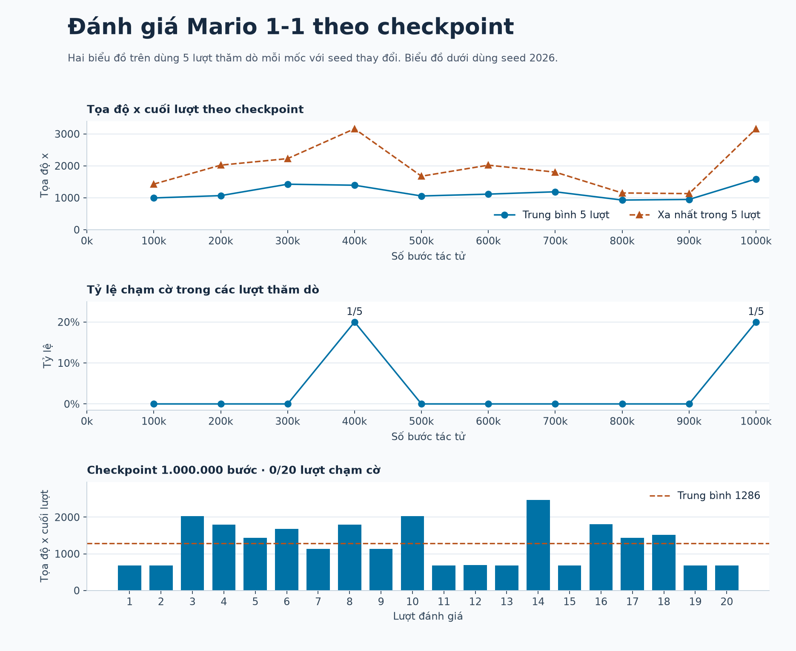

# Dạy Mario vượt màn bằng PPO

Đồ án cuối kỳ Học tăng cường, học kỳ 1 năm học 2026–2027. Mario học chọn hành động từ ảnh màn hình bằng PPO kiểu actor–critic trong môi trường `mo-supermario-v0`. Mục tiêu của đề là vượt màn 1-1 và thêm một màn trong danh sách cho sẵn. [Đề bài](de-bai.md)

Checkpoint 2 triệu bước đạt **15/20 lượt chạm cờ** trên màn 1-1, còn thiếu một lượt so với yêu cầu **16/20**. Phần huấn luyện màn thứ hai và hồ sơ nộp vẫn đang hoàn thiện. [Bảng so sánh và video](#so-sanh-1m-2m)

## 1. Các thành phần chính

| Tệp | Phần thực hiện |
|---|---|
| [`wrappers.py`](mario_ppo/wrappers.py) | Lặp hành động, cộng thưởng các khung và lấy max theo pixel của hai ảnh cuối. Đổi RGB sang ảnh xám 84×84. Gộp năm thành phần thưởng bằng tích vô hướng. |
| [`model.py`](mario_ppo/model.py) | Actor và critic dùng chung CNN. Actor xuất logits cho các tổ hợp nút, critic ước lượng giá trị trạng thái. Nature-CNN dùng 3 lớp tích chập và lớp ẩn 512 nút. |
| [`ppo.py`](mario_ppo/ppo.py) | Tính GAE, mục tiêu PPO có clipping, value loss và entropy. Chia minibatch, cập nhật nhiều epoch, cắt chuẩn gradient và ghi `approx_kl`, `clipfrac`. |
| [`train.py`](mario_ppo/train.py) | Thu mẫu song song, lưu log và checkpoint. Trên Windows, tiến trình môi trường khởi động bằng `spawn` vì `forkserver` không có sẵn. |

Mỗi quan sát gồm **4 ảnh xám** xếp chồng. Mạng nhận các ảnh này để chọn nút bấm. Tọa độ `x` và `flag_get` được đọc từ thông tin môi trường để theo dõi kết quả. Khi tính GAE, một lượt kết thúc thật sẽ bỏ giá trị tương lai. Một lượt bị cắt vẫn lấy giá trị từ ảnh cuối trước khi reset. Đây cũng là hai trường hợp được kiểm thử riêng.

## 2. Cài đặt và kiểm tra nhanh

Dùng Python **3.10–3.12**. Bản cài trên Windows dùng Python **3.12 x64**. Gói `nes-py` cần trình biên dịch C++ nếu phải cài từ mã nguồn.

**Linux hoặc WSL**

```bash
python3.12 -m venv .venv
source .venv/bin/activate
python -m pip install -e .
python -m pytest -q
```

**Windows với PowerShell**

Đoạn dưới dùng MinGW-w64. Chạy `g++ --version` để kiểm tra trình biên dịch có trong PATH.

```powershell
py -3.12 -m venv .venv
$python = ".\.venv\Scripts\python.exe"
& $python -m pip install setuptools wheel
& $python -m pip download --no-deps --dest .wheels nes-py==8.2.1
& $python scripts/build_nes_windows.py .wheels/nes_py-8.2.1.tar.gz
& $python -m pip install --find-links .wheels -e . "opencv-python-headless==4.11.0.86"
& $python -X utf8 -m pytest -q
```

Chạy các lệnh sau từ thư mục gốc repo. Trên PowerShell, có thể dùng `& $python -X utf8` thay cho `python`.

```bash
python -m mario_ppo.train --config configs/nature_1_7m.yaml run_dir=runs/smoke algo.total_steps=1000 eval_episodes=0
```

Lệnh thử thu một rollout, cập nhật PPO rồi lưu checkpoint. Bộ kiểm thử công khai bao gồm wrapper, mạng, GAE, PPO loss và pipeline huấn luyện–đánh giá trên trình giả lập.

## 3. Huấn luyện và đánh giá

[`configs/default.yaml`](configs/default.yaml) là cấu hình của bộ khởi đầu. [`configs/nature_1_7m.yaml`](configs/nature_1_7m.yaml) chứa thiết lập các lần thử Nature-CNN với cấu hình cũ. Lệnh dưới đặt ngân sách **1 triệu bước** như lần chạy đã báo cáo.

```bash
python -m mario_ppo.train --config configs/nature_1_7m.yaml run_dir=runs/nature-1m algo.total_steps=1000000
```

| Thông số của lần chạy 1 triệu bước | Giá trị |
|---|---|
| Quan sát và hành động | 4 ảnh xám 84×84, `frame_skip=2`, bộ 5 hành động `right_only` |
| Mạng | CNN 32 → 64 → 64 kênh, lớp ẩn 512, **1.687.206 tham số** |
| Thu mẫu | 8 môi trường × 125 bước, tổng 1.000 mẫu mỗi rollout |
| Cập nhật PPO | 4 epoch × 4 minibatch, mỗi minibatch 250 mẫu |
| Tối ưu | Adam, learning rate ban đầu `2.5e-4` giảm tuyến tính, chuẩn gradient tối đa 0,5 |
| GAE và loss | `gamma=0.9`, `gae_lambda=0.95`, `clip_coef=0.2`, entropy 0,01, critic 0,25 |
| Thưởng | `[1, 1, 2, 0.05, 0.05]` theo thứ tự tiến ngang, thời gian, chết, xu và địch. Chuẩn hóa thưởng trong huấn luyện. |
| Seed và checkpoint | Seed train 2026, lưu mỗi 100.000 bước, thăm dò 5 lượt mỗi mốc |

Lần chạy thực tế được nạp lại từ checkpoint 100.000 bước sau khi máy khởi động lại. Để tiếp tục một lần bị gián đoạn, dùng `resume` và một thư mục log mới. `algo.total_steps` là **mốc tổng**, tính cả số bước trong checkpoint.

```bash
python -m mario_ppo.train --config configs/nature_1_7m.yaml resume=runs/nature-1m/checkpoints/step_000100000.pt run_dir=runs/nature-1m-resume algo.total_steps=1000000
```

Thư mục mỗi lần chạy có `config.yaml`, `progress.csv`, `evals.csv` và `checkpoints/`. Khóa `video=true` bật video thăm dò theo checkpoint. Để tạo kết quả dùng cho đồ án, chạy [script đánh giá nguyên bản của thầy](mario_ppo/evaluate.py) với đường dẫn checkpoint thực tế.

```bash
python -m mario_ppo.evaluate --ckpt runs/nature-1m/checkpoints/step_001000000.pt --level 1-1 --episodes 20 --seed 2026 --out ket-qua-1-1.json --video 1-1.mp4
```

Giao thức chấm dùng 20 lượt, 0–30 bước NOOP đầu mỗi lượt, lấy mẫu hành động theo chính sách và tối đa 3.000 bước tác tử mỗi lượt. Tỷ lệ chạm cờ tính từ `flag_get`. Khi chạy màn thứ hai, thay `--level` và tên tệp đầu ra tương ứng.

<a id="so-sanh-1m-2m"></a>

## 4. So sánh ba checkpoint trên màn 1-1

Cả ba bản dùng Nature-CNN 1.687.206 tham số, 4 ảnh xám 84 × 84 và lặp mỗi hành động trong 2 khung hình. Mỗi checkpoint được chấm 20 lượt bằng cùng script, seed 2026 và giới hạn 3.000 bước mỗi lượt.

| Cấu hình | Bước huấn luyện | Chạm cờ | Tỷ lệ | Tọa độ cuối trung bình | Tọa độ cuối cao nhất | Video lượt xa nhất |
|---|---:|---:|---:|---:|---:|---|
| Cũ | 1.000.000 | [0/20](docs/results/nature-cnn-1m.json) | 0% | 1.286,00 | 2.469 | [Lượt 14 · MP4](docs/results/1m-cu.mp4) |
| Mới | 1.000.000 | [6/20](docs/results/1m-moi.json) | 30% | 1.941,55 | 3.161 | [Lượt 1 · MP4](docs/results/1m-moi.mp4) |
| Mới | 2.000.000 | [15/20](docs/results/2m-moi.json) | 75% | 2.801,80 | 3.161 | [Lượt 1 · MP4](docs/results/2m-moi.mp4) |

**Ở cùng mốc 1 triệu bước**, đổi cấu hình giúp Mario chạm cờ thêm 6 lượt (+30 điểm phần trăm). Tọa độ cuối trung bình tăng 655,55. **Khi tiếp tục cấu hình mới đến 2 triệu bước**, số lượt về đích tăng từ 6 lên 15 (+45 điểm phần trăm), tọa độ trung bình tăng thêm 860,25. Cả hai video cấu hình mới đều kết thúc ở cờ. Sự khác biệt nằm ở số lần lặp lại được kết quả đó trong 20 lượt.

| Tham số huấn luyện | Cũ · 1M | Mới · 1M và 2M |
|---|---|---|
| Số môi trường × bước mỗi đợt | 8 × 125 | 8 × 512 |
| Epoch × số mini-batch | 4 × 4 | Tối đa 10 × 16, dừng sớm khi KL vượt 0,03 |
| Learning rate ban đầu và lịch giảm | 0,00025, giảm tuyến tính về 0 ở 1M | 0,00015, giảm tuyến tính về 0 ở 2M |
| Gamma / lambda GAE | 0,90 / 0,95 | 0,90 / 1,00 |
| Ngưỡng cắt PPO / hệ số critic | 0,20 / 0,25 | 0,15 / 0,50 |
| Trọng số tiến ngang / thời gian / chết / xu / địch | 1 / 1 / 2 / 0,05 / 0,05 | 1 / 1 / 2 / 0 / 0 |
| Thưởng và cắt lượt | Chuẩn hóa thưởng | Dùng thưởng thô, cộng 2 khi chạm cờ, cắt lượt sau 200 quyết định liên tiếp không vượt tọa độ xa nhất trong lượt |

Hệ số entropy 0,01 và chuẩn hóa advantage được giữ ở cả ba bản. Nhiều tham số thay đổi cùng lúc ở mốc 1M, nên mức tăng 30 điểm phần trăm phản ánh tác động chung của cấu hình. Mỗi video minh họa một lượt có tọa độ cuối cao nhất trong 20 lượt chấm. Khi nhiều lượt cùng chạm cờ, video lấy lượt đầu tiên.

### Các lần thử trước với cấu hình cũ

Bảng dưới lấy từ các lần gọi trực tiếp script của thầy, mỗi checkpoint **20 lượt với seed 2026**.

| Mạng | Mốc bước | Chạm cờ | `x` cuối lượt trung bình | `x` xa nhất |
|---|---:|---:|---:|---:|
| CNN 223.190 tham số | 500.000 | [0/20](docs/results/mang-nho-500k.json) | 942,9 | 1.528 |
| Nature-CNN 1.687.206 tham số | 300.000 | [1/20](docs/results/nature-cnn-300k.json) | 864,8 | 3.161 |
| Nature-CNN 1.687.206 tham số | 700.000 | [1/20](docs/results/nature-cnn-700k.json) | 1.501,8 | 3.161 |
| Nature-CNN 1.687.206 tham số | 1.000.000 | [0/20](docs/results/nature-cnn-1m.json) | 1.286,0 | 2.469 |

Để chạy lại cấu hình mạng nhỏ, dùng cùng tệp cấu hình với các thiết lập sau.

```bash
python -m mario_ppo.train --config configs/nature_1_7m.yaml run_dir=runs/cnn-nho-500k 'model.channels=[16,32,32]' model.hidden_size=128 algo.total_steps=500000
```

Hai lần chạy dùng CPU Intel Core i5-12450H. Lần 500.000 bước mất khoảng **43 phút**, tốc độ trung bình trong log là **193 bước/giây**. Đoạn chạy lại từ 100.000 đến 1.000.000 bước mất khoảng **2 giờ 21 phút**, trung bình **106 bước/giây**. Hai số thời gian lấy theo tốc độ ghi ở cuối từng đoạn, có tính thời gian thăm dò định kỳ trước khi train kết thúc.



Lợi tức và tọa độ cuối lượt tăng so với đầu lần chạy. Cuối lịch giảm learning rate, `approx_kl` và `clipfrac` được ghi gần 0. Tốc độ thay đổi chính sách ở giai đoạn này đã giảm rõ.



Hai ô trên của hình dùng **5 lượt thăm dò mỗi mốc với seed thay đổi**. Ô dưới dùng 20 lượt chấm seed 2026. Ở checkpoint cuối, **8/20 lượt kết thúc tại `x=676–698`**. Khi chạy lại để kiểm tra nguyên nhân, cả 20 lượt đều chết khi đồng hồ trong game còn thời gian.

## 5. Hạn chế và việc còn lại

- **Màn 1-1 còn thiếu một lượt chạm cờ.** Bản 2M kết thúc 5 lượt trước cờ, với tọa độ cuối lần lượt là 1.797, 2.019, 2.469, 313 và 2.023. Có thể xem lại các lượt này để xác định Mario gặp trở ngại ở đâu.
- **Hai lần chạy đang dùng ngân sách khác nhau.** Mạng nhỏ chạy 500.000 bước, mạng lớn chạy 1 triệu, nên lịch learning rate cũng khác. Thí nghiệm so sánh để đưa vào báo cáo sẽ dùng cùng ngân sách, cấu hình và giao thức chấm, mỗi cặp chỉ đổi một yếu tố. Nếu đủ thời gian, chạy thêm một seed huấn luyện.
- **Cần cô lập số ngẫu nhiên khi thăm dò định kỳ.** Lời gọi đánh giá hiện thay đổi seed PyTorch của tiến trình huấn luyện. Việc cần sửa nằm ở chỗ gọi đánh giá trong `train.py`, để tần suất thăm dò ít ảnh hưởng hơn đến khả năng tái lập lần chạy.
- **Màn thứ hai còn phải chốt.** Đề cho chọn một màn trong danh sách và dùng tối đa 10 triệu bước. Nếu chuyển giao từ checkpoint 1-1, cần ghi rõ checkpoint nguồn, cách khởi tạo và số bước trên màn đích trong báo cáo.

Hồ sơ nộp theo đề gồm mã nguồn, `config.yaml`, `progress.csv`, `evals.csv`, checkpoint tốt nhất của hai màn, JSON và video chấm. Báo cáo PDF tối đa 8 trang cần có cấu hình, đường cong học, thí nghiệm so sánh, phân tích thất bại và đóng góp từng thành viên. Phần trình bày gồm 10 phút demo và 5 phút hỏi đáp. Checkpoint và log huấn luyện dung lượng lớn lưu cùng thư mục kết quả của lần chạy.
