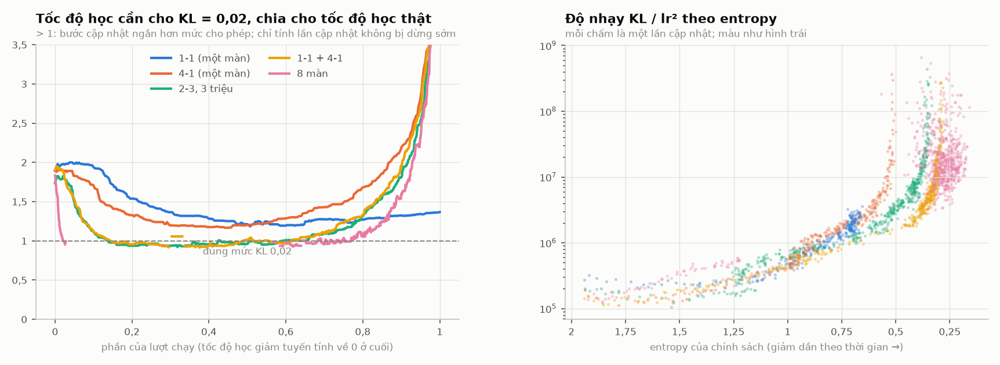
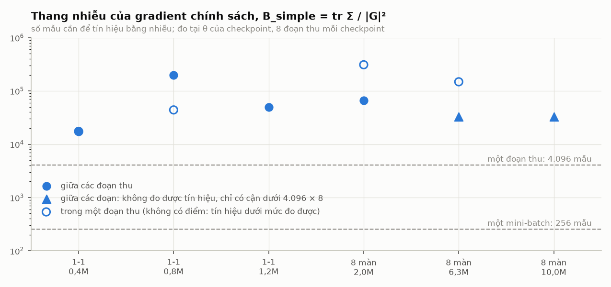
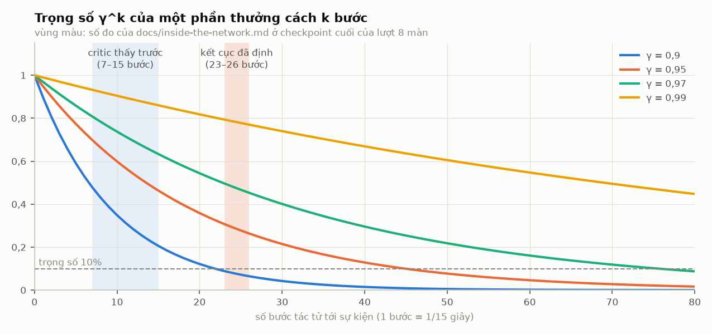
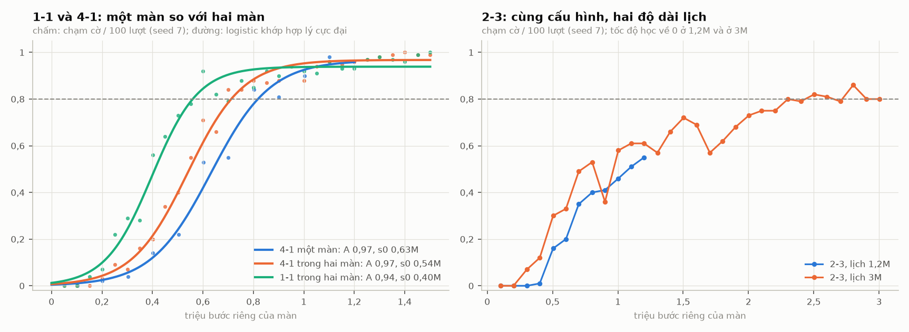
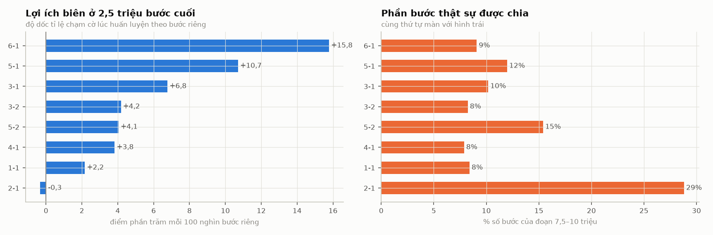

# Phân tích toán học của cấu hình PPO, từ số liệu đã chạy

Ghi ngày 26/11/2026. Bài này không huấn luyện thêm bước nào. Nó chỉ đọc lại `progress.csv`, `allocation.csv` và các lần chấm 100 lượt (seed 7) đã có trong `runs/`. Ngoài ra có một phép đo mới là thang nhiễu gradient, đo tại một số checkpoint mà không cập nhật trọng số.

- Số liệu và hình: `experiments/config_math.py`, ghi hình vào `docs/config-math/`.
- Thang nhiễu gradient: `experiments/gradient_noise.py`, ghi kết quả vào `runs/<lượt>/eval/gradient-noise/`.

Bài này bổ sung cho `docs/config-review.md`. Bài kia so cấu hình với tài liệu công bố; bài này dựng mô hình toán đơn giản cho từng tham số rồi kiểm mô hình bằng số đo.

## Tóm tắt

| # | Câu hỏi | Mô hình | Số đo | Kết luận |
|---|---|---|---|---|
| 1 | Tốc độ học có đúng cỡ không? | KL ≈ S · lr², trong đó S là độ nhạy | S tăng 8–56 lần khi entropy giảm. Ở 1/5 đầu lượt một màn, tốc độ học cần để đạt KL 0,02 gấp 1,7–1,9 lần tốc độ học thật. | Lịch tuyến tính đúng hướng nhưng sai hình dạng: đầu lượt bước cập nhật quá ngắn. Nên thử tốc độ học tự chỉnh theo KL. |
| 2 | 4.096 mẫu mỗi lần cập nhật có hợp lý không? | Thang nhiễu B_simple = tr Σ / \|G\|² | Gradient của actor cần 17 nghìn tới hơn 100 nghìn mẫu để tín hiệu bằng nhiễu. Một đoạn thu 4.096 mẫu chỉ có 0–19% tín hiệu. | Cấu hình đang ở vùng tiết kiệm mẫu, đúng cho ngân sách tính bằng bước, nên không cần đổi. Nhiễu lớn là lý do tốc độ học phải về 0 và điểm dao động giữa các checkpoint. 16 × 256 không ít nhiễu hơn 8 × 512. |
| 3 | γ = 0,9 nhìn đủ xa chưa? | V giảm khi sắp chết ≈ 5 · γ^k | Critic hoàn hảo chỉ thấy tới 22 bước, trong khi kết cục đã định từ 23–26 bước. | Chưa đủ ở các đoạn cần chuẩn bị sớm. **Đã thử (27/11/2026):** ở 2-1, γ = 0,97 qua tường ngay ở 148/149 lượt tới tường, so với 1/120 khi γ = 0,9; chạm cờ 149/200 so với 83/200. Mới có một seed. |
| 4 | Chia bước giữa các màn đã tối ưu chưa? | Tối đa Σ f_i(s_i) ⇒ lợi ích biên f_i′ bằng nhau | 2-1 có độ dốc −0,3 điểm mỗi 100 nghìn bước mà nhận 29% số bước. 6-1 và 5-1 dốc +16 và +11 mà chỉ nhận 9–12%. | Chưa. Nên chia theo độ dốc (tốc độ tiến bộ), không theo tỉ lệ hỏng. |
| 5 | Hệ số entropy có quyết định độ ngẫu nhiên lúc chấm không? | Cân bằng π ∝ exp(Â / c) | Với c = 0,002, hành động kém hơn chỉ 0,01 độ lệch chuẩn đã có xác suất tương đối 0,007. | Không. Entropy còn lại 0,28 đến từ việc tối ưu dừng lại, không từ hệ số entropy. Đặt `ent_coef_final: 0` sẽ không giúp. |
| 6 | Các con số chấm đáng tin tới đâu? | Nhị thức và kiểm định χ² | Chọn checkpoint tốt nhất trong 10 cái làm điểm seed 7 cao hơn thật 2–6 điểm. 20 lượt cho khoảng tin cậy rộng khoảng 25 điểm. | Luôn xác nhận bằng một seed mới, như nhóm đã làm. Một thí nghiệm muốn thấy khác biệt 10 điểm cần khoảng 140–200 lượt mỗi nhánh. |

**Có cần tối ưu thêm không?**
- Với điểm số thì không: ba bản nộp đã qua ngưỡng (xem `docs/config-review.md`, Mục 6).
- Với hiệu quả học (ít bước hơn, ít giờ máy hơn) thì có hai chỗ có cơ sở toán: mục 1 (tốc độ học) và mục 4 (chia bước giữa các màn).
- Mục 3 (γ) cần thí nghiệm trước khi quyết.
- Mục 2 và mục 5 cho thấy hai hướng tôi từng đề xuất trong `docs/config-review.md` sẽ không có tác dụng: đổi sang 16 × 256 và hạ `ent_coef_final` về 0.

## 1. Vùng tin cậy: tốc độ học, approxKL và entropy



**Mô hình.**
- PPO giữ chính sách mới gần chính sách cũ. Với bước cập nhật nhỏ, D_KL(π_cũ ‖ π_mới) ≈ ½ Δθᵀ F Δθ, trong đó F là ma trận Fisher của chính sách.
- Adam, cộng với phép cắt chuẩn gradient luôn hoạt động (`docs/config-review.md`, Mục 2), làm độ dài Δθ tỉ lệ với tốc độ học.
- Vì vậy KL ≈ S · lr². Đại lượng S = KL / lr² là "độ nhạy" của chính sách với một bước cập nhật, và đo được ở mọi lần cập nhật.

**Số đo** (chỉ dùng các lần cập nhật không bị `target_kl` dừng sớm, để KL chưa chạm trần):

| Lượt | Entropy (từ → tới) | S tăng | Tốc độ học cần / thật, năm đoạn của lượt |
|---|---|---|---|
| 1-1 một màn | 1,49 → 0,67 | 8 lần | 1,90 / 1,38 / 1,24 / 1,26 / 1,32 |
| 4-1 một màn | 1,49 → 0,52 | 56 lần | 1,67 / 1,22 / 1,20 / 1,43 / 2,20 |
| 2-3, 3 triệu bước | 1,23 → 0,36 | 34 lần | 1,21 / 0,94 / 0,97 / 1,09 / 1,81 |
| 1-1 + 4-1 | 1,33 → 0,30 | 36 lần | 1,22 / 0,95 / 0,98 / 1,13 / 1,96 |
| 8 màn | 0,93 → 0,23 | 9 lần | 1,21 / – / 0,96 / 1,01 / 1,62 |

"Tốc độ học cần" là lr · √(0,02 / KL): tốc độ học mà, với cùng độ nhạy S, sẽ cho đúng KL = 0,02. Mức 0,02 là ngưỡng mà bài "37 implementation details" coi là nên giữ dưới. Ở đoạn 2 của lượt 8 màn, gần như mọi lần cập nhật đều bị dừng sớm, nên đoạn đó không có số.

**Đọc số.**
- **S tăng đều theo entropy ở cả năm lượt, và các lượt nằm trên cùng một đường cong** (hình phải). Cùng một tốc độ học cho KL lớn hơn 8–56 lần ở cuối lượt so với đầu lượt. Nguyên nhân cụ thể chưa tách được: có thể do Adam chuẩn hóa theo độ lớn gradient, có thể do đặc trưng của thân CNN lớn dần. Còn S tăng thế nào thì đo được.
- **Hệ quả 1: lịch giảm tuyến tính là cần thiết.** Nếu giữ nguyên tốc độ học, KL ở cuối lượt sẽ lớn hơn đầu lượt hàng chục lần. Điều này giải thích bằng toán điều nhóm đã thấy bằng thực nghiệm: các lượt chạy hết lịch kết thúc ổn định hơn (`nhat-ky-trong-tu.md`, Mục 14.2).
- **Hệ quả 2: lịch tuyến tính có hình dạng sai ở đầu lượt.**
  - Ở các lượt một màn, 1/5 đầu lượt chỉ dùng khoảng một nửa "ngân sách KL": tốc độ học cần gấp 1,7–1,9 lần, nên KL ≈ 0,005–0,008 thay vì 0,02.
  - Giữa lượt thì vừa khớp.
  - Cuối lượt, tốc độ học cố ý nhỏ.
- **Hướng sửa: tốc độ học tự chỉnh theo KL.** Ý tưởng lấy từ biến thể "phạt KL thích nghi" trong bài PPO gốc (Schulman và cộng sự, 2017, mục 4): hệ số phạt nhân hoặc chia 2 khi KL lệch quá 1,5 lần mục tiêu. Áp dụng cho tốc độ học:
  - Nếu KL > 1,5 × 0,02 thì chia lr cho 1,5.
  - Nếu KL < 0,02 / 1,5 thì nhân lr với 1,5.
  - Luôn giữ lr dưới trần lr_max · (1 − t/T), để vẫn về 0 ở cuối như nhóm muốn.
  - Đổi này chỉ chạm hai dòng đặt `lr` trong vòng lặp của `train.py` / `train_joint.py`.
  - Cách đơn giản hơn cho lượt một màn: tăng `lr` từ 2e-4 lên khoảng 3e-4 và giữ `target_kl` 0,03 làm hàng rào.
- **Dự đoán kiểm được** (chưa thử): ở 4-1 một màn, số bước tới 80% chạm cờ lúc huấn luyện giảm từ 0,86 triệu xuống khoảng 0,6–0,7 triệu. approxKL ở 20% đầu lượt tăng từ khoảng 0,007 lên khoảng 0,02.

## 2. Nhiễu gradient và kích thước batch



**Mô hình** (McCandlish và cộng sự, 2018, "An Empirical Model of Large-Batch Training").
- Gradient tính trên B mẫu là g_B = G + nhiễu, với E|g_B|² = |G|² + tr Σ / B. Ở đây G là gradient thật, Σ là hiệp phương sai của gradient một mẫu.
- **B_simple = tr Σ / |G|²** là số mẫu mà ở đó năng lượng của tín hiệu bằng năng lượng của nhiễu. Một batch B mẫu có tỉ số tín hiệu / nhiễu ≈ B / B_simple.
- Hệ quả của mô hình:
  - Khi B ≪ B_simple, ta ở vùng **tiết kiệm mẫu**. Tăng B gần như không làm giảm tổng số mẫu cần; nó chỉ giảm số lần cập nhật, tức tiết kiệm giờ máy.
  - Khi B ≫ B_simple, ta phí mẫu.

**Cách đo** (`experiments/gradient_noise.py`). Tại θ của mỗi checkpoint:
- Chạy 8 đoạn thu 8 × 512 bằng chính chính sách đó, trên môi trường huấn luyện có mẹo huấn luyện.
- Tính gradient của mất mát PPO, ở chỗ tỉ số chính sách bằng 1, trên cả đoạn thu và trên 16 mini-batch 256 mẫu.
- Lấy hai ước lượng:
  - trong một đoạn thu: so mini-batch với cả đoạn;
  - giữa các đoạn thu: so gradient của 8 đoạn với nhau.
- Không cập nhật trọng số.

| Checkpoint | Chạm cờ lúc đo | B_simple của actor, giữa các đoạn | B_simple của actor, trong một đoạn | Phần tín hiệu trong gradient một đoạn | cos giữa gradient hai đoạn | B_simple của cả mất mát (có critic), trong / giữa |
|---|---|---|---|---|---|---|
| 1-1, 0,4M | 0,16 | 17 nghìn | 17 nghìn | 19% | +0,20 | 418 / 5,2 nghìn |
| 1-1, 0,8M | 0,79 | 199 nghìn | 44 nghìn | 2% | +0,03 | 300 / 30 nghìn |
| 1-1, 1,2M | 0,83 | 49 nghìn | không đo được | 8% | +0,08 | 347 / 20 nghìn |
| 8 màn, 2,0M | 0,13 | 66 nghìn | 310 nghìn | 6% | +0,06 | 398 / 1,1 nghìn |
| 8 màn, 6,3M | 0,71 | > 33 nghìn (không đo được) | 149 nghìn | ≈ 0% | −0,01 | 1,2 nghìn / 5,8 nghìn |
| 8 màn, 10M | 0,85 | > 33 nghìn (không đo được) | không đo được | ≈ 0% | −0,01 | 3,9 nghìn / 42 nghìn |

"Không đo được" nghĩa là ước lượng |G|² ≤ 0: với số mẫu đã dùng, tín hiệu nhỏ hơn mức phân biệt được với nhiễu. Khi đó chỉ có cận dưới thô: B_simple > 4.096 × 8.

**Đọc số.**
1. **Gradient của actor cần từ 17 nghìn tới hơn 100 nghìn mẫu để tín hiệu bằng nhiễu, và con số này tăng dần theo quá trình huấn luyện.** McCandlish và cộng sự cũng thấy thang nhiễu tăng khi mất mát giảm.
   - Một đoạn thu 4.096 mẫu chỉ có 2–19% năng lượng là tín hiệu. Một mini-batch 256 mẫu chỉ có khoảng 0,1–1,5%.
   - Gradient của hai đoạn thu độc lập gần như vuông góc (cos 0,03–0,20, và khoảng 0 ở lượt 8 màn từ 6,3M).
2. **Vì 4.096 ≪ B_simple, cấu hình đang ở vùng tiết kiệm mẫu.**
   - Với một đồ án giới hạn bằng số bước, không phải bằng giờ máy, đây là vùng đúng.
   - Tăng số mẫu mỗi lần cập nhật (thêm môi trường hoặc đoạn thu dài hơn) theo mô hình sẽ không làm giảm số bước cần. Nó chỉ đổi số lần cập nhật lấy thời gian.
   - **Kết luận: không cần đổi `num_envs` × `num_steps` để tiết kiệm bước.**
3. **Mỗi lần cập nhật chủ yếu đi theo nhiễu của chính đoạn thu đó.** Điều này giải thích ba quan sát cũ:
   - KL vẫn chạm trần và tỉ lệ cắt cao dù tín hiệu yếu: PPO dùng phần lớn "ngân sách KL" cho nhiễu.
   - Điểm chấm dao động mạnh giữa hai checkpoint liền nhau, ví dụ 2-1 từ 42 xuống 5.
   - Giảm tốc độ học về 0 làm kết quả ổn định. Khi bước cập nhật chủ yếu là nhiễu, chính sách đi như một bước ngẫu nhiên có độ lệch tỉ lệ với tốc độ học. Đưa tốc độ học về 0 thu nhỏ độ lệch đó, giống SGD với tốc độ học giảm dần. Đây là lý do toán học cho bài học 14.2 trong nhật ký.
4. **Critic thì khác: các mẫu trong cùng một đoạn thu tương quan mạnh với nhau.**
   - B_simple của cả mất mát chỉ 300–3,9 nghìn khi đo trong một đoạn, nhưng 1,1–42 nghìn khi đo giữa các đoạn.
   - Lý do: các mẫu trong một đoạn chung lợi tức của cùng vài lượt chơi.
   - Số mẫu "độc lập" mà critic thật sự nhận mỗi lần cập nhật chỉ cỡ 4.096 × (B trong / B giữa), tức khoảng 40 tới 1.400, không phải 4.096.
   - Từ đó nảy ra ý: giữ 4.096 mẫu nhưng dùng 16 môi trường × 256 bước, để có gấp đôi số lượt chơi độc lập mỗi lần cập nhật. Phép so trực tiếp tại hai checkpoint 1-1 (0,4M và 0,8M) **không thấy lợi rõ**:
     - Tỉ số nhiễu / tín hiệu của cả mất mát là 1,64 và 8,25 với 16 × 256, so với 1,28 và 7,31 với 8 × 512.
     - Của riêng actor là 6,2 và 5,9, so với 4,3 và 48.
   - Mỗi ước lượng chỉ dựa trên 8 đoạn thu, nên sai cỡ 2 lần, và các chênh lệch trên nằm trong sai số đo. Vì vậy không có cơ sở đổi sang 16 × 256. Gợi ý đó trong `docs/config-review.md` nên bỏ, trừ khi mục đích chỉ là đo tốc độ.

## 3. Hệ số chiết khấu γ



**Mô hình.**
- Giá trị V(s) là tổng phần thưởng có chiết khấu, nên một sự kiện cách k bước chỉ góp với trọng số γ^k.
- Xét một critic hoàn hảo. Chết sau k bước làm mất phần phạt 1,67 cộng khoảng 3,3 phần thưởng tương lai (V khi chạy đều), nên V giảm khoảng 5 · γ^k.
- Với γ = 0,9, mức giảm này còn trên ngưỡng 0,5 mà `docs/inside-the-network.md` dùng khi 5 · 0,9^k ≥ 0,5, tức k ≤ ln 0,1 / ln 0,9 = 21,9 bước.

**So với số đo.**
- `inside-the-network.md` đo được critic thấy trước 7–15 bước, trong khi kết cục đã định từ 23–26 bước.
- Như vậy ngay cả critic hoàn hảo cũng không thấy được điểm 23–26 bước. "Critic thấy trước ngắn" phần lớn là giới hạn của γ, không phải điểm yếu của mạng.

Khoảng cách xa nhất mà một sự kiện còn giữ ít nhất 10% trọng số:

| γ | 0,9 | 0,95 | 0,97 | 0,99 |
|---|---|---|---|---|
| Khoảng cách | 22 bước | 45 bước | 76 bước | 229 bước |

**Cái giá của γ lớn.**
- Mất mát của critic lớn lên cùng V², tới 11 lần ở γ = 0,97.
- Gradient luôn bị cắt về 0,5, nên phần của actor trong gradient bị thu nhỏ. Chi tiết và cách bù bằng `normalize_reward` ở `docs/config-review.md`, Mục 4.
- **Thí nghiệm đề xuất:** γ = 0,9 so với 0,97, bật `normalize_reward` ở cả hai nhánh, 2 seed.

## 4. Đường cong học và cách chia bước giữa các màn

### 4.1 Học chung nhiều màn tốn ít bước riêng hơn

Bảng dưới là số bước *của riêng màn đó* tới khi tỉ lệ chạm cờ lúc huấn luyện (trung bình 100 lượt gần nhất, chỉ tính khi đủ 100 lượt) đạt 50% và 80%:

| Màn | Một màn | Hai màn (1-1 + 4-1) | Tám màn |
|---|---|---|---|
| 1-1 | 0,51 / 0,78 triệu | 0,42 / 0,58 triệu | 0,29 / 0,35 triệu |
| 4-1 | 0,61 / 0,86 triệu | 0,55 / 0,63 triệu | 0,30 / 0,51 triệu |

Các màn khác trong lượt 8 màn tới 50% / 80% ở:

| 3-2 | 6-1 | 3-1 | 5-1 | 5-2 | 2-1 |
|---|---|---|---|---|---|
| 0,39 / 0,52M | 0,23 / 0,44M | 0,74 / 0,84M | 0,76 / 1,08M | 0,97 / 1,36M | chưa tới / chưa tới |



**Khớp đường logistic.** Khớp p(s) = A / (1 + e^{−(s − s₀)/w}) bằng hợp lý cực đại nhị thức vào các lần chấm 100 lượt:
- 4-1 một màn: A = 0,97, s₀ = 0,63 triệu bước riêng, tới 80% ở 0,82 triệu.
- 4-1 trong hai màn: A = 0,97, s₀ = 0,54 triệu, tới 80% ở 0,71 triệu.
- 1-1 trong hai màn: A = 0,94, s₀ = 0,40 triệu, tới 80% ở 0,56 triệu.

Học chung không làm thấp mức trần A, và đưa điểm giữa s₀ sớm hơn khoảng 15%.

**Đọc cẩn thận.**
- Ở cùng số bước riêng, lượt nhiều màn còn đang ở đầu lịch, nên tốc độ học cao hơn. Mục 1 cho thấy lượt một màn bị thiếu bước ở đầu lượt.
- Vì vậy chênh lệch trên là gộp của hai thứ: các màn dùng chung đặc trưng ảnh, và tốc độ học khác nhau. Số liệu hiện có không tách được hai thứ này.
- Muốn tách, phải cho hai lượt cùng tốc độ học tại cùng số bước riêng.
- Kết quả này không mâu thuẫn với việc mạng 8 màn không chơi được màn lạ (`inside-the-network.md`, mục 3). Đặc trưng dùng chung có thể làm học nhanh hơn trên các màn đã học mà vẫn không đủ cho màn mới.

**2-3: lượt 1,2 triệu bước dừng vì hết lịch, không phải vì đã bão hòa.**
- Hai lượt trùng nhau tới khoảng 1 triệu bước (hình phải).
- Lượt 3 triệu bước tiếp tục lên tới khoảng 0,80.
- Ở 10 checkpoint cuối, các lần chấm đồng nhất với một tỉ lệ chung (Mục 6). Vậy 0,80 (seed 7) là trần thật của cấu hình này ở 2-3, không phải dao động.

### 4.2 Điều kiện chia bước tối ưu

**Bài toán.**
- Gọi f_i(s) là tỉ lệ chạm cờ của màn i sau s bước riêng.
- Với tổng S bước, ta muốn tối đa Σ f_i(s_i) với ràng buộc Σ s_i = S và s_i ≥ sàn.
- Theo nhân tử Lagrange, nghiệm tối ưu có **f_i′(s_i) bằng nhau ở mọi màn trên mức sàn**. Màn có lợi ích biên thấp hơn mức chung thì chỉ nhận mức sàn.

**Công thức hiện tại đi ngược điều kiện này.**
- Công thức hiện tại chia phần bước theo tỉ lệ hỏng 1 − f_i.
- Với đường logistic, f′ = (1/w) · f · (1 − f/A): bằng 0 ở *cả hai đầu*, khi màn chưa học được gì (f ≈ 0) và khi đã thạo (f ≈ A).
- Còn 1 − f thì lớn nhất đúng ở chỗ f′ = 0 lúc màn kẹt ở 0.
- Vì vậy màn kẹt như 2-1 bị dồn nhiều bước nhất, đúng ở chỗ lợi ích biên bằng 0.



**Số đo ở 2,5 triệu bước cuối của lượt 8 màn.** Độ dốc là độ dốc trung bình của tỉ lệ chạm cờ lúc huấn luyện, tính theo số bước riêng.

| Màn | 6-1 | 5-1 | 3-1 | 3-2 | 5-2 | 4-1 | 1-1 | 2-1 |
|---|---|---|---|---|---|---|---|---|
| Độ dốc (điểm phần trăm mỗi 100 nghìn bước) | +15,8 | +10,7 | +6,8 | +4,2 | +4,1 | +3,8 | +2,2 | −0,3 |
| Phần bước thật sự được chia | 9% | 12% | 10% | 8% | 15% | 8% | 8% | **29%** |

- Hai thứ gần như ngược thứ tự nhau.
- Theo điều kiện tối ưu, 2-1 lẽ ra chỉ nên nhận mức sàn 6%. Phần chênh khoảng 23% (khoảng 0,57 triệu bước ở đoạn này) lẽ ra thuộc về các màn đang tiến.
- **Giới hạn:** độ dốc là trung bình trên cả đoạn, không phải đạo hàm đúng ở cuối. Tỉ lệ lúc huấn luyện có mẹo cắt lượt. Tốc độ học cùng giảm về 0 ở mọi màn, nên so sánh giữa các màn vẫn công bằng, nhưng giá trị tuyệt đối của độ dốc thì không.

**Hướng sửa.** Đổi trọng số trong `level_shares` (`mario_ppo/train_joint.py`) từ tỉ lệ hỏng sang một ước lượng của f_i′. Hai lựa chọn:
- **Tốc độ tiến bộ:** max(0, độ dốc của tỉ lệ chạm cờ trên khoảng 50 lần cập nhật gần nhất). Đây là ý của Teacher–Student Curriculum Learning (Matiisen và cộng sự, 2017).
- **Dạng logistic:** f_i · (1 − f_i). Không cần ước lượng độ dốc, và cũng bằng 0 ở hai đầu.

Giữ mức sàn, để màn đã thạo không bị quên và màn đang ở 0 vẫn được thử. Cả hai lựa chọn đều không phụ thuộc vào việc mẹo cắt lượt làm sai tỉ lệ hỏng của 2-1.

## 5. Entropy và việc chấm bằng lấy mẫu

**Mô hình.**
- Mất mát của actor dùng lợi thế đã chuẩn hóa  (độ lệch chuẩn 1 trên mỗi mini-batch), cộng phần thưởng entropy c · H(π).
- Ở một trạng thái, cực đại của Σ π(a) Â(a) + c · H(π) là π(a) ∝ exp(Â(a) / c).
- Như vậy một hành động kém hơn hành động tốt nhất Δ độ lệch chuẩn, ở trạng thái cân bằng, có xác suất tương đối exp(−Δ / c):

| c | Δ = 0,01 | Δ = 0,05 | Δ = 0,1 |
|---|---|---|---|
| 0,01 (đầu lượt) | 0,37 | 0,0067 | 0,00005 |
| 0,002 (cuối lượt) | 0,0067 | 10⁻¹¹ | 10⁻²² |

**Đọc số.**
- Với c = 0,002, phần thưởng entropy gần như không giữ được chút ngẫu nhiên nào, trừ khi các hành động chênh nhau dưới 1% độ lệch chuẩn.
- Entropy còn lại ở cuối lượt (0,28 ở lượt 8 màn) tương đương p_max ≈ 0,95 nếu 6 hành động còn lại chia đều phần còn lại. Mức này *không* do hệ số entropy giữ. Nó đến từ hai thứ:
  - các trạng thái mà nhiều hành động gần như tương đương (ví dụ "phải + A" và "phải + A + B" khi đang ở trên không);
  - việc tối ưu bị dừng vì tốc độ học về 0 và bị giới hạn KL, trước khi chính sách kịp hội tụ.
- **Vì vậy đặt `ent_coef_final: 0` sẽ gần như không đổi gì.** Đề xuất này trong `docs/config-review.md`, Mục 3, nên bỏ.

**Khoảng cách giữa lấy mẫu và chọn tham lam.**
- Ở 5-2, chọn tham lam đạt 87%, lấy mẫu đạt 73,5%. Tỉ số là 0,845.
- Nếu mỗi quyết định then chốt có p = 0,95, thì 0,95^K = 0,845 cho K ≈ 3,3. Nếu p = 0,9 thì K ≈ 1,6.
- Vậy khoảng cách đến từ một vài quyết định then chốt mỗi lượt, không phải từ hàng trăm bước. Điều này khớp với `docs/reports/report-5-2.md`: lượt hỏng tập trung ở x 2952 và x 1858–1900.
- Hướng sửa vì vậy là thêm tín hiệu học ở đúng các chỗ đó: thêm bước, hoặc bắt đầu một phần lượt huấn luyện gần chỗ đó. Không phải giảm entropy chung, và càng không phải chỉnh nhiệt độ sau khi huấn luyện, vì đề không cho phép.

## 6. Độ tin cậy của các con số chấm

**Đồng nhất giữa các checkpoint liền nhau** (kiểm định χ², mỗi checkpoint 100 lượt seed 7):

| Đoạn | Chạm cờ /100 | p̄ | χ²/bậc tự do | p | Kỳ vọng max nếu mọi checkpoint như nhau |
|---|---|---|---|---|---|
| 2-3, 2,1–3,0M | 75 75 80 79 82 81 79 86 80 80 | 0,797 | 0,63 | 0,77 | 85,7 (+6,0) |
| 1-1 trong hai màn, 2,1–3,0M | 91 96 93 93 97 98 97 96 99 100 | 0,960 | 2,14 | 0,02 | 98,7 (+2,7) |
| 4-1 trong hai màn, 2,1–3,0M | 94 96 95 96 97 98 99 100 99 99 | 0,973 | 1,53 | 0,13 | 99,4 (+2,1) |
| 1-1 một màn, 0,8–1,2M | 83 81 84 80 89 | 0,834 | 0,89 | 0,47 | 87,6 (+4,2) |
| 4-1 một màn, 0,8–1,2M | 84 81 90 98 96 | 0,898 | 5,92 | < 0,001 | 93,2 (+3,4) |

- **2-3 đã phẳng thật.** Mười checkpoint cuối không khác nhau hơn mức ngẫu nhiên nhị thức (p = 0,77).
- **Checkpoint 2-3 được chọn nộp có 86/100 ở seed 7**, đúng bằng giá trị cao nhất kỳ vọng của 10 checkpoint giống hệt nhau (85,7). Chỉ nhìn seed 7 thì không phân biệt được checkpoint tốt thật với checkpoint gặp may.
  - Lần chấm lại bằng seed 11 cho 87/100, độc lập với lần chọn, nên checkpoint này tốt thật.
  - Chấm lại bằng một seed mới là bắt buộc về mặt thống kê, không chỉ là cẩn thận thêm.
- **1-1 trong hai màn và 4-1 một màn vẫn còn đang lên** (χ² lớn, có xu hướng tăng rõ). Ở đó checkpoint cuối là lựa chọn hợp lý, không phải checkpoint cao nhất.

**Lệnh chấm 20 lượt** chỉ cho khoảng tin cậy rộng (Wilson 95%):

| Kết quả | 16/20 | 18/20 | 19/20 | 20/20 |
|---|---|---|---|---|
| Khoảng tin cậy | 58–92% | 70–97% | 76–99% | 84–100% |

**Cỡ mẫu cho một thí nghiệm** (kiểm định hai tỉ lệ, α = 0,05 hai phía, lực 0,8), số lượt mỗi nhánh:

| So sánh | 0,80 với 0,90 | 0,85 với 0,95 | 0,70 với 0,80 | 0,10 với 0,20 | 0,10 với 0,40 |
|---|---|---|---|---|---|
| Lượt mỗi nhánh | 197 | 138 | 291 | 197 | 29 |

Vậy với thí nghiệm γ (Mục 3), mỗi nhánh cần ít nhất 2 checkpoint × 100 lượt để thấy khác biệt 10 điểm. Ngoài ra cần 2 seed huấn luyện, vì chênh lệch giữa các seed chưa đo bao giờ. Kết quả 39 so với 10 ở thí nghiệm cắt lượt 2-1 thuộc loại 0,10 so với 0,40: đủ lớn để 100 lượt thấy được. Nhưng mỗi nhánh mới có một seed, và cùng một lượt ở 2-1 từng dao động 42 → 5 giữa hai checkpoint.

## 7. Hướng đi, xếp theo độ chắc của cơ sở

| # | Hướng | Cơ sở | Đổi gì | Dự đoán kiểm được |
|---|---|---|---|---|
| 1 | Chia bước theo lợi ích biên (khi học nhiều màn) | Điều kiện Lagrange; độ dốc và phần bước gần ngược thứ tự (Mục 4.2) | Trọng số trong `level_shares`: f(1 − f) hoặc độ dốc gần đây | 2-1 chỉ nhận mức sàn; các màn đang tiến vượt 80% sớm hơn |
| 2 | Tốc độ học tự chỉnh theo KL (hoặc lr 3e-4 cho lượt một màn) | KL ≈ S · lr²; đầu lượt thiếu 1,7–1,9 lần (Mục 1) | Hai dòng đặt `lr` trong vòng lặp | approxKL ở 20% đầu lượt khoảng 0,02; ít bước hơn tới 80% |
| 3 | Giữ `num_envs` × `num_steps` = 8 × 512 | 4.096 ≪ B_simple; 16 × 256 không ít nhiễu hơn (Mục 2) | Không đổi | – |
| 4 | γ = 0,97 với `normalize_reward` | Tầm nhìn 22 bước so với 23–26 bước (Mục 3) | `algo.gamma`, `env.normalize_reward` | Critic thấy trước xa hơn; ở 2-1 nhiều lần thoát tường hơn |
| – | Bỏ: `ent_coef_final: 0` | Cân bằng exp(Â / c) (Mục 5) | – | – |

Mỗi hướng là một thí nghiệm đổi đúng một thứ, hợp với Mục 4 của báo cáo. Số bước do Dũng quyết.

## 8. Giới hạn

- Không huấn luyện thêm bước nào. Mọi "dự đoán" ở Mục 7 chưa được kiểm.
- Mô hình KL ≈ S · lr² chỉ đúng cho bước nhỏ. S gộp cả tác dụng của Adam, của phép cắt gradient và của việc chạy nhiều epoch.
- Độ dốc ở Mục 4.2 tính trên tỉ lệ chạm cờ lúc huấn luyện (có mẹo cắt lượt, cửa sổ 100 lượt). Đó là trung bình trên 2,5 triệu bước, không phải đạo hàm đúng tại một điểm.
- So sánh một màn / hai màn / tám màn bị lẫn với lịch tốc độ học, và mỗi lượt chỉ có một seed.
- Thang nhiễu đo tại θ của checkpoint (tỉ số chính sách bằng 1), không đo trong lúc 10 epoch đang chạy.
  - Mỗi ước lượng dựa trên 8 đoạn thu nên sai cỡ 2 lần. Kết luận chỉ dựa vào bậc độ lớn: mọi ước lượng đều từ 17 nghìn trở lên, tức ít nhất gấp 4 lần 4.096.
  - Các mẫu trong một đoạn thu tương quan với nhau, nên ước lượng "trong một đoạn" của critic đánh giá thấp nhiễu thật.

## Phụ lục: lệnh đã chạy

```bash
python experiments/config_math.py
python experiments/gradient_noise.py --ckpt runs/1-1/run-1/checkpoints/step_000401408.pt --rollouts 8 \
    --out runs/1-1/run-1/eval/gradient-noise/step_000401408.json
# tương tự cho step_000802816, step_001200128 (1-1) và step_002002944, step_006303744, step_009998336 (8 màn)
```
