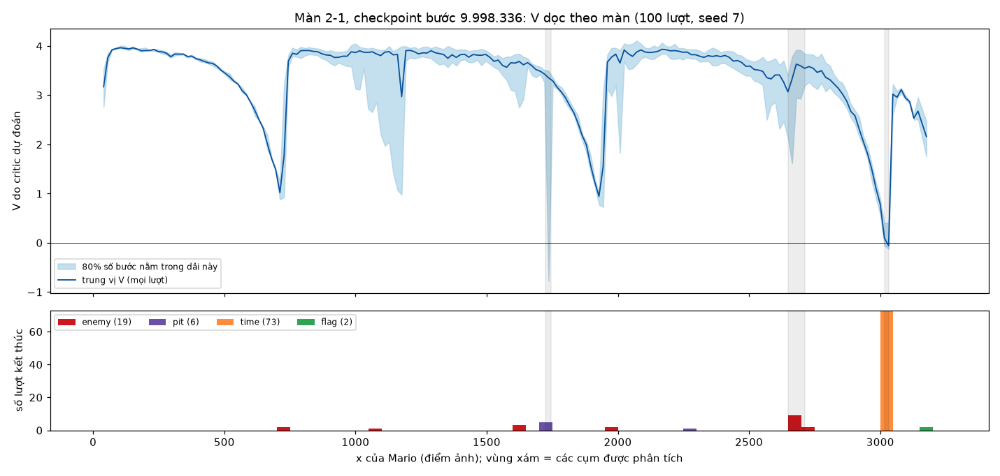
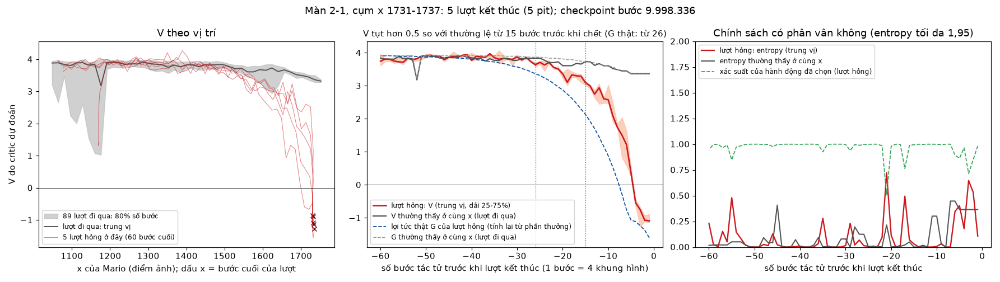
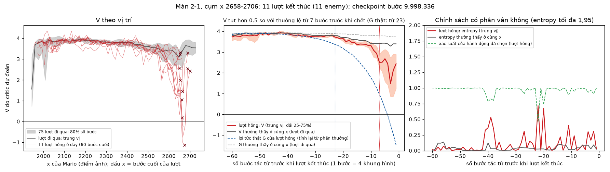
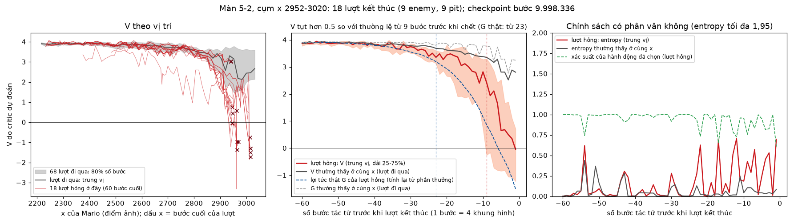
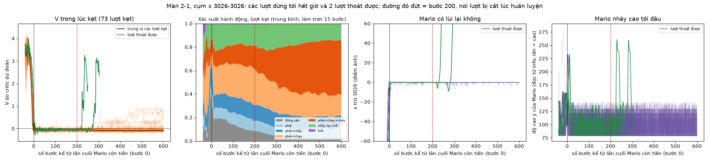
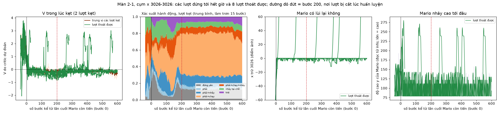
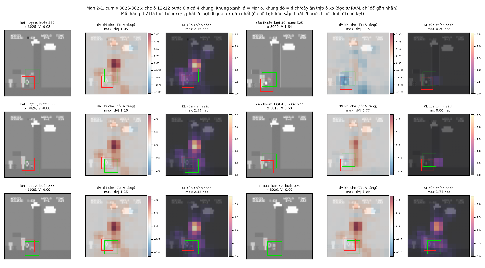
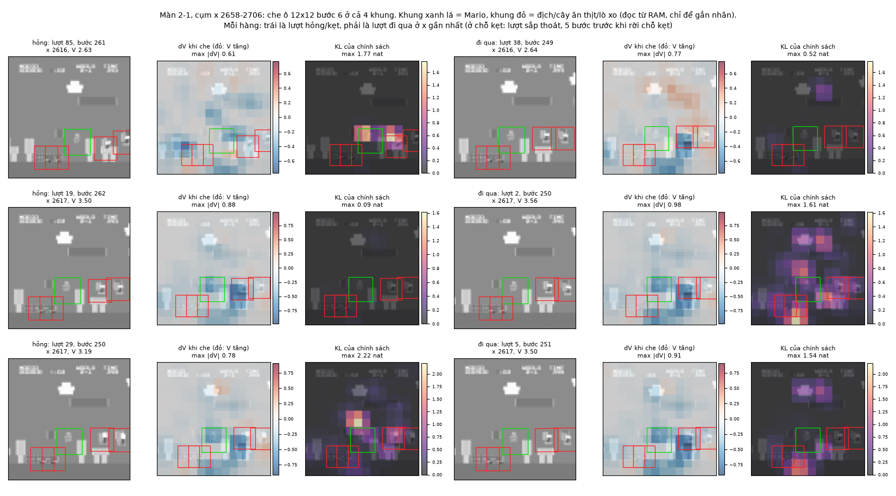

# Soi vào bên trong mạng 8 màn (hướng 1, không huấn luyện thêm)

Ghi ngày 24/11/2026. Đây là hướng 1 trong `docs/extension-directions.md`. Không có bước huấn luyện nào ở đây: chỉ chơi lại các lượt, đọc đầu ra của mạng và chấm.

- **Checkpoint được soi:** `runs/8-levels/from-scratch-10m/checkpoints/step_009998336.pt`, checkpoint cuối của lượt 8 màn (9.998.336 bước). Riêng mục 1.6 dùng thêm checkpoint 6.303.744 của cùng lượt chạy để so sánh.
- **Số liệu thô:** `runs/8-levels/from-scratch-10m/eval/inside-network-009998336/`.
- **Hình:** `docs/inside-the-network/`.
- **Độ chắc:** mọi kết luận ở đây là của **một checkpoint, một seed huấn luyện**. Mỗi con số đều đọc từ một tệp: do các script dưới đây ghi ra, hoặc đã có sẵn trong `runs/` (ghi rõ tên tệp). Chỗ nào là suy luận, hoặc chưa đo, đều ghi rõ.

Ba script mới (cách dùng ghi ở đầu mỗi tệp):

| Script | Làm gì |
|---|---|
| `experiments/value_trace.py` | Chơi lại đúng các lượt của `mario_ppo/evaluate.py`. Ở mọi bước ghi V, x, hành động, xác suất, entropy và phần thưởng. Sau đó gom các chỗ nhiều lượt kết thúc thành cụm và so V trước lúc hỏng với các lượt đi qua. |
| `experiments/occlusion_map.py` | Che từng ô của ảnh đầu vào, đo V và chính sách đổi bao nhiêu. |
| `experiments/unseen_levels.py` | Chấm checkpoint trên 24 màn nó chưa học bằng `mario_ppo.evaluate`, rồi dựng bảng so với các mạng khác. |

Các lượt được chơi lại đúng. `value_trace.py` cho cùng kết quả với `death_look.py` trên cùng checkpoint, 100 lượt, seed 7 (lần chấm của phiên chính, `eval/step-009998336-100ep-seed7/deaths-<màn>/look.txt`):

| Màn | Cờ | Chết vì địch | Rơi hố | Hết giờ | x trung bình |
|---|---|---|---|---|---|
| 2-1 | 2 | 19 | 6 | 73 | 2790 |
| 5-2 | 68 | 19 | 13 | 0 | 2985 |
| 3-1 | 97 | 3 | 0 | 0 | 3174 |

Ở checkpoint 6.303.744, kết quả trên 2-1 cũng khớp `look-2-1/look.txt` cũ. Phần che ô tính lại V khớp `trace.npz` tới 0,00.

## Tóm tắt

1. **Critic không mù, nhưng thấy trước rất ngắn.**
   - Ở cả ba màn đo, V của lượt sắp hỏng chỉ tụt rõ (thấp hơn mức thường thấy ở cùng chỗ từ 0,5 trở lên) từ 7–15 bước trước lúc chết, tức chưa tới 1 giây chơi. Kết cục thật của các lượt ấy đã xấu đi từ 23–26 bước trước.
   - Ở 2-1, vấn đề chính không còn là chết nữa: 73/100 lượt tới bức tường gạch có lò xo ở x 3026 rồi đứng đó tới hết giờ. Ở đó V lập tức về khoảng 0, nghĩa là critic biết là không tiến được nữa. Chính sách thì vẫn bấm phải và nhảy, gần như không bao giờ bấm trái (xác suất 0,00–0,01).
   - Ở checkpoint 6,3 triệu bước, 8/11 lượt tới tường vẫn thoát được bằng cách lùi vài điểm ảnh lên lò xo, và 6 trong 8 lần đó xảy ra sau hơn 200 bước đứng yên. 200 bước chính là ngưỡng cắt lượt lúc huấn luyện. Tới checkpoint cuối, tỉ lệ thoát trên mỗi bước kẹt giảm khoảng 80 lần.
2. **Mạng nhìn vào sân chơi quanh Mario, gần như bỏ qua HUD.** Che dải chữ HUD (điểm, đồng hồ) chỉ chiếm 2–5% tổng thay đổi của V, dù dải đó chiếm 13% ảnh. Ở bức tường, chỗ làm V và chính sách đổi nhiều nhất là mặt tường ngay trên đầu Mario, không phải cái lò xo.
3. **Kết quả này giống học thuộc từng màn hơn là học kỹ năng.** Trên 24 màn chưa học, mạng 8 màn không chạm cờ lượt nào (0/480), trung bình chỉ đi được 13,5% chiều dài màn. Con số này ngang mạng 2 màn (13,0%) và các mạng chuyên một màn (14,3–16,2%), dù mạng 8 màn được học gấp 3–8 lần số bước.

## 0. Vài khái niệm dùng trong bài

- **Bước:** một lần mạng chọn hành động. Một bước bằng 4 khung hình của trò chơi, tức 1/15 giây.
- **Actor và critic.** Mạng có một thân tích chập (CNN) dùng chung và hai đầu ra.
  - **Actor** (chính sách π) cho xác suất của 7 hành động: đứng yên, phải, phải+nhảy, phải+chạy, phải+chạy+nhảy, nhảy tại chỗ, trái.
  - **Critic** cho một con số **V**. Đó là dự đoán của mạng về tổng phần thưởng Mario sẽ nhận từ khung hình này trở đi, nếu cứ chơi theo chính sách hiện tại.
  - Khi huấn luyện, PPO so kết quả thật với V. Hành động nào dẫn tới kết quả tốt hơn V dự đoán thì được tăng xác suất (hiệu đó gọi là advantage). Như vậy critic là cái thước để actor biết mình làm tốt hơn hay kém hơn thường lệ.
- **Lợi tức chiết khấu G** là thứ critic cố đoán: G = r₀ + γ·r₁ + γ²·r₂ + … Với γ = 0,9, phần thưởng cách 10 bước chỉ còn nặng 0,9¹⁰ ≈ 0,35, cách 20 bước còn 0,12, cách 30 bước còn 0,04.
  - Vì thế ngay cả một critic hoàn hảo cũng chỉ "nhìn" được khoảng 20–30 bước về phía trước (1,5–2 giây chơi).
  - G trong bài này được tính lại từ phần thưởng thật của từng lượt. Nó là **kết cục đã xảy ra**, chỉ biết được sau. Còn V là **dự đoán trung bình**, làm trước. Nếu một cái chết vẫn còn tránh được thì V tụt ít hơn G là đúng.
- **Mức V thường gặp.** Khi Mario chạy hết tốc độ, V vào khoảng 3,8–3,9. Ở 5-2, phần thưởng trung bình là 0,375 mỗi bước, và 0,375 / (1 − 0,9) ≈ 3,75. Chết bị phạt −1,67 (−25 × 5/150, nhân trọng số 2). Vì vậy G ở bước cuối của một lượt chết vào khoảng −1,5.
- **Độ chính xác của critic.** Trung vị của |V − G| trên mọi bước là 0,05 ở 2-1, 0,06 ở 5-2, 0,03 ở 3-1 (`summary.txt` của từng màn). Tính trung bình, critic đoán rất sát. Câu hỏi của bài này là nó có đoán được những lúc hiếm, ngay trước khi hỏng, hay không.
- **Entropy** của chính sách: bằng 0 khi mạng chắc chắn một hành động, bằng ln 7 ≈ 1,95 khi chọn đều 7 hành động.
- **KL** (Kullback–Leibler): đo hai phân phối hành động khác nhau bao nhiêu, đơn vị nat. 0 là giống hệt.

## 1. Critic có thấy trước lúc Mario hỏng ở 2-1 không?

### 1.1 Câu hỏi

Trước khi một lượt ở 2-1 hỏng, V có tụt sớm không?

- **V tụt sớm:** mạng nhận ra nguy hiểm, cái sai nằm ở hành động.
- **V cao tới lúc chết:** mạng không nhận ra nguy hiểm. Nguyên nhân có thể là nhìn (không thấy) hoặc tầm nhìn quá ngắn (γ).

### 1.2 Cách đo

- `value_trace.py` chơi lại 100 lượt của `evaluate.py` trên 2-1: seed 7, số bước NOOP đầu lượt như nhau, lấy mẫu hành động như khi chấm. Ở mỗi bước nó ghi V, x, y, hành động, xác suất của hành động đó, cả 7 xác suất, entropy và phần thưởng. Lý do kết thúc lượt (flag / enemy / pit / time) đọc từ RAM như `death_look.py`, chỉ để gắn nhãn.
- **Cụm:** xếp x cuối của các lượt không chạm cờ. Hai lượt cùng cụm nếu x cuối cách nhau không quá 48 điểm ảnh. Chỉ phân tích cụm có từ 5 lượt trở lên.
- **"V thường thấy ở cùng x":** lấy mọi bước của các lượt **đi qua** cụm đó (chạm cờ, hoặc kết thúc xa hơn mép phải của cụm ít nhất 100 điểm ảnh), chia theo ô x rộng 16 điểm ảnh.
- Với mỗi lượt hỏng, đặt k = số bước còn lại tới lúc kết thúc (k = 1 là bước cuối). So V ở bước k với V thường thấy ở đúng x lúc đó.
- **"V tụt rõ từ k bước trước":** trung vị của (V − V thường thấy) thấp hơn −0,5 liên tục từ bước k tới bước cuối. Làm y hệt với G thay cho V. Con số với G là mức thấy trước của một critic biết trước kết cục, và nó bị giới hạn bởi γ.
- Các lượt đứng yên tới hết giờ được xét riêng: V và xác suất hành động theo số bước kể từ lần cuối Mario còn tiến.

### 1.3 Màn 2-1 ở checkpoint cuối khác hẳn ở bước 6,3 triệu

Năm chỗ vướng ghi trong `docs/extension-directions.md` lấy từ checkpoint 6.303.744. Ở checkpoint cuối, phần lớn các chỗ đó đã hết:

| | Checkpoint 6.303.744 (`look-2-1/look.txt` cũ và bảng trong `docs/extension-directions.md`) | Checkpoint 9.998.336 (`value-2-1/summary.txt`) |
|---|---|---|
| Lý do kết thúc (100 lượt) | enemy 67, time 13, pit 12, flag 8 | time 73, enemy 19, pit 6, flag 2 |
| x cuối trung bình | 2045 | 2790 |
| Chỗ nhiều lượt kết thúc | 1000–1400 (15), 1646 (15), 2066 (10 đứng tới hết giờ), 2666 (18), 3026 (3) | 1731–1737 (5, rơi hố), 2658–2706 (11, địch), **3026 (73, đứng tới hết giờ)** |

- Chín lượt hỏng còn lại không thuộc cụm nào: x cuối 734, 736, 1087, 1646 (ba lượt), 1950, 1951, 2258.
- Khe ống ở x 2066 không còn lượt nào kẹt.
- Mạng đi xa hơn nhưng chạm cờ ít hơn (8 → 2). Gần như mọi lượt bây giờ đều tới bức tường có lò xo, rồi dừng ở đó.
- Hình `value-2-1-overview.png` vẽ V dọc theo màn và nơi các lượt kết thúc:



- V của mọi lượt, kể cả lượt đi qua, tụt đều trước x ≈ 700, ≈ 1930 và ≈ 3000, rồi bật lên lại.
  - Ở x ≈ 3000 là bức tường lò xo. Critic đoán đúng rằng sắp hết tiến.
  - Ở x ≈ 700 và ≈ 1930 chưa xem có gì ở đó. Suy luận từ dáng tụt đều rồi bật lên: đó là chỗ Mario phải chậm lại hoặc dừng trước khi vượt.

### 1.4 Số liệu: hai cụm có lượt chết, ở 2-1 và ở hai màn đối chứng

"V tụt rõ" và "G tụt rõ" theo định nghĩa ở 1.2. Các cột V là trung vị của V các lượt hỏng; trong ngoặc là V thường thấy ở cùng x.

| Màn, cụm | Lượt hỏng | V ở k = 20 | k = 10 | k = 5 | k = 1 | V tụt rõ từ | G tụt rõ từ |
|---|---|---|---|---|---|---|---|
| 2-1, x 1731–1737 (rơi hố) | 5 | 3,36 (3,61) | 2,58 (3,61) | 0,35 (3,37) | −1,09 (3,37) | 15 bước trước | 26 bước trước |
| 2-1, x 2658–2706 (rùa có cánh, Goomba) | 11 | 3,64 (3,70) | 3,30 (3,40) | 2,68 (3,43) | 2,43 (3,40) | 7 bước trước | 23 bước trước |
| 5-2, x 2952–3020 (9 địch, 9 rơi hố) | 18 | 3,44 (3,62) | 2,82 (3,38) | 0,65 (2,81) | −0,04 (2,81) | 9 bước trước | 23 bước trước |
| 3-1, x 2338–2339 (địch) | 2 | 3,02 (3,06) | 2,47 (2,88) | 3,18 (3,85) | 2,44 (3,85) | 7 bước trước | 23 bước trước |

- 3-1 chỉ có 3 lượt hỏng trên 100, nên cụm ở đó chỉ có 2 lượt (phân tích lại với `--min-size 2`). Dòng 3-1 chỉ để minh họa.
- Ngay trước lúc hỏng, chính sách vẫn rất chắc chắn. Ở hai cụm của 2-1, tại mọi mốc k = 1, 2, 3, 5, 8, 10, 15, 20, entropy trung vị không quá 0,67 (tối đa có thể là 1,95). Xác suất của hành động được chọn từ 0,71 trở lên.







Hình đối chứng của 3-1: `docs/inside-the-network/value-3-1-cluster-x2338.png`.

### 1.5 Bức tường lò xo ở x 3026: 73 lượt đứng tới hết giờ

Số liệu từ `value-2-1/summary.txt`. Bước 0 là lần cuối x xa nhất còn tăng.

| Khoảng bước | V trung bình | V nhỏ nhất / lớn nhất | Lùi xa nhất | đứng yên | phải | phải+nhảy | phải+chạy | phải+chạy+nhảy | nhảy tại chỗ | trái |
|---|---|---|---|---|---|---|---|---|---|---|
| −10 … 0 (đang tới) | 0,75 | −0,29 / 2,60 | – | 0,41 | 0,07 | 0,21 | 0,02 | 0,15 | 0,13 | 0,00 |
| 1 … 20 | −0,05 | −0,32 / 0,36 | 4 px | 0,23 | 0,08 | 0,11 | 0,23 | 0,15 | 0,19 | 0,00 |
| 21 … 100 | −0,06 | −0,27 / 0,21 | 5 px | 0,18 | 0,09 | 0,13 | 0,26 | 0,14 | 0,20 | 0,00 |
| 101 … 200 | −0,06 | −0,24 / 0,44 | 4 px | 0,11 | 0,10 | 0,14 | 0,29 | 0,18 | 0,17 | 0,01 |
| 201 … 1000 | −0,03 | −0,38 / 1,21 | 8 px | 0,03 | 0,09 | 0,11 | 0,19 | 0,42 | 0,15 | 0,00 |
| 1001 … hết giờ | 0,14 | −0,29 / 1,47 | 7 px | 0,04 | 0,14 | 0,10 | 0,16 | 0,44 | 0,12 | 0,00 |

Các cột hành động là xác suất trung bình của từng hành động.

- **75 lượt tới chỗ này** (x ≥ 2978).
  - 73 lượt đứng không tiến 1664–1718 bước, tới khi đồng hồ về 0.
  - 2 lượt thoát được (lượt 30 và 45, cả hai chạm cờ).
- **Hai lượt thoát được:**
  - Đứng không tiến 221 và 275 bước liên tục trước khi thoát.
  - Lùi xa nhất 6 và 9 điểm ảnh, tức đủ để đứng lên lò xo.
  - Bật lên tới độ cao y = 261 và 260.
- **Các lượt kẹt** chỉ nhảy tới y cao nhất 142–233 (trung vị 149).
- **Không lượt nào thoát trong vòng 200 bước đứng không tiến đầu tiên.** Tính chung có 124.484 bước đứng không tiến ở chỗ này, tức 0,016 lần thoát trên 1000 bước.
- **Critic có nhận ra lúc Mario đứng lên lò xo:**
  - Lúc hai lượt thoát được còn đứng chờ, V trung vị là −0,05.
  - Trong 8 bước ngay trước khi rời chỗ kẹt, V nhảy lên 1,64 (lượt 30) và 1,11 (lượt 45).
  - Ở chính các bước đó (lượt 30 bước 525–528, lượt 45 bước 576–580, đọc từ `trace.npz`), xác suất của phải+chạy+nhảy là 0,79–1,00. Hình dưới cho thấy V nhảy lên.



Ô thứ tư (độ cao y) cho thấy rõ sự khác nhau: các lượt kẹt nhảy liên tục nhưng chỉ tới y cao nhất trung vị 149, tức nhảy từ mặt đất sát chân tường. Hai lượt thoát (xanh lá) bật lên trên 250, tức bật từ lò xo.

### 1.6 So với checkpoint 6,3 triệu (cùng 100 lượt, seed 7)

`look.txt` cũ của checkpoint 6.303.744 cho thấy hồi đó tối đa 11 lượt tới bức tường và 8 lượt chạm cờ. Để biết các lượt đó qua tường thế nào, chạy lại `value_trace.py` trên checkpoint 6.303.744. Lần chạy này cho đúng kết quả cũ (enemy 67, time 13, pit 12, flag 8, x trung bình 2045). Số liệu ở `value-2-1-step6303744/summary.txt`.

| Ở bức tường lò xo (x ≥ 2978) | Checkpoint 6.303.744 | Checkpoint 9.998.336 |
|---|---|---|
| Lượt tới được tường | 11 | 75 |
| Lượt thoát được (vượt x 3042) | 8 | 2 |
| Thoát mà không phải đứng (≤ 9 bước) | 1 | 0 |
| Thoát sau khi đứng 10–200 bước | 1 (114 bước) | 0 |
| Thoát sau khi đứng hơn 200 bước | 6 (245, 362, 398, 541, 694, 1212 bước) | 2 (221, 275 bước) |
| Tổng số bước đứng không tiến ở tường | 6.064 | 124.484 |
| Số lần thoát trên 1000 bước đứng không tiến | 1,319 | 0,016 |
| Xác suất "trái" trung bình của các lượt kẹt, theo từng khoảng bước | 0,06–0,12 (2 lượt kẹt) | 0,00–0,01 (73 lượt kẹt) |
| Lùi xa nhất trước khi thoát | 6–12 điểm ảnh (7 lượt có đứng) | 6–9 điểm ảnh |

- Các lượt thoát ở checkpoint 6.303.744 cũng làm đúng một cách: lùi 6–12 điểm ảnh, bật lò xo lên y = 260–271.
- Ở checkpoint này, trong 11 lượt tới tường chỉ 2 lượt kẹt tới hết giờ, 1 lượt chết vì địch, 8 lượt thoát.
- Khe ống x 2064–2090 ở checkpoint này thì ngược lại: 53 lượt tới, 40 lượt đi thẳng qua không dừng, 10 lượt kẹt tới hết giờ. Không lượt nào thoát được sau khi đã kẹt ở khe ống.



- **Giữa 6,3 triệu và 10 triệu bước,** mạng học được cách tới bức tường đều hơn nhiều (11 → 75 lượt).
- **Nhưng nó gần như mất cách rời khỏi tường.** Số lần thoát trên mỗi bước kẹt giảm khoảng 80 lần (1,319 → 0,016 trên 1000 bước). Xác suất "trái" khi kẹt giảm từ 0,06–0,12 xuống 0,00–0,01.
- **Ngay ở 6,3 triệu,** 6 trên 8 lần thoát xảy ra sau hơn 200 bước đứng yên. Lúc huấn luyện, lượt bị cắt sau đúng 200 bước như vậy.
- **Một số liệu khớp với điều đó:** trong `progress.csv`, ở dòng bước 6.303.744, tỉ lệ chạm cờ lúc huấn luyện ở 2-1 (`flag_rate_2-1`, tính trên các lượt huấn luyện gần nhất) là 0,0. Trong khi đó, chấm cùng checkpoint mà không cắt lượt ra 8/100. Ở dòng bước 9.998.336, con số đó là 0,02. Đây chỉ là một dòng mỗi mốc, nên chỉ để minh họa.

### 1.7 Quan sát

- **Critic không mù với cái chết, nhưng báo rất muộn.**
  - Ở cả bốn cụm có lượt chết, V tụt rõ chỉ từ 7–15 bước trước (0,5–1 giây). Kết cục thật (G) đã khác từ 23–26 bước trước.
  - Rơi hố được nhận ra sớm và rõ hơn. Ở cụm hố của 2-1 (chỉ có rơi hố), V ở bước cuối là −1,09. Ở cụm của 5-2 (nửa rơi hố, nửa chết vì địch) là −0,04.
  - Chết vì địch thì gần như bất ngờ với critic. Ở cụm rùa có cánh của 2-1, ở bước cuối V vẫn là 2,43, trong khi mức thường thấy là 3,40 và G thật là −1,47.
- **Ở checkpoint 6,3 triệu cũng vậy** (`value-2-1-step6303744/summary.txt`, cụm từ 3 lượt).
  - Hai cụm rơi hố (x 1522–1530, 2452–2462) có V tụt rõ từ 10 và 8 bước trước.
  - Sáu cụm chết vì địch có V tụt rõ từ 0–9 bước trước. Ở 3 trong 6 cụm đó (x 1008–1125, 1182–1187, 3026), V không tụt rõ ở bước nào trước khi chết.
  - Ngoại lệ duy nhất là cụm khe ống x 2064–2090. Ba lượt chết vì địch ở đó có V tụt từ 35 bước trước; chưa xem vì sao.
- **Thấy trước 23–26 bước của G là giới hạn của γ = 0,9, không phải của mạng.** Một cái chết cách 25 bước làm G giảm khoảng 0,5. Xa hơn nữa thì γ làm nó gần như biến mất.
- **Mạng 8 màn không phân vân trước khi chết.** Entropy thấp, hành động được chọn với xác suất cao. Mạng chắc chắn với một hành động sai, chứ không lưỡng lự giữa đúng và sai.
- **Ở bức tường lò xo, không có gì để "thấy trước" cả.**
  - Critic đoán đúng: đứng sát tường thì không tiến được (V ≈ 0, so với 3,5–3,9 khi đang chạy).
  - Nó cũng đoán đúng khi Mario đã đứng trên lò xo (V nhảy lên 1,1–1,6).
  - Cái thiếu là chính sách gần như không bấm trái (xác suất 0,00–0,01). Mario chỉ bị dạt lùi tối đa 8 điểm ảnh, và trong 73 lượt kẹt không lần nào thành một cú bật lò xo đủ cao.

### 1.8 Kết luận và độ chắc

- **Chắc (đo trực tiếp, 100 lượt):** chỗ hỏng chính của 2-1 ở checkpoint cuối là bức tường lò xo x ≈ 3026 (73/100), không phải các đoạn có địch.
- **Chắc:** ở bức tường, critic hiểu tình huống. V ≈ 0 khi kẹt, V tăng khi đứng lên lò xo. Vấn đề nằm ở actor: chuỗi hành động cần (lùi vài điểm ảnh, đứng lên lò xo, rồi bật) gần như không bao giờ xảy ra. Theo cách đọc ở `docs/extension-directions.md`, đây là trường hợp "mạng thấy tình huống, hành động là vấn đề". Cụ thể hơn, đó là vấn đề khám phá: chưa bao giờ thử thì không học được.
- **Khá chắc:** với các cái chết vì địch (rùa có cánh x 2658), critic chỉ báo trước khoảng 7 bước, và ở bước cuối V vẫn cao. Đây gần với trường hợp "mạng không nhận ra nguy hiểm". Lý do có thể là nó không nhận ra mối nguy, hoặc cái chết thật sự phụ thuộc may rủi của việc lấy mẫu hành động. Phép đo này không tách được hai khả năng đó.
- **Khá chắc (so hai checkpoint của cùng lượt chạy):** khả năng rời bức tường bị mất dần trong lúc huấn luyện. Ở 6,3 triệu bước, 8/11 lượt tới tường thoát được. Ở 10 triệu, chỉ 2/75. Tỉ lệ thoát trên mỗi bước kẹt giảm khoảng 80 lần.
- **Suy luận, chưa kiểm:** cơ chế có thể như sau.
  - Ở cả hai checkpoint, phần lớn các lần thoát (6/8 và 2/2) xảy ra sau hơn 200 bước đứng yên. Lúc huấn luyện, `NoProgressTruncation` cắt lượt đúng ở 200 bước.
  - Vậy trong huấn luyện, phần lớn những lần thoát kiểu này không bao giờ xảy ra. Mạng hầu như chỉ thấy "đứng ở tường 200 bước rồi bị cắt". Không có gì củng cố hành động lùi lại.
  - Hệ số entropy lại giảm dần từ 0,01 xuống 0,002 trong lượt chạy (`config.yaml`), nên hành động "trái" vốn ít dùng mờ dần.
  - Đây là cách giải thích khớp với số liệu, không phải điều đã đo. Chưa đo được huấn luyện đã thấy bao nhiêu lần thoát ở tường, vì `progress.csv` không ghi theo vị trí.
- Mọi điều trên là của một lượt chạy, một seed huấn luyện. So hai checkpoint không phải thí nghiệm có đối chứng: nhiều thứ đổi cùng lúc giữa 6,3 và 10 triệu bước (tỉ lệ chia bước, entropy, tốc độ học).

### 1.9 Bổ sung sau khi chấm thêm checkpoint 9,0 triệu (24/11/2026, 08:30)

Số liệu từ `eval/step-<bước>-100ep-seed7/deaths-2-1/deaths.json` của lượt 8 màn (100 lượt, seed 7, không cắt lượt). Một lượt chạy thẳng tới cờ mất khoảng 350 bước.

| Bước | Chạm cờ | Dừng ở tường (x 2978–3099) | Lượt chạm cờ mất từ 600 bước trở lên | Chạm cờ lúc huấn luyện (`progress.csv`, có cắt lượt) |
|---|---|---|---|---|
| 6.201.344 | 2 | 5 | 2 trên 2 | – |
| 6.303.744 | 8 | 3 | 6 trên 8 | 0,00 |
| 9.003.008 | 42 | 1 | 37 trên 42 (trung vị 806 bước) | 0,03 |
| 9.900.032 | 5 | 61 | 1 trên 5 | 0,02 |
| 9.998.336 | 2 | 73 | 1 trên 2 | 0,02 |

- **Câu "mất dần" ở mục 1.8 chưa đủ.** Khả năng qua tường không giảm đều: nó cao nhất ở bước 9,0 triệu (42/100) rồi sụp trong một triệu bước cuối.
- **Ở bước 9,0 triệu, 37 trên 42 lượt chạm cờ mất từ 600 bước trở lên,** tức phần lớn đã đứng rất lâu rồi mới qua. Lúc huấn luyện những lượt như vậy bị cắt ở 200 bước không tiến, và tỉ lệ chạm cờ lúc huấn luyện ở cùng bước chỉ là 0,03. Chưa đo trực tiếp số bước đứng ở tường của checkpoint này (chưa chạy `value_trace.py` trên nó); "đứng lâu ở tường" là suy ra từ độ dài lượt.
- Điều này khớp với giả thuyết ngưỡng cắt lượt ở mục 4: khi chấm, mạng qua tường chủ yếu bằng những lần thoát mà huấn luyện không bao giờ thấy, nên không có gì giữ hành vi đó lại.

### 1.10 Đo trực tiếp ở tường cho checkpoint 9,0 triệu (24/11/2026, 11:00)

`value_trace.py` đã chạy trên checkpoint 9.003.008 (`eval/inside-network-009998336/value-2-1-step9003008/`). Bảng dưới tính lại từ `trace.npz` của ba checkpoint theo cùng một định nghĩa: "ở tường" là các bước có x trong 2960–3060, "qua tường" là lượt có x lớn nhất trên 3130.

| Bước | Lượt tới tường | Lượt qua tường | Số bước ở tường (mọi lượt) | Lượt qua trên 1000 bước ở tường | Lượt qua sau hơn 200 bước ở tường | Xác suất nút "trái" khi đứng ở tường |
|---|---|---|---|---|---|---|
| 6.303.744 | 11 | 8 | 6.222 | 1,29 | 6 trên 8 | 0,085 |
| 9.003.008 | 43 | 42 | 26.768 | 1,57 | 38 trên 42 (trung vị 494 bước) | 0,079 |
| 9.998.336 | 75 | 2 | 125.070 | 0,016 | 2 trên 2 | 0,004 |

- **Từ 6,3 tới 9,0 triệu bước, mạng không qua tường giỏi hơn.** Tỉ lệ qua tường trên mỗi bước đứng gần như không đổi (1,29 và 1,57 trên 1000 bước). Số chạm cờ tăng từ 8 lên 42 vì số lượt tới được tường tăng từ 11 lên 43, và vì khi chấm lượt được đứng tới hết giờ.
- **38 trên 42 lượt qua tường ở bước 9,0 triệu đứng hơn 200 bước,** nên lúc huấn luyện chúng đã bị cắt trước khi qua. Đây là số đo trực tiếp cho điều mục 1.9 mới chỉ suy ra.
- **Trong một triệu bước cuối, xác suất bấm "trái" khi đứng ở tường giảm từ 0,08 xuống 0,004** và tỉ lệ qua tường giảm khoảng 100 lần. Số liệu này mô tả điều đã xảy ra; nó chưa cho biết nguyên nhân (ngưỡng cắt, hệ số entropy giảm, hay tốc độ học về 0). Thí nghiệm hai nhánh ở `runs/2-1/` nhằm tách riêng ngưỡng cắt.
- **Ở bước 9,0 triệu còn một chỗ kẹt thứ hai, x 2066:** 13 lượt đứng tới hết giờ. Chỗ này khác tường: 64 lượt đi qua mà không đứng lại, còn lượt nào đã đứng lại thì không thoát (0 lần thoát). Ở checkpoint cuối không còn lượt nào kẹt ở đây.

## 2. Mạng dùng phần nào của màn hình?

### 2.1 Câu hỏi

Khi ra quyết định ở các chỗ hỏng của 2-1, mạng dựa vào đâu trên ảnh: Mario, địch, lò xo, bức tường hay chữ HUD?

### 2.2 Cách đo

`occlusion_map.py`, trên chính các lượt của mục 1.

- **Chọn khung hình:**
  - Mỗi cụm lấy 3 khung "hỏng": 4 bước trước khi lượt kết thúc.
  - Với cụm tường, lấy 3 khung "kẹt": 100 bước sau lần cuối Mario còn tiến.
  - Mỗi khung có một khung đối chứng ở x gần nhất từ một lượt đi qua được.
  - Riêng ở tường, khung đối chứng là "sắp thoát": 5 bước trước khi lượt 30 hoặc 45 rời chỗ kẹt, lúc Mario đã đứng trên lò xo. Khung kẹt thứ ba được so với lượt 30 lúc nó còn đang chờ.
  - Tổng cộng 18 khung.
- **Che ô:** che một ô 12×12 điểm ảnh của ảnh 84×84, trượt bước 6, tức 13 × 13 = 169 vị trí. Ô được tô bằng độ sáng trung bình của khung, ở cùng chỗ trên cả 4 khung xếp chồng.
- **Đo:** dV = V khi che − V gốc, và KL(π gốc ‖ π khi che). Bản đồ của mỗi điểm ảnh là trung bình các ô phủ lên nó.
- **Đếm theo vùng**, để không chỉ nhìn hình: phần trăm khối lượng của |dV| và của KL rơi vào bốn vùng.
  - Dải HUD: 11 hàng trên cùng.
  - Hộp 19×19 quanh Mario.
  - Hộp 17×17 quanh mỗi vật thể mà trò chơi giữ trong ô nhớ của địch: địch, cây ăn thịt, lò xo.
  - Phần còn lại.
  - Vị trí Mario và vật thể đọc từ RAM, chỉ để vẽ khung và đếm. Không đưa vào mạng. Độ lệch giữa tọa độ RAM và hình vẽ đã được kiểm bằng mắt trên ảnh gốc 256×240.

### 2.3 Số liệu (`occlusion-2-1/summary.txt`)

| Nhóm khung | Số khung | Phần \|dV\| ở HUD / Mario / vật thể / còn lại | Phần KL ở HUD / Mario / vật thể / còn lại | Diện tích HUD / Mario / vật thể | dV trung bình trên vật thể |
|---|---|---|---|---|---|
| 1731 hỏng | 3 | 4% / 12% / 12% / 72% | 0% / 17% / 9% / 73% | 13% / 5% / 8% | +0,30 |
| 1731 đi qua | 3 | 2% / 22% / 7% / 68% | 0% / 27% / 26% / 47% | 13% / 5% / 8% | −0,08 |
| 2658 hỏng | 3 | 3% / 10% / 21% / 66% | 1% / 21% / 25% / 54% | 13% / 5% / 12% | −0,17 |
| 2658 đi qua | 3 | 3% / 9% / 20% / 68% | 1% / 5% / 21% / 73% | 13% / 5% / 12% | −0,18 |
| 3026 kẹt | 3 | 5% / 9% / 3% / 84% | 1% / 14% / 4% / 80% | 13% / 5% / 2% | +0,16 |
| 3026 sắp thoát | 2 | 5% / 14% / 3% / 78% | 0% / 36% / 1% / 63% | 13% / 5% / 2% | −0,15 |
| 3026 đi qua (lượt 30 lúc còn chờ) | 1 | 5% / 8% / 2% / 85% | 1% / 16% / 5% / 78% | 13% / 5% / 2% | +0,04 |

Thay đổi lớn nhất của chính sách khi che một ô (trung bình các khung): 3,82 nat ở khung kẹt, 1,51 nat ở khung sắp thoát (lượt 30: 0,73; lượt 45: 2,29).





Hình cụm rơi hố: `docs/inside-the-network/occlusion-2-1-x1731.png`.

### 2.4 Quan sát

- **HUD gần như không được dùng.** Che dải chữ HUD (điểm, xu, tên màn, đồng hồ) chỉ tạo 2–5% tổng |dV| và 0–1% tổng KL, dù dải đó chiếm 13% ảnh. Vậy việc đứng tới hết giờ không phải do mạng đọc đồng hồ.
- **Ở tường, khi kẹt:**
  - Ô làm V tăng nhiều nhất (khoảng +1 trên bản đồ) và chính sách đổi nhiều nhất là mặt tường ngay phía trên Mario. Cả ba khung kẹt cho cùng một hình, khung lượt 30 lúc còn chờ cũng vậy.
  - Che chỗ đó thì critic lạc quan hơn. Suy luận: có thể vì mạng không còn thấy tường.
  - Lò xo chỉ chiếm 3% |dV| và 4% KL, gần đúng bằng diện tích của nó (2%). Khi kẹt, mạng không dựa nhiều vào lò xo.
- **Khi đã đứng trên lò xo** (sắp thoát), phần KL dồn về quanh Mario (36%), và chính sách ít nhạy với việc che hơn hẳn.
- **Ở rùa có cánh**, khung hỏng và khung đi qua gần như giống nhau. Vùng vật thể chiếm 20–21% |dV| trên 12% diện tích, nên mạng có nhìn vào địch. Nhưng che địch làm V *giảm* nhẹ (−0,17) thay vì tăng. Vậy không thấy dấu hiệu critic coi con rùa là mối nguy.
  - Ba khung hỏng có V 2,63 / 3,50 / 3,19. Ba khung đi qua ở cùng x có V 2,64 / 3,56 / 3,50.
- **Ở hố**, 4 bước trước lúc kết thúc Mario đã rơi (V của khung hỏng −0,54 tới −0,79). Bản đồ chỉ cho thấy mạng nhìn quanh Mario và mép hố. Quyết định sai đã xảy ra sớm hơn.

### 2.5 Bản đồ che ô cho biết gì và không cho biết gì

- **Cho biết:** nếu bỏ thông tin ở một chỗ thì đầu ra đổi bao nhiêu. Chỗ nào đổi nhiều thì mạng có dùng thông tin ở đó, trong đúng khung hình ấy.
- **Không cho biết:**
  - **Vì sao** mạng dùng chỗ đó.
  - Mạng có "hiểu" vật đó là gì không.
- **Ô che không trung tính.** Ô xám là một thứ lạ với mạng. Trong Mario, một khối vuông đặc trông giống gạch hoặc nền. Nên dV đo cả hiệu ứng "thêm một vật giả", không chỉ "bỏ thông tin".
- **Các chỗ không cộng lại được.** Che hai chỗ cùng lúc không bằng tổng hai lần che riêng. Một vật cũng có thể quan trọng mà vẫn không hiện ra, nếu mạng còn thấy cùng thông tin ở chỗ khác (ví dụ ở khung trước trong 4 khung xếp chồng).
- **Ô 12×12 khá thô.** Nó phủ cỡ 36 × 34 điểm ảnh gốc, to hơn Mario nhỏ. Nên không tách được Mario với vật ngay sát Mario.
- **Mẫu rất nhỏ:** 18 khung, 3 khung mỗi nhóm. Các con số ở 2.3 chỉ để mô tả, không đủ để kết luận thống kê.

### 2.6 Kết luận và độ chắc

- **Khá chắc:** mạng dựa vào sân chơi quanh Mario và gần như bỏ qua HUD. Nhóm khung nào cũng cho kết quả này.
- **Suy luận, chưa chắc:** ở tường, mạng phản ứng với "có tường cao trước mặt" nhiều hơn là với "có lò xo bên cạnh". Điều này khớp với việc chính sách không tìm cách dùng lò xo khi đã sát tường. Nhưng 3 khung và một phép đo có nhiễu thì chưa đủ để khẳng định.

## 3. Kỹ năng hay học thuộc?

### 3.1 Câu hỏi

Sau 10 triệu bước trên 8 màn, mạng có học được thứ dùng được ở màn mới không: nhảy qua hố, tránh Goomba, leo bậc? Hay nó chỉ thuộc 8 màn đã học?

### 3.2 Cách đo

- `unseen_levels.py` gọi `python -m mario_ppo.evaluate` cho từng màn trong 24 màn mạng chưa học: 20 lượt, seed 2026.
- Đó đúng là giao thức đã dùng để chấm mạng 2 màn (ghi ở đầu `runs/1-1+4-1/from-scratch/eval/all-levels/unseen-by-checkpoint.txt`). Script kiểm cả số lượt và seed của mọi tệp được đọc.
- Các mạng so sánh:
  - mạng 2 màn (1-1 và 4-1), bước 2.904.064;
  - ba mạng chuyên một màn: 1-1 và 4-1 ở bước 1.200.128, 2-3 ở bước 2.801.664.
- Mạng nào đã học màn đang xét thì ô của nó được đánh dấu "đã học". Chỉ có một trường hợp: mạng chuyên 2-3 trên 2-3.
- Màn chưa có số của một mạng ghi "chưa đo": mạng chuyên 4-1 chưa được chấm ở 1-2, 1-4, 3-3.
- Toàn bộ bảng, mỗi màn một bảng: `docs/inside-the-network/unseen-levels.md` (bản gốc ở `inside-network-009998336/unseen-levels/`).

### 3.3 Số liệu

**x trung bình (x xa nhất)**, 20 lượt. "x cờ" lấy từ `runs/level-lengths/level-lengths.csv`; dấu – là màn kết thúc bằng ống hay mê cung, không đo được cờ.

| Màn | x cờ | Mạng 8 màn | Mạng 2 màn | Chuyên 1-1 | Chuyên 4-1 | Chuyên 2-3 |
|---|---|---|---|---|---|---|
| 1-2 | – | 427 (972) | 256 (652) | 177 (965) | chưa đo | 355 (892) |
| 1-3 | 2425 | 430 (439) | 157 (420) | 416 (445) | 403 (747) | 292 (315) |
| 1-4 | 2244 | 232 (236) | 494 (561) | 233 (234) | chưa đo | 232 (232) |
| 2-2 | – | 874 (1435) | 322 (514) | 1096 (1618) | 822 (2163) | 1084 (1522) |
| 2-3 | 3593 | 259 (1081) | 192 (650) | 843 (1762) | 1024 (1792) | *đã học:* 3492 (3593), 18/20 cờ |
| 2-4 | 2245 | 344 (348) | 389 (416) | 291 (344) | 337 (347) | 314 (344) |
| 3-3 | 2409 | 462 (472) | 305 (323) | 322 (454) | chưa đo | 324 (326) |
| 3-4 | 2244 | 358 (524) | 358 (434) | 324 (521) | 270 (274) | 505 (1435) |
| 4-2 | – | 244 (346) | 263 (466) | 281 (466) | 249 (350) | 223 (466) |
| 4-3 | 2345 | 398 (413) | 187 (634) | 508 (578) | 466 (710) | 421 (583) |
| 4-4 | – | 138 (138) | 132 (137) | 123 (133) | 108 (147) | 134 (138) |
| 5-3 | 2425 | 425 (628) | 416 (628) | 360 (702) | 267 (418) | 285 (318) |
| 5-4 | 2245 | 338 (347) | 343 (418) | 295 (378) | 337 (347) | 315 (344) |
| 6-2 | 3449 | 356 (448) | 295 (305) | 318 (448) | 686 (1278) | 296 (302) |
| 6-3 | 2665 | 411 (491) | 311 (393) | 299 (373) | 350 (480) | 375 (480) |
| 6-4 | 2244 | 237 (349) | 521 (561) | 233 (234) | 233 (235) | 232 (232) |
| 7-1 | 2857 | 409 (722) | 443 (1216) | 559 (882) | 524 (985) | 514 (817) |
| 7-2 | – | 485 (789) | 389 (786) | 810 (1235) | 487 (1109) | 682 (1904) |
| 7-3 | 3593 | 299 (796) | 167 (586) | 637 (1080) | 582 (891) | 1178 (1867) |
| 7-4 | – | 345 (424) | 341 (346) | 301 (358) | 340 (347) | 328 (422) |
| 8-1 | 6009 | 450 (1216) | 507 (938) | 401 (1074) | 461 (1072) | 256 (546) |
| 8-2 | 3449 | 317 (348) | 421 (1018) | 305 (1428) | 408 (1438) | 286 (346) |
| 8-3 | 3417 | 654 (2009) | 589 (1730) | 601 (1015) | 923 (1237) | 566 (1137) |
| 8-4 | – | 171 (178) | 167 (167) | 147 (147) | 238 (1159) | 174 (177) |

**Tổng hợp:** chỉ các màn đo được x cờ và mạng đó chưa học.

| Mạng | Số màn | Lượt chạm cờ | Trung bình của (x trung bình / x cờ) | Trung bình của (x xa nhất / x cờ) | Lớn nhất của (x xa nhất / x cờ) |
|---|---|---|---|---|---|
| Mạng 8 màn, bước 9.998.336 | 17 | 0/340 | 13,5% | 21,2% | 59% |
| Mạng 2 màn, bước 2.904.064 | 17 | 0/340 | 13,0% | 22,7% | 51% |
| Chuyên 1-1, bước 1.200.128 | 17 | 0/340 | 14,3% | 23,1% | 49% |
| Chuyên 4-1, bước 1.200.128 | 15 | 0/300 | 16,2% | 26,1% | 50% |
| Chuyên 2-3, bước 2.801.664 | 16 | 0/320 | 14,3% | 21,2% | 64% |

**So từng cặp** trên các màn cả hai mạng đều chưa học và đều đã chấm. "Xa hơn" và "hòa" so x trung bình; hòa là chênh nhau dưới 50 điểm ảnh.

| Mạng 8 màn so với | Số màn | 8 màn xa hơn | Hòa | Trung bình x trung bình: 8 màn / mạng kia | Trung bình x xa nhất: 8 màn / mạng kia |
|---|---|---|---|---|---|
| Mạng 2 màn | 24 | 11 | 9 | 378 / 332 | 631 / 596 |
| Chuyên 1-1 | 24 | 6 | 12 | 378 / 412 | 631 / 703 |
| Chuyên 4-1 | 21 | 4 | 9 | 378 / 453 | 641 / 835 |
| Chuyên 2-3 | 23 | 7 | 11 | 383 / 407 | 612 / 658 |

### 3.4 Quan sát

- **Mạng 8 màn không chạm cờ lượt nào** trên 24 màn chưa học (0/480 lượt). Trung bình nó dừng ở 13,5% chiều dài màn. Chưa ghi lý do kết thúc ở các màn này.
- **Nó không đi xa hơn các mạng học ít hơn nhiều.**
  - So với mạng 2 màn, nó xa hơn ở 11/24 màn, kém ở 4 màn. Trung bình x trung bình 378 so với 332, chênh chưa tới 50 điểm ảnh.
  - So với ba mạng chuyên một màn (1,2–2,8 triệu bước), nó kém hơn một chút theo cả ba thước đo.
- **Đi xa nhất:** 8-3 (x trung bình 654, xa nhất 2009) và 2-2 (874). Không có dấu hiệu chung nào cho thấy học nhiều màn hơn thì đi xa hơn ở màn lạ.

### 3.5 Kết luận và độ chắc

- **Khá chắc:** những gì mạng 8 màn học được gắn với 8 màn đó. Theo thước đo "đi được bao xa ở màn lạ", học thêm 6 màn và gấp 3–8 lần số bước không đem lại gì so với mạng một hoặc hai màn. Đó là dấu hiệu của học thuộc từng màn (vị trí, nhịp nhảy), không phải kỹ năng tổng quát.
- **Hạn chế:**
  - Mỗi ô chỉ 20 lượt. Chênh nhau 100–200 điểm ảnh giữa hai mạng ở một màn nằm trong mức dao động.
  - Nhiều màn lạ có hình ảnh khác hẳn (dưới đất, dưới nước, lâu đài), nên một phần thất bại có thể do mạng chưa từng thấy kiểu hình đó, chứ không do thiếu kỹ năng.
  - Chưa đo mức của một chính sách tầm thường (ví dụ luôn giữ phải + chạy + nhảy) trên cùng các màn. Nếu nó cũng đi được ~13%, thì không mạng nào ở đây thể hiện kỹ năng chuyển sang màn khác được.

## 4. Hệ quả cho hướng 2 (`docs/extension-directions.md`)

Hướng 2 định thử γ = 0,9 so với 0,97 trên 2-1, với giả thuyết phụ là ngưỡng cắt lượt 200 bước. Kết quả ở trên làm đổi trọng tâm:

1. **Đoạn cần nhắm là bức tường lò xo, x ≈ 2950–3040**, không phải khe ống x 2066. Ở checkpoint cuối, khe ống không còn lượt nào kẹt, còn bức tường giữ 73/100 lượt.
2. **Biến đáng thử nhất là ngưỡng cắt lượt `max_no_progress_steps`, không phải γ.** Đây là giả thuyết phụ trong `docs/extension-directions.md`. Kết quả ở mục 1.6 đưa nó lên thành giả thuyết chính.
   - Ở checkpoint 6,3 triệu, 6/8 lần thoát khỏi tường cần hơn 200 bước đứng yên. Ngưỡng 200 cắt mất đúng những lượt đó.
   - Sau đó khả năng thoát giảm khoảng 80 lần.
   - **Thí nghiệm đổi đúng một thứ:** 200 so với một giá trị lớn (ví dụ 2000, gần như tắt), giữ nguyên mọi thứ khác, huấn luyện chỉ trên 2-1, 2 seed mỗi bên. Số bước do Dũng quyết.
   - **Dự đoán kiểm được:**
     - Với ngưỡng lớn, số lần thoát trên 1000 bước đứng ở tường không sụp xuống gần 0 khi huấn luyện lâu, như đã xảy ra từ 1,319 xuống 0,016.
     - Xác suất "trái" khi kẹt ở tường giữ trên khoảng 0,05.
     - Đo bằng `value_trace.py` trên vài checkpoint của mỗi lượt: dòng "lượt tới được chỗ này / vượt qua", "số lần thoát trên 1000 bước không tiến", và bảng xác suất hành động khi kẹt. Không chỉ dùng tỉ lệ chạm cờ.
   - **Cái giá:** bỏ ngưỡng thì mỗi lượt kẹt tốn tới khoảng 1700 bước, so với 200. Tới tường mất khoảng 300 bước (lượt 30 và 45 tới ở bước 301 và 299). Vậy phần bước huấn luyện dành cho việc đứng ở tường tăng từ khoảng 40% lên khoảng 85% số bước của một lượt kẹt. Kết quả âm tính (thoát vẫn sụp) cũng là kết quả viết được.
3. **γ không phải thứ đáng thử trước ở đoạn này.**
   - Critic đã thấy giá trị của lò xo: V nhảy từ ≈ 0 lên 1,1–1,6 (checkpoint cuối) hoặc 0,2–1,9 (checkpoint 6,3 triệu) trong 8 bước trước khi Mario rời tường.
   - Phần thưởng sau cú bật chỉ cách khoảng 5–15 bước, trong tầm của γ = 0,9 (0,9¹⁰ ≈ 0,35).
   - Lùi 6–12 điểm ảnh chỉ mất khoảng −0,2 tới −0,4 phần thưởng (x chia 30). Nếu được thử, việc lùi lại sẽ được advantage dương.
   - Vấn đề là nó ngày càng ít được thử.
   - Nếu vẫn thử γ = 0,97, dự đoán là γ không làm tăng rõ tỉ lệ thoát ở tường.
4. **Hai cách khác nhắm thẳng vào việc khám phá ở tường:** bắt đầu một phần lượt huấn luyện ngay trước bức tường, hoặc giữ hệ số entropy không giảm. Cả hai cần sửa mã hoặc đổi nhiều thứ hơn ngưỡng cắt. Chưa đo.
5. **Đoạn rùa có cánh (x 2658) là chuyện khác.** Ở đó critic báo trước rất ngắn (7 bước) và V còn cao tới lúc chết. Đây là phản xạ hoặc nhìn, không phải tầm nhìn: chết cách 7 bước nằm gọn trong tầm γ = 0,9. Điều này khớp với dự đoán trong `docs/extension-directions.md` rằng γ không giúp đoạn này, nhưng chưa thử.
6. **Nên làm trước hướng 2:** cập nhật bảng "năm chỗ vướng" trong `docs/extension-directions.md` theo checkpoint cuối, vì số liệu cũ (6,3 triệu bước) không còn đúng. Bài này không sửa tệp đó.

## 5. Chưa đo, hoặc bị bỏ qua

- **Chỉ một checkpoint của một seed huấn luyện**, cộng mục 1.6 ở checkpoint 6,3 triệu. Chưa chạy các checkpoint khác.
- **Nhãn "lùi lại để đứng lên lò xo"** đọc từ x, y trong `trace.npz` và từ hình. Chưa đọc RAM để xác nhận Mario đứng đúng trên lò xo.
- **Hai đoạn V tụt đều ở x ≈ 700 và ≈ 1930** (mục 1.3) chưa được xem hình nên chưa rõ là gì.
- **Che ô chỉ làm trên 2-1** (18 khung), không làm trên màn đối chứng.
- **Ở 3-1 chỉ có 2 lượt** trong cụm duy nhất.
- **Chưa đo chính sách tầm thường** trên các màn chưa học (mục 3.5).

## Phụ lục: lệnh đã chạy

Chạy trong WSL, từ thư mục gốc của kho, với `OMP_NUM_THREADS=1`.

```
python experiments/value_trace.py --ckpt runs/8-levels/from-scratch-10m/checkpoints/step_009998336.pt --level 2-1 --episodes 100 --seed 7 --out-dir runs/8-levels/from-scratch-10m/eval/inside-network-009998336/value-2-1
python experiments/value_trace.py --ckpt runs/8-levels/from-scratch-10m/checkpoints/step_009998336.pt --level 5-2 --episodes 100 --seed 7 --out-dir runs/8-levels/from-scratch-10m/eval/inside-network-009998336/value-5-2
python experiments/value_trace.py --ckpt runs/8-levels/from-scratch-10m/checkpoints/step_009998336.pt --level 3-1 --episodes 100 --seed 7 --min-size 3 --out-dir runs/8-levels/from-scratch-10m/eval/inside-network-009998336/value-3-1
python experiments/value_trace.py --level 3-1 --reuse --min-size 2 --out-dir runs/8-levels/from-scratch-10m/eval/inside-network-009998336/value-3-1
python experiments/value_trace.py --ckpt runs/8-levels/from-scratch-10m/checkpoints/step_006303744.pt --level 2-1 --episodes 100 --seed 7 --min-size 3 --out-dir runs/8-levels/from-scratch-10m/eval/inside-network-009998336/value-2-1-step6303744
python experiments/occlusion_map.py --ckpt runs/8-levels/from-scratch-10m/checkpoints/step_009998336.pt --trace-dir runs/8-levels/from-scratch-10m/eval/inside-network-009998336/value-2-1 --out-dir runs/8-levels/from-scratch-10m/eval/inside-network-009998336/occlusion-2-1
python experiments/unseen_levels.py --ckpt runs/8-levels/from-scratch-10m/checkpoints/step_009998336.pt --out-dir runs/8-levels/from-scratch-10m/eval/inside-network-009998336/unseen-levels --jobs 2
```

Một lần chạy 100 lượt 2-1 mất khoảng 40 phút trên một nhân. Phần lớn thời gian là các lượt đứng ở tường tới hết giờ. Phân tích lại một `trace.npz` có sẵn (`--reuse`) mất vài giây.
