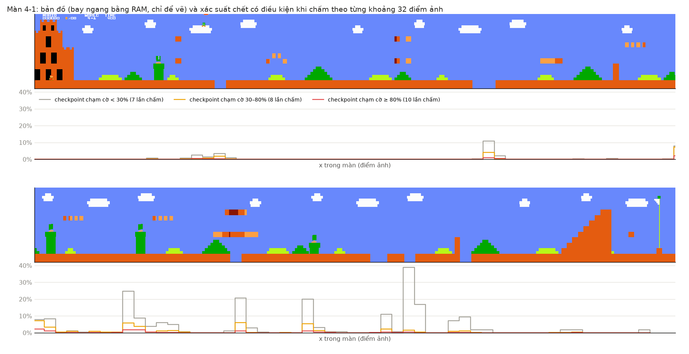
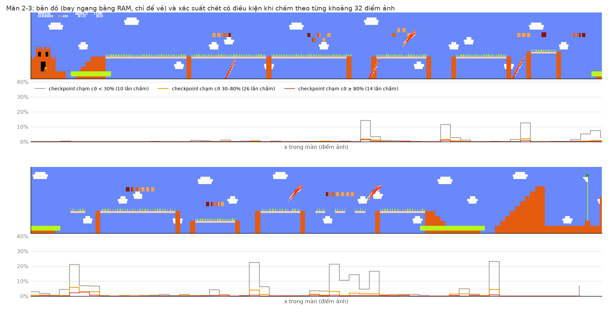
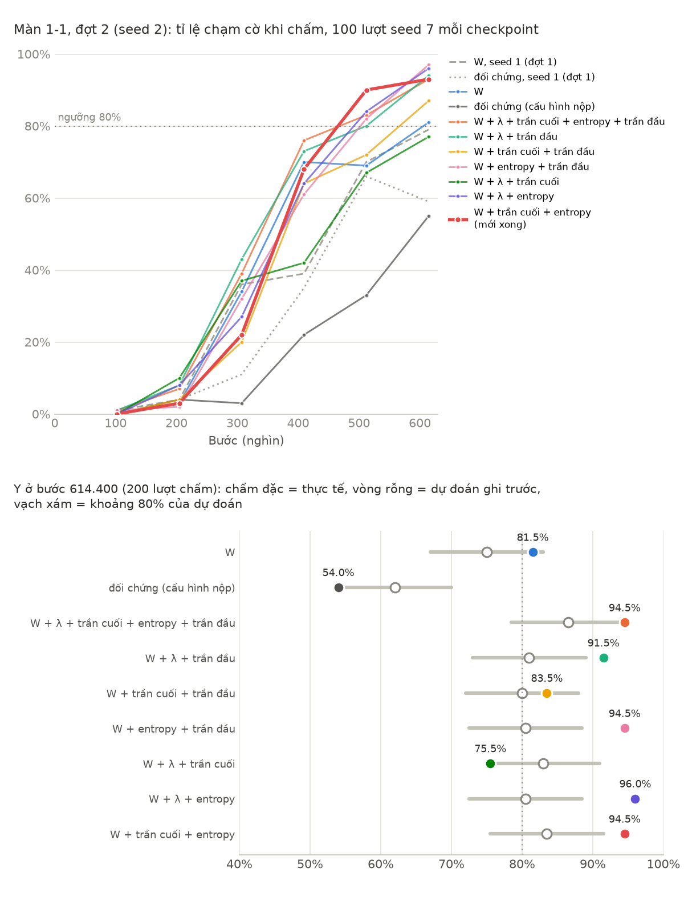
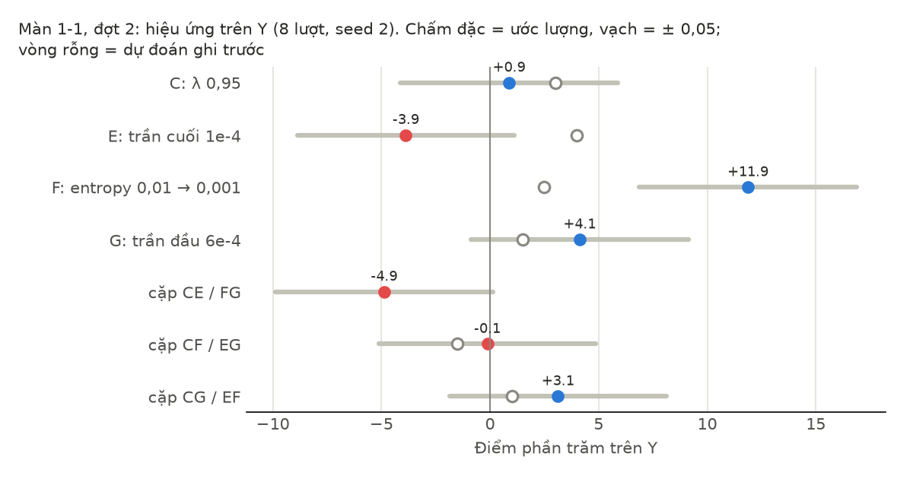
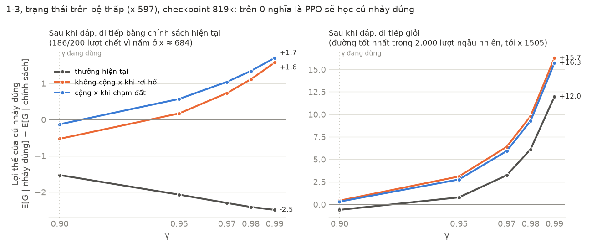
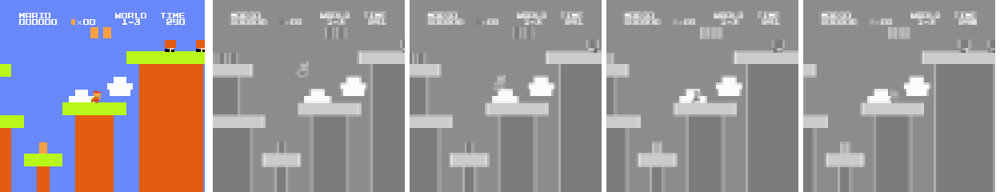

# Tối ưu cấu hình huấn luyện ở màn 1-1

Ghi ngày 27/11/2026, trước khi chạy bước huấn luyện nào. Phần này chốt câu hỏi, thước đo, thiết kế, luật quyết định và dự đoán. Kết quả sẽ ghi ở Mục 7 sau khi có số.

**Câu hỏi.** Với cùng một mạng và cùng giao thức chấm, đổi những tham số nào thì 1-1 đạt tỉ lệ chạm cờ cao hơn với ít bước hơn? Nếu có cấu hình tốt hơn rõ, áp tiếp cho các màn khác.

**Điểm xuất phát.** Bản nộp `submission/1-1.pt` (`runs/1-1/run-1`, `configs/group-1-1.yaml`): 89/100 (seed 7) và 19/20 (lệnh chấm) ở bước 1.200.128, trên CPU, mất khoảng 2 giờ 35 phút. Tỉ lệ chạm cờ lúc huấn luyện tới 0,5 ở bước 512.000 và tới 0,8 ở bước 704.512.

## 1. Thước đo (chốt trước)

- **Ngân sách mỗi lượt: 614.400 bước** (150 lần cập nhật × 4.096), bằng nửa số bước của bản nộp. Lịch tốc độ học của mọi nhánh tính theo con số này.
- **Chỉ số chính Y:** tỉ lệ chạm cờ ở checkpoint cuối (614.400), 200 lượt: 100 lượt seed 7 cộng 100 lượt seed 11, chấm bằng `evaluate.py` nguyên bản trên CPU.
- **Chỉ số phụ Z (tốc độ học):** trung bình tỉ lệ chạm cờ của 100 lượt seed 7 ở sáu checkpoint 102.400, 204.800, …, 614.400. Z cao nghĩa là lên sớm.
- Mọi nhánh: GPU (venv `~/.venvs/mario-ppo-gpu`), seed 1, `mario_ppo/train_joint.py` với một màn, cấu hình `configs/group-1-1-tuning.yaml` (giống hệt `group-1-1.yaml`, chỉ khác số bước, thiết bị, nhịp checkpoint và việc tắt chấm trong lúc huấn luyện).

## 2. Từng tham số: mô hình, số đo, quyết định

Số đo lấy từ `runs/1-1/run-1/progress.csv`, `docs/config-math.md` và ba phép đo mới ở Mục 2.1–2.3 (không có bước huấn luyện nào).

| Tham số | Hiện tại | Mô hình và số đo | Quyết định |
|---|---|---|---|
| Tốc độ học và lịch | 1,5e-4 giảm tuyến tính về 0 | KL ≈ S · lr². Ở 1-1, KL chỉ 0,005–0,006 trong 200 nghìn bước đầu, trong khi tốc độ học cần để có KL 0,02 là 2,6–2,9e-4, gần gấp đôi (Mục 2.1). Từ 0,5 triệu bước thì hai con số gần nhau (1,25 lần). | Yếu tố **A** |
| γ | 0,9 | Ở 1-1, đa số lượt hỏng đã định từ 6–24 bước trước (nhật ký, Mục 7). Trọng số của sự kiện cách 24 bước: 0,08 với γ 0,9, 0,48 với γ 0,97. Ở 2-1, γ 0,97 gỡ được bức tường ở cả hai seed. Nhưng γ 0,97 làm gradient chính sách nhiễu hơn 2–4 lần (Mục 2.2). | Yếu tố **B** |
| Hệ số thưởng | trọng số [1, 1, 2, 0, 0] | Với phần thưởng đều r̄, V ≈ s · r̄ / (1 − γ). Nhân thưởng với s = (1 − 0,97) / (1 − 0,9) = 0,3 giữ V cùng cỡ với γ 0,9, nên mất mát và gradient của critic không lấn actor như ở phép kiểm 2-1 (gấp 22 lần). Lợi thế được chuẩn hóa nên actor không đổi theo s. | Đi cùng **B** |
| λ của GAE | 1,0 | λ < 1 dựa vào critic để bớt phương sai. Ở cùng dữ liệu, λ 0,95 giảm nhiễu gradient chính sách 10–33% mà hướng gần như không đổi (cos 0,98–0,99); λ 0,8 giảm thêm nhưng lệch hướng hơn (cos 0,88). Ở γ 0,97, λ 0,95 giảm nhiễu khoảng một nửa (Mục 2.2). | Yếu tố **C** |
| Số môi trường × độ dài đoạn thu | 8 × 512 | Cùng 4.096 mẫu mỗi lần cập nhật thì số mẫu cần gần như không đổi (4.096 ≪ B_simple, `config-math.md` Mục 2). 16 × 256 nhanh hơn 29% trên GPU (Mục 2.3). | Yếu tố **D** |
| Số epoch, `target_kl` | 10, 0,03 | Ở 1-1 gần như không lần cập nhật nào bị dừng sớm (0% tới 1,0 triệu bước), nên bước đi do tốc độ học quyết định. Khi bật A, KL được giữ quanh 0,02 nên số epoch ít ảnh hưởng hơn. | Giữ; đợt 2 |
| Hệ số entropy | 0,01 cố định | Ở trạng thái cân bằng π ∝ exp(Â / c), c = 0,01 chỉ giữ ngẫu nhiên giữa các hành động gần ngang nhau (`config-math.md`, Mục 5). Entropy đứng ở 0,69 từ 700 nghìn bước vì tốc độ học về 0. Chênh lệch lấy mẫu / chọn tham lam ở 1-1 là 89 so với 97. | Giữ; đợt 2 (lịch giảm) |
| Trọng số phạt chết, thưởng cờ | 2, 2,0 | Chưa có mô hình định lượng. | Giữ; đợt 2 |
| `clip_coef`, `vf_coef`, `max_grad_norm` | 0,15, 0,5, 0,5 | Phép cắt gradient luôn hoạt động (chuẩn gradient 1,2–2,7 > 0,5), nên nó đóng vai chuẩn hóa độ dài bước; Adam không đổi theo thang chung. Tỉ lệ cắt 0,20–0,23 ở giữa lượt, bình thường. | Giữ |
| Cắt lượt, NOOP đầu lượt | 200 bước, 0–30 | 1-1 không có chỗ kẹt như bức tường 2-1. NOOP 0–30 khớp với lệnh chấm. | Giữ |
| Tập hành động, frame skip, kiến trúc | simple, 4, Nature-CNN | Đổi những thứ này là đổi bài toán, không phải chỉnh tham số. IMPALA-CNN chậm hơn 10–12 lần trên CPU, chưa đo trên GPU. | Ngoài phạm vi |
| Thiết bị | CPU | GPU nhanh 1,76 lần với `train.py` (`config-review.md`, Mục 5). | GPU cho mọi nhánh |

### 2.1 Tốc độ học cần để có KL 0,02, theo từng đoạn của lượt 1-1

Tính từ `progress.csv` của `runs/1-1/run-1`: S = KL / lr² (trung vị trong mỗi đoạn 100 nghìn bước), rồi lr cần = √(0,02 / S).

| Đoạn (triệu bước) | 0,0 | 0,1 | 0,2 | 0,3 | 0,4 | 0,5 | 0,6 | 0,8 | 1,0 |
|---|---|---|---|---|---|---|---|---|---|
| Tốc độ học đã dùng | 1,46e-4 | 1,39e-4 | 1,32e-4 | 1,24e-4 | 1,17e-4 | 1,09e-4 | 1,02e-4 | 0,87e-4 | 0,72e-4 |
| approxKL | 0,0052 | 0,0059 | 0,0084 | 0,0108 | 0,0117 | 0,0131 | 0,0136 | 0,0126 | 0,0124 |
| Tốc độ học cho KL 0,02 | 2,91e-4 | 2,64e-4 | 2,03e-4 | 1,71e-4 | 1,54e-4 | 1,38e-4 | 1,24e-4 | 1,09e-4 | 0,93e-4 |

Luật của yếu tố A (`algo.lr_control`, mục 6 ở đầu `mario_ppo/train_joint.py`): sau mỗi lần cập nhật, KL > 0,03 thì chia tốc độ học cho 1,5, KL < 0,0133 thì nhân 1,5; trần 4e-4 giảm tuyến tính về 0 khi hết 614.400 bước. Với các số trên, trần bắt đầu chặn từ khoảng bước 0,45 triệu, nên nửa sau lượt vẫn giảm dần về 0 như lịch cũ.

### 2.2 Độ nhiễu của gradient chính sách với các cách ước lượng lợi thế

`experiments/estimator_noise.py`: tại θ của hai checkpoint 1-1, 8 đoạn thu 8 × 512 bằng chính sách đó, cùng dữ liệu cho mọi cách ước lượng, không cập nhật trọng số. B_simple là số mẫu mà ở đó tín hiệu bằng nhiễu (càng nhỏ càng ít nhiễu); "giữa các đoạn" là nhiễu của cả một đoạn thu 4.096 mẫu. Tệp ở `runs/1-1/run-1/eval/estimator-noise/`.

| Cách ước lượng | B_simple giữa các đoạn, 0,4M | Phần tín hiệu trong một đoạn, 0,4M | B_simple giữa các đoạn, 0,8M | Phần tín hiệu, 0,8M | cos với γ 0,9 λ 1 (0,4M / 0,8M) |
|---|---|---|---|---|---|
| γ 0,9, λ 1 (hiện tại) | 22,9 nghìn | 15% | 59,5 nghìn | 6% | 1 / 1 |
| γ 0,9, λ 0,95 | 20,6 nghìn | 17% | 40,0 nghìn | 9% | 0,99 / 0,98 |
| γ 0,9, λ 0,8 | 20,2 nghìn | 17% | 33,7 nghìn | 11% | 0,96 / 0,88 |
| γ 0,97, λ 1, thưởng × 0,3 | 98,3 nghìn | 4% | không đo được (≈ 0%) | ≈ 0% | 0,70 / 0,72 |
| γ 0,97, λ 0,95, thưởng × 0,3 | 47,0 nghìn | 8% | 188 nghìn | 2% | 0,86 / 0,81 |

- Khi B ≪ B_simple, số mẫu cần để học tỉ lệ với B_simple (McCandlish và cộng sự, 2018). Theo mô hình này, λ 0,95 có thể bớt tới khoảng 10–30% số bước, nếu độ chệch nhỏ.
- γ 0,97 là một mục tiêu khác (nhìn xa hơn), nên B_simple của nó không so thẳng được. Nhưng nó cho thấy cái giá: tín hiệu mỗi đoạn thu ít đi 2–4 lần. λ 0,95 bù được khoảng một nửa.
- **Giới hạn:** critic của hai checkpoint học cho γ 0,9, nên ở γ 0,97 nó giải thích kém mục tiêu (EV 0,36–0,62 so với 0,71–0,85). Một lượt học từ đầu với γ 0,97 sẽ có critic hợp hơn, nên số đo của hàng γ 0,97 có thể bi quan quá. Mỗi ước lượng dựa trên 8 đoạn thu nên sai cỡ 2 lần.

### 2.3 Tốc độ theo số môi trường (GPU, cùng 4.096 mẫu mỗi lần cập nhật)

Hai lần cập nhật mỗi cấu hình, `train_joint.py`, thư mục tạm đã xóa (tổng 24.600 bước).

| Môi trường × bước | 8 × 512 | 12 × 342 | 16 × 256 |
|---|---|---|---|
| Bước mỗi giây ở lần cập nhật thứ hai | 216 | 249 | 279 |

Máy có 6 nhân, 12 luồng. Phần thu dữ liệu (trình giả lập) chiếm khoảng 82% thời gian mỗi vòng khi dùng GPU, nên thêm tiến trình trình giả lập là chỗ còn lợi được.

## 3. Thiết kế: 2^(4−1), 8 lượt

Bốn yếu tố, mỗi yếu tố hai mức; mức 0 là cấu hình nộp hiện tại.

| Yếu tố | Mức 0 | Mức 1 |
|---|---|---|
| A, tốc độ học | 1,5e-4 giảm tuyến tính | `lr_control`: KL mục tiêu 0,02, hệ số 1,5, trần 4e-4 giảm tuyến tính, sàn 1e-5, bắt đầu 1,5e-4 |
| B, tầm nhìn | γ 0,9, trọng số [1, 1, 2, 0, 0] | γ 0,97, trọng số [0,3, 0,3, 0,6, 0, 0] |
| C, λ | 1,0 | 0,95 |
| D, cách thu | 8 môi trường × 512 bước | 16 môi trường × 256 bước |

Tám lượt là một nửa của 16 tổ hợp, chọn theo D = A·B·C (mức ±1). Như vậy:

- Mỗi hiệu ứng chính được ước lượng từ cả 8 lượt (4 lượt ở mỗi mức), không lẫn với tương tác hai yếu tố nào.
- Ba cặp tương tác hai yếu tố bị gộp: AB với CD, AC với BD, AD với BC. Tương tác đáng ngờ nhất theo Mục 2.2 là **BC** (λ có ích nhiều hơn khi γ = 0,97); nó gộp với AD (tốc độ học × cách thu), thứ mà mô hình nhiễu dự đoán gần 0. AB (tốc độ học × γ) gộp với CD (λ × cách thu), cũng được dự đoán gần 0.

| Lượt | A | B | C | D |
|---|---|---|---|---|
| `a0-b0-c0-d0` (cấu hình nộp, đối chứng) | 0 | 0 | 0 | 0 |
| `a1-b0-c0-d1` | 1 | 0 | 0 | 1 |
| `a0-b1-c0-d1` | 0 | 1 | 0 | 1 |
| `a1-b1-c0-d0` | 1 | 1 | 0 | 0 |
| `a0-b0-c1-d1` | 0 | 0 | 1 | 1 |
| `a1-b0-c1-d0` | 1 | 0 | 1 | 0 |
| `a0-b1-c1-d0` | 0 | 1 | 1 | 0 |
| `a1-b1-c1-d1` | 1 | 1 | 1 | 1 |

**Chi phí:** 8 × 614.400 = 4.915.200 bước. Ước tính 5,5–6 giờ trên GPU (4 lượt ở 216 bước mỗi giây, 4 lượt ở 279), chạy lần lượt, mỗi lúc một lượt huấn luyện. Chấm (7 × 100 lượt mỗi nhánh, tổng 5.600 lượt) chạy trên CPU trong lúc nhánh kế tiếp huấn luyện.

**Cách chạy:** `experiments/run_tuning_batch.sh` (dừng hẳn bằng `experiments/stop_tuning_batch.sh`), thư mục `runs/1-1/tuning/<lượt>/`.

**Kiểm trước khi chạy.**
- `pytest -q tests tests_group`: 48 bài qua, gồm hai bài mới cho `lr_control` (luật dải KL; mỗi tốc độ học tính đúng từ KL lần trước, có trần, nối tiếp đúng sau `resume=`).
- Chạy thử nhánh `a1-b1-c1-d1` 2 lần cập nhật trên GPU (8.192 bước, thư mục tạm, đã xóa): cấu hình đọc đúng cả bốn yếu tố; tốc độ học lên 1,5e-4 → 2,25e-4 sau lần cập nhật đầu (KL 0,0058 < 0,0133); 271 bước mỗi giây.

## 4. Luật quyết định (chốt trước)

- Hiệu ứng chính của một yếu tố = trung bình Y của 4 lượt mức 1 trừ trung bình Y của 4 lượt mức 0; tương tự cho Z.
- **A, B, C:** mức 1 được giữ cho đợt xác nhận nếu hiệu ứng trên Y ≥ +0,04 và trên Z ≥ 0, hoặc hiệu ứng trên Z ≥ +0,04 và trên Y ≥ −0,02.
- **D** (chỉ để tiết kiệm thời gian): giữ 16 × 256 nếu hiệu ứng trên cả Y và Z đều không thấp hơn −0,04.
- Nếu ước lượng của cặp gộp BC/AD lớn hơn 0,04 về trị tuyệt đối, chọn mức của B và C theo ô tốt nhất trong bảng 2 × 2 của B và C (mỗi ô 2 lượt), không chỉ theo hiệu ứng chính.
- **Độ tin.** Sai số nhị thức của Y ở một lượt là khoảng 0,03 (200 lượt chấm); sai số của một hiệu ứng chính chỉ tính phần nhị thức là khoảng 0,02. Phần lệch do seed huấn luyện chưa biết và thiết kế 8 lượt không đủ bậc tự do để ước lượng nó. Vì vậy đợt này chỉ để **chọn**, không để kết luận: cấu hình được chọn phải thắng đối chứng ở đợt xác nhận với seed mới (đợt 2, mỗi bên 2 seed, 2.457.600 bước, cần duyệt riêng).

## 5. Dự đoán ghi trước

- *Dũng:* (điền trước khi xem kết quả).
- *Claude:*
  - Lượt đối chứng `a0-b0-c0-d0`: Y trong khoảng 0,55–0,80. Lý do: ở lượt nộp, 600 nghìn bước cho 71/100 với lịch dài hơn; ở đây tốc độ học về 0 sớm hơn.
  - A: hiệu ứng trên Z từ +0,05 trở lên, trên Y dương. Độ tin vừa.
  - B: hiệu ứng chính nhỏ (|hiệu ứng| < 0,05), vì lợi do nhìn xa và thiệt do nhiễu gần cân nhau ở 1-1. Độ tin thấp.
  - C: dương, nhỏ (+0,01 tới +0,05).
  - Cặp BC/AD: dương, tức λ 0,95 có ích nhiều hơn khi γ = 0,97.
  - D: |hiệu ứng| < 0,04 trên cả Y và Z; tốc độ tăng 25–30%.

## 6. Giới hạn đã biết trước

- Một seed huấn luyện mỗi lượt; kết luận chỉ có sau đợt xác nhận.
- Ngân sách 614.400 bước được chọn để hỏi "có qua được 1-1 với nửa số bước không". Thứ tự tốt / xấu của các yếu tố có thể khác ở ngân sách khác.
- GPU và CPU cho số ngẫu nhiên khác nhau, nên lượt đối chứng ở đây không trùng `runs/1-1/run-1` dù cùng cấu hình; chỉ so trong đợt.
- Tỉ lệ chạm cờ lúc huấn luyện (`progress.csv`) dùng để theo dõi, không dùng để quyết định.

## 7. Kết quả

**Chạy theo hai nửa.** Ngày 27/11/2026, Dũng duyệt nửa đầu: 4 lượt đầu của bảng ở Mục 3 (`a0-b0-c0-d0`, `a1-b0-c0-d1`, `a0-b1-c0-d1`, `a1-b1-c0-d0`), 4 × 614.400 = 2.457.600 bước. Nửa sau (4 lượt có λ 0,95) chạy hay không sẽ quyết sau khi xem nửa đầu và cần duyệt riêng.

Bốn lượt đầu đều có C ở mức 0, nên chúng là thiết kế 2^(3−1) của A, B, D với D = −A·B (mức ±1). Từ nửa đầu:
- Hiệu ứng của A và của B, mỗi cái so 2 lượt với 2 lượt; sai số nhị thức khoảng 0,03 (bằng sai số của một lượt), gấp khoảng 1,4 lần so với đủ 8 lượt.
- A gộp với tương tác B×D, B gộp với A×D; cả hai là tương tác với cách thu, thứ mô hình nhiễu dự đoán gần 0 (cùng giả định mà thiết kế 8 lượt dựa vào cho cặp AD/BC).
- D gộp với tương tác A×B, nên chưa đọc riêng được D; chỉ đọc được tốc độ của 16 × 256.

Nửa đầu chỉ để quyết có chạy nửa sau không. Luật ở Mục 4 áp dụng khi đủ 8 lượt.

Chạy từ 15:52 tới 19:35 ngày 27/11/2026 (giờ máy), kể cả phần chấm; mỗi lượt huấn luyện 47–53 phút. Card nóng nhất 69 °C. Số liệu gộp ở `runs/1-1/tuning/summary-half1.json` (`python experiments/tuning_summary.py`).

### 7.1. Số chấm nửa đầu

Tỉ lệ chạm cờ bằng `evaluate.py`, 100 lượt seed 7 mỗi checkpoint; checkpoint cuối thêm 100 lượt seed 11.

| Lượt | A | B | D | 102k | 205k | 307k | 410k | 512k | 614k | seed 11 | **Y** | **Z** | Bước/giây |
|---|---|---|---|---|---|---|---|---|---|---|---|---|---|
| `a0-b0-c0-d0` (đối chứng) | 0 | 0 | 0 | 0,00 | 0,04 | 0,11 | 0,35 | 0,66 | 0,59 | 0,63 | **0,610** | 0,292 | 215 (chạy một mình) |
| `a1-b0-c0-d1` | 1 | 0 | 1 | 0,01 | 0,04 | 0,36 | 0,39 | 0,70 | 0,79 | 0,80 | **0,795** | 0,382 | 219 |
| `a0-b1-c0-d1` | 0 | 1 | 1 | 0,00 | 0,00 | 0,00 | 0,02 | 0,09 | 0,13 | 0,16 | **0,145** | 0,040 | 214 |
| `a1-b1-c0-d0` | 1 | 1 | 0 | 0,00 | 0,01 | 0,02 | 0,12 | 0,14 | 0,22 | 0,26 | **0,240** | 0,085 | 190 |

Hiệu ứng chính (2 lượt mức 1 trừ 2 lượt mức 0; sai số chỉ tính phần nhị thức, chưa tính phần lệch giữa seed):

| Yếu tố | Trên Y | Trên Z |
|---|---|---|
| A, tốc độ học | **+0,140** ± 0,035 | +0,068 ± 0,016 |
| B, γ 0,97 | **−0,510** ± 0,035 | −0,274 ± 0,016 |
| D (= −A×B), 16 × 256 | +0,045 ± 0,035 | +0,022 ± 0,016 |

Bảng 2 × 2 của A và B trên Y: với γ 0,9, A thêm +0,185 (0,610 → 0,795); với γ 0,97, A thêm +0,095 (0,145 → 0,240). Hiệu của hai con số chia đôi (−0,045) chính là −D, nên không tách được "16 × 256 giúp" với "A giúp ít hơn khi γ 0,97".

### 7.2. Đọc kết quả

- **A thắng, nhưng không phải nhờ phần "tự chỉnh".** Trong 150 lần cập nhật của mỗi lượt A1, tốc độ học nằm đúng trần ở 147 lần. Từ 102k tới 512k, KL trung bình mỗi đoạn là 0,016–0,022, nằm trong dải [0,0133; 0,03] nên luật KL giữ nguyên, và trần giảm tuyến tính quyết định tốc độ học. Ở đầu lượt (0–102k, KL 0,0087–0,0095) và cuối lượt (512k–614k, KL 0,006–0,007) luật muốn tăng nhưng trần chặn. Vậy A1 trong đợt này thực chất là **tốc độ học 4e-4 giảm tuyến tính về 0** thay cho 1,5e-4, tức gấp 2,67 lần ở mọi bước. KL tăng khoảng 4 lần (0,005 → 0,02) khi tốc độ học gấp khoảng 2 lần ở cùng giai đoạn, khớp với KL ≈ S · lr².
- **Đoạn cuối của lượt thắng vẫn còn học được.** Từ 512k tới 614k, số chấm của `a1-b0-c0-d1` lên 0,70 → 0,79 trong khi tốc độ học chỉ còn 3,5e-5 trung bình và KL 0,006, dưới dải của luật. Lượt đối chứng ở đoạn này có KL 0,0024 và số chấm đi ngang (0,66 → 0,59).
- **γ 0,97 thua xa ở ngân sách này.** Mục 2.2 đã đo: với γ 0,97, phần tín hiệu của gradient chỉ còn 4% (so với 15% ở γ 0,9) tại checkpoint 0,4M. Dự đoán của Claude (|B| < 0,05) bỏ qua số đo đó và sai. Kết quả ở 2-1 (γ 0,97 phá được bức tường) không mâu thuẫn: ở đó mạng đã học 6,3M bước và vướng một chướng ngại cần nhìn xa; ở đây mạng học từ đầu và nhiễu là nút thắt.
- **D: 16 × 256 không làm hại.** Hiệu ứng +0,045 (gộp với −A×B). Tốc độ khó so vì lượt 1 chạy một mình còn lượt 2–4 chạy cùng phần chấm trên CPU: so hai lượt cùng chịu tải thì 16 × 256 nhanh hơn khoảng 14% (214–219 so với 190 bước/giây), ít hơn 25–29% đo lúc máy rảnh.

### 7.3. So với dự đoán ghi trước

| Dự đoán của Claude | Kết quả |
|---|---|
| Đối chứng: Y trong 0,55–0,80 | 0,610: đúng |
| A: Z ≥ +0,05 và Y dương | Z +0,068, Y +0,140: đúng, nhưng cơ chế là tốc độ học cao hơn, không phải tự chỉnh |
| B: \|hiệu ứng\| < 0,05 | −0,510: sai |
| D: \|hiệu ứng\| < 0,04, nhanh hơn 25–30% | +0,045 và nhanh hơn khoảng 14% khi có tải: gần đúng về số chấm, sai về tốc độ |
| C và cặp BC/AD | chưa chạy |

### 7.4. Theo luật ở Mục 4 (áp tạm cho 4 lượt)

- A: giữ (Y +0,140 ≥ 0,04 và Z ≥ 0).
- B: bỏ γ 0,97 cho 1-1 ở ngân sách này.
- D: giữ 16 × 256 (cả Y và Z đều không thấp hơn −0,04).
- Nửa sau như thiết kế ban đầu có 2 trong 4 lượt dùng γ 0,97, yếu tố đã bị loại với cách biệt khoảng 15 lần sai số, nên không nên chạy nguyên như vậy. Cấu hình tốt nhất hiện có (`a1-b0-c0-d1`, Y = 0,795) mới có một seed.

## 8. Đợt 2

Ngày 27/11/2026, Dũng duyệt phương án 1 (5.529.600 bước). Chạy bằng `experiments/run_tuning_stage2.sh`, thư mục `runs/1-1/tuning-2/`, bắt đầu 21:06; báo cáo từng lượt bằng `python experiments/tuning2_report.py`. Trước khi chạy đã thử lượt có cả bốn thay đổi 2 lần cập nhật (8.192 bước, thư mục tạm, đã xóa): đủ các khóa, tốc độ học 1,5e-4 → 2,25e-4 sau KL 0,0078, hệ số entropy 0,01 → 0,00994.

Gốc mới W = `a1-b0-c0-d1`: `lr_control` trần 4e-4, γ 0,9, λ 1, 16 × 256, entropy 0,01 cố định. Nhắm vào hai chỗ nghẽn đã thấy trong số liệu, cộng hai tham số chưa thử:

| Yếu tố | Mức 0 (như W) | Mức 1 | Lý do |
|---|---|---|---|
| C, λ | 1,0 | 0,95 | Chưa thử. Mục 2.2: ở γ 0,9, λ 0,95 giảm nhiễu 10–33% mà hướng gradient gần như giữ nguyên (cos 0,98–0,99). |
| E, trần cuối lượt | trần giảm về 0 | trần giảm về 1e-4 (`lr_control.cap_final`) | Ở 100k bước cuối của W, KL chỉ 0,006 (dưới dải của luật) mà số chấm vẫn lên 0,70 → 0,79: trần về 0 chặn đoạn đang học. Có sàn thì luật KL được tự chỉnh ở đoạn cuối. |
| F, entropy | 0,01 cố định | 0,01 giảm tuyến tính về 0,001 (`ent_coef_final`) | `evaluate.py` lấy mẫu hành động. Ở bản nộp, chọn hành động xác suất cao nhất được 97/100 còn lấy mẫu được 89/100 (`docs/reports/report-1-1.md`, Mục 5): khoảng 8 điểm mất vì nhiễu lấy mẫu. Entropy cuối lượt của W là 0,73 nat. |
| G, trần đầu lượt | 4e-4 | 6e-4 | Trong 100k bước đầu của W, KL 0,009 (dưới dải) và trần chặn. Với KL ≈ S · lr², trần 6e-4 cho phép KL vượt dải ở đoạn giữa, nên luật KL mới thật sự điều khiển; so được "tự chỉnh" với "chỉ là tốc độ học cao". |

**Phương án 1 (khuyên): 2^(4−1) trong C, E, F, G với G = C·E·F, cộng một lượt đối chứng (cấu hình nộp), tất cả seed 2.** 9 lượt × 614.400 = 5.529.600 bước, khoảng 8–8,5 giờ (nửa đầu mất 56 phút mỗi lượt kể cả chấm).
- Mỗi hiệu ứng chính so 4 lượt với 4 lượt, không lẫn với tương tác hai yếu tố nào; ba cặp tương tác gộp: CE/FG, CF/EG, CG/EF.
- Lượt có cả bốn yếu tố ở mức 0 chính là W ở seed mới, và lượt đối chứng ở seed 2: hai lượt này là đợt xác nhận cho A mà Mục 4 đòi.

**Phương án 2 (nhỏ hơn): 2^2 trong E, F quanh W, cộng đối chứng, seed 2.** 5 lượt × 614.400 = 3.072.000 bước, khoảng 4,5–5 giờ. Đo được E, F và tương tác E×F (mỗi hiệu ứng 2 lượt so 2 lượt); λ và trần đầu lượt để sau.

Cả hai phương án đều cần mã đã có: `lr_control.cap_final` (thêm 27/11, có bài kiểm thử) và `ent_coef_final`.

### 8.1. Dự đoán ghi trước cho phương án 1 (Claude, 27/11/2026, trước khi chạy)

Các con số tính từ số đo của nửa đầu; đoạn tính nằm trong lịch sử phiên làm việc, các công thức ghi dưới đây.

**Công cụ.**
1. **KL ≈ S · lr².** Đo trên lượt W, S (lấy E[lr²] mỗi đoạn) tăng 55 lần trong một lượt: 7,0e4 → 2,0e5 → 4,0e5 → 7,4e5 → 1,5e6 → 3,8e6 qua sáu đoạn 102k. Từ S suy ra tốc độ học mà luật KL sẽ giữ (dải KL [0,0133; 0,03]): đoạn đầu 4,4–6,6e-4, đoạn cuối 5,9–8,9e-5.
2. **Mỗi lần cập nhật dịch chính sách một khoảng ≈ √KL** (khoảng cách theo ma trận Fisher). Độ dài đường đi trung bình mỗi lần cập nhật của W theo đoạn: 0,092; 0,134; 0,148; 0,145; 0,127; 0,074.
3. **Đường học bão hòa:** khoảng cách tới trần giảm theo hàm mũ của độ dài đường đi có ích, gap = gap₀ · e^(−k·L). Trần lấy 0,90–0,97 (bản nộp: lấy mẫu 89/100, chọn hành động tốt nhất 97/100). Ở đoạn cuối, W đi 0,70 → 0,79, cho k·L = 0,41–0,60.
4. **Phần tín hiệu của gradient** s = 1 / (1 + B_simple / B), B = 4.096 (Mục 2.2): λ 0,95 nâng s từ 0,152 lên 0,166 ở 0,4M (×1,09) và từ 0,064 lên 0,093 ở 0,8M (×1,44). Lấy ×1,22 cho đoạn 410k–614k, đã trừ độ lệch hướng (cos 0,98).
5. **Độ dao động của một lượt:** σ ≈ √(0,03² + 0,06²) ≈ 0,07 (nhị thức 200 lượt chấm, cộng phần do seed ước từ cặp bản nộp và đối chứng). Sai số một hiệu ứng chính (4 lượt so 4 lượt): σ/√2 ≈ 0,05.

**Cơ chế (kiểm được bằng `progress.csv`):**
| Dự đoán | Số của W ở nửa đầu |
|---|---|
| W ở seed 2: tốc độ học nằm ở trần ≥ 90% số lần cập nhật; KL mỗi đoạn lệch không quá ±30% so với W ở seed 1 | 147/150; 0,009 / 0,018 / 0,022 / 0,021 / 0,016 / 0,006 |
| E1: KL ở đoạn 512k–614k trong 0,013–0,03, tốc độ học 5,9–8,9e-5; tốc độ học nằm ở trần dưới 30% số lần cập nhật của đoạn này | KL 0,006, tốc độ học trung bình 3,5e-5 |
| G1 (không có E1): tốc độ học lên 4–5e-4 trong 100k bước đầu; ở đoạn 102k–512k nằm dưới trần ít nhất một nửa số lần cập nhật (luật KL thật sự điều khiển) | trần chặn 147/150 |
| F1: entropy cuối lượt 0,55–0,65 nat; các lượt F0: 0,70–0,78 | 0,73 |
| S tăng 30–80 lần trong mọi lượt | 55 lần |

**Hiệu ứng chính trên Y** (khoảng 80% = dự đoán ± 0,08, gồm sai số đo 0,05 và sai số của mô hình khoảng 0,04):
| Yếu tố | Dự đoán | Cách tính |
|---|---|---|
| C, λ 0,95 | **+0,03** | công cụ 3 và 4: đường đi có ích ×1,22 ở 410k–614k cho +0,03 (trần 0,90) đến +0,04 (trần 0,97) |
| E, trần cuối 1e-4 | **+0,04** | đoạn cuối √KL 0,141 so với 0,074 (×1,9) cho +0,05 đến +0,06 khi G0; khi G1 chỉ thêm khoảng +0,02 vì đoạn cuối đã do luật KL giữ; trừ chút rủi ro dao động khi tốc độ học không về 0 |
| F, entropy 0,01 → 0,001 | **+0,025** | nếu phần xác suất còn lại chia cho 2 hành động, entropy 0,73 ứng với hành động tốt nhất được chọn khoảng 75%, còn 0,60 ứng với khoảng 80%, nên xác suất chọn sai ở mỗi bước giảm khoảng 20%. Ở bản nộp, 8/11 lượt hỏng biến mất khi chọn hành động tốt nhất; với mạng ở mức 0,75 lấy khoảng 60% số lượt hỏng là do lấy mẫu: 0,2 × 0,6 × 0,2 ≈ +0,025 |
| G, trần đầu 6e-4 | **+0,015** | +0,03 khi E0 (trần đoạn cuối ×1,5); gần 0 khi E1 |
| Cặp E×G (gộp với C×F) | −0,015 | E và G cùng nâng tốc độ học ở đoạn cuối, nên cái sau thêm ít |
| Cặp E×F (gộp với C×G) | +0,01 | E giữ tốc độ học, giúp entropy giảm kịp theo lịch của F |

Trên Z: C +0,02, E +0,01 (chỉ hai checkpoint cuối), F +0,01, G +0,02.

**Từng lượt** (cộng các hiệu ứng trên vào W ở seed 2):
| Lượt | Y dự đoán | P(Y ≥ 0,80) |
|---|---|---|
| Đối chứng, seed 2 | 0,62 (80%: 0,52–0,72) | dưới 0,01 |
| `c0-e0-f0-g0` (W, seed 2) | 0,75 (80%: 0,65–0,85) | 0,27 |
| `c1-e0-f0-g1` | 0,81 | 0,55 |
| `c0-e1-f0-g1` | 0,80 | 0,50 |
| `c0-e0-f1-g1` | 0,805 | 0,52 |
| `c1-e1-f0-g0` | 0,83 | 0,65 |
| `c1-e0-f1-g0` | 0,805 | 0,52 |
| `c0-e1-f1-g0` | 0,835 | 0,67 |
| `c1-e1-f1-g1` | **0,865** (cao nhất) | 0,79 |

- W ở seed 2 thấp hơn 0,795 của seed 1 vì kéo về trung bình: W được chọn vì cao nhất nửa đầu. Ước lượng gộp của A là +0,14 (+0,185 ở γ 0,9, +0,095 ở γ 0,97), cộng lên đối chứng 0,62 rồi làm tròn xuống: 0,75.
- Xác nhận A: W − đối chứng ở seed 2 dự đoán +0,13 ± 0,10, nên P(> 0) ≈ 0,90 và P(≥ +0,04) ≈ 0,82.
- Số lượt (trong 8 lượt thiết kế) có Y ≥ 0,80: kỳ vọng 4,5, khoảng 80% là 2–7.
- Lượt cao nhất quan sát được: 0,88–0,93. Con số này cao hơn dự đoán cho lượt tốt nhất vì lấy max của 8 lượt có nhiễu.

**Lực của thiết kế.** Với sai số 0,05 cho mỗi hiệu ứng, xác suất một yếu tố vượt mức giữ +0,04 là: 0,21 nếu hiệu ứng thật bằng 0; 0,34 nếu +0,02; 0,50 nếu +0,04; 0,79 nếu +0,08; 0,95 nếu +0,12. Các hiệu ứng dự đoán ở đây đều nhỏ (+0,015 đến +0,04), nên rất có thể đợt này **không tách được rõ từng yếu tố**. Nó sẽ cho biết chắc hơn hai điều: A có lặp lại được không, và gộp các thay đổi lại có đẩy được 1-1 qua 0,8 ở 614k bước không (trung bình 8 lượt dự đoán 0,81).

**Mô hình sai nếu:** E1 không làm KL đoạn cuối lên trên 0,013 (luật không can thiệp như tính), F1 không hạ entropy dưới 0,68, hoặc W ở seed 2 dưới 0,62 (A không lặp lại).

- *Dũng:* (điền trước khi xem kết quả).

## 9. Đợt 3: mang sang 4-1 và 2-3 (ghi trước khi chạy)

Ngày 28/11/2026, 00:35, Dũng dặn: chủ động tối ưu; nếu xong 1-1 mà Dũng chưa quay lại thì tự làm bước tiếp theo thấy đúng, không cần hỏi, miễn có tác dụng. Mục này ghi lúc 01:15, khi đợt 2 mới chấm xong 3/9 lượt, trước khi có số của đợt 3.

### 9.1. Mô hình quãng đường

Gọi **M** là tổng √approx_kl qua các lần cập nhật đã qua (mỗi lần cập nhật 4.096 mẫu; công cụ 2 ở Mục 8.1). Giả thuyết: ở một màn, tỉ lệ chạm cờ chủ yếu phụ thuộc M, không phụ thuộc cấu hình đã sinh ra M. Đường "chạm cờ theo M" của mỗi màn được khớp từ các lượt cũ của màn đó bằng hồi quy đơn điệu (`python experiments/transfer_report.py --predict`).

**Kiểm ở 1-1.** Chỉ khớp đường từ `runs/1-1/run-1`, rồi đoán các lượt của đợt 1 và đợt 2 từ M thực tế của chúng:

| Lượt | M ở 614k | Số chấm thật (seed 7) | Mô hình |
|---|---|---|---|
| W, seed 1 | 18,0 | 79 | 75 |
| W, seed 2 | 18,3 | 81 | 76 |
| Cả bốn thay đổi, seed 2 | 21,3 | 93 | 82 |
| Đối chứng, seed 1 | 10,3 | 59 | 36 |
| Đối chứng, seed 2 | 10,7 | 55 | 40 |

- Với W, mô hình lệch 4–5 điểm: hai cấu hình khác nhau (tốc độ học cố định 1,5e-4 trên CPU và luật KL trên GPU) cho cùng số chấm ở cùng M.
- Lượt đổi cả bốn tham số cao hơn mô hình 9–11 điểm (cả ở 512k: 83 so với 74). Phần này là hiệu quả thêm trên mỗi đơn vị M, hợp với λ 0,95 bớt nhiễu và entropy thấp hơn.
- Đối chứng cao hơn mô hình 19–23 điểm. Ở đối chứng, tốc độ học về 0 đúng lúc chấm checkpoint cuối, còn run-1 ở cùng M (khoảng bước 400–450k) vẫn đang học mạnh. Vậy mô hình thiếu một "phần thưởng ủ" khi tốc độ học về gần 0.

**Hệ quả cho hai màn kia.** M tăng nhanh khi KL mỗi lần cập nhật lớn. Ở các lượt cũ:
- 1-1 (run-1) và 4-1 (`runs/4-1/from-scratch`): KL chỉ 0,005–0,015, dưới dải của luật. Đây là chỗ cấu hình mới lợi nhiều, như đã thấy ở 1-1.
- 2-3, lượt 3 triệu bước (`runs/2-3/from-scratch-3m`): KL đã 0,022–0,025 trong suốt đoạn 0,5–2,0 triệu bước, tức nằm sẵn trong dải. Vì lịch tốc độ học dài 3 triệu bước nên tốc độ học giảm chậm, và S ở 2-3 lớn: 7,5e5 ở 0,5M, 1,2e6 ở 0,9M. Cấu hình mới chỉ lợi ở đoạn đầu (KL cũ 0,006–0,017 trong 400k bước đầu) và ở chỗ không cho tốc độ học về 0.

Mô hình vì thế dự đoán: **ở 4-1 lợi gần như 1-1 (khoảng gấp đôi tốc độ); ở 2-3 lợi ít.**

### 9.2. Kế hoạch và dự đoán

**Chọn cấu hình (chốt trước):** lượt có Y cao nhất trong 8 lượt thiết kế của đợt 2. Lúc ghi, đó là lượt đổi cả bốn tham số (Y 0,945): λ 0,95, trần 6e-4 giảm về 1e-4, entropy 0,01 → 0,001, KL mục tiêu 0,02, 16 × 256.

**Hai lượt, seed 1, chạy lần lượt sau khi đợt 2 xong**, nghỉ 10 phút giữa hai lượt. Đợt này tự bắt đầu bằng `experiments/start_transfer_batch.sh`. Script đó áp luật chọn ở trên (`tuning2_report.py --best-overrides`) và ghi lựa chọn vào `runs/transfer/choice.log`. Nó chỉ được gọi khi đợt 2 kết thúc không lỗi và máy đang cắm sạc; script canh máy chạy tiếp cho đợt 3. Đợt 3 chạy bằng `experiments/run_transfer_batch.sh`, cấu hình `configs/group-4-1-tuning.yaml` và `configs/group-2-3-tuning.yaml`. Chấm: 100 lượt seed 7 mỗi checkpoint 102.400 bước, thêm 100 lượt seed 11 ở checkpoint cuối. Tổng 1.843.200 bước, khoảng 2–2,5 giờ trên GPU.

| Lượt | Số bước | Mốc cũ | Mô hình M (M giả định 2,9 + 3,7 mỗi 102k) | **Dự đoán Y (khoảng 80%)** |
|---|---|---|---|---|
| 4-1 | 614.400 | 53/100 ở 602k, 96/100 ở 1,2M (bản nộp) | M 21,4 → 82% (M ±15%: 59–85%) | **0,85 (0,65–0,95)** |
| 2-3 | 1.228.800 | 55/100 ở 1,2M (lượt 1,2M); 61/100 ở 1,2M của lượt 3M (bản nộp 86/100 ở 2,8M) | M 43,6 → 60% (60–65%) | **0,66 (0,52–0,80)** |

- Dự đoán Y = mô hình M + 3–5 điểm. Phần cộng là một nửa phần hiệu quả thêm 9–11 điểm thấy ở 1-1, vì chưa biết nó có mang sang màn khác không.
- **Phép thử phân biệt.** Giả thuyết đối lập H2: "cấu hình mới giảm một nửa số bước ở mọi màn", như ở 1-1. Theo H2, 2-3 ở 1,2M bước sẽ bằng lượt 3M ở khoảng 2,4M, tức khoảng 0,80. Vậy:
  - Y(2-3) ≥ 0,78 thì mô hình quãng đường sai ở 2-3, nghiêng về H2.
  - Y(2-3) ≤ 0,70 thì nghiêng về mô hình.
- Ở 4-1, mô hình và H2 cho cùng hướng (lợi lớn), nên 4-1 chỉ kiểm việc mang cấu hình sang màn khác có giữ được lợi không.

**Bước sau, tùy kết quả.**
- 2-3 thấp như mô hình: cái nghẽn ở 2-3 không phải lịch tốc độ học. Lúc đầu tôi ghi hướng kế là nâng dải KL. Mục 9.4 cho thấy cách đó vô ích, vì KL bị phép cắt của PPO giữ quanh 0,023. Hướng còn lại: nhắm thẳng vào chỗ khó (Mục 9.3), hoặc chạy cấu hình mới dài 2,5M bước để có mạng 2-3 vượt 86,5% của bản nộp.
- 2-3 cao như H2: chạy thêm seed để xác nhận, rồi đề xuất thay bản nộp 2-3. Việc thay bản nộp do Dũng quyết.

### 9.3. Bản đồ, chỗ chết và thông số theo từng màn (Dũng yêu cầu lúc 01:20, trước khi chạy)

**Cách làm.** `experiments/level_map.py` vẽ bản đồ cả màn: cho Mario bay ngang bằng cách ghi RAM, như `level_length.py`, và chỉ dùng để vẽ. Trên bản đồ, script chồng xác suất chết có điều kiện theo từng khoảng 32 điểm ảnh: số lượt chết trong khoảng chia cho số lượt đi tới đầu khoảng. Số lấy từ mọi tệp chấm sẵn có:
- 1-1: 6.100 lượt (run-1 và các lượt đợt 1, 2).
- 4-1: 2.500 lượt (lượt học từ đầu và lượt chuyển giao).
- 2-3: 5.000 lượt (lượt 1,2M và lượt 3M).

Các checkpoint được chia ba giai đoạn theo tỉ lệ chạm cờ của chính chúng. Hình: `docs/reports/figures/1-1-map.png`, `4-1-map.png`, `2-3-map.png`.

**Hình học chung.**

| Màn | x của cờ | Bước tác tử tới cờ (trung vị) | Điểm ảnh mỗi bước | Nội dung chính |
|---|---|---|---|---|
| 1-1 | 3161 | 291 | 10,9 | ống, Goomba, hai hố, cầu thang |
| 4-1 | 3593 | 304 | 11,8 | Lakitu ném gai suốt màn, 3 ống có cây ăn thịt (x ≈ 1840, 2050, 2640), 4 hố |
| 2-3 | 3593 | 302 | 11,9 | các cầu nối nhau qua hố, cá bay ngang (Cheep Cheep) |

Ba màn dài như nhau tính theo thời gian, khoảng 300 bước tác tử. Vì vậy các tham số gắn với thời gian có cùng nghĩa ở cả ba màn:
- γ 0,9 nhìn khoảng 10 bước, tức khoảng 120 điểm ảnh.
- Mỗi đoạn thu 256 bước của một môi trường bằng khoảng 0,85 lượt chơi.
- Cắt lượt sau 200 bước không tiến. Cây ăn thịt thụt lên xuống mỗi khoảng 30 bước, nên không màn nào cần đứng chờ lâu như vậy.

Không có lý do đổi các tham số này theo màn.

**Tỉ lệ chạm cờ ≈ tích xác suất sống qua từng chỗ khó.** Ở các checkpoint đã ≥ 80%, mỗi màn còn 4–6 chỗ, mỗi chỗ giết 1–5% số lượt tới được:
- 1-1: 4,0 / 3,3 / 3,1 / 2,9%.
- 4-1: 4,4 / 3,3 / 1,6 / 1,5 / 1,2 / 1,1%.
- 2-3: 5,4 / 2,0 / 2,0 / 1,3 / 1,2%.

Tích các xác suất sống là 0,87–0,89, khớp với tỉ lệ chạm cờ đo được.

**Số lượt chết theo vùng ở các checkpoint quan trọng** (chết / tới được; lượt cuối của đợt 2 gộp seed 7 và 11):

| 1-1 | 1728–1824 | 1824–2048 | 2432–2496 | 2688–2784 | Cờ |
|---|---|---|---|---|---|
| Đối chứng s2, 614k | 17/185 | 23/168 | 19/145 | 18/126 | 54% |
| W s2, 614k | 7/193 | 6/186 | 12/180 | 5/168 | 81,5% |
| Cả bốn thay đổi s2, 614k | 3/198 | 4/195 | 1/191 | 1/190 | 94,5% |

| 4-1 (lượt cũ) | 1248–1344 | 1760–1952 | **1984–2272** | 2784–2944 | Cờ |
|---|---|---|---|---|---|
| 602k | 4/99 | 1/95 | **25/94** | 6/65 | 53% |
| 803k | 2/100 | 0/98 | **11/98** | 1/85 | 84% |
| 1,0M | 1/100 | 2/99 | **3/97** | 1/91 | 90% |

| 2-3 (lượt cũ) | **1664–2080** | 2304–2592 | 2624–3040 | 3136–3360 | Cờ |
|---|---|---|---|---|---|
| Lượt 1,2M, ở 1,2M | **13/94** | 9/81 | 8/72 | 9/64 | 55% |
| Lượt 3M, ở 1,2M | **13/90** | 5/76 | 7/71 | 3/64 | 61% |
| Lượt 3M, ở 2,0M | **12/97** | 2/85 | 10/83 | 0/73 | 73% |
| Lượt 3M, ở 2,8M (bản nộp, 200 lượt) | **14/193** | 1/179 | 2/178 | 3/176 | 86,5% |

**Đọc từng màn.**
- **1-1.** Cấu hình đổi cả bốn tham số giảm số chết ở mọi vùng, nhiều nhất ở hai vùng cuối (cầu thang; 12/180 → 1/191). Đó là chỗ W còn đang học khi trần tốc độ học về 0, hợp với cơ chế của E (trần cuối) và F (entropy thấp).
- **4-1.** Một vùng chiếm phần lớn số lượt hỏng: ống có cây ăn thịt ở x ≈ 2050 cộng gai của Lakitu (x 1984–2272). Vùng này giết 27% số lượt tới được ở bước 602k, rồi 11% ở 803k, 3% ở 1,0M. Đường học của 4-1 gần như là đường học của chỗ này. Cấu hình mới đẩy nhanh mọi vùng ở 1-1, nên cũng nên đẩy nhanh vùng này.
- **2-3.** Một chỗ khó **không chịu giảm**: cú nhảy từ bệ xanh thấp lên cầu, có cá bay (x 1664–2080). Nó giết 13–14% số lượt tới được ở 1,2M, vẫn 12% ở 2,0M, và còn 7% ở 2,8M. Trong cùng quãng đó, ba vùng sau giảm từ khoảng 10% xuống 1–2%. Báo cáo 2-3 (Mục 5) đã cho thấy chỗ này phụ thuộc vào trạng thái lúc tới nơi:
  - Đạp trúng cá ở x 1800–2000 thì chết 11/25, không đạp thì 2/167.
  - Cho Mario bắt đầu từ các ảnh chụp ở x ≈ 1500–1600 thì được 4/40 tới 39/40, tùy ảnh chụp.

  Đây là bài toán **trạng thái hiếm**: tổ hợp cá nguy hiểm ít xảy ra, nên mỗi triệu bước mạng chỉ gặp nó vài lần. Thêm bước chỉ chữa chậm. Đường học dẹt của 2-3 trong mô hình quãng đường (M 30–48 chỉ cho 55–66%) phần lớn là do chỗ này.

**Thông số theo màn.**

| Thông số | Đọc từ bản đồ và số liệu | Quyết định cho đợt 3 |
|---|---|---|
| Tốc độ học, luật KL | S ở bước 500k gần nhau ở cả ba màn: 1-1 khoảng 1,5e6 (W), 4-1 khoảng 1,0e6, 2-3 khoảng 0,75e6 (lượt 3M). KL thấp của các lượt cũ ở 1-1 và 4-1 là do lịch giảm nhanh, không phải do màn. Câu "2-3 lợi ít" ở Mục 9.1 là so với lượt 3M có lịch dài; so với lượt 1,2M cùng ngân sách thì cấu hình mới đi được M 44 so với 30. | Dùng chung một luật cho cả ba màn |
| Entropy (F) | Lấy mẫu làm mất 8–14 điểm ở cả ba màn: chọn hành động tốt nhất / lấy mẫu là 97/89 (1-1), 95/81 (4-1, lượt chuyển giao), 96/86 (2-3). Lượt 2-3 cũ đã giảm entropy về 0,002, entropy cuối 0,33, nên phần lợi thêm ở 2-3 nhỏ hơn. | Giữ 0,01 → 0,001 |
| γ | Ở chỗ khó của 2-3, từ lúc đạp cá (x 1800–2000) tới lúc rơi (x 1989) là khoảng 16 bước. Trọng số của sự kiện cách 16 bước: γ^16 = 0,19 với γ 0,9; 0,44 với γ 0,95. Nhưng γ 0,97 làm gradient nhiễu hơn 2–4 lần ở 1-1 (Mục 2.2) và đã thua ở đợt 1. | Giữ 0,9. γ 0,95 riêng cho 2-3 là ứng viên sau, chưa chạy |
| λ (C) | Như 1-1: bớt nhiễu 10–33%, hướng gần như giữ nguyên | Giữ 0,95 |
| Cắt lượt 200 bước, NOOP 0–30, frame skip 4, bộ hành động | Không màn nào cần chờ lâu; NOOP khớp lệnh chấm | Giữ |
| Số bước | 4-1: chỗ khó chính ở cũ cần khoảng 1,0M bước, cấu hình mới nhanh khoảng gấp đôi, nên 614k. 2-3: 1.228.800, bằng ngân sách lượt 1,2M cũ, để so thẳng | Giữ như Mục 9.2 |

**Dự đoán thêm theo vùng (ghi trước khi chạy).**
- 4-1 ở 614k: vùng 1984–2272 giết **≤ 10%** số lượt tới được (lượt cũ ở 602k: 27%).
- 2-3 ở 1.228.800:
  - Vùng 1664–2080 giết **10–16%**, gần như không đổi so với lượt cũ (13–14%).
  - Ba vùng sau (2304–3360) gộp lại giết **ít hơn** lượt 1,2M cũ: 26/81 ở lượt cũ, dự đoán 10–20%.
  - Nếu vùng 1664–2080 xuống dưới 7% thì phân tích "trạng thái hiếm" ở trên sai: chỉ đổi cấu hình cũng chữa được chỗ đó.

### 9.4. Ghi thêm sau lượt 4 của đợt 2 (01:31, trước khi đợt 3 chạy)

Lượt `c1-e0-f0-g1` (λ 0,95, trần đầu 6e-4) đạt Y 0,915, trong khi dự đoán là 0,81. KL theo từng đoạn 102k của các lượt có trần 6e-4 cho thấy một điều mô hình ở Mục 8.1 bỏ sót:

| Lượt | KL đoạn 2–5 | KL lớn nhất của một lần cập nhật | Tốc độ học đoạn 2 | S đoạn 2 |
|---|---|---|---|---|
| W (trần 4e-4) | 0,021–0,022 | 0,024 | 3,0e-4 | 2,3e5 |
| `c1-e0-f0-g1` (trần 6e-4) | 0,020–0,023 | 0,025 | 4,5e-4 | 1,1e5 |
| `c1-e1-f1-g1` (trần 6e-4) | 0,022–0,023 | 0,026 | 4,8e-4 | 1,0e5 |
| `c0-e1-f0-g1` (trần 6e-4) | 0,022–0,023 | 0,028 | 4,8e-4 | 1,0e5 |

- **KL bão hòa quanh 0,023.** Tốc độ học tăng 1,5 lần mà KL gần như không đổi, nên KL ≈ S · lr² chỉ đúng khi KL còn nhỏ. Lý do: phép cắt tỉ số xác suất của PPO (clip 0,15) cùng 10 epoch giữ KL mỗi lần cập nhật dưới khoảng 0,025.
- Vì vậy mép trên 0,03 của luật KL gần như không bao giờ chạm. Luật chỉ còn tác dụng "nâng tốc độ học khi KL thấp", và trần tốc độ học quyết định phần còn lại. Dự đoán cơ chế của G1 ("luật KL thật sự điều khiển, tốc độ học dưới trần ít nhất một nửa số lần cập nhật") **sai**: lượt này nằm ở trần 100% trong đoạn 102k–512k.
- **M gần như như nhau giữa các cấu hình** khi tốc độ học đủ cao. Ở 614k, M của W là 18,4, còn M của `c1-e0-f0-g1` là 19,8. Thế nhưng Y là 0,815 so với 0,915. Phần hơn nằm ở hiệu quả trên mỗi đơn vị M (+10–12 điểm so với mô hình, ở cả hai lượt trần 6e-4 đã chấm), không ở quãng đường. Giải thích hợp lý nhất: critic không bị phép cắt chặn (không cắt mất mát giá trị), nên tốc độ học cao hơn làm critic học nhanh hơn. Lợi thế vì thế chính xác hơn, nhất là khi λ 0,95 dựa vào critic. Chưa kiểm riêng.
- **Hệ quả cho Mục 9.2.** Nếu phần hiệu quả thêm mang sang màn khác nguyên vẹn, dự đoán thành 4-1 khoảng 0,90 và 2-3 khoảng 0,70. Tôi giữ dự đoán gốc (0,85 và 0,66) để chấm cho trung thực, và ghi bản sửa này bên cạnh.
- **Hệ quả cho hướng sau.** Nâng dải KL không làm M tăng, vì KL đã bị phép cắt giữ. Muốn bước lớn hơn mỗi lần cập nhật thì phải nới clip (0,2), một thay đổi rủi ro hơn, chưa đề xuất.

### 9.5. Cấu hình thực sự được chọn và phân tích lại trước khi chạy (05:10, 28/11/2026)

Đợt 2 xong lúc 05:07. Kết quả đủ ở Mục 10. Theo luật chọn ghi trước, lượt có Y cao nhất là `c1-e0-f1-g0` (Y 0,960). Lượt này **không** phải lượt đổi cả bốn tham số mà Mục 9.2 dùng để tính dự đoán.

**Cấu hình mang sang 4-1 và 2-3:**
- λ 0,95.
- Hệ số entropy 0,01 giảm tuyến tính về 0,001 theo `total_steps`.
- Luật KL: mục tiêu 0,02, hệ số 1,5, sàn 1e-5. Trần tốc độ học 4e-4 giảm tuyến tính về **0** (không có trần cuối).
- 16 × 256, γ 0,9, clip 0,15, 10 epoch.

Vì cấu hình khác nên tôi tắt việc tự chạy và phân tích lại theo đúng cấu hình này trước khi bắt đầu đợt 3.

**1. Yếu tố thắng lớn nhất ở đợt 2 (F, entropy giảm dần, +0,12) đã có sẵn trong cấu hình cũ của 4-1 và 2-3.** Cả `group-4-1.yaml` và `group-2-3.yaml` đều cho entropy giảm 0,01 → 0,002. Ở 1-1 thì lượt nộp và đối chứng giữ entropy 0,01 cố định. Vì vậy ở hai màn kia, phần lợi mới chỉ còn:
- luật KL nâng tốc độ học ở đầu lượt (trần 4e-4 so với 2e-4 cố định của cấu hình cũ);
- λ 0,95, hiệu ứng ở 1-1 gần 0;
- entropy về 0,001 ngay trong ngân sách, thay vì còn khoảng 0,006 ở giữa lịch 1,2M của cấu hình cũ;
- tốc độ học về 0 đúng cuối ngân sách.

Lợi ở 4-1 và 2-3 vì thế **nhỏ hơn** lợi ở 1-1 (+0,42 so với đối chứng).

**2. Mô hình quãng đường cho từng lượt của đợt 2.** M ở 614k và số chấm seed 7 so với mô hình khớp từ run-1:

| Lượt | M | Mô hình | Thật |
|---|---|---|---|
| Các lượt F1 (entropy giảm) | 18,4–21,3 | 76–82 | 93–97 |
| Các lượt F0 | 18,3–21,2 | 76–82 | 77–94 |

Phần cao hơn mô hình đến chủ yếu từ F (+11 tới +20 điểm), trong khi các lượt F0 lệch mô hình −5 tới +12.

**3. Dự đoán cho cấu hình đã chọn.** Dự đoán ở Mục 9.2 được tính cho cấu hình khác nên coi như bỏ. Dự đoán mới, ghi trước khi chạy:

| Lượt | Lịch tốc độ học và KL theo mô hình | M ở cuối | Đường theo M của màn | **Dự đoán Y (80%)** | Theo H2 ("giảm nửa số bước") |
|---|---|---|---|---|---|
| 4-1, 614.400 bước | giống hệt `c1-e0-f1-g0` ở 1-1 (KL theo đoạn 0,010 / 0,022 / 0,022 / 0,021 / 0,016 / 0,006) | 18,4 | 55% | **0,72 (0,55–0,90)** | khoảng 0,90 (lượt cũ: 84 ở 803k, 90 ở 1,0M) |
| 2-3, 1.228.800 bước | trần 4e-4 giảm về 0 trong 1,23M. Với S của 2-3 (lượt 3M), KL bão hòa 0,022 tới khoảng 0,8M, rồi rơi về 0,018 / 0,011 / 0,005 / 0,001 | khoảng 37 | 60% | **0,66 (0,52–0,80)** | khoảng 0,80 |

- Phần cộng thêm so với mô hình là +10 đến +20 điểm ở 4-1, +5 đến +10 điểm ở 2-3. Lấy nhỏ hơn 1-1 vì entropy giảm đã có trong lượt cũ.
- Đường theo M của 4-1 dốc đúng ở đoạn M 15–21 (53 → 82), nên dự đoán 4-1 có khoảng rộng.
- **Theo vùng.** 4-1: vùng 1984–2272 giết ≤ 15% số lượt tới được (lượt cũ ở 602k: 27%). 2-3: vùng 1664–2080 giết 10–16% (không đổi); ba vùng sau giết ít hơn lượt 1,2M cũ.
- **Phân biệt hai giả thuyết.** Mô hình quãng đường và H2 giờ cho số khác nhau ở cả hai màn. 4-1 ≥ 0,85 hoặc 2-3 ≥ 0,78 thì nghiêng về H2: cấu hình mới mang sang được gần nguyên phần lợi.

**4. Ứng viên khác chưa thử.** Theo mô hình chỉ có hiệu ứng chính, tổ hợp tốt nhất là F1, E0, G1 (C gần như không ảnh hưởng), tức `c1-e0-f1-g1` hoặc `c0-e0-f1-g1`. Lượt `c0-e0-f1-g1` có trong thiết kế (Y 0,945). Lượt `c1-e0-f1-g1` chưa chạy, mô hình đoán 0,99. Chênh lệch giữa các lượt đứng đầu (0,945–0,960) nhỏ hơn độ nhiễu seed, nên tôi giữ luật chọn đã ghi trước.

**Bước sau cho 2-3 (đề xuất, chưa chạy, cần Dũng quyết).** Nhắm thẳng vào chỗ khó, không phải thêm bước:
- Cho một phần môi trường huấn luyện bắt đầu từ ảnh chụp trạng thái ngay trước x ≈ 1800, để gặp tổ hợp cá nhiều hơn. Đây là mẹo huấn luyện, đặt trong `if not eval_mode:`.
- Hoặc dùng γ 0,95 riêng cho 2-3.

## 10. Kết quả đợt 2

Chạy từ 21:06 ngày 27/11 tới 05:07 ngày 28/11/2026, kể cả phần chấm.
- Lúc 00:00 laptop chuyển sang chạy pin, script canh máy tạm dừng mọi tiến trình. Đợt chạy tự chạy lại lúc 00:17, sau khi cắm sạc lại.
- Theo lời dặn của Dũng, máy nghỉ thêm 15 phút sau lượt 4 (`experiments/rest_after_arm.sh`).
- Hai lần dừng này làm số bước/giây ghi lại của lượt 4 và lượt 5 thấp hơn thực tế. Không ảnh hưởng số chấm.
- Card nóng nhất 75 °C.

Số liệu: `runs/1-1/tuning-2/summary-stage2.json`, vẽ bằng `python experiments/tuning2_report.py --plot ... --effects-plot ...`.

### 10.1. Số chấm

Tỉ lệ chạm cờ bằng `evaluate.py`, 100 lượt seed 7 mỗi checkpoint; checkpoint cuối thêm 100 lượt seed 11. Mọi lượt seed 2.

| Lượt | C λ | E trần cuối | F entropy | G trần đầu | 102k | 205k | 307k | 410k | 512k | 614k | seed 11 | **Y** | Dự đoán | **Z** | Entropy cuối |
|---|---|---|---|---|---|---|---|---|---|---|---|---|---|---|---|
| Đối chứng (cấu hình nộp) | | | | | 0 | 4 | 3 | 22 | 33 | 55 | 53 | **0,540** | 0,62 | 0,195 | 0,79 |
| `c0-e0-f0-g0` (W) | 0 | 0 | 0 | 0 | 0 | 3 | 34 | 70 | 69 | 81 | 82 | **0,815** | 0,75 | 0,428 | 0,67 |
| `c1-e1-f1-g1` | 1 | 1 | 1 | 1 | 1 | 7 | 39 | 76 | 83 | 93 | 96 | **0,945** | 0,865 | 0,498 | 0,45 |
| `c1-e0-f0-g1` | 1 | 0 | 0 | 1 | 1 | 8 | 43 | 73 | 80 | 94 | 89 | **0,915** | 0,81 | 0,498 | 0,61 |
| `c0-e1-f0-g1` | 0 | 1 | 0 | 1 | 0 | 4 | 20 | 64 | 72 | 87 | 80 | **0,835** | 0,80 | 0,412 | 0,64 |
| `c0-e0-f1-g1` | 0 | 0 | 1 | 1 | 1 | 2 | 32 | 61 | 82 | 97 | 92 | **0,945** | 0,805 | 0,458 | 0,44 |
| `c1-e1-f0-g0` | 1 | 1 | 0 | 0 | 0 | 10 | 37 | 42 | 67 | 77 | 74 | **0,755** | 0,83 | 0,388 | 0,67 |
| `c1-e0-f1-g0` | 1 | 0 | 1 | 0 | 0 | 8 | 27 | 64 | 84 | 96 | 96 | **0,960** | 0,805 | 0,465 | 0,44 |
| `c0-e1-f1-g0` | 0 | 1 | 1 | 0 | 0 | 3 | 22 | 68 | 90 | 93 | 96 | **0,945** | 0,835 | 0,460 | 0,50 |

**Hiệu ứng chính** (4 lượt so 4 lượt). Sai số nhị thức là 0,016; tính cả phần do seed (Mục 8.1) thì khoảng 0,05.

| Yếu tố | Trên Y | Dự đoán | Trên Z | Dự đoán |
|---|---|---|---|---|
| C, λ 0,95 | +0,009 | +0,03 | +0,023 | +0,02 |
| E, trần cuối 1e-4 | **−0,039** | +0,04 | −0,023 | +0,01 |
| F, entropy 0,01 → 0,001 | **+0,119** | +0,025 | +0,039 | +0,01 |
| G, trần đầu 6e-4 | **+0,041** | +0,015 | +0,031 | +0,02 |
| Cặp CE/FG | −0,049 | – | | |
| Cặp CF/EG | −0,001 | −0,015 | | |
| Cặp CG/EF | +0,031 | +0,01 | | |

W − đối chứng ở seed 2: **+0,275** (dự đoán +0,13 ± 0,10; seed 1: +0,185). Gộp hai seed được +0,23 ± khoảng 0,07, nên A (lịch tốc độ học mới) lặp lại được.

### 10.2. Đọc kết quả

- **F là yếu tố mạnh nhất, gấp gần 5 lần dự đoán.** Cả bốn lượt có entropy giảm đều đạt 0,945–0,960. Entropy cuối lượt 0,44–0,50, so với 0,61–0,67 ở các lượt F0. Bản đồ chỗ chết (Mục 9.3) cho thấy các lượt này bớt chết ở mọi vùng, nhất là hai vùng cầu thang cuối màn. Phần hỏng do lấy mẫu ở những cú nhảy cần chính xác lớn hơn mức 60% tôi giả định.
- **E (trần cuối 1e-4) hại chứ không lợi.** Có trần cuối thì tốc độ học ở đoạn cuối còn 1,1–1,4e-4 và KL 0,017–0,019. Chính sách vẫn đang đổi mạnh lúc chấm checkpoint cuối. Không có trần cuối thì tốc độ học về 0 và chính sách được "ủ". Điều này khớp với phần thưởng ủ thấy ở các lượt đối chứng (Mục 9.1). Hai lượt thấp nhất (0,755 và 0,835) đều có E1 mà không có F1.
- **G có lợi vừa phải.** Lý do không phải luật KL điều khiển: KL bão hòa quanh 0,023 do phép cắt (Mục 9.4), nên tốc độ học luôn nằm ở trần.
- **C (λ 0,95) gần như không đổi Y**, dù Z hơi tăng.
- **Theo luật ở Mục 4** (giữ yếu tố nếu Y ≥ +0,04 và Z ≥ 0): giữ F và G, bỏ E và C. Tổ hợp theo luật này là `c0-e0-f1-g1` (Y 0,945).
- **Luật chọn cho đợt 3** (Mục 9.2: lượt có Y cao nhất) chọn ra `c1-e0-f1-g0` (0,960). Hai lượt khác nhau ở C (gần 0) và G (+0,04 ± 0,05). Chênh 0,015 giữa chúng nhỏ hơn độ nhiễu, nên cả hai đều là cấu hình tốt. Đợt 3 theo đúng luật đã ghi trước cho nó.
- **Cơ chế so với dự đoán ghi trước:**
  - Đúng: W ở trần ≥ 90% số lần cập nhật (98%); KL đoạn cuối của các lượt E1 trong 0,013–0,03 (0,017–0,019).
  - Sai: tốc độ học đoạn cuối của các lượt E1 (1,1–1,4e-4, không phải 5,9–8,9e-5); G1 nằm dưới trần ≥ 50% số lần cập nhật (thực tế 0%); entropy cuối (F1 0,44–0,50 so với dự đoán 0,55–0,65; F0 0,61–0,67 so với 0,70–0,78); S tăng 30–80 lần (ở các lượt E1 chỉ 16–22 lần, vì KL bão hòa làm S = KL/lr² không còn là một đại lượng riêng).
  - Không điều kiện bác bỏ nào xảy ra.
- **Số lượt thiết kế đạt Y ≥ 0,8:** 7/8, so với dự đoán 4,5 (khoảng 80%: 2–7). Lượt cao nhất 0,960, so với dự đoán 0,88–0,93.

### 10.3. Cấu hình 1-1 tốt nhất hiện có

`c1-e0-f1-g0` và `c0-e0-f1-g1`, tức W cộng entropy giảm dần về 0,001, không có trần cuối. Cả hai đạt 93–97/100 ở 614.400 bước, khoảng 40 phút trên GPU. Bản nộp (89/100) cần 1.200.128 bước, 2 giờ 35 phút trên CPU.

Hai lưu ý:
- Mỗi cấu hình mới có một seed.
- Muốn dùng một trong các mạng này để nộp thì phải commit `mario_ppo/train_joint.py` (khóa `lr_control`, chưa commit) cùng cấu hình, theo Quy định 3.5.4 của đề.

## 11. Xác nhận cấu hình 1-1 tốt nhất ở seed mới (ghi trước khi chạy, 28/11/2026, 05:18)

Dũng hỏi cấu hình tốt nhất đã hội tụ ở các seed khác chưa. Câu trả lời là chưa: `c1-e0-f1-g0` (Y 0,960) mới chạy một seed. Dũng duyệt chạy 3 seed ngay sau lượt 4-1 của đợt 3, trước lượt 2-3.

**Lượt chạy.**
- Cấu hình: đúng `c1-e0-f1-g0`, tức các khóa ghi đè trong `runs/transfer/choice.log`.
- Seed 3, 4, 5. Mỗi lượt 614.400 bước, tổng 1.843.200 bước. Thư mục `runs/1-1/confirm/c1-e0-f1-g0-seed<n>`.
- Chấm như đợt 2: 100 lượt seed 7 mỗi checkpoint, thêm 100 lượt seed 11 ở checkpoint cuối.
- Giữa hai lượt máy nghỉ 10 phút.

Bản đồ và thông số của 1-1 đã phân tích ở Mục 9.3 và Mục 10. Cấu hình không đổi, chỉ đổi seed, nên không cần phân tích thêm.

**Độ dao động giữa các seed, ước từ số đã có.**
- Cặp W (seed 1, 2): 0,795 và 0,815.
- Cặp đối chứng: 0,610 và 0,540.
- Bốn lượt F1 của đợt 2 khác nhau vài yếu tố nhỏ mà đều nằm trong 0,945–0,960.

Lấy σ seed ≈ 0,04. Gần trần (khoảng 0,97, ứng với luôn chọn hành động tốt nhất) thì độ dao động nhỏ lại. Riêng phần nhị thức của 200 lượt chấm ở mức 0,93 là 0,018.

**Dự đoán.**
- Mỗi seed: Y trong **0,85–0,98**.
- Trung bình 3 seed: **0,93** (khoảng 80%: 0,89–0,96). Con số này thấp hơn 0,960 của seed 2 vì kéo về trung bình: lượt đó được chọn vì cao nhất trong 8 lượt.
- Z trung bình khoảng 0,45.
- Chỗ chết vẫn là bốn vùng ở Mục 9.3, mỗi vùng ≤ 4% số lượt tới được.

**Luật đọc (chốt trước).**
- Cả 3 seed ≥ 0,85 và trung bình ≥ 0,90: cấu hình được xác nhận, đủ để tính chuyện thay bản nộp 1-1 (việc thay do Dũng quyết).
- Có seed < 0,80: chưa vững, cần xem lượt đó hỏng ở đâu trước khi dùng.
- Ở giữa hai trường hợp trên: ghi lại, không kết luận.

## 12. Kiểm luật của đề trước mỗi lượt mới

Dũng nhắc (28/11/2026, 06:20): mọi lượt phải giữ đúng luật của đề. Từ giờ, trước khi bắt đầu một lượt mới và sau khi chạy, tôi chạy `bash experiments/check_rules.sh <các thư mục lượt>`. Script kiểm:

| Mục | Kiểm gì |
|---|---|
| 3.5.1 | `evaluate.py` giống hệt mã khởi đầu (commit `4093e7d`). Phần sửa của `env.py` so với mã khởi đầu đúng bằng bản đã duyệt: hai mẹo trong `if not eval_mode:` và dòng import, so bằng mã băm của bản diff. |
| 3.5.2 | `model.py` và `wrappers.py` không có thay đổi chưa commit; `model.py` không đọc RAM hay `info`. |
| 3.5.3 | Mọi cấu hình đợt tối ưu và mọi thư mục lượt có `resume: null` (học từ đầu). |
| 3.5.4 | Mỗi lượt có `config.yaml` (đủ khóa ghi đè) và `code-version.txt` (commit cộng phần sửa chưa commit). Nhắc rằng `train_joint.py` phải được commit trước khi nộp mạng nào từ các lượt này. |
| Quy ước nhóm | `submission/` và `train.py` không đổi. |

Lần chạy đầu (06:20, gồm 9 lượt đợt 2, lượt 4-1 và lượt 1-1 seed 3 đang chạy): không có điều sai. Ngân sách bước cũng trong giới hạn: 1-1 mỗi lượt 614k (đề gợi ý 2–5M); 4-1 và 2-3 mỗi lượt ≤ 1,23M (giới hạn 10M).

## 13. 4-1: giảm số bước bằng mô hình (ghi trước khi chạy, 28/11/2026, 09:50)

Lượt 4-1 ở 614k bước đạt Y 0,83: qua ngưỡng, nhưng thua bản nộp (96/100 ở 1,2M bước, 20/20 lệnh chấm). Dũng yêu cầu dựa vào số liệu đã có và toán để tìm cách đạt chất lượng của bản nộp với ít bước hơn. Lượt này chạy sau khi lượt 2-3 huấn luyện xong; không dừng 2-3. Bản kế hoạch trước đó (chạy lại 1,23M bước để so ngang ngân sách) được thay bằng mục này và không chạy.

### 13.1. Mô hình: tỉ lệ hỏng giảm theo hàm mũ của số bước

- **Lượt cũ.** Tỉ lệ hỏng f = 1 − tỉ lệ chạm cờ (seed 7) đi 0,47 (602k) → 0,45 → 0,16 (802k) → 0,19 → 0,10 (1,0M) → 0,02 (1,1M). Khớp log-tuyến tính trên đoạn 600k–1,1M: f giảm một nửa sau mỗi **175k bước**.
- **Hỏng dồn vào một chỗ.** Ở lượt cũ, vùng ống có cây ăn thịt và gai Lakitu (x 1984–2272) giết 27% → 11% → 3% → 0% số lượt tới được ở 602k → 803k → 1,0M → 1,2M. Đường học của 4-1 gần như là đường học của chỗ này.
- **Cấu hình mới nhanh hơn khoảng 1,3 lần.** Ở 614k nó đạt 83%, bằng lượt cũ ở khoảng 800k. Vậy thời gian giảm nửa của f là khoảng 175 / 1,3 ≈ 135k bước; khoảng xét 117–146k ứng với tỉ lệ 1,2–1,5.
- **Trần đầu 6e-4 (G1).** Ở 1-1, G1 thêm +0,041 vào Y: tỉ lệ hỏng trung bình giảm từ khoảng 0,13 xuống 0,09, tức nhân 0,67. Cơ chế (Mục 9.4): KL bão hòa nên quãng đường không đổi, nhưng critic học nhanh hơn.
- **Dự đoán** cho một lượt chạy trọn lịch tới T bước (tốc độ học và entropy về đích ở T):
  f(T) = 0,17 · 2^(−(T − 614k)/135k), nhân 0,67 nếu dùng G1.

| T | Không G1 | **Có G1** | Khoảng (tỉ lệ 1,2–1,5) |
|---|---|---|---|
| 614.400 | 0,830 (đã đo) | 0,886 | – |
| 716.800 | 0,900 | 0,933 | 0,930–0,938 |
| **819.200** | 0,941 | **0,960** | 0,957–0,966 |
| 921.600 | 0,965 | 0,977 | 0,973–0,982 |
| 1.024.000 | 0,979 | 0,986 | 0,984–0,990 |

Chọn **T = 819.200** (8 checkpoint × 102.400): đó là ngân sách nhỏ nhất mà mô hình cho Y ≈ 0,96, bằng bản nộp, với **ít hơn 32% số bước**.

### 13.2. Lượt chạy

- Cấu hình `c1-e0-f1-g1`: λ 0,95, entropy 0,01 → 0,001, luật KL với trần **6e-4** giảm về 0, không có trần cuối, 16 × 256, γ 0,9. Đây là tổ hợp mà mô hình hiệu ứng chính của đợt 2 đoán tốt nhất (Mục 9.5, ý 4); nó chưa chạy ở 1-1.
- Cấu hình nền `configs/group-4-1-tuning.yaml` với `algo.total_steps=819200`, seed 1. Thư mục `runs/4-1/tuning/fast-819k`.
- Chạy bằng `experiments/start_4-1_fast.sh`. Script kiểm luật trước khi chạy (`experiments/check_rules.sh`).
- Chấm: 100 lượt seed 7 mỗi checkpoint, thêm 100 lượt seed 11 ở checkpoint cuối.
- So với lượt 614k, lượt này đổi hai thứ: số bước và G. Mục tiêu ở đây là ít bước nhất cho chất lượng của bản nộp, không phải tách riêng từng yếu tố.

### 13.3. Dự đoán ghi trước

- Y (200 lượt) **0,96**. Khoảng 80% là 0,90–0,98: khoảng của mô hình cộng độ nhiễu seed ±0,03.
- Vùng x 1984–2272 giết ≤ 4% số lượt tới được.
- Cách đọc kết quả:
  - Y ≥ 0,95: đạt chất lượng bản nộp với 68% số bước.
  - Y trong 0,90–0,95: mô hình đúng hướng nhưng lạc quan; lượt kế nên lấy 921.600 bước.
  - Y < 0,90: mô hình hàm mũ sai cho 4-1.

### 13.4. Kết quả xác nhận seed của Mục 11 (ghi 09:45)

Cấu hình `c1-e0-f1-g0`, 614.400 bước. Chạm cờ /100, seed 7 ở từng checkpoint; checkpoint cuối thêm seed 11.

| Seed huấn luyện | 102k | 205k | 307k | 410k | 512k | 614k | seed 11 | **Y** | Z | Entropy cuối |
|---|---|---|---|---|---|---|---|---|---|---|
| 2 (đợt 2) | 0 | 8 | 27 | 64 | 84 | 96 | 96 | 0,960 | 0,465 | 0,44 |
| 3 | 0 | 3 | 50 | 80 | 97 | 98 | 90 | **0,940** | 0,547 | 0,41 |
| 4 | 0 | 5 | 55 | 87 | 92 | 98 | 99 | **0,985** | 0,562 | 0,44 |
| 5 | 1 | 8 | 49 | 73 | 87 | 88 | 88 | **0,880** | 0,510 | 0,39 |

- **Theo luật đọc ở Mục 11:** cả ba seed mới ≥ 0,85 (0,940; 0,985; 0,880), trung bình 0,935 ≥ 0,90. **Cấu hình được xác nhận.**
- **So với dự đoán:** trung bình dự đoán 0,93 (0,89–0,96), thực tế 0,935. Seed 4 vượt mép trên khoảng dự đoán mỗi seed một chút (0,985 so với 0,98). Z thực tế 0,51–0,56, cao hơn dự đoán khoảng 0,45: cấu hình này lên sớm hơn tôi tính.
- **Độ lệch giữa các seed:** độ lệch chuẩn của Y qua 4 seed là 0,045, gần mức 0,04 đã giả định.
- **Chỗ chết khác nhau theo seed.** Seed 5 hỏng chủ yếu ở cầu thang cuối màn (x 2688–2784: 11/187 lượt tới được). Seed 3 hỏng ở x 1824–2048 (5/193). Mỗi seed còn một chỗ chưa học kỹ, và chỗ đó khác nhau giữa các seed.
- **Chấm 20 lượt theo lệnh của đề:** mạng seed 4 được chấm với 10 seed chấm, gộp 198/200; seed 2026 cho 20/20 (`report-1-1.md`, Mục 1).

## 14. Kết quả 2-3 của đợt 3 (ghi 28/11/2026, 12:10)

Lượt `runs/2-3/tuning/best-seed1`: cấu hình `c1-e0-f1-g0`, 1.228.800 bước, seed 1. Huấn luyện xong lúc 10:23, chấm xong lúc 11:56.

| | Dự đoán ghi trước (Mục 9.5) | Thật |
|---|---|---|
| Y (200 lượt seed 7 + 11, checkpoint cuối) | **0,66** (0,52–0,80) | **0,665** (67 + 66) |
| Theo H2 ("giảm nửa số bước") | khoảng 0,80 | sai |
| M ở cuối | khoảng 37 | 38,9 |
| Vùng cá 1664–2080, chết / tới được | 10–16% | 6,2% (12/194) |
| Ba vùng sau, so với lượt 1,2M cũ | ít hơn | 2304–2592: 12,1% so với 11,1% (không ít hơn); 2624–3040: 6,2% so với 11,1%; 3136–3360: 11,3% so với 14,1% |

Bảng theo checkpoint và bảng vùng đủ ở `docs/reports/report-2-3.md`, Mục 4 và 5.

### 14.1. Đọc kết quả

- **Mô hình quãng đường đúng ở 2-3, phần cộng thêm gần như không có.** Đường "chạm cờ theo M" của lượt mới nằm sát đường của hai lượt cũ: 67 so với mô hình 60 ở M 38,9, chênh ít hơn độ nhiễu (sai số chuẩn của 100 lượt ở mức 60% khoảng 5 điểm). Ở 1-1 và 4-1, cấu hình mới vượt mô hình 10–28 điểm.
- **Vì sao không nhanh hơn theo bước.** Khi KL bão hòa (Mục 9.4), mỗi lần cập nhật đi được khoảng √0,02 ≈ 0,14. Vậy
  M(T) ≈ (T / 4.096) · √KL_bão_hòa ≈ 3,45 mỗi 100k bước, nhân khoảng 0,92 vì đầu lượt khởi động và cuối lượt tốc độ học về 0.
  Lượt 3M cũ có tốc độ học 2e-4 giảm rất chậm, nên cũng gần bão hòa: M của nó ở 1,2M là 40,3, so với 38,9 của lượt mới. Ở 2-3, lợi duy nhất của cấu hình mới là lợi trên mỗi đơn vị M, và lợi đó ở đây nhỏ.
- **Phần hỏng còn lại nằm ở các vùng sau:** 2304–2592 và 3136–3360, mỗi vùng khoảng 11–12%. Bản nộp 3M chỉ còn 2–3% ở đó. Mario tới các vùng này ít hơn (150–182 trên 200 lượt), nên chúng được luyện ít hơn vùng đầu.
- **Kết luận:** với 2-3, kết quả này **chưa tốt** (dưới ngưỡng 0,8; bản nộp 0,865). Theo quy trình thì không chấm nhiều seed, và phải đưa hướng mới.

### 14.2. Hướng mới cho 2-3 (đề xuất, chưa chạy, xếp sau 4-1 và 1-3)

Đường theo M của 2-3 (khớp đơn điệu, ba lượt) cho 80% ở **M ≈ 80**.

| Phương án | Toán | Dự đoán Y | Bước | Rủi ro |
|---|---|---|---|---|
| A. Giữ cấu hình, kéo dài | T = 80 / (3,45 × 0,92) × 100k ≈ **2,5–2,6M** | 0,80 (0,72–0,86) | 2,6M (bản nộp 2,8M) | thấp; chỉ tiết kiệm khoảng 7% |
| B. 2.048 mẫu mỗi lần cập nhật (16 × 128, 8 minibatch nên mỗi minibatch vẫn 256 mẫu) | gấp đôi số lần cập nhật trên mỗi bước; KL vẫn bão hòa nên M gấp đôi: M 80 ở khoảng **1,3M** bước. Tính toán trên mỗi mẫu không đổi (mỗi mẫu vẫn dùng 10 epoch), nên thời gian mỗi bước gần như cũ | 0,80 nếu "chạm cờ theo M" vẫn đúng; 0,55–0,85 vì gradient nhiễu hơn | 1,3M | chưa thử ở màn nào; nên thử trước ở 1-1 (rẻ, có 8 lượt để so) |
| C. Bắt đầu một phần môi trường từ ảnh chụp trạng thái ở các vùng sau | nâng số lần gặp vùng 2304–2592 và 3136–3360 | chưa có số để tính | – | Dũng đã chọn để sau |

- Phương án B cũng có thể rút ngắn 1-1 và 4-1, vì ở mọi màn M tăng gần tuyến tính theo số lần cập nhật khi KL bão hòa.
- Thứ tự Dũng đã chốt: xong 4-1 (Mục 13) → nghiên cứu và chạy 1-3 (819.200 bước). 2-3 chờ tới khi biết 1-3 có thay được 2-3 không, vì bản nộp 2-3 đã đạt (18/20).

## 15. 1-3: phân tích trước lượt đầu (ghi trước khi chạy, 28/11/2026, 12:20)

Dũng chốt: khi 4-1 đã tốt, nghiên cứu 1-3 rồi chạy 819.200 bước, sau đó cải thiện tiếp. Lượt này **chỉ bắt đầu khi lượt 4-1 ở Mục 13 đạt Y ≥ 0,95**. Nếu 4-1 chưa đạt thì làm lại 4-1 trước.

Về điểm (đề bài, Mục 5): 1-3 không nằm trong danh sách màn cộng điểm. Nó chỉ có thể thay 2-3 ở phần "một màn ngoài danh sách", mà bản nộp 2-3 đã đạt (18/20). Vì vậy 1-3 chỉ đáng giữ nếu vượt ngưỡng chắc hơn 2-3, hoặc tốn ít bước hơn.

### 15.1. Bản đồ

Bản đồ đo bằng `experiments/level_map.py` (bay ngang bằng RAM, chỉ để vẽ), hình ở `runs/level-maps/1-3-map.png`. Cờ ở x = 2425. Hố là đoạn không có nền ở hàng ảnh y = 230 (đáy màn hình).

- **16 hố không đáy, tổng rộng 1.122 px:** 50, 63, 32, 32, 32, 80, 112, 48, 32, 79, 288, 65, 47, 33, 65, 64.
- So sánh: 2-3 có khoảng 21 hố thật (dài 3593, cộng cá bay); 1-1 có 3 hố.
- Nền liền chỉ có ở đầu màn (x < 257) và cuối màn (x > 2067). Phần giữa là các bệ cây cao thấp khác nhau, nên mỗi cú nhảy phải đúng độ cao, không chỉ đúng chỗ.
- Bệ di động: một chiếc ở hố 112 px (x khoảng 880–930), hai chiếc trong vực 288 px (x 1298–1586), một chiếc tùy chọn ở x khoảng 2100–2150.
- Địch: rùa đỏ trên bệ hẹp (x khoảng 470, 1000, 1760), rùa bay (x khoảng 1190, 1830, 2120), nấm ở x khoảng 700.

**Vùng (để đếm chết / tới được sau lượt chạy):**

| Vùng | x | Nội dung |
|---|---|---|
| V1 | 257–402 | hai hố đầu (50, 63) |
| V2 | 499–659 | ba hố 32 px giữa các bệ cây, nấm và rùa đỏ |
| V3 | 738–963 | hố 80 px, rồi hố 112 px qua bằng bệ di động |
| V4 | 1010–1234 | ba hố (48, 32, 79), rùa bay ở x khoảng 1190 |
| V5 | 1298–1586 | vực 288 px, phải qua bằng hai bệ di động |
| V6 | 1618–1683 | hố 65 px |
| V7 | 1779–2067 | bốn hố (47, 33, 65, 64), rùa ở x khoảng 1830 |
| V8 | 2067–2425 | nền liền, bậc thang tới cờ, rùa bay ở x khoảng 2120 |

### 15.2. Dữ liệu sẵn có

- **Mạng chưa học 1-3 chết ngay ở V1.** Năm mạng (8 màn, 2 màn, chuyên 1-1, chuyên 4-1, chuyên 2-3) cho x trung bình 157–430 và x xa nhất 315–747 trên 20 lượt (`docs/inside-the-network.md`, Mục 3.3). Ở 2-3, mạng chưa học vẫn đi được tới x khoảng 840–1020. Vậy 1-3 khó ngay từ đầu.
- **Kho PPO Mario công khai của uvipen** ghi 1-3 qua được ở tốc độ học 7e-5, sau khoảng 70 lần thất bại (`docs/config-review.md`). Không có số bước, nên chỉ coi là dấu hiệu màn này nhạy với tốc độ học.
- **Mạng 8 màn ở 1-3 chọn hành động có nút A với xác suất 99,99%** trên 384 quan sát đầu lượt (`docs/phan-tich-hoc-skill-10m.md`). Đó là thiên lệch của mạng chưa học, không phải kết quả của lượt này. Nhưng nó báo một rủi ro: chính sách sụp về "giữ A" trước khi học nhảy đúng độ cao.
- **Bài học từ 2-3 (Mục 14):** ở màn khó, cấu hình mới không có phần cộng thêm so với mô hình quãng đường, và M ≈ 3,45 mỗi 100k bước.

### 15.3. Thông số

Cấu hình `c1-e0-f1-g1`, giống hệt lượt 4-1 ở Mục 13:
- λ 0,95; entropy 0,01 → 0,001; luật KL mục tiêu 0,02, trần 6e-4 giảm về 0; 16 × 256; γ 0,9; clip 0,15; 10 epoch.
- `configs/group-1-3-tuning.yaml`, 819.200 bước, seed 1, thư mục `runs/1-3/tuning/first-819k`.
- Chạy bằng `experiments/start_1-3.sh`. Script kiểm luật trước, và không chạy nếu đang có lượt huấn luyện khác.
- Chấm: 100 lượt seed 7 mỗi checkpoint, thêm 100 lượt seed 11 ở checkpoint cuối.
- Không đổi tham số riêng cho 1-3. Đây là lượt đo, để có đường học đầu tiên của màn này.

### 15.4. Dự đoán ghi trước

**Hai cách ước lượng, cho số khác nhau:**
1. *Theo số hố.* Ở 2-3, lượt mới đạt 0,53 ở 819k với khoảng 21 hố, tức sống qua mỗi hố 0,53^(1/21) ≈ 0,970. Áp cho 16 hố của 1-3: 0,970^16 ≈ **0,61**.
2. *Theo độ khó từ đầu.* Mạng chưa học ở 1-3 chết ngay ở V1, còn ở 2-3 thì đi được một phần tư màn. Các hố của 1-3 cũng đòi đúng độ cao, và V5 cần canh bệ di động. Mỗi hố của 1-3 vì thế khó hơn một hố trung bình của 2-3. Nếu sống qua mỗi hố 0,93–0,95 thì Y ≈ 0,31–0,44.

Ghi trước:
- **Y (200 lượt, checkpoint cuối) = 0,30.** Khoảng 80% là 0,05–0,60, rộng vì chưa có lượt nào học 1-3.
- x trung bình (seed 7, cuối) khoảng 1700 (1100–2300).
- **Vùng chết nhiều nhất ở checkpoint cuối là V5** (vực 288 px với bệ di động), chiếm ≥ 30% số lượt hỏng.
- Tỉ lệ chạm cờ seed 7 ở 410k ≤ 0,10.

**Cách đọc kết quả (chốt trước):**
- Y ≥ 0,60: 1-3 học nhanh hơn 2-3 theo bước (2-3 đạt 0,53 ở cùng số bước). Bước sau: khớp mô hình hàm mũ (như Mục 13.1) trên các checkpoint của lượt này để tính số bước cho Y ≈ 0,9, rồi đề xuất lượt dài hơn.
- 0,20 ≤ Y < 0,60: ngang 2-3. 1-3 sẽ cần khoảng 2M bước trở lên như 2-3. Bước sau: đọc vùng chết, đề xuất cách nhắm vào vùng đó, và báo Dũng rằng đổi sang 1-3 khó có lợi.
- Y < 0,20: khó hơn 2-3. Đề xuất giữ 2-3, trừ khi vùng chết cho thấy một chỗ duy nhất có thể sửa.
- Theo quy trình, **chỉ chấm nhiều seed (20 lượt) khi kết quả đã tốt (Y ≥ 0,8).**

## 16. Kết quả 4-1 "ít bước" của Mục 13 (ghi 28/11/2026, 12:35)

Lượt `runs/4-1/tuning/fast-819k` huấn luyện xong lúc 11:36 (63 phút), chấm xong lúc 12:24.

| | Dự đoán ghi trước (Mục 13.3) | Thật |
|---|---|---|
| Y (200 lượt seed 7 + 11, checkpoint cuối) | **0,96** (0,90–0,98) | **0,98** (96 + 100) |
| Vùng x 1984–2272, chết / tới được | ≤ 4% | **0/198** |
| f(T) theo mô hình hàm mũ có G1 ở 716.800 | 0,933 | 0,94 (seed 7) |

| Bước | 102k | 205k | 307k | 410k | 512k | 614k | 717k | 819k |
|---|---|---|---|---|---|---|---|---|
| Chạm cờ /100 (seed 7) | 0 | 0 | 21 | 46 | 81 | 80 | 94 | **96** |
| M | 2,7 | 6,5 | 10,3 | 14,1 | 17,8 | 21,5 | 24,7 | 26,5 |

- **Theo cách đọc đã chốt: Y ≥ 0,95, đạt chất lượng bản nộp với 68% số bước** (819.200 so với 1.200.128). Mô hình hàm mũ đúng ở 4-1, hơi bi quan.
- Chỉ 4 lượt hỏng trên 200: hai ở x = 535, hai ở x 2406–2417.
- KL bão hòa ở 0,023 trong đoạn 205k–614k, tốc độ học nằm sát trần suốt lượt (Mục 9.4 đúng).
- **Bước sau, theo quy trình:**
  - Kết quả tốt nên đã bắt đầu chấm 20 lượt với 10 seed chấm (2026, 1–9) cho checkpoint cuối, lúc 12:26 (`experiments/eval_seeds.sh`, `runs/eval-seeds/4-1-fast-819k/`).
  - Điều kiện của Mục 15 đã thỏa, nên lượt 1-3 (`runs/1-3/tuning/first-819k`) cũng bắt đầu lúc 12:26. Hai việc chạy song song: chấm trên CPU, huấn luyện trên GPU, mỗi lúc một lượt huấn luyện.
- **Kết quả chấm nhiều seed (12:42):** 20 lượt mỗi seed chấm, seed 2026 và 1–9 được 19, 20, 20, 19, 20, 20, 20, 19, 20, 20. Gộp lại là **197/200 (98,5%)**, cả 10 lần qua ngưỡng 16/20. Mạng đã hội tụ ở mức của bản nộp (bản nộp: 96/100 seed 7, 20/20 seed 2026).

## 17. Kết quả 1-3 lượt đầu và hướng mới (ghi 28/11/2026, 14:30)

Lượt `runs/1-3/tuning/first-819k` (Mục 15): huấn luyện 62 phút, chấm xong lúc 13:41. **Y = 0,00**, ngoài khoảng dự đoán (0,30; 0,05–0,60). Bảng đủ ở `docs/reports/report-1-3.md`.

### 17.1. Đọc lại toàn bộ dữ liệu

- **Một chỗ duy nhất.** Cả 900 lượt chấm (8 checkpoint seed 7, cộng seed 11) đều chết ở x ≤ 783. Từ 102k bước đã có 84/100 lượt tới cú nhảy từ bệ cây thấp (x 575–640) lên bệ cây cao (x 660–738), và đều hỏng ở đó. Lúc huấn luyện, từ khoảng 200k bước mọi lượt kết thúc giống hệt nhau (explained variance 0,98–1,00), nên 600k bước sau không tiến thêm.
- **Cú nhảy làm được, nhưng cần một nút cụ thể.** Phân tích bằng trình giả lập (chỉ chẩn đoán, không huấn luyện), từ lúc Mario vừa đáp xuống bệ thấp:
  - Nhảy kèm nút phải thì cụng đầu vào mặt dưới vành tán cây cao (chỉ lên 38 px). 5.040 chuỗi "lùi, lấy đà, nhảy giữ A 1–12 bước": 0 chuỗi lên được.
  - **Bấm A không kèm phải 1–2 bước, rồi phải+A 5–11 bước: lên được** (52 trên 14.256 chuỗi thử theo lưới).
  - Hành động ngẫu nhiên đều 30 bước: 112/4.000 = **2,8%** lên được. Ngẫu nhiên không có nút trái: 259/4.000 = **6,5%**.
- **Chính sách gần như không bao giờ chọn nút đó.** Xác suất của chính sách ngay lúc đáp, và tỉ lệ lên được bệ cao trong 300 lượt thử từ cùng trạng thái (lấy mẫu như lúc chấm):

| Checkpoint | Xác suất chọn A hoặc phải+A lúc đáp | Lên được bệ cao |
|---|---|---|
| 102k | 0,01 | 0/300 |
| 205k | 0,01 | 2/300 (0,7%) |
| 307k | < 0,01 | 0/300 |
| 512k | < 0,01 | 0/300 |
| 819k | < 0,01 | 0/300 |

- **Nguyên nhân gốc: phần thưởng theo x đánh lừa ở chỗ này.** Nhảy hụt thì Mario rơi xuống hố nhưng vẫn trôi sang phải từ x khoảng 645 tới 783, và phần đường đó vẫn được cộng thưởng. Nhảy trúng thì Mario đứng trên bệ cao (x 660–738). Nếu sau đó chưa biết qua hố kế (x 738–818) thì Mario cũng chết ở khoảng x 740–783, với phần thưởng gần như bằng nhau. Vì vậy lần nhảy trúng hiếm hoi (0,7%) không có lợi thế dương, chính sách không có lý do học nó, và xác suất chọn nút A tiếp tục về 0.
- **Vì sao dự đoán sai.** Cả hai cách ước lượng ở Mục 15.4 đều coi mỗi hố là một rủi ro độc lập, học dần theo số bước. Ở đây hố đầu tiên khó không phải vì cần nhiều bước, mà vì phần thưởng không phân biệt nhảy trúng với nhảy hụt.

### 17.2. Hướng mới (đề xuất, chưa chạy, cần Dũng chọn)

| Phương án | Toán / lý do | Dự đoán | Chi phí |
|---|---|---|---|
| **A. Dừng 1-3, giữ 2-3** | 1-3 chỉ thay được 2-3 ở phần "một màn ngoài danh sách", không cộng thêm điểm. Bản nộp 2-3 đã đạt (18/20) | – | 0 |
| **B. Không cộng thưởng x cho đoạn rơi xuống hố** (mẹo huấn luyện, chỉ trong `if not eval_mode:`) | Khi lượt kết thúc vì rơi hố, trừ lại phần thưởng x từ lần cuối Mario đứng trên nền. Nhảy hụt: x được tính chỉ tới khoảng 645 thay vì 783. Nhảy trúng: tới ít nhất mép bệ cao 738. Lợi thế của nhảy trúng thành khoảng +90 px. Mỗi lượt dài khoảng 66 bước nên mỗi 100k bước có khoảng 1.500 lần tới chỗ này. Với tỉ lệ khám phá 0,7% là khoảng 10 lần nhảy trúng mỗi 100k bước, mỗi lần có lợi thế dương | qua cú nhảy đầu (x trung bình > 900) với xác suất khoảng 60%. Y ở 819k vẫn thấp (0–0,3) vì còn 15 hố; tới 0,8 có lẽ cần 2M bước trở lên | một wrapper mới, chỉ đọc `info` (x_pos, y_pos), không đổi đầu vào mạng. Phải cập nhật `check_rules.sh` và commit trước khi nộp. Cũng có thể giúp 2-3 (cầu, cùng kiểu hố) |
| C. Bắt đầu một phần môi trường từ ảnh chụp trạng thái trên bệ cao và các đoạn sau | làm cho "đứng trên bệ cao" có giá trị, nên lần nhảy trúng hiếm có lợi thế dương | chưa có số để tính | nhiều mã hơn; Dũng đã chọn để sau (ở 2-3) |
| D. Chỉ tăng hệ số entropy | với lợi thế chuẩn hóa (độ lệch chuẩn 1), giữ xác suất nút A ≥ 5% ở trạng thái lợi thế âm cần hệ số entropy khoảng 1/ln(19) ≈ 0,3, gấp 30 lần hiện tại, sẽ làm hỏng các cú nhảy khác | không đề xuất | – |

**Đề xuất:** A nếu chỉ tính điểm. Nếu muốn tiếp tục 1-3, chọn B: nó nhắm thẳng vào nguyên nhân gốc, ít mã, và có thể dùng lại cho 2-3.

*Đính chính sau phép tính ở Mục 18:*
- Sau khi nhảy trúng, chính sách hiện tại chết vì hai con nấm trên bệ cao ở x khoảng 684, không phải ở x 740–783.
- B một mình (giữ γ 0,9) vẫn cho lợi thế âm (−0,53), nên dự đoán "khoảng 60%" ở bảng trên quá lạc quan. Phương án mới ở Mục 18.6.

## 18. 1-3: vì sao chết, tính bằng phần thưởng; có nên tăng tầm nhìn γ (ghi 28/11/2026, 16:40)

Dũng hỏi: phân tích bằng toán và logic vì sao 1-3 chết, và có nên tăng khả năng nhìn tương lai. Mục này chỉ chẩn đoán trên trình giả lập, không huấn luyện.

### 18.1. Cách đo

- **Trạng thái quyết định s0:** Mario vừa đứng lên bệ cây thấp (x 597) và đang chạy 12 px mỗi bước.
  - Lấy bằng cách phát lại đúng một chuỗi hành động của chính sách 819k trong môi trường huấn luyện, không NOOP ngẫu nhiên và không chuẩn hóa thưởng.
  - Ở s0, chính sách chọn phải+B với xác suất 0,997; nút A gần như 0.
- **Bốn nhánh đi từ s0:**
  - **P:** chính sách đã học, lấy mẫu như lúc huấn luyện.
  - **S+P:** một cú nhảy đúng viết sẵn (lên được bệ cao), rồi để chính sách đi tiếp.
  - **S+U:** cú nhảy đúng, rồi bấm ngẫu nhiên, không có nút trái.
  - **S+B:** cú nhảy đúng, rồi đường tốt nhất trong 2.000 lượt ngẫu nhiên. Đây là "đi tiếp giỏi": tới x 1505 sau 132 bước và vẫn sống.
- **Đại lượng đo:** lợi tức có chiết khấu G_γ = Σ γ^t r_t tính từ s0, với 5 giá trị γ và 3 cách tính thưởng (Mục 18.3).
- Script ở `experiments/jump_returns.py`. Số liệu ở `runs/1-3/tuning/first-819k/eval/returns-s0-819k-*.txt` và `returns-s0-819k-sb.json`. Hình vẽ bằng `experiments/jump_advantage_plot.py`.

### 18.2. Phần thưởng của hai cú nhảy

Thưởng mỗi bước là r = (Δx + Δthời gian) / 30. Phạt chết là −50/30 ≈ −1,67 (trọng số [1, 1, 2, 0, 0]).

**Nhảy hụt** (nhánh P; 50/50 lượt giống hệt nhau):
- Mario chạy 12 px mỗi bước. Lần cuối Mario đứng trên bệ là ở x 633 (bước 3); từ bước 4 (x 645) Mario đã ở trên không.
- Sau đó Mario trôi tới x 783 khi đang rơi, và chết ở bước 16.
- Nghĩa là được r ≈ 0,4 mỗi bước trong 15 bước, rồi −1,47 ở bước chết:

  G_hụt(γ) ≈ 0,4 · (1 − γ^15) / (1 − γ) − 1,47 · γ^15

  Với γ = 0,9 thì G_hụt = 2,83. Critic của lượt chạy đoán V(s0) = 2,82, sai 0,01. Critic học đúng; cái sai nằm ở mục tiêu.

**Nhảy đúng:**
- A 1 bước, rồi phải+A, đáp xuống bệ cao ở x 675 sau 12 bước.
- x theo từng bước: 609, 621, 626, 627, 630, 634, 640, 647, 654, 661, 668, 675.
- Trong 12 bước đó nhảy đúng chỉ đi được 78 px, còn nhảy hụt đi được 144 px.

**Chặn trên.** Giả sử sau khi đáp, Mario chạy 12 px mỗi bước mãi mãi và không bao giờ chết:

  G_đúng,max(γ) = Σ_{t<12} γ^t · r_t + γ^12 · 0,4 / (1 − γ)

- Với γ = 0,9 thì G_đúng,max = 2,72, nhỏ hơn G_hụt = 2,83. **Tức là với γ = 0,9, chơi hoàn hảo sau cú nhảy đúng vẫn được ít thưởng hơn nhảy xuống hố.**
- Hai bên hòa nhau khi γ = 0,905 nếu sau khi đáp chạy 12 px/bước, γ = 0,920 nếu 9 px/bước, và γ = 0,938 nếu 6 px/bước.

**Giải thích bằng trọng số γ^k:**
- Phạt chết ở bước 16 chỉ còn 1,67 · 0,9^15 = 0,34, ngang 10 px.
- Mọi thứ xảy ra sau khi đáp (từ bước 12) bị nhân với hệ số không quá 0,9^12 = 0,28.
- Trong 10 bước đầu, nhảy hụt đi được 120 px, nhảy đúng chỉ 64 px.
- Như vậy mục tiêu với γ = 0,9 gần như chỉ hỏi "10 bước tới đi được bao xa". Nhảy xuống hố là câu trả lời đúng cho câu hỏi đó. Chính sách không học sai; nó tối ưu đúng mục tiêu đang có.

### 18.3. Lợi thế của cú nhảy đúng, đo được

Lợi thế = E[G | nhảy đúng rồi đi tiếp] − E[G | chính sách]. Lợi thế dương thì PPO đẩy xác suất nhảy đúng lên; âm thì đẩy xuống.

Ba cách tính thưởng được so:
- **Thưởng hiện tại.**
- **Không cộng x khi rơi hố** (hướng B của Mục 17.2): khi chết, trừ lại phần x đi được từ lần cuối Mario đứng trên nền. Với nhảy hụt, x chỉ được tính tới 633.
- **Cộng x khi chạm đất:** phần x đi được lúc ở trên không chỉ được trả khi Mario đáp xuống. Nếu chết trước khi đáp thì mất phần đó.

| Sau khi đáp | Cách tính thưởng | γ 0,9 | 0,95 | 0,97 | 0,98 | 0,99 |
|---|---|---|---|---|---|---|
| Chính sách hiện tại (S+P, 200 lượt) | hiện tại | −1,53 | −2,07 | −2,30 | −2,41 | −2,49 |
| | không cộng x khi rơi hố | −0,53 | +0,17 | **+0,73** | +1,11 | +1,57 |
| | cộng x khi chạm đất | −0,13 | +0,57 | +1,04 | +1,34 | +1,70 |
| Ngẫu nhiên, không trái (S+U, 200 lượt) | hiện tại | −1,48 | −1,95 | −2,10 | −2,16 | −2,19 |
| | không cộng x khi rơi hố | −0,48 | +0,27 | +0,88 | +1,28 | +1,76 |
| Đi tiếp giỏi (S+B, 1 đường) | hiện tại | −0,62 | +0,78 | +3,23 | +6,11 | +11,96 |
| | không cộng x khi rơi hố | +0,41 | +3,09 | +6,39 | +9,80 | +16,26 |

Về độ tin của các số:
- Sai số chuẩn ở S+P và S+U không quá 0,2. Một lần đo lại với 20 lượt cho cùng dấu ở mọi ô.
- S+B chỉ tính trong 132 bước, nên với γ lớn đây là chặn dưới.

**Lợi thế mà PPO thật sự đã tính** trong lượt chạy (critic của lượt, γ 0,9, λ 0,95, tại s0):
- **−1,31** cho cú nhảy đúng, so với +0,01 cho hành động của chính sách.
- Nghĩa là mỗi lần tác tử tình cờ nhảy đúng lúc huấn luyện, PPO phạt nặng lựa chọn đó.
- Khớp với dữ liệu: xác suất chọn A hoặc phải+A tại s0 là ≤ 0,01 từ 102k bước, và dưới 0,0005 ở 819k.

### 18.4. Đọc kết quả: bốn nguyên nhân chồng lên nhau

1. **Tầm nhìn γ = 0,9 quá ngắn cho chỗ này** (Mục 18.2). Chặn trên 2,72 nhỏ hơn 2,83: không tăng γ thì không có cách nào làm cú nhảy đúng có lợi, kể cả khi đi tiếp hoàn hảo.
2. **Thưởng vẫn cộng x khi Mario rơi.** Từ lần cuối đứng trên bệ tới lúc chết, Mario đi 150 px (x 633 → 783) và được 5,0 điểm thưởng, gấp 3 phạt chết 1,67.
3. **Sau khi đáp, chính sách chết ngay vì hai con nấm trên bệ cao:** 186/200 lượt chết ở x khoảng 684.
   - Đây là vòng lặp gà – trứng. Muốn học cách đi tiếp trên bệ cao thì phải lên đó nhiều lần. Nhưng mỗi lần lên lại nhận lợi thế âm, nên số lần lên giảm dần về 0.
   - Với thưởng hiện tại, tăng γ còn làm lợi thế âm thêm (−1,53 → −2,49). Lý do: nhánh nhảy hụt thu 186 px sớm, còn nhánh nhảy đúng chỉ được 87 px rồi cũng chết.
4. **Cửa sổ quyết định rất hẹp.**
   - Từ x 597 (đang chạy 12 px/bước), 33/1.260 chuỗi viết sẵn lên được. Các chuỗi đó đều bấm A không kèm phải ngay bước đầu, hoặc phanh bằng nút trái 1 bước trước.
   - Ở checkpoint 205k, Mario tới bệ muộn hơn 1 bước (x 609). Từ đó 0/1.260 chuỗi lên được, kể cả phanh 1–4 bước.
   - Vậy chỉ có khoảng 1 bước để quyết định.

**Về "nhìn" theo nghĩa hình ảnh:**
- Ở s0, mạng thấy cả bệ cao lẫn hai con nấm (hình dưới, ảnh màu bên trái và 4 khung 84×84 mạng nhận).
- Hố 80 px sau bệ cao nằm ngoài màn hình, nhưng quyết định ở s0 không cần thấy hố đó.
- Vậy hình ảnh không thiếu. Cái thiếu là cách mục tiêu chấm điểm tương lai (γ) và cách tính thưởng khi rơi.

### 18.5. Trả lời: có nên tăng tầm nhìn?

- **Có, và bắt buộc phải tăng.** Theo chặn trên ở Mục 18.2, với γ = 0,9 không có cách nào làm cú nhảy đúng thắng. Cần γ lớn hơn 0,905–0,94.
- **Nhưng tăng γ một mình chưa đủ, thậm chí lúc đầu còn hại.** Với thưởng hiện tại, chừng nào chính sách chưa biết đi tiếp trên bệ cao, lợi thế của cú nhảy đúng càng âm khi γ tăng (−2,30 ở γ 0,97).
- **Tăng γ cùng với không cộng x khi rơi hố thì lợi thế đổi dấu.**
  - Ở γ 0,97 lợi thế là +0,73, ngay cả khi chính sách sau khi đáp vẫn chết vì nấm.
  - Khi đã biết đi tiếp thì lợi thế là +6,4.
  - Lợi thế dương ngay từ đầu thì vòng gà – trứng bị phá: mỗi lần lên bệ cao được thưởng, nên số lần lên tăng, và có dữ liệu để học cách xử lý hai con nấm.
- **Chọn γ 0,97, không chọn 0,99.**
  - γ 0,97 đã thử ở 2-1 trên chính mã này: 2 seed, phần thưởng gốc, chạm cờ 149/200 và 147/200, so với 83/200 khi γ = 0,9 (`docs/extension-directions.md`).
  - γ 0,99 làm V lớn tới khoảng 40, nên mất mát critic lớn khoảng 100 lần so với γ 0,9, và chưa thử lần nào.
  - γ 0,97 đã đủ để lợi thế đổi dấu. Giữ λ 0,95, khi đó γλ ≈ 0,92.
- **Chọn "không cộng x khi rơi hố" thay vì "cộng x khi chạm đất".** Cách thứ hai cho lợi thế cao hơn một chút (+1,04), nhưng nó trì hoãn thưởng của mọi cú nhảy, nên đổi động lực ở mọi chỗ trên màn. Cách thứ nhất chỉ đổi thưởng ở các lượt chết, ít tác dụng phụ hơn.

### 18.6. Phương án (thay bảng ở Mục 17.2)

| Phương án | Toán | Dự đoán | Chi phí |
|---|---|---|---|
| **A. Dừng 1-3, giữ 2-3** | 1-3 không cộng điểm | – | 0 |
| **E. γ 0,97 + không cộng x khi rơi hố**, 819.200 bước, phần còn lại giữ cấu hình `c1-e0-f1-g1` | Lợi thế +0,73 ngay khi chính sách còn kém sau khi đáp. Lúc đầu, chính sách gần ngẫu nhiên lên bệ cao trong 2,8–6,5% số lần tới bệ thấp. Có khoảng 62 lần tới mỗi lần cập nhật (4.096 bước / 66 bước mỗi lượt), tức 2–4 lần nhảy đúng có lợi thế dương mỗi lần cập nhật | Qua cú nhảy đầu (≥ 50% lượt chấm đi quá x 783) với xác suất khoảng 0,6–0,7. Chỗ khó kế tiếp là V3 (hố 80 px, rồi hố 112 px qua bằng bệ di động): bấm ngẫu nhiên chỉ 8,6% đi quá x 963. Y ở 819k: 0–0,2 | Một wrapper mới trong `if not eval_mode:`, chỉ đọc `info` (x_pos, y_pos); không đổi đầu vào mạng. Cập nhật `check_rules.sh`; commit trước khi nộp. Hai thay đổi cùng lúc, nên nếu tốt thì chưa tách được phần của từng cái |
| B. Chỉ không cộng x khi rơi hố (γ 0,9) | Lợi thế −0,53, vẫn âm | Không đề xuất nữa | – |
| G. Chỉ tăng γ lên 0,97 | Lợi thế −2,30, còn âm hơn | Không đề xuất | – |
| C. Bắt đầu từ ảnh chụp trạng thái | Làm "đứng trên bệ cao" có giá trị ngay | – | Dũng đã chọn để sau |

**Đề xuất:**
- A nếu chỉ tính điểm.
- Nếu muốn tiếp tục 1-3 thì chọn E. Đây là phương án duy nhất mà phép tính cho lợi thế dương với chính sách hiện tại.
- Trước khi chạy E, cần ghi trước dự đoán và cách đọc kết quả (như Mục 15). Cũng cần kiểm wrapper trên trình giả lập: dấu hiệu "đứng trên nền" lấy từ `info` phải khớp với RAM ở các lượt rơi hố.

## 19. 1-3 phương án E: ghi trước khi chạy (28/11/2026, 17:20)

Dũng chọn phương án E (Mục 18.6) ngày 28/11/2026.

### 19.1. Thay đổi so với lượt đầu

**Chỉ đổi hai thứ:**
- γ 0,9 → **0,97**.
- Bật `env.pit_fall_claw: true` (wrapper `PitFallClaw` trong `mario_ppo/wrappers.py`).

Mọi thứ khác giống lượt `first-819k`:
- cấu hình `c1-e0-f1-g1`: λ 0,95; entropy 0,01 → 0,001; luật KL mục tiêu 0,02, trần 6e-4 giảm về 0; 16 × 256; clip 0,15; 10 epoch;
- seed 1, 819.200 bước, GPU;
- `normalize_reward: false`, như thí nghiệm γ 0,97 ở 2-1.

Lượt chạy: `runs/1-3/tuning/gamma97-claw-819k`, bắt đầu bằng `experiments/start_1-3_e.sh`. Script kiểm luật trước, và không chạy nếu đang có lượt huấn luyện khác.

**`PitFallClaw`:**
- Khi Mario chết (không tính chạm cờ), trừ (x lúc chết − x lần cuối đứng trên nền) / 30 khỏi thành phần x của phần thưởng.
- "Đứng trên nền" đọc từ RAM 0x001D ở cuối mỗi bước tác tử. RAM chỉ dùng để tính phần thưởng lúc huấn luyện; đầu vào của mạng vẫn chỉ là khung hình. Đề bài cho phép wrapper định hình phần thưởng chỉ dùng khi huấn luyện (Mục 3.4) và chỉ cấm đưa RAM vào làm đầu vào mạng (Mục 3.5.2).
- Wrapper nằm trong khối `if not eval_mode:`. `evaluate.py` không đổi.
- **Đổi so với Mục 18.6:** bản đầu của wrapper chỉ đọc `info` (coi là đứng trên nền khi y_pos không đổi). Khi kiểm, bản đó sai ở 19/60 lượt chết, vì không thấy những lần đáp xuống rồi nhảy tiếp trong cùng một bước. Nên chuyển sang đọc RAM.

**Kiểm trước khi chạy:**
- `experiments/pit_claw_check.py`, 60 lượt 1-3 (chính sách, ngẫu nhiên, ngẫu nhiên không trái):
  - 60/60 lượt chết bị trừ đúng như tính từ RAM.
  - Phần thưởng chỉ khác ở bước chết, và khác đúng bằng phần bị trừ.
  - Cú nhảy hụt của chính sách cũ (chết ở x 783) bị trừ 150 px, tức 5,0.
- `tests_group/test_tricks.py` có 4 bài mới (2 trên môi trường giả, 2 trên trình giả lập), đều qua.
  - Bài cũ `test_single_level_gives_the_same_numbers_as_train` chập chờn: ngay với `env.py` và `wrappers.py` của HEAD, nó vẫn hỏng 1 trong 3 lần chạy cả tệp, còn chạy riêng thì qua. Bài này không dùng mẹo mới.
- `experiments/check_rules.sh` có số kiểm mới cho `env.py`, và số kiểm cho phần thêm vào `wrappers.py`. Kết quả: không có điều sai.
- Mạng nào từ lượt này muốn nộp thì phải commit `wrappers.py`, `env.py` và `train_joint.py` trước.

**Hai thay đổi cùng lúc.** Nếu kết quả tốt, chưa tách được phần đóng góp của từng cái. Mục 18 tính rằng nếu chỉ làm một trong hai thì lợi thế của cú nhảy đúng vẫn âm.

### 19.2. Hệ quả của γ 0,97 lên thang giá trị

- Khi chạy đều, V ≈ 0,4 / (1 − 0,97) ≈ 13, so với khoảng 4 khi γ = 0,9. Mất mát của critic vì thế lớn hơn nhiều.
- Ở 2-1, cùng kiểu thay đổi (γ 0,97, phần thưởng gốc) vẫn có lợi ở cả 2 seed.
- Lượt này dùng luật KL, nên tốc độ học tự điều chỉnh theo KL.
- Nửa đầu lượt có thể có explained variance thấp hơn lượt đầu; đó chưa phải dấu hiệu hỏng.

### 19.3. Dự đoán ghi trước

**Chỉ số chính Q:** tỉ lệ lượt chấm có x xa nhất > 783, tức qua được cú nhảy từ bệ thấp lên bệ cao, đo ở checkpoint cuối, 100 lượt seed 7. Lượt đầu: 0/900.

- **Q = 0,55.** Khoảng 80% là 0–0,95, rộng vì cả hai thay đổi chưa từng chạy ở 1-3. Xác suất Q ≥ 0,5 khoảng 0,6–0,7 (Mục 18.6).
- **Y** (200 lượt, checkpoint cuối, seed 7 + seed 11) **= 0,05** (0–0,2).
- x trung bình cuối (seed 7) khoảng 900 (700–1300).
- Nếu qua được cú nhảy đầu thì vùng chết nhiều nhất là **V3** (x 738–963: hố 80 px, rồi hố 112 px qua bằng bệ di động). Bấm ngẫu nhiên sau khi đáp chỉ 8,6% đi quá x 963.
- Lúc huấn luyện, tỉ lệ lượt đi quá x 783 vượt 20% trước bước 410k.

### 19.4. Cách đọc kết quả (chốt trước)

- **Q ≥ 0,5:** cơ chế ở Mục 18 đúng. Bước sau:
  - đọc vùng chết mới;
  - đo lại kiểu Mục 18 ở chỗ khó kế tiếp;
  - đề xuất số bước cho lượt tiếp (Dũng quyết).
- **0,05 ≤ Q < 0,5:** đúng hướng nhưng chậm. Bước sau:
  - đo lợi thế ở s0 bằng checkpoint mới (`experiments/jump_returns.py`, γ 0,97, thưởng có trừ) để xem lợi thế đã dương thật chưa;
  - đề xuất lượt dài hơn hoặc entropy đầu cao hơn.
- **Q < 0,05:** giả thuyết sai hoặc thiếu. Đọc lại toàn bộ: xác suất nhảy đúng tại s0 theo từng checkpoint, lợi thế PPO đã tính, và critic.
- Chỉ chấm 20 lượt với nhiều seed khi đã có kết quả tốt (Y cao).

**An toàn máy:**
- Mỗi lúc chỉ một lượt huấn luyện.
- Watchdog tạm dừng mọi tiến trình python trong WSL nếu máy chạy pin 2 lần liên tiếp, CPU tự giảm tốc vì nóng, hoặc GPU ≥ 85 °C. Watchdog không đổi cài đặt nào.

## 20. Kết quả 1-3 phương án E và hướng mới (ghi 28/11/2026, 18:45)

Lượt `runs/1-3/tuning/gamma97-claw-819k`: huấn luyện 70 phút, chấm xong lúc 18:38. Watchdog không kích hoạt lần nào, GPU cao nhất 68 °C, máy cắm sạc suốt lượt. Kiểm luật cho thư mục lượt: không có điều sai.

### 20.1. Bảng so sánh

Số chấm (100 lượt seed 7 mỗi checkpoint; cột cuối là seed 11). Q là tỉ lệ lượt đi quá x 783.

| Bước | 102k | 205k | 307k | 410k | 512k | 614k | 717k | 819k | 819k, seed 11 |
|---|---|---|---|---|---|---|---|---|---|
| Lượt đầu (γ 0,9): Q | 0 | 0 | 0 | 0 | 0 | 0 | 0 | 0 | 0 |
| Lượt E (γ 0,97, có trừ): Q | **0,03** | 0 | 0 | 0 | 0 | 0 | 0 | **0** | **0** |
| Lượt đầu: x trung bình | 714 | 754 | 763 | 775 | 781 | 781 | 782 | 783 | 783 |
| Lượt E: x trung bình | 682 | 751 | 775 | 768 | 772 | 773 | 778 | 778 | 780 |
| Lượt đầu: M | 2,9 | 6,6 | 10,2 | 13,8 | 17,2 | 20,4 | 23,0 | 24,8 | |
| Lượt E: M | 2,4 | 5,7 | 9,1 | 12,2 | 15,2 | 18,0 | 20,4 | 22,0 | |

| | Dự đoán (Mục 19.3) | Thật |
|---|---|---|
| Q, checkpoint cuối | 0,55 (0–0,95) | **0** |
| Y | 0,05 (0–0,2) | 0 (0/200) |
| x trung bình cuối | khoảng 900 | 778 |
| Lúc huấn luyện, tỉ lệ lượt đi quá x 783 vượt 20% trước 410k | | không: x trung bình lúc huấn luyện nằm ở 754–780 từ 205k |

**Đọc theo luật đã chốt: Q < 0,05, nên giả thuyết của Mục 18 sai hoặc thiếu.**

### 20.2. Đọc lại toàn bộ

**Hai thay đổi có tác dụng đúng như thiết kế:**
- Lợi tức mỗi lượt lúc huấn luyện là 17,7, so với 22,7 ở lượt đầu, dù x lúc chết gần như bằng nhau. Chênh khoảng 5,0, đúng bằng phần trừ 150 px.
- Ở 205k, critic cho V(s0) = 0,47, so với 2,82 ở lượt đầu: nhảy xuống hố không còn được coi là tốt.
- Mất mát critic lúc đầu lớn hơn khoảng 10 lần (0,77 so với 0,08 ở 102k), như dự kiến khi γ = 0,97.
- Từ 307k, explained variance bằng 1,00: mọi lượt lại kết thúc giống hệt nhau.

**Nhưng chính sách vẫn hội tụ về việc rơi xuống hố, vì cú nhảy đúng gần như không bao giờ được thử.** Tỉ lệ lên được bệ cao, đo trong 200 lượt chơi lấy mẫu như lúc huấn luyện (`experiments/landing_rate.py`):

| Checkpoint | Đứng được trên bệ thấp | Lên được bệ cao | Tốc độ khi tới bệ thấp |
|---|---|---|---|
| Lượt E, 102k | 145 | **3 (1,5%)** | 10 px/bước |
| Lượt E, 205k | 193 | 0 | 12 px/bước |
| Lượt E, 307k | 197 | 0 | 12 px/bước |
| Lượt đầu, 102k | 162 | 0 | 12 px/bước |
| Lượt đầu, 205k | 196 | 0 | 12 px/bước |

Ở 205k của lượt E, xác suất chọn A tại trạng thái quyết định chỉ còn 0,001 (`experiments/q_at_s0.py`).

**Vì sao 1,5% ở 102k không được khuếch đại.** PPO cắt tỉ số xác suất ở 1 ± 0,15:
- Mỗi lần cập nhật, xác suất của một hành động ở một trạng thái chỉ tăng được tối đa khoảng 1,15 lần, dù lợi thế lớn tới đâu.
- Đi từ 1% lên 50% cần ln 50 / ln 1,15 ≈ **28 lần cập nhật liên tiếp**, lần nào cũng phải có ít nhất một cú nhảy trúng với lợi thế dương.
- Với 1,5% mỗi lượt và khoảng 62 lượt mỗi lần cập nhật (4.096 / 66), trung bình chỉ có khoảng 0,9 cú nhảy trúng mỗi lần cập nhật.
- Cú nhảy lại là một chuỗi 12 bước chính xác. Mỗi bước trong chuỗi đều phải được tăng xác suất, và mỗi bước chỉ được tăng khi cả chuỗi đã thành công.
- Trong khi đó, 98,5% lượt còn lại tiếp tục luyện cách chạy tới mép bệ, và hệ số entropy giảm dần từ 0,01 về 0,001.
- Kết quả đo được: tới 205k thì cú nhảy mất hẳn.

**Cú nhảy chỉ làm được từ một số trạng thái tới bệ.**
- Tới bệ ở x 597, đang chạy 12 px/bước: 33/1.260 chuỗi viết sẵn lên được.
- Tới bệ ở x 609–611: 0/1.260, kể cả khi phanh.
- Như vậy cách Mario tới bệ thấp cũng phải đúng, chứ không chỉ cú nhảy sau đó.

**Sau khi lên được, hai con nấm trên bệ cao giết Mario** (Mục 18). Lượt chạy không có lần nào học được bước này, vì gần như không bao giờ lên tới đó.

**Kết luận đọc lại:**
- Mục 18 đúng ở chỗ: với γ 0,9 và cách tính thưởng cũ, mục tiêu huấn luyện thật sự thích rơi xuống hố.
- Nhưng Mục 18 thiếu một điều: sửa mục tiêu là cần nhưng chưa đủ. Chỗ nghẽn còn lại là **khám phá**: chuỗi đúng quá hiếm (≤ 1,5% mỗi lượt) để PPO, vốn chỉ tăng xác suất từ từ, kịp khuếch đại trước khi chính sách cứng lại.
- Thêm bước không giúp: cả hai lượt đều có explained variance 1,00 từ khoảng 300k, tức không còn gì mới để học.

### 20.3. Hướng mới (đề xuất, chưa chạy, cần Dũng chọn)

| Phương án | Toán / lý do | Dự đoán | Chi phí |
|---|---|---|---|
| **A. Dừng 1-3, giữ 2-3** | Hai lượt (2 giờ 15 phút huấn luyện) đều Q = 0. 1-3 không cộng điểm; bản nộp 2-3 đã đạt (18/20) | – | 0 |
| **C. Bắt đầu một phần lượt từ trạng thái lưu**, chỉ lúc huấn luyện, giữ γ 0,97 và phần trừ | Một phần lượt bắt đầu ngay trên bệ cao: critic học được rằng lên bệ cao có giá trị, và chính sách học xử lý nấm cùng hố 80 px mà không cần chờ cú nhảy hiếm. Khi đó lợi thế của cú nhảy trúng lên khoảng +6, như dòng "đi tiếp giỏi" ở Mục 18.3. Một phần khác bắt đầu trên bệ thấp, đúng ở trạng thái tới bệ mà cú nhảy làm được, nên số lần thử cú nhảy tăng khoảng 1,6 lần | Q ≥ 0,5 với xác suất khoảng 0,5. Chỗ khó kế tiếp là V3 và V5 (bệ di động) | Một wrapper mới trong `if not eval_mode:`, khi reset thì phát lại một chuỗi hành động đã lưu. Đây là kiểu học theo chương trình mà đề bài cho phép (Mục 3.4). Chuỗi do nhóm tự tạo, không dùng checkpoint ngoài. Cần kiểm kỹ (FrameStack, thưởng, cắt lượt). Lượt chạm cờ ở 1-3 vẫn phải đi từ đầu màn khi chấm |
| Thêm bước với cấu hình E | Explained variance 1,00 từ 307k: không còn tín hiệu | Không đề xuất | – |
| Chỉ tăng entropy | Đã tính ở Mục 17.2: cần hệ số khoảng 0,3 | Không đề xuất | – |

**Đề xuất: A.** 1-3 không cộng điểm, và cả hai lượt đều cho thấy đây là bài toán khám phá khó, cần thêm cơ chế mới (C). Nếu Dũng muốn tiếp tục 1-3 để nghiên cứu, C là hướng duy nhất mà dữ liệu còn ủng hộ.

Wrapper `PitFallClaw` vẫn nằm trong mã (chưa commit). Nó chỉ bật khi `env.pit_fall_claw: true`, nên các cấu hình khác không đổi.

### 20.4. Quyết định (28/11/2026, 19:59)

Dũng chọn **A: dừng 1-3, giữ bản nộp 2-3**. Không chạy thêm lượt nào ở 1-3.
- Không mạng 1-3 nào được nộp, nên chưa cần commit `PitFallClaw` vì lý do tái lập. Nó vẫn nằm trong mã như một mẹo lúc huấn luyện, mặc định tắt; `experiments/check_rules.sh` đã nhận diff này.
- Nếu sau này quay lại 1-3, hướng C ở Mục 20.3 là điểm bắt đầu. Khi đó cần phân tích và ghi trước như Mục 19 rồi mới chạy.

## 21. 2-3: phân tích lại và hướng cải tiến (ghi 28/11/2026, 20:30, trước khi chạy)

Dũng yêu cầu tiếp tục phân tích và cải tiến 2-3 sau khi dừng 1-3.

**Vì sao còn đáng làm.** Bản nộp đạt 0,865 (gộp seed 7 và 11) và 18/20 ở seed 2026. Lệnh chấm lấy mẫu hành động. Nếu máy chấm cho chuỗi số ngẫu nhiên khác (khác phần cứng, khác phép tính số thực), mỗi lần chấm gần như một lần rút mới 20 lượt. Theo phân phối nhị thức:

| Tỉ lệ chạm cờ thật p | P(dưới 16/20) |
|---|---|
| 0,865 (bản nộp) | 12% |
| 0,90 | 4,3% |
| 0,95 | 0,3% |

### 21.1. Chết theo vùng và kinh nghiệm ở vùng đó

Script: `experiments/zone_visits.py`. Với mỗi checkpoint (100 lượt seed 7) của ba lượt 2-3:
- d_z = số lượt chết trong vùng z chia cho số lượt tới đầu vùng.
- V_z = số lượt huấn luyện đã tới vùng z tính đến checkpoint đó. Ước lượng bằng tổng theo từng lần cập nhật của (4.096 / độ dài lượt trung bình) × (tỉ lệ tới vùng, nội suy giữa các checkpoint).

d_z theo V_z, gộp ba lượt (chết / tới được):

| Vùng x | V 0,5–1k | 1–2k | 2–3k | 3–4,5k | 4,5–6k | 6–8k | 8–12k |
|---|---|---|---|---|---|---|---|
| 1056–1248 (đầu màn, để so) | – | 14% | 5,9% | 4,7% | 2,6% | 2,2% | 2,7% |
| 1664–2080 (đoạn cá) | 48% | 26% | 18% | 13,3% | 11,1% | 10,7% | 7,1% |
| 2304–2592 | 20% | 13,6% | 8,2% | 7,2% | 2,7% | 1,8% | 1,1% |
| 2624–3040 | 19% | 12% | 10,6% | 9,3% | 7,9% | 3,5% | – |
| 3136–3360 | 13,6% | 11,4% | 2,8% | 2,1% | 1,5% | 1,6% | – |

- **Mỗi vùng tự học theo số lần được tới.** Ba vùng cuối giảm từ 12–20% ở V khoảng 1k xuống 1,5–8% ở V 4,5–6k.
- **Vùng cuối được tới muộn nên luôn đi sau.** Ở checkpoint cuối của lượt đối chứng (`best-seed1`, 1,23M), V của ba vùng cuối là 1,9–3,0k, của các vùng đầu là 4,2–5,3k. Mario chỉ tới các vùng cuối đều đặn từ khoảng 400k bước.
- **Phần hỏng còn lại nằm ở đó.** Trong 67 lượt hỏng của đối chứng (200 lượt): 49 lượt (73%) ở ba vùng cuối, 12 (18%) ở đoạn cá, 6 (9%) ở đầu màn.
- Cuối mỗi lượt, mỗi vùng nhận 250–400 lượt tới trên 100k bước, gần như như nhau ở cả ba lượt. Vì cả ba lượt tới vùng với cùng nhịp, số liệu chưa tách được "kinh nghiệm ở vùng" khỏi "tổng số bước". Cần một lượt đổi nhịp đó mới tách được.
- **Đường theo M khớp lại với cả ba lượt:** M 39 → 0,62, M 57 → 0,65, M 70 → 0,73, M 80 → 0,80.

### 21.2. Bắt đầu giữa màn: điều đã biết

- `start-from-snapshot.txt` của bản nộp:
  - Bắt đầu khi Mario **đứng trên nền** ở x 1509 hoặc 1605: chạm cờ từ 4/40 tới 39/40, tùy trạng thái lúc chụp (vị trí cá).
  - Bắt đầu khi Mario **đang nhảy** ở x 1844: 0/60. Lúc bắt đầu, mạng nhận 4 khung giống hệt nhau nên không thấy chuyển động.
  - Vì vậy điểm bắt đầu lại phải ở lúc Mario đứng trên nền, và cách chỗ nguy hiểm vài bước.
- **Phát lại chuỗi hành động từ đầu màn cho đúng trạng thái.** RAM giống từng byte ở 29/29 điểm thử (bốn lượt của bản nộp, `replay_check.py` trong thư mục nháp). Nhưng phát lại chậm: 115 bước tác tử mỗi giây, tức khoảng 1,7 giây để tới x 2400. Nếu mỗi lần bắt đầu lại đều phát lại thì khối giả lập tăng khoảng 67%. Hơn nữa mọi môi trường phải chờ môi trường đang phát lại.
- **Lưu và khôi phục trạng thái của nes_py mất 0,1 ms.** Mỗi trình giả lập chỉ có một ô lưu, và ô đó cũng là điểm reset. Tạo một trình giả lập mới mất 0,26 giây và khoảng 2 MB.

### 21.3. Phương án

| Phương án | Toán | Dự đoán Y ở 1.228.800 bước (khoảng 80%) | Chi phí |
|---|---|---|---|
| **C. Bắt đầu lại từ chỗ hỏng** (khuyên) | Khoảng 22% số bước dành cho lượt bắt đầu lại, khoảng 310 lượt mỗi 100k bước. Ba vùng cuối nhận khoảng 1,6 lần số lượt tới mỗi bước; các vùng đầu nhận 0,78 lần. Thế vào bảng Mục 21.1 ở V của đối chứng: xác suất sống qua ba vùng cuối từ 0,73 lên 0,86, các vùng đầu mất khoảng 1,5 điểm. Y ≈ 0,665 × 1,17 | **0,78 (0,66–0,88)** | Wrapper mới, móc nhỏ trong `train_joint.py`, bài kiểm tra. Khoảng 1,5 giờ viết và kiểm, rồi chạy 85 phút cộng chấm |
| B. Lô 2.048 mẫu mỗi lần cập nhật (16 × 128, 8 minibatch nên minibatch vẫn 256), trần tốc độ học 8e-4 | Số lần cập nhật gấp đôi. Luật KL giữ 0,02 mỗi lần. Trần 8e-4 để luật KL còn chỗ nâng tốc độ học tới khoảng 70% của lượt. M ≈ 70 thay vì 39, nên theo đường M là 0,73. Nếu chỉ kinh nghiệm ở vùng quyết định thì vẫn 0,665 | 0,70 (0,60–0,80) | Chỉ đổi cấu hình |
| A. Giữ cấu hình, 2,6M bước | Mục 14.2 | 0,80 (0,72–0,86) | 2,6M bước, không hơn bản nộp |

**Cách làm phương án C** (chỉ lúc huấn luyện, trong `if not eval_mode:`):
- Mỗi lượt từ đầu màn chạy trên một trình giả lập vừa tạo, đứng ở đầu màn. Các trình giả lập này được tạo sẵn trong lúc GPU cập nhật, nên không làm các môi trường phải chờ.
- Trong lượt, mỗi khi Mario đứng trên nền (RAM 0x001D = 0) mà bản lưu trước đã cũ từ 12 bước trở lên, lưu trạng thái vào ô lưu của chính trình giả lập đó.
- Mario chết mà bản lưu cũ 6–40 bước: giữ trình giả lập đó làm một điểm bắt đầu lại. Mỗi môi trường giữ tối đa 4 điểm, điểm mới thay điểm cũ nhất. Hết giờ hoặc bị cắt lượt thì không giữ.
- Khi reset, nếu có điểm trong kho: xác suất 0,5 bắt đầu lại từ một điểm chọn đều (khôi phục ô lưu, không thêm NOOP). Còn lại bắt đầu từ đầu màn với 0–30 NOOP như cũ.
- Lượt bắt đầu lại được đánh dấu trong `info`. `progress.csv` chỉ tính tỉ lệ chạm cờ trên lượt từ đầu màn, và thêm cột tỉ lệ lượt bắt đầu lại.

Lý do các số:
- Chu kỳ lưu 12 bước tương đương khoảng 140 px.
- Bản lưu phải cũ ít nhất 6 bước, để mạng còn thời gian có 4 khung thật trước chỗ nguy hiểm.
- Xác suất 0,5 vẫn để khoảng 78% số bước cho lượt từ đầu màn, giống lúc chấm.

**Phần lợi chưa tính vào dự đoán.** Bắt đầu lại đúng ở trạng thái mạng vừa thua, kể cả tổ hợp cá hiếm mà Mục 9.3 cho là nút thắt của đoạn cá. Dự đoán ở trên chỉ tính phần tăng số lần tới vùng.

**Luật của đề.**
- Học theo chương trình được phép (Mục 3.4).
- RAM chỉ dùng để chọn lúc lưu, không vào mạng (3.5.2).
- Không dùng dữ liệu hay checkpoint ngoài: mọi điểm bắt đầu lại do chính lượt đó tạo ra (3.5.3).
- Tái tạo được từ cấu hình (3.5.4).
- Lúc chấm vẫn đi từ đầu màn, không đổi gì.

### 21.4. Dự đoán và cách đọc (chốt trước)

So với lượt đối chứng `best-seed1`: cùng cấu hình `c1-e0-f1-g0`, cùng seed 1, cùng 1.228.800 bước. Sai số chuẩn của hiệu hai Y (200 lượt mỗi bên) khoảng 4,7 điểm.

| | Đối chứng | C | B |
|---|---|---|---|
| Y (seed 7 + 11, checkpoint cuối) | 0,665 | 0,78 (0,66–0,88) | 0,70 (0,60–0,80) |
| Ba vùng cuối gộp, chết / tới được | 27% | ≤ 15% | 20–27% |
| Đoạn cá | 6,2% | 4–12% | 4–12% |

- C đạt Y ≥ 0,76: cơ chế đúng. Bước sau là một lượt dài hơn để vượt bản nộp; Dũng quyết số bước. Kiểm 20 lượt nhiều seed chỉ khi có kết quả ≥ 0,8.
- C đạt Y ≤ 0,70: đọc lại tỉ lệ lượt bắt đầu lại, số điểm trong kho, và các lượt bắt đầu lại có tới được vùng cuối không.
- B đạt Y ≥ 0,74: thêm số lần cập nhật có ích (M quyết định). Khi đó ghép với C và thử ở các màn khác. B đạt Y ≤ 0,69: kinh nghiệm ở vùng là giới hạn, nghiêng về C.

**Chấm:** 100 lượt seed 7 ở 205k, 410k, 614k, 819k, 1,02M và 1,23M; thêm 100 lượt seed 11 ở checkpoint cuối. Chạy hai tiến trình chấm song song.

## 22. Kinh nghiệm chung của 1-1, 4-1 và 2-3, và thứ tự chạy cho 2-3 (ghi 28/11/2026, 21:40, trước khi chạy)

Dũng dặn: chủ động phân tích kinh nghiệm của 2-3 và các màn khác bằng toán, rồi chủ động tối ưu. Mục này dùng mọi lượt học từ đầu có tệp chấm: 12 lượt 1-1 (đợt 2 và đợt xác nhận), 3 lượt 4-1, 3 lượt 2-3. Lượt chuyển giao bị bỏ vì nó bắt đầu với kinh nghiệm mà phép đếm không thấy. Script: `experiments/cross_level.py`, số liệu ở `runs/transfer/cross-level-zones.json`.

### 22.1. Một luật chung: chết theo số lần tới vùng

Với mỗi vùng z, gộp mọi lượt của một màn, khớp bằng hợp lý cực đại nhị thức:

  d_z(V) = k · a_z · (V_z / 1000)^(−α_z)

- d_z là tỉ lệ chết ở vùng z, tính trên số lượt tới được vùng.
- V_z là số lượt huấn luyện đã tới vùng z, đếm như Mục 21.1.
- a_z là tỉ lệ chết khi V = 1.000.
- α_z cho biết mỗi lần tới vùng dạy được bao nhiêu.
- k là hệ số riêng của từng lượt, bằng 1 trên đường gộp.

| Màn | Vùng (x) | a_z | α_z (95%) |
|---|---|---|---|
| 1-1 | 1728–1824 / 1824–2048 / 2432–2496 / 2688–2784 | 9,6 / 5,5 / 3,6 / 1,8% | 1,24 / 1,52 / 1,52 / 1,62 (1,14–1,88) |
| 4-1 | 1248–1344 / 1760–1952 / **1984–2272 (ống cây ăn thịt và gai)** / 2784–2944 | 6,6 / 12,0 / **23,7** / 1,2% | 1,54 / 1,20 / **0,88** / 2,10 |
| 2-3 | ba vùng đầu (1056–1600) | 7,9–18,3% | 0,98–1,10 |
| 2-3 | **đoạn cá 1664–2080 và ba vùng cuối 2304–3360** | **10–33%** | **0,66–0,76** (0,58–0,88) |

- **Kiểm luật bằng số đã có.** Với V cuối lượt và k của từng lượt, luật cho Y = 0,674 ở lượt đối chứng (thật 0,665). Với lượt 3M ở 3,0M bước, luật cho 0,81 (thật 0,80 ở seed 7).
- **Vì sao 2-3 chậm.** Bốn vùng khó của 2-3 có α ≈ 0,7. Ở 1-1 các vùng có α 1,2–1,6. Với α = 0,7, muốn giảm nửa tỉ lệ chết cần 2^(1/0,7) ≈ 2,7 lần số lần tới vùng; với α = 1,5 chỉ cần 1,6 lần. Chỗ khó của 2-3 (cá bay, cây ăn thịt ở 4-1) có vị trí đổi theo từng lượt, nên mạng phải học cả một phân bố tình huống chứ không phải một tình huống.
- **Chỉ thêm bước thì đắt.** Theo luật, với cấu hình hiện tại (k 0,89), 3M bước mới cho khoảng 0,83, và muốn 0,90 thì cần khoảng 6M bước.

### 22.2. Cấu hình đổi được gì trong luật

Hệ số k của từng lượt cho biết lượt đó chết ít hơn (k < 1) hay nhiều hơn đường gộp, ở cùng số lần tới vùng.

- **Trong các cấu hình mới, k không đổi rõ theo cấu hình.** Bốn yếu tố của đợt 2 ở 1-1 (λ, trần cuối, entropy, trần đầu) đổi log k −0,11 tới +0,14. Năm lượt `c1-e0-f1-g0` (seed 2–5) cho log k −0,56 tới −0,07, tức độ lệch giữa các seed khoảng 0,2. Như vậy các yếu tố đều nằm trong độ nhiễu. G (trần đầu 6e-4) làm Y tăng +0,04 mà k không giảm, nên nếu phần lợi đó là thật thì nó đến từ V (tới các vùng sau sớm hơn), không từ việc học nhiều hơn mỗi lần tới.
- **Cái đổi được k là quãng đường chính sách đi trên mỗi mẫu.** Gọi m là M trên 100k bước. Ở cả ba màn, cấu hình cũ (tốc độ học thấp, KL 0,005–0,015) có m nhỏ hơn và k lớn hơn:

| Màn | Cũ: m, k | Mới: m, k | Hệ số co giãn d ln k / d ln m |
|---|---|---|---|
| 1-1 (đối chứng so với W, cùng seed 2; khác lịch tốc độ học và cách chia 16 × 256) | 1,74; 1,70 | 2,98; 1,04 | −0,92 |
| 4-1 | 2,35; 1,12 | 2,95–3,24; 0,89–0,93 | −0,75 |
| 2-3 | 2,52; 1,19 | 3,17; 0,89 | −1,27 |

  Vậy gần đúng k ∝ m^(−0,95): đi gấp đôi quãng đường trên mỗi mẫu thì tỉ lệ chết ở cùng số lần tới vùng còn khoảng một nửa.
- **Cấu hình mới đã chạm trần của m.** KL bị phép cắt và target_kl 0,03 giữ quanh 0,023 mỗi lần cập nhật (Mục 9.4), nên m ≈ 3,2 là trần khi mỗi lần cập nhật dùng 4.096 mẫu. Muốn m cao hơn chỉ còn cách cập nhật thường hơn.

### 22.3. Hệ quả cho hai phương án của Mục 21

**B (2.048 mẫu mỗi lần cập nhật, 8 minibatch 256 mẫu, trần 8e-4)** trở thành phép thử trực tiếp của luật k ∝ m^(−0,95).
- Mỗi mẫu vẫn được dùng 10 epoch, và tổng số bước Adam trên mỗi mẫu không đổi (160 trên 4.096 mẫu).
- Cái đổi là chính sách tham chiếu của phép cắt được làm mới sau mỗi 2.048 mẫu, nên m tăng tới 2 lần.
- Mỗi lần cập nhật chỉ còn 80 bước Adam. Muốn KL vẫn khoảng 0,02 mỗi lần thì tốc độ học phải khoảng gấp đôi, nên trần là 8e-4.
- Lô nhỏ hơn thì gradient nhiễu hơn. Phần tín hiệu s = 1/(1 + B_simple/B), với B_simple ≈ 23k đo ở 1-1 (Mục 2.2), giảm từ 0,15 xuống 0,08. Phần quãng đường có ích tỉ lệ với số lần cập nhật nhân √s, nên tăng 2 × 0,74 ≈ 1,48 lần.
- Ước lượng k_B = 0,89 × (1,48 đến 2)^(−0,95) = 0,46–0,61. Thế vào luật ở V của đối chứng được Y 0,77–0,82, chưa tính phần Mario tới các vùng sau sớm hơn.
- Nếu phần đi thêm chỉ là nhiễu (luật chỉ đúng dưới mức bão hòa) thì k không đổi, và Y vẫn khoảng 0,67.

**C (bắt đầu lại từ chỗ hỏng)** chỉ đổi V.
- Ba vùng cuối nhận khoảng 1,6 lần số lần tới, đoạn cá 1,1 lần, ba vùng đầu 0,78 lần (Mục 21.3).
- Với α thật của 2-3 (0,66–0,76), luật cho Y 0,674 → **0,71**: thấp hơn 0,78 ở Mục 21.3, vì phép tính ở đó dùng bảng theo khoảng V, tương đương α ≈ 1.
- Phần lợi chưa tính được: lượt bắt đầu lại gặp lại đúng tình huống vừa giết Mario (cùng vị trí cá), tức tăng đúng phần "phân bố tình huống" làm α nhỏ.

**Thứ tự chạy (Claude chọn theo lời dặn chủ động, mỗi lượt 1.228.800 bước như đã hỏi):**
1. Chạy B ngay. Nó chỉ đổi cấu hình, và theo luật nó là phương án có kỳ vọng cao nhất. Nếu luật đúng, nó cũng rút ngắn được 1-1 và 4-1.
2. Trong lúc B chạy, viết và kiểm C.
3. Lượt C chạy trên cấu hình thắng trong hai cấu hình đối chứng và B, để mỗi lượt chỉ đổi một thứ so với một lượt đã có.

### 22.4. Dự đoán cho B và cách đọc (chốt trước)

Lượt `runs/2-3/tuning/batch2048-seed1`: khóa ghi đè của `c1-e0-f1-g0` với `algo.num_steps=128 algo.num_minibatches=8 algo.lr_control.lr_max=8e-4`; seed 1; 1.228.800 bước (600 lần cập nhật, 12 checkpoint). Chấm như mọi lượt: 100 lượt seed 7 mỗi checkpoint, thêm 100 lượt seed 11 ở checkpoint cuối.

| | Đối chứng `best-seed1` | Dự đoán cho B |
|---|---|---|
| Y (seed 7 + 11, checkpoint cuối) | 0,665 | **0,76** (khoảng 80%: 0,65–0,85) |
| KL mỗi lần cập nhật, đoạn 205k–819k | 0,021–0,023 | 0,015–0,023 |
| M ở cuối | 38,9 | 60–78 |
| k (khớp trên đường gộp của 2-3) | 0,89 | ≤ 0,70 |
| Ba vùng cuối gộp, chết / tới được | 27% | 12–22% |

- Y ≥ 0,76 và k ≤ 0,70: luật đúng cả khi KL bão hòa. Bước sau là ghép B với C, và thử B ở 1-1 (614k bước, có 5 lượt để so).
- Y ≤ 0,69 hoặc k ≥ 0,85: phần đi thêm là nhiễu. Bỏ B, chạy C trên cấu hình đối chứng.
- Ở giữa: chạy C trên cấu hình B, vì B không thua.
- Mất mát giá trị tăng vọt, hoặc explained variance dưới 0,5 sau 400k bước: trần 8e-4 quá cao cho critic. Ghi lại và không dùng B.

**Bắt đầu (28/11/2026, 21:26).** Sau 282k bước, tỉ lệ chạm cờ lúc huấn luyện là 0,14 và x trung bình 2.260. Đối chứng ở 287k: 0,00 và 1.936; nó tới 0,14 ở 410k. Tốc độ 266–285 bước/giây, nhanh hơn đối chứng (245).

### 22.5. Kết quả B (ghi 29/11/2026, 00:05)

Lượt B huấn luyện xong lúc 22:34 (68 phút, trung bình 286 bước/giây). Các số dưới đây lấy từ `experiments/compare_2_3.py`.

| | Đối chứng `best-seed1` | Dự đoán cho B | **B thật** |
|---|---|---|---|
| Y (seed 7 + 11, checkpoint cuối) | 0,665 | 0,76 (0,65–0,85) | **0,705** (75 + 66 trên 200) |
| KL mỗi lần cập nhật, đoạn 205k–819k | 0,021 | 0,015–0,023 | 0,021 |
| M ở cuối | 38,9 | 60–78 | 80,7 |
| k (khớp trên đường gộp của 2-3) | 0,89 ± 0,03 | ≤ 0,70 | **0,78 ± 0,04** |
| Ba vùng cuối gộp, chết / tới được | 49/182 (26,9%) | 12–22% | 33/174 (19,0%) |
| Đoạn cá, chết / tới được | 12/194 (6,2%) | – | 17/192 (8,9%) |
| Explained variance, đoạn 205k–819k | 0,79 | ≥ 0,5 | 0,74 |
| Tốc độ học trung bình, đoạn 205k–819k | 1,6e-4 | – | 3,9e-4 |
| Phần mẫu bị cắt, đoạn 205k–819k | 0,25 | – | 0,21 |

| Bước | 102k | 205k | 307k | 410k | 512k | 614k | 717k | 819k | 922k | 1,02M | 1,13M | 1,23M |
|---|---|---|---|---|---|---|---|---|---|---|---|---|
| Đối chứng: chạm cờ /100 (seed 7) | 0 | 0 | 1 | 22 | 35 | 40 | 45 | 53 | 60 | 57 | 64 | 67 |
| **B: chạm cờ /100 (seed 7)** | 0 | 1 | **24** | 31 | 44 | 50 | 56 | 53 | 57 | 57 | 73 | **75** |
| B: M | 6,1 | 13,4 | 20,9 | 28,3 | 35,6 | 42,8 | 49,9 | 56,9 | 64,0 | 71,0 | 77,3 | 80,7 |
| B: x trung bình (seed 7) | 1327 | 1970 | 2439 | 2601 | 2783 | 2945 | 3003 | 2961 | 3000 | 2963 | 3237 | 3260 |

**Cách đọc theo luật chốt trước.** Y nằm giữa 0,69 và 0,76, k nằm giữa 0,70 và 0,85. Đây là trường hợp "ở giữa", nên C chạy trên cấu hình B. Script nối đã tự làm việc này lúc 22:48, vì Y_B = 0,705 ≥ 0,70 và explained variance sau 410k bằng 0,77 ≥ 0,5. Điều kiện để thử B ở 1-1 (Y ≥ 0,76 và k ≤ 0,70) không đạt, nên chưa thử.

**Những gì đọc được:**
- **B học sớm hơn.** B hơn đối chứng 9–23 điểm ở mọi checkpoint từ 307k tới 717k. Từ 819k tới 1,02M, B đứng yên ở 53–57 và đối chứng đuổi kịp. Hai checkpoint cuối B lại hơn 8–9 điểm. Tính trung bình 10 checkpoint từ 307k tới 1,23M, B được 52,0 còn đối chứng 44,4.
- **Luật k ∝ m^(−0,95) không đúng khi KL đã bão hòa.**
  - M tăng 2,07 lần mà k chỉ giảm 12%, nên hệ số co giãn là −0,18 thay vì −0,95.
  - Theo luật, k 0,78 ứng với quãng đường có ích chỉ tăng (0,78/0,89)^(−1/0,95) ≈ 1,15 lần. Mục 22.3 ước lượng 1,48–2 lần.
  - Vậy phần lớn quãng đường đi thêm khi cập nhật thường hơn là nhiễu.
  - Hệ số −0,95 ở Mục 22.2 đo từ các cấu hình cũ, khi KL mỗi lần cập nhật còn dưới mức bão hòa. Khi đó tốc độ học cao hơn làm bước dài hơn theo cùng một hướng tín hiệu.
- **Lời của B đến cả từ V.** Ở vùng cuối, số lần tới (ước lượng) là 2,20 nghìn so với 1,89 nghìn, vì B tới các vùng sau sớm hơn. Luật với k và V của B cho Y = 0,716, khớp với số thật 0,705.
- **Hai lượt đều tăng khi tốc độ học về gần 0.** Ở 1,02M bước, trần tốc độ học của B còn 1,4e-4; từ đó B đi từ 57 lên 73–75, đối chứng từ 57 lên 64–67. Có thể chính sách rung khi tốc độ học còn cao, làm điểm chấm (lấy mẫu) đứng yên. Đây là quan sát trên hai lượt, chưa kiểm riêng.
- **Độ tin cậy.**
  - Hiệu Y là 0,04. Riêng phần lấy mẫu khi chấm 200 lượt đã có sai số chuẩn khoảng 0,046, chưa tính phần do seed huấn luyện (độ lệch của log k giữa các seed khoảng 0,2, Mục 22.2).
  - Ba vùng cuối, 19,0% so với 26,9%, cho z ≈ 1,8. Đoạn cá, 8,9% so với 6,2%, cho z ≈ −1,0.
  - Với một seed, B "không thua và sớm hơn", chưa phải "tốt hơn chắc chắn".
- **Giá.** Không tốn thêm tính toán: tổng số bước Adam trên mỗi mẫu bằng nhau. Critic không mất ổn định: mất mát giá trị cao nhất 0,57 ở 12k bước, trung vị 0,08, giống đối chứng.

**Luật cho số bước cần thêm.** Phép tính này giả sử V tăng tỉ lệ với số bước, nên chỉ là ước lượng thô:

| Tổng bước | 1,23M | 1,84M | 2,46M | 3,0M | 3,69M |
|---|---|---|---|---|---|
| Cấu hình đối chứng (k 0,89) | 0,674 | 0,749 | 0,793 | 0,819 | 0,843 |
| Cấu hình B (k 0,78) | 0,716 | 0,783 | **0,821** | 0,844 | 0,865 |

Theo luật, cấu hình B cần khoảng 2,1M bước để tới 0,8; đối chứng cần khoảng 2,6M. Số bước của lượt tiếp theo do Dũng quyết.

## 23. Phương án C: cách làm, thông số và dự đoán (ghi 28/11/2026, 21:50, trước khi chạy)

### 23.1. Mã

- `FailureRestart` (cuối `mario_ppo/wrappers.py`) và khóa `env.failure_restart` trong khối `if not eval_mode:` của `env.py`. Khi khóa bật, wrapper này thay `RandomNoopStart`. Lượt từ đầu màn vẫn có 0–30 NOOP như cũ.
- `train_joint.py`:
  - Lượt bắt đầu lại không tính vào tỉ lệ chạm cờ lúc huấn luyện.
  - Mọi lượt ghi vào `episodes.csv` (x lúc bắt đầu, x lúc kết thúc, chạm cờ, độ dài). Từ đó đếm đúng số lần tới từng vùng, không phải ước lượng như Mục 21.1.
  - `progress.csv` thêm bốn cột: phần bước của lượt bắt đầu lại, số lượt mỗi loại, số điểm trong kho.
  - Trình giả lập mới được tạo sẵn trong lúc GPU cập nhật (`call_async`), nên các môi trường không phải chờ nhau.
- Kiểm tra (`tests_group/test_tricks.py`, 5 bài mới, đều qua):
  - Giữ đúng điểm, dùng đủ số lần rồi bỏ.
  - Không giữ lượt chết ngay sau bản lưu.
  - Dùng lại trình giả lập chưa lưu lần nào.
  - Không lưu khi Mario đang ở trên không.
  - Trên trình giả lập thật (1-1): RAM sau khi khôi phục giống từng byte với lúc lưu. Bước đầu sau khi khôi phục không có thưởng x hay thưởng thời gian khổng lồ.
  - Ở `eval_mode` không có wrapper này.
- Cả bộ `tests_group`: 21/22 qua. Bài còn lại so số liệu với `train.py`, lệch 2e-5 ở mất mát chính sách khi máy đang chạy lượt B. Bản mã trước khi sửa (dựng lại từ `code-version.txt` của lượt B) cũng hỏng bài này trong cùng điều kiện, còn chạy riêng thì qua. Đây là độ nhiễu số thực có sẵn, không do C.
- `experiments/check_rules.sh`: cập nhật mã băm đã duyệt của `env.py` và `wrappers.py`.
- Chạy thử rất nhỏ trên CPU (4 môi trường, 3.072 bước, thư mục nháp, không giữ):
  - Kho đầy dần tới 14/16 điểm.
  - Lượt bắt đầu lại chiếm 11–55% số bước.
  - 22 lượt từ đầu màn và 15 lượt bắt đầu lại. Lượt bắt đầu lại khởi đầu trung bình ở x 723, ngay trước chỗ chết của chính sách ban đầu.

### 23.2. Thông số (khác Mục 21.3 ở hai chỗ)

| Khóa | Giá trị | Lý do |
|---|---|---|
| `prob` | 0,5 | Như Mục 21.3. Kho rỗng thì lượt đi từ đầu màn, nên phần bắt đầu lại tự giảm khi Mario ít chết |
| `pool` | 4 | Như Mục 21.3 |
| `max_uses` | 4 | Mới. Không có giới hạn thì khi Mario ít chết, kho ít được thay và một điểm đã học xong vẫn bị chơi lại mãi. Ước lượng cân bằng: ở Y 0,7 mỗi môi trường có khoảng 15 lượt bắt đầu lại và khoảng 4 điểm mới trên 100k bước, tức 4 lần mỗi điểm |
| `backup_every` | **16** (Mục 21.3: 12) | Chỉ có một ô lưu, nên bản lưu mới xóa bản cũ. Khi Mario chết lúc đang chạy trên nền, tuổi của bản lưu gần như đều trong 0..(chu kỳ − 1). Chu kỳ 12 thì chỉ khoảng 50% số lượt chết có bản lưu cũ ≥ 6 bước; chu kỳ 16 thì khoảng 62% |
| `min_age`, `max_age` | 6, **48** (Mục 21.3: 40) | Có ít nhất 6 bước để chồng 4 khung có chuyển động thật trước chỗ nguy hiểm. 48 bước bằng chu kỳ 16 cộng một cú nhảy dài |
| `min_time` | 100 | Không bắt đầu lại khi đồng hồ sắp hết |
| `spares` | 3 | Số trình giả lập tạo sẵn cho mỗi môi trường |

### 23.3. Cấu hình nền và luật chọn (chốt trước, áp tự động)

Lượt C chỉ đổi một thứ so với một lượt đã có. Script `experiments/chain_2-3_b_then_c.sh`:
1. Chờ B huấn luyện xong.
2. Chấm ngay checkpoint cuối của B (100 lượt seed 7 và 100 lượt seed 11, chạy song song).
3. Chọn cấu hình nền:
   - Y_B ≥ 0,70 và explained variance trung bình sau 410k bước ≥ 0,5: nền là cấu hình B (lượt `runs/2-3/tuning/batch2048-restart-seed1`).
   - Ngược lại: nền là cấu hình đối chứng (lượt `runs/2-3/tuning/restart-seed1`).
4. Bắt đầu C: 1.228.800 bước, seed 1, chấm như mọi lượt.

Hệ số k của B (cần đủ checkpoint) được tính sau. Nó không đổi lựa chọn đã chạy, chỉ dùng để đọc kết quả.

### 23.4. Dự đoán cho C

Theo luật ở Mục 22.1, C nhân tỉ lệ hỏng khoảng 0,89 (đối chứng theo luật: 0,326 → 0,291).

| | C trên nền đối chứng | C trên nền B |
|---|---|---|
| Y (seed 7 + 11, checkpoint cuối) | **0,71** (khoảng 80%: 0,62–0,82) | **Y_B + 0,03** (khoảng 80%: Y_B − 0,06 tới Y_B + 0,10) |
| Phần bước của lượt bắt đầu lại, đoạn 205k–1,23M | 12–30% | 10–28% |
| Số lần tới ba vùng cuối ở checkpoint cuối, so với lượt nền | 1,4–1,8 lần | 1,3–1,7 lần |
| Số lần tới ba vùng đầu, so với lượt nền | 0,75–0,9 lần | 0,75–0,9 lần |

- Phần lợi thêm chưa tính được là gặp lại đúng tình huống vừa thua. Nếu có, nó làm k của C nhỏ hơn k của lượt nền.
- Cách đọc:
  - Y_C − Y_nền ≥ +0,05: C có lợi.
  - Trong ±0,05: không phân biệt được với độ nhiễu (sai số chuẩn của hiệu khoảng 0,05–0,07 khi tính cả phần do seed).
  - ≤ −0,05: C hại. Khi đó đọc lại phần bước, tỉ lệ chết ở các vùng đầu, và lượt bắt đầu lại có học được gì không.

### 23.5. Kết quả C (ghi 29/11/2026, 01:15)

Lượt C (`runs/2-3/tuning/batch2048-restart-seed1`) chạy trên nền B: huấn luyện từ 22:48 tới 00:04 (76 phút, trung bình 251 bước/giây), chấm xong lúc 01:04. Script: `experiments/compare_2_3.py`.

| | Đối chứng | B | Dự đoán cho C (nền B) | **C thật** |
|---|---|---|---|---|
| Y (seed 7 + 11, checkpoint cuối) | 0,665 | 0,705 | 0,735 (0,645–0,805) | **0,780** (79 + 77 trên 200) |
| M ở cuối | 38,9 | 80,7 | như B | 80,5 |
| Phần bước của lượt bắt đầu lại, sau 205k | – | – | 10–28% | 20,4% |
| Số lần tới ba vùng cuối, so với B | – | 1 | 1,3–1,7 lần | khoảng 1,35 lần |
| Số lần tới ba vùng đầu, so với B | – | 1 | 0,75–0,9 lần | khoảng 0,95–1,0 lần |
| Ba vùng cuối gộp, chết / tới được | 49/182 (26,9%) | 33/174 (19,0%) | – | **19/175 (10,9%)** |
| Đoạn cá, chết / tới được | 12/194 (6,2%) | 17/192 (8,9%) | – | 16/192 (8,3%) |
| k, V ước lượng như đường tham chiếu | 0,89 | 0,78 | < k_B nếu có lợi thêm | 0,77 |
| k, V đếm đúng từ `episodes.csv` | – | – | – | 1,01 |
| Explained variance, đoạn 205k–819k | 0,79 | 0,74 | – | 0,80 |

| Bước | 102k | 205k | 307k | 410k | 512k | 614k | 717k | 819k | 922k | 1,02M | 1,13M | 1,23M |
|---|---|---|---|---|---|---|---|---|---|---|---|---|
| Đối chứng: chạm cờ /100 (seed 7) | 0 | 0 | 1 | 22 | 35 | 40 | 45 | 53 | 60 | 57 | 64 | 67 |
| B | 0 | 1 | 24 | 31 | 44 | 50 | 56 | 53 | 57 | 57 | 73 | 75 |
| **C** | 0 | 8 | 19 | 22 | 40 | 42 | 57 | 61 | 61 | 67 | 54 | **79** |
| C: x trung bình (seed 7) | 1557 | 2183 | 2513 | 2429 | 2794 | 2949 | 3001 | 2967 | 3091 | 3219 | 2884 | 3301 |

**Theo luật đọc chốt trước,** Y_C − Y_B = +0,075 ≥ +0,05, nên C tính là có lợi. Y 0,78 vẫn dưới ngưỡng tốt 0,8, nên chưa chấm 20 lượt với nhiều seed.

**Nhưng bằng chứng yếu hơn con số cuối:**
- **Hiệu ở checkpoint cuối nhỏ hơn độ dao động giữa các checkpoint.** Seed 7 của C đi 67 → 54 → 79 ở ba checkpoint cuối.
  - Trung bình ba checkpoint cuối: C 66,7, B 68,3, đối chứng 62,7.
  - Trung bình 10 checkpoint từ 307k: C 50,2, B 52,0, đối chứng 44,4.
  - Tính cả đường cong, C chưa hơn B.
- **Vùng cuối không ít chết hơn một cách đều đặn.** Số lượt chết ở x ≥ 2304 (seed 7) ở bốn checkpoint cuối: C 19, 23, 16, 9; B 18, 16, 11, 15. Phần lợi 10,9% so với 19,0% ở checkpoint cuối có thể một phần là may của checkpoint đó.
- **Sai số chuẩn của hiệu Y.** Chỉ tính phần lấy mẫu khi chấm: C − B = 0,075 ± 0,044 (z ≈ 1,7), C − đối chứng = 0,115 ± 0,044 (z ≈ 2,6). Chưa tính phần do seed huấn luyện.
- **Mỗi lần tới từ lượt bắt đầu lại dạy được ít hơn một lần tới từ đầu màn.**
  - Ba vùng cuối nhận thêm khoảng 35% số lần tới.
  - Nếu tính mọi lần tới như nhau (đếm đúng), k của C là 1,01, tệ hơn B.
  - Nếu chỉ dùng cách ước lượng cũ (không thấy phần bắt đầu lại), k của C là 0,77, bằng B.
  - Vậy phần thêm chưa biến thành học tương xứng.
  - Lượt bắt đầu lại ngay sau đoạn cá (x 2080–2624) chết lại trong vòng 150 px ở 37% số lượt, và chỉ 33% chạm cờ.
- **Ba vùng đầu không bị bớt như dự đoán.** 1.633 trên 4.445 lượt bắt đầu lại khởi đầu trước x 1664, nên các vùng đầu vẫn được tới gần bằng B.

**Tóm lại.** C không gây hại và có thể giúp ở vùng cuối. Nhưng với một seed và một checkpoint, chưa tách được phần lợi thật khỏi độ nhiễu. C tốt nhất trong ba lượt 1,23M bước ở checkpoint cuối (0,78), nhưng chưa tới 0,8. Bước tiếp theo do Dũng quyết.

## 24. Lượt C dài 1,84M bước (ghi 29/11/2026, 02:00, trước khi chạy)

Dũng chọn chạy cấu hình C dài 1,8M bước. Lý do: theo luật, 1,23M bước đã gần trần của 2-3; mọi đổi cấu hình đã thử chỉ đổi k nhiều nhất khoảng 12%, nên chỉ còn số bước là đòn bẩy chắc.

### 24.1. Bản đồ và chỗ cần xem

Bản đồ và các vùng như Mục 9.3 và 22.1 (`docs/reports/figures/2-3-map.png`). Ở checkpoint cuối của C (1,23M), chỗ chết nhiều nhất là đoạn cá x 1664–2080, với 16/192 lượt (8,3%). Đoạn này khó nhất theo luật: a_z cao nhất (33%) và α thấp nhất (0,66).

### 24.2. Cấu hình

- Giống hệt lượt C `runs/2-3/tuning/batch2048-restart-seed1`: khóa ghi đè của `c1-e0-f1-g0`, cộng `algo.num_steps=128 algo.num_minibatches=8 algo.lr_control.lr_max=8e-4`, cộng `env.failure_restart` với thông số ở Mục 23.2; seed 1.
- Chỉ đổi `algo.total_steps=1843200`. Số này chia hết cho 2.048 mẫu mỗi lần cập nhật và cho chu kỳ checkpoint 102.400, nên ra 900 lần cập nhật và 18 checkpoint.
- Hệ quả của việc đổi số bước:
  - Trần tốc độ học và hệ số entropy giảm tuyến tính theo `total_steps`, nên cả hai lịch kéo dài 1,5 lần.
  - Đoạn tốc độ học thấp ở cuối lượt, nơi cả B lẫn C tăng mạnh (Mục 22.5), cũng dài 1,5 lần.
  - Ở cùng số bước, lượt này có tốc độ học cao hơn lượt 1,23M, nên **không so được từng checkpoint với lượt 1,23M**. Lượt 3M cũ chỉ được 0,62 ở mốc 1,8M vì lúc đó tốc độ học của nó còn cao.
- Thư mục lượt: `runs/2-3/tuning/batch2048-restart-1.84m-seed1`. Bắt đầu bằng `bash experiments/start_2-3_c.sh batch2048 1843200`.
- Chấm như mọi lượt: 100 lượt seed 7 mỗi checkpoint, thêm 100 lượt seed 11 ở checkpoint cuối.
- Thời gian ước lượng: khoảng 2 giờ huấn luyện (khoảng 250 bước/giây) và khoảng 1,5 giờ chấm.

### 24.3. Luật đề

- `env.failure_restart` chỉ có trong khối `if not eval_mode:` của `env.py`. Lúc chấm, môi trường giống hệt đề (§3.5.1).
- Mạng chỉ nhận khung hình (§3.5.2).
- Học từ đầu, không dùng checkpoint ngoài (§3.5.3).
- Chạy lại được từ cấu hình (§3.5.4). `code-version.txt` của lượt ghi bản mã. Nếu nộp mạng từ lượt này thì phải commit `train_joint.py`, `env.py` và `wrappers.py` trước.
- `experiments/check_rules.sh` được chạy trước khi bắt đầu; script bắt đầu dừng nếu kiểm báo sai.

### 24.4. Dự đoán (chốt trước)

Luật ở Mục 22.1, với k của C khi V ước lượng như đường tham chiếu (0,77), và V tăng tỉ lệ với số bước:

| | C 1,23M (thật) | Luật ở 1,23M | **Dự đoán ở 1,84M** |
|---|---|---|---|
| Y (seed 7 + 11, checkpoint cuối) | 0,780 | 0,726 | **0,79** (theo độ lệch giữa các seed: 0,75–0,83; nếu phần C hơn luật ở 1,23M là thật: khoảng 0,84) |
| Đoạn cá chết | 8,3% | 9,6% | khoảng 7% |
| Ba vùng cuối gộp chết | 10,9% | 15,1% | khoảng 11% |
| Phần bước của lượt bắt đầu lại | 20% | – | 15–22%: Mario chết ít hơn nên kho được thay chậm hơn |

### 24.5. Cách đọc (chốt trước)

- **Y ≥ 0,80:** kết quả tốt. Theo quy trình của Dũng, khi đó mới chấm 20 lượt với nhiều seed (seed 2026 theo lệnh của đề và vài seed khác) để xem đã hội tụ chưa.
- **0,75 ≤ Y < 0,80:** đúng như luật. Cần thêm bước; số bước do Dũng quyết.
- **Y < 0,75:** tệ hơn luật. Đọc lại toàn bộ: lượt bắt đầu lại, tốc độ học, các vùng.
- Kèm theo, so Y với trung bình ba checkpoint cuối, để biết checkpoint cuối có may hay không như ở Mục 23.5.
