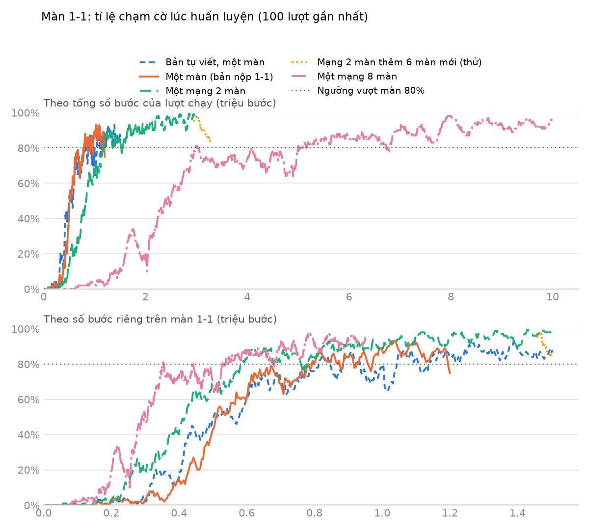
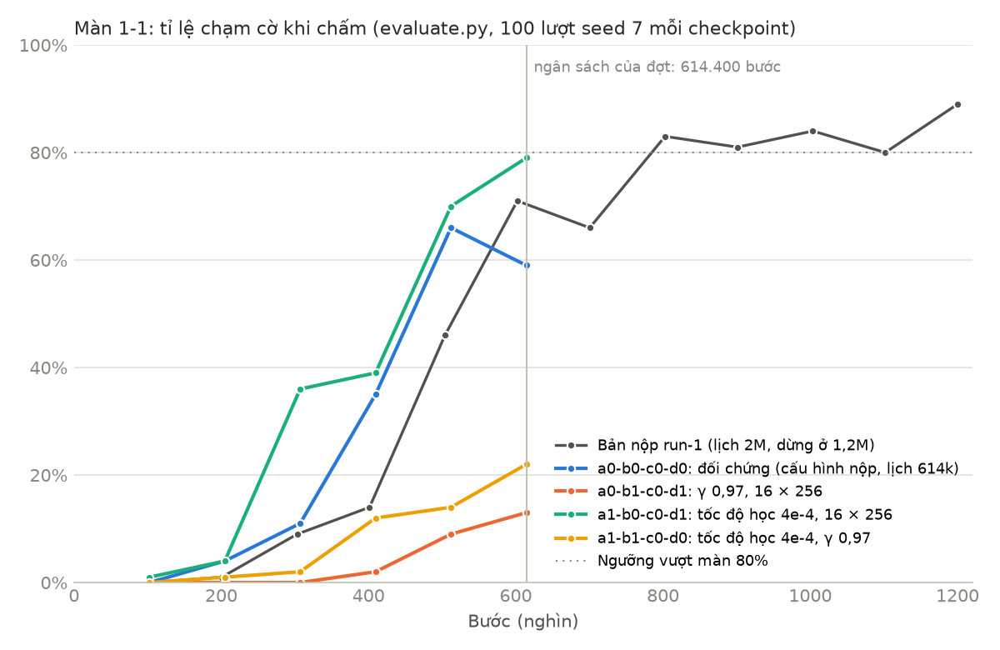
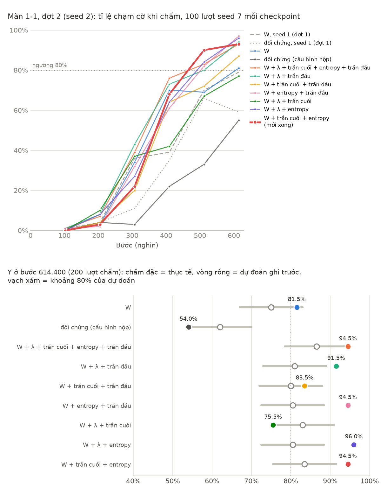
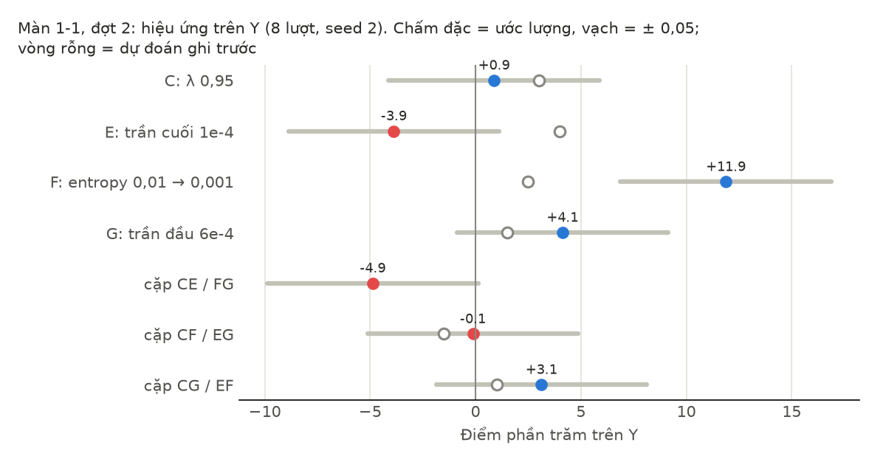
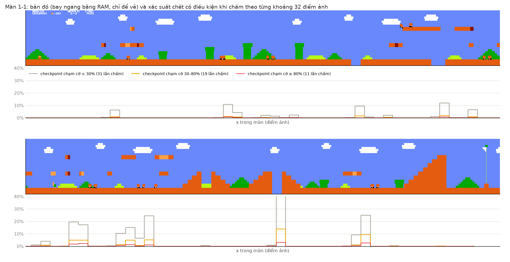

# Báo cáo màn 1-1

Cập nhật lần cuối: 29/11/2026, 03:00: **đổi bản nộp** sang mạng seed 4 của cấu hình `c1-e0-f1-g0` (614.400 bước). Lần trước: 28/11/2026, 05:30. Lượt 8 màn đã kết thúc ở bước 9.998.336; 10 checkpoint của nó đã được chấm 100 lượt seed 7 trên 1-1, 2 checkpoint đã được chấm theo lệnh của đề. Checkpoint cuối đã được chấm thêm 100 lượt seed 11. Đợt tối ưu cấu hình đã chạy và chấm xong cả hai đợt: nửa đầu 4 lượt (seed 1) và đợt 2 gồm 9 lượt (seed 2), mỗi lượt 614.400 bước.

Quy ước: **bước** là bước tác tử. **Số chấm** là kết quả của `evaluate.py` (100 lượt seed 7 để ra quyết định, 20 lượt seed 2026 là đúng lệnh chấm của đề). **Số lúc huấn luyện** là tỉ lệ chạm cờ của 100 lượt huấn luyện gần nhất trong `progress.csv`; hai loại số có thể lệch nhau hơn 10 điểm. Cờ của 1-1 ở x = 3161; ngưỡng vượt màn là 0,8.

## 1. Kết quả tốt nhất hiện có

| Mạng | Checkpoint | 100 lượt, seed 7 | 20 lượt, seed 2026 |
|---|---|---|---|
| Chỉ học 1-1 (bản nộp cũ, tới 28/11/2026) | `runs/1-1/run-1`, bước 1.200.128 | 89/100 | 19/20 |
| Một mạng 2 màn (1-1 và 4-1) | `runs/1-1+4-1/from-scratch`, bước 2.904.064 | 99/100 | 20/20 |
| Một mạng 8 màn | `runs/8-levels/from-scratch-10m`, bước 9.900.032 | 99/100 | 20/20 |
| Một mạng 8 màn (checkpoint cuối) | `runs/8-levels/from-scratch-10m`, bước 9.998.336 | 99/100 | 19/20 |
| Chỉ học 1-1, cấu hình tối ưu `c1-e0-f1-g0` (seed 2, GPU) | `runs/1-1/tuning-2/c1-e0-f1-g0`, bước 614.400 | 96/100 (seed 11: 96/100) | chưa chấm |
| Chỉ học 1-1, cấu hình tối ưu `c0-e0-f1-g1` (seed 2, GPU) | `runs/1-1/tuning-2/c0-e0-f1-g1`, bước 614.400 | 97/100 (seed 11: 92/100) | chưa chấm |
| Chỉ học 1-1, cấu hình tối ưu `c1-e0-f1-g0`, seed huấn luyện 4 (GPU; **bản nộp từ 29/11/2026**, `submission/1-1.pt`, cấu hình `configs/group-1-1-fast.yaml`) | `runs/1-1/confirm/c1-e0-f1-g0-seed4`, bước 614.400 | 98/100 (seed 11: 99/100) | **20/20** |

**Chấm 20 lượt với 10 seed chấm** (`experiments/eval_seeds.sh`, tệp ở `runs/eval-seeds/`). Mạng seed 4 ở trên được chấm bằng `evaluate.py` nguyên bản, 20 lượt mỗi seed chấm, seed chấm 2026 (của đề) và 1–9:

| Seed chấm | 2026 | 1 | 2 | 3 | 4 | 5 | 6 | 7 | 8 | 9 | Gộp |
|---|---|---|---|---|---|---|---|---|---|---|---|
| Chạm cờ /20 | 20 | 19 | 20 | 20 | 20 | 20 | 20 | 19 | 20 | 20 | 198/200 = 99,0% |

Cả 10 seed chấm đều qua ngưỡng 16/20. Với tỉ lệ 99%, xác suất một lần chấm 20 lượt dưới 16/20 gần như bằng 0.

Màn 1-1 đã vượt ngưỡng ở mọi mạng trong bảng.
- **Bản nộp mới (29/11/2026):** mạng seed 4 ở trên, học 614.400 bước, khoảng một nửa số bước của bản nộp cũ.
- **Chấm lại bằng đúng lệnh của đề** trên `submission/1-1.pt`: 20/20, ghi ở `submission/ket-qua-1-1.json` và `submission/1-1.mp4`.
- **Cách chọn:** seed 4 là seed tốt nhất trong 4 seed huấn luyện (2–5) của cùng cấu hình. Gộp seed chấm 7 và 11, bốn seed được 192, 188, 197 và 176/200, cả bốn đều vượt ngưỡng.
- **Chạy lại được:** `mario_ppo/train_joint.py`, `env.py` và `wrappers.py` được commit cùng lần đổi này. Các thay đổi sau lượt này chỉ chạy khi cấu hình có khóa tương ứng.
- Bản nộp cũ vẫn ở `runs/1-1/run-1/checkpoints/step_001200128.pt`.

## 2. Các lượt chạy có huấn luyện 1-1

Mọi lượt đều dùng seed 1 và bộ hành động `simple`. Năm lượt đầu dùng 8 môi trường × 512 bước, γ = 0,9, chạy trên CPU; bốn lượt của đợt tối ưu chạy trên GPU và khác nhau ở những chỗ ghi trong cột cuối.

| Lượt chạy | Số màn | Tổng bước | Bước riêng trên 1-1 | Tốc độ học | Chạm cờ lúc huấn luyện, cuối lượt |
|---|---|---|---|---|---|
| `legacy/runs/trial-100k` (bản tự viết) | 1 | 1.503.232 | 1.503.232 | 1,5e-4 giảm về 1e-4 | 88% |
| `runs/1-1/run-1` | 1 | 1.200.128 | 1.200.128 | 1,5e-4, lịch tính cho 2 triệu bước | 75% |
| `runs/1-1+4-1/from-scratch` | 2 | 3.002.368 | 1.501.184 | 2e-4 giảm về 0 | 99% |
| `runs/multi-level/restart-test` | 8 | 372.736 (nối tiếp mạng 2 màn) | 46.592 thêm | 1,4e-4 | 86% |
| `runs/8-levels/from-scratch-10m` | 8 | 9.998.336 | 955.357 | 2e-4 giảm về 0 | 96% |
| `runs/1-1/tuning/a0-b0-c0-d0` (đối chứng: cấu hình nộp) | 1 | 614.400 | 614.400 | 1,5e-4 giảm về 0 | 59% |
| `runs/1-1/tuning/a1-b0-c0-d1` | 1 | 614.400 | 614.400 | 4e-4 giảm về 0 (trần của `lr_control`); 16 × 256 | 74% |
| `runs/1-1/tuning/a0-b1-c0-d1` | 1 | 614.400 | 614.400 | 1,5e-4 giảm về 0; γ 0,97, thưởng × 0,3; 16 × 256 | 15% |
| `runs/1-1/tuning/a1-b1-c0-d0` | 1 | 614.400 | 614.400 | 4e-4 giảm về 0; γ 0,97, thưởng × 0,3 | 22% |
| `runs/1-1/tuning-2/control` (seed 2, cấu hình nộp) | 1 | 614.400 | 614.400 | 1,5e-4 giảm về 0 | 59% |
| `runs/1-1/tuning-2/<8 lượt>` (seed 2) | 1 | 614.400 mỗi lượt | 614.400 | W (`lr_control` trần 4e-4, 16 × 256) cộng tổ hợp của λ 0,95, trần cuối 1e-4, entropy 0,01 → 0,001, trần đầu 6e-4; bảng ở Mục 4 | 77–94% |

- Bản tự viết dùng mã và cách xử lý khung hình khác kho của thầy; checkpoint của nó không dùng được với `evaluate.py` hiện tại.
- Ở lượt 8 màn, 1-1 nhận 1/8 số bước tới bước 2.002.944 (mỗi màn một môi trường); sau đó phần bước chia theo tỉ lệ hỏng lúc huấn luyện (sàn 6%, trần 30%, ghi trong `allocation.csv`) nên 1-1 chỉ nhận 8–10% số bước của mỗi triệu bước, 9% của cả chặng.
- `runs/4-1/transfer` khởi tạo từ checkpoint 1-1 nhưng chỉ học 4-1, nên không tính là lượt huấn luyện 1-1 (xem Mục 6).

## 3. Đường cong học

Hình vẽ bằng `python experiments/level_curves.py 1-1`.

- **Theo tổng số bước, càng nhiều màn thì 1-1 càng chậm đạt ngưỡng.** Hai lượt một màn chạm 80% ở khoảng 0,8–0,9 triệu bước, lượt 2 màn ở 1,2 triệu, lượt 8 màn ở 3,0 triệu.
- **Theo số bước riêng trên 1-1 thì ngược lại.** Lượt 8 màn chạm 80% sau 0,35 triệu bước riêng, lượt 2 màn sau 0,6 triệu, lượt một màn sau 0,8 triệu.
- **Mức cuối cao hơn ở các lượt học nhiều màn và chạy hết lịch tốc độ học.** Lượt 2 màn kết thúc ở 99%, lượt 8 màn ở 96% (50 dòng cuối của `progress.csv` nằm trong khoảng 91–96%), hai lượt một màn dừng quanh 85–88%.
- **Thêm màn mới đột ngột làm 1-1 tụt.** Ở lượt thử nối tiếp, 1-1 đi từ 100% xuống 86% sau 373 nghìn bước.

Giới hạn: mỗi lượt chỉ một seed và các lượt khác nhau nhiều thứ cùng lúc (số màn, số bước, tốc độ học, lịch entropy), nên các nhận xét trên là quan sát, chưa phải kết luận về nguyên nhân.

## 4. Số chấm theo checkpoint

### Lượt một màn (`runs/1-1/run-1`)

| Bước | 100k | 200k | 300k | 400k | 500k | 600k | 700k | 800k | 900k | 1,0M | 1,1M | 1,2M |
|---|---|---|---|---|---|---|---|---|---|---|---|---|
| Chạm cờ /100 (seed 7) | 0 | 1 | 9 | 14 | 46 | 71 | 66 | 83 | 81 | 84 | 80 | **89** |
| Chạm cờ /20 (seed 2026) | – | – | – | – | – | – | – | 17 | 16 | 19 | 19 | **19** |

Bốn checkpoint đầu (bước 102.400, 200.704, 303.104, 401.408) được chấm thêm ngày 27/11/2026 để so với đợt tối ưu.

### Đợt tối ưu cấu hình, nửa đầu (`runs/1-1/tuning`, ngân sách 614.400 bước mỗi lượt)

Thiết kế, luật quyết định và phân tích ở `docs/optimize-1-1.md`. Mỗi lượt một seed.

| Lượt | 102k | 205k | 307k | 410k | 512k | 614k | 614k, seed 11 | Gộp 200 lượt |
|---|---|---|---|---|---|---|---|---|
| Đối chứng (cấu hình nộp, lịch 614k) | 0 | 4 | 11 | 35 | 66 | 59 | 63 | 61,0% |
| Tốc độ học 4e-4, 16 × 256 | 1 | 4 | 36 | 39 | 70 | 79 | 80 | **79,5%** |
| γ 0,97, 16 × 256 | 0 | 0 | 0 | 2 | 9 | 13 | 16 | 14,5% |
| Tốc độ học 4e-4, γ 0,97 | 0 | 1 | 2 | 12 | 14 | 22 | 26 | 24,0% |

Hình vẽ bằng `python experiments/tuning_summary.py --plot docs/reports/figures/1-1-tuning-eval.png`.

- Với nửa số bước, tốc độ học 4e-4 (gấp 2,67 lần) đưa 1-1 lên 79,5%, sát ngưỡng 80%; cấu hình nộp chạy cùng ngân sách được 61%.
- γ 0,97 làm 1-1 học chậm hẳn (14,5% và 24%), khớp với phép đo nhiễu gradient ở `docs/optimize-1-1.md`, Mục 2.2.
- Bản nộp ở bước 602.112 được 71/100, cao hơn lượt đối chứng (59/100) vì lịch của nó tính cho 2 triệu bước nên tốc độ học ở đó vẫn còn 1,04e-4, trong khi lượt đối chứng đã giảm về 0.
- Ở khoảng 400k thì ngược lại: bản nộp 14/100, lượt đối chứng 35/100, dù tốc độ học của bản nộp lúc đó cao hơn (1,2e-4 so với 5e-5). Hai lượt gần cùng cấu hình (khác lịch tốc độ học, CPU so với GPU) lệch nhau 21 điểm ở cùng một mốc, nên chênh lệch dưới khoảng 20 điểm giữa hai lượt đơn lẻ chưa đủ để kết luận.

### Đợt tối ưu cấu hình, đợt 2 (`runs/1-1/tuning-2`, seed 2, 614.400 bước mỗi lượt)

Thiết kế 2^(4−1) quanh W (lượt thắng của nửa đầu), cộng một lượt đối chứng. Dự đoán ghi trước, kết quả và hiệu ứng chính ở `docs/optimize-1-1.md`, Mục 8 và Mục 10.

| Lượt | 102k | 205k | 307k | 410k | 512k | 614k | 614k, seed 11 | Gộp 200 lượt |
|---|---|---|---|---|---|---|---|---|
| Đối chứng (cấu hình nộp) | 0 | 4 | 3 | 22 | 33 | 55 | 53 | 54,0% |
| W | 0 | 3 | 34 | 70 | 69 | 81 | 82 | 81,5% |
| W + λ + trần cuối + entropy + trần đầu | 1 | 7 | 39 | 76 | 83 | 93 | 96 | 94,5% |
| W + λ + trần đầu | 1 | 8 | 43 | 73 | 80 | 94 | 89 | 91,5% |
| W + trần cuối + trần đầu | 0 | 4 | 20 | 64 | 72 | 87 | 80 | 83,5% |
| W + entropy + trần đầu | 1 | 2 | 32 | 61 | 82 | **97** | 92 | 94,5% |
| W + λ + trần cuối | 0 | 10 | 37 | 42 | 67 | 77 | 74 | 75,5% |
| W + λ + entropy | 0 | 8 | 27 | 64 | 84 | 96 | 96 | **96,0%** |
| W + trần cuối + entropy | 0 | 3 | 22 | 68 | 90 | 93 | 96 | 94,5% |

Hình vẽ bằng `python experiments/tuning2_report.py --plot docs/reports/figures/1-1-tuning2-eval.png --effects-plot docs/reports/figures/1-1-tuning2-effects.png`.

- **W lặp lại được.** W hơn đối chứng +27,5 điểm ở seed 2 và +18,5 điểm ở seed 1.
- **Entropy giảm dần là yếu tố mạnh nhất: +11,9 điểm.** Bốn lượt có nó đạt 94,5–96%, entropy cuối lượt 0,44–0,50 so với 0,61–0,67 ở các lượt không có.
- **Trần đầu 6e-4: +4,1 điểm. λ 0,95: +0,9 điểm.**
- **Trần cuối 1e-4: −3,9 điểm.** Tốc độ học không về 0 nên chính sách vẫn đổi mạnh lúc chấm checkpoint cuối.
- **Chỗ chết theo vùng.** Lượt `c1-e1-f1-g1` bớt chết ở mọi vùng so với W, nhiều nhất ở vùng cầu thang x 2432–2496: 12/180 lượt tới được của W chết ở đây, còn lượt này chỉ 1/191.
- **Chưa phân biệt được hai cấu hình tốt nhất.** Hiệu ứng chính được ước lượng chắc vì mỗi hiệu ứng so 4 lượt với 4 lượt. Nhưng mỗi lượt chỉ có một seed, nên chênh 0,015 giữa `c1-e0-f1-g0` (96,0%) và `c0-e0-f1-g1` (94,5%) nằm trong độ nhiễu.

### Một mạng 2 màn (`runs/1-1+4-1/from-scratch`), cột 1-1

| Bước | 0,5M | 1,0M | 1,2M | 1,5M | 2,0M | 2,5M | 2,9M | 3,0M |
|---|---|---|---|---|---|---|---|---|
| Chạm cờ /100 (seed 7) | 22 | 73 | 92 | 88 | 92 | 97 | **99** | 100 |
| Chạm cờ /20 (seed 2026) | 2 | 15 | 16 | 15 | 18 | 20 | **20** | 18 |

Bảng đủ 30 checkpoint ở Mục 10 của `docs/nhat-ky-trong-tu.md`.

### Lượt thử nối tiếp (`runs/multi-level/restart-test`)

| Bước sau khi thêm 6 màn mới | 0 | 24.576 | 106.496 | 208.896 | 372.736 |
|---|---|---|---|---|---|
| Chạm cờ /100 (seed 7) | 99 | 98 | 88 | 75 | 80 |

### Một mạng 8 màn (`runs/8-levels/from-scratch-10m`)

| Bước | 1,90M | 2,00M | 3,40M | 3,50M | 6,20M | 6,30M | 8,00M | 9,00M | 9,90M | 9,998M (cuối) |
|---|---|---|---|---|---|---|---|---|---|---|
| Bước riêng trên 1-1 | 237.568 | 250.368 | 383.507 | 390.830 | 628.356 | 636.918 | 786.838 | 867.988 | 947.784 | 955.357 |
| Chạm cờ /100 (seed 7) | 13 | 36 | 67 | 79 | 95 | 86 | 83 | 85 | 99 | 99 |
| Chạm cờ /100 (seed 11) | – | – | – | – | – | – | – | – | – | 96 |
| x trung bình (seed 7) | 2099 | 2352 | 2719 | 2855 | 3083 | 2966 | 2923 | 2998 | 3154 | 3154 |
| Chạm cờ /20 (seed 2026) | – | – | – | – | – | – | – | – | 20 | 19 |

- Checkpoint cuối được chấm kiểm tra thêm 100 lượt seed 11: 96/100 (96 chạm cờ, 2 chạm địch, 2 rơi hố). Gộp với seed 7: 195/200 = 97,5%, khoảng tin cậy 95% 94,3–98,9% (công thức Wilson). Tệp ở `runs/8-levels/from-scratch-10m/eval/step-009998336-100ep-seed11/deaths-1-1/`. Video lượt chạm cờ đầu tiên theo lệnh chấm: `runs/8-levels/from-scratch-10m/eval/step-009998336-20ep-seed2026/videos/1-1.mp4`.
- Từ bước 6,30M tới cuối lượt, số chạm cờ /100 tăng từ 86 lên 99.
- Hai checkpoint cách nhau khoảng 100 nghìn bước có thể chênh 23 điểm (bước 1,90M và 2,00M: 13 và 36), nên không đọc xu hướng từ một checkpoint đơn lẻ.

## 5. Mario hỏng ở đâu

### Bản đồ và xác suất chết theo vị trí (6.100 lượt chấm)

Hình vẽ bằng `python experiments/level_map.py --level 1-1 --runs runs/1-1/run-1 runs/1-1/tuning/... runs/1-1/tuning-2/...`. Bản đồ có được bằng cách cho Mario bay ngang màn qua RAM; cách này chỉ dùng để vẽ.

Ở các checkpoint đã ≥ 80%, còn bốn chỗ giết 3–4% số lượt tới được:
- x 1760–1824 (hố đầu tiên): 4,0%.
- x 2688–2784: 3,3%.
- x 2432–2496: 3,1%.
- x 1920–2048: 2,9%.

Tích xác suất sống qua bốn chỗ này là 0,87, khớp với tỉ lệ chạm cờ.

### Bản nộp (bước 1.200.128, 100 lượt seed 7, 11 lượt hỏng)

| Vị trí x | Số lượt | Chuyện xảy ra |
|---|---|---|
| 1791–1793 | 3 | hai Goomba ngay sau con Koopa ở x≈1700; Mario đáp xuống ngay trước mặt chúng |
| 1978–2025 | 3 | nhóm Goomba dưới dãy gạch; rơi cạnh một con hoặc nảy từ con này sang con khác |
| 2468–2472 | 3 | hố giữa hai cầu thang; không bật nhảy hoặc nhảy thiếu |
| 2743–2759 | 2 | hai Goomba giữa hai ống cuối, dưới dãy gạch thấp; cú nhảy bị gạch chặn |

- Chọn hành động xác suất cao nhất từ cùng các điểm xuất phát thì đạt 97/100, nên phần lớn thất bại là nhiễu do lấy mẫu ở chỗ cần chuỗi hành động chính xác.
- Ảnh từng trường hợp ở `runs/1-1/run-1/eval/failure-analysis-001200128/`.

### Mạng 8 màn (100 lượt seed 7 mỗi checkpoint)

| Bước | Chạm cờ | Chết vì địch | Rơi hố |
|---|---|---|---|
| 2,00M | 36 | 60 | 4 |
| 3,40M | 67 | 26 | 7 |
| 3,50M | 79 | 13 | 8 |
| 6,20M | 95 | 4 | 1 |
| 6,30M | 86 | 11 | 3 |
| 8,00M | 83 | 13 | 4 |
| 9,00M | 85 | 13 | 2 |
| 9,90M | 99 | 0 | 1 |
| 9,998M | 99 | 0 | 1 |

Số lượt chết vì địch giảm mạnh nhất. Ở checkpoint cuối (bước 9.998.336) chỉ còn 1 lượt hỏng: rơi hố ở x = 2471, đúng hố giữa hai cầu thang mà bản nộp cũng hỏng 3 lượt (x 2468–2472). Chưa xem khung hình các lượt hỏng của mạng 8 màn ở 1-1.

## 6. Mạng không học 1-1 thì chơi 1-1 thế nào

| Mạng | Chạm cờ ở 1-1 (20 lượt, seed 2026) |
|---|---|
| Chỉ học 4-1 (`runs/4-1/from-scratch`, bước 1.200.128) | 0/20 |
| Chỉ học 2-3 (`runs/2-3/from-scratch-3m`, bước 2.801.664) | 0/20 |
| Chuyển giao 1-1 → 4-1, sau 100 nghìn bước chỉ học 4-1 | 10/20 |
| Chuyển giao 1-1 → 4-1, sau 200 nghìn bước chỉ học 4-1 | 2/20 |
| Chuyển giao 1-1 → 4-1, từ 300 nghìn bước trở đi (tới 1,3 triệu) | 0–2/20 |

Kỹ năng ở màn khác không tự mang sang 1-1, và học lần lượt làm quên 1-1 sau 100–200 nghìn bước.

## 7. Điều chưa biết

- Vì sao tính theo bước riêng thì mạng nhiều màn học 1-1 nhanh hơn: do học chung, do tốc độ học cao hơn (2e-4 so với 1,5e-4), hay do lịch entropy. Đợt tối ưu cho thấy riêng tốc độ học cao hơn (4e-4 so với 1,5e-4) đã giúp nhiều ở mạng một màn, nhưng chưa tách được phần của học chung và lịch entropy.
- Mọi kết quả mới có một seed; lượt tốt nhất của đợt tối ưu (79,5%) chưa được chạy lại với seed khác.

## 8. Nhật ký cập nhật

| Ngày | Thay đổi |
|---|---|
| 24/11/2026 | Tạo báo cáo từ năm lượt chạy đã có. Lượt 8 màn đang ở bước 9,91 triệu; số chấm của nó mới tới mốc 6,3 triệu. |
| 24/11/2026 | Điền số của lượt 8 màn sau khi lượt kết thúc: 100 lượt seed 7 ở các bước 8,00M, 9,00M, 9,90M, 9,998M; lệnh chấm ở các bước 9,90M, 9,998M; vẽ lại hình. Sửa hai số cũ: phần bước của 1-1 ở chặng chia theo tỉ lệ hỏng (trước ghi khoảng 7–9%) và bước riêng của lượt thử nối tiếp (46.592, trước ghi khoảng 46.600). |
| 24/11/2026 | Thêm lần chấm kiểm tra 100 lượt seed 11 ở checkpoint cuối của lượt 8 màn (96/100, gộp hai seed 195/200) và đường dẫn video quay bằng lệnh chấm. |
| 27/11/2026 | Thêm nửa đầu đợt tối ưu cấu hình (4 lượt × 614.400 bước trên GPU) vào Mục 2 và Mục 4, kèm hình số chấm theo checkpoint; chấm thêm 4 checkpoint đầu của bản nộp (100 lượt seed 7). |
| 28/11/2026 | Thêm đợt 2 của đợt tối ưu (9 lượt × 614.400 bước, seed 2) vào Mục 1, 2 và 4, kèm hình số chấm và hình hiệu ứng chính. Thêm bản đồ 1-1 với xác suất chết theo vị trí (`docs/reports/figures/1-1-map.png`, `experiments/level_map.py`) vào Mục 5. |
| 29/11/2026 | Đổi bản nộp sang `runs/1-1/confirm/c1-e0-f1-g0-seed4` (614.400 bước, lệnh của đề 20/20, cấu hình `configs/group-1-1-fast.yaml`): Mục 1. |
