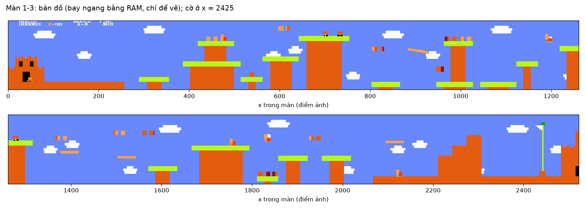
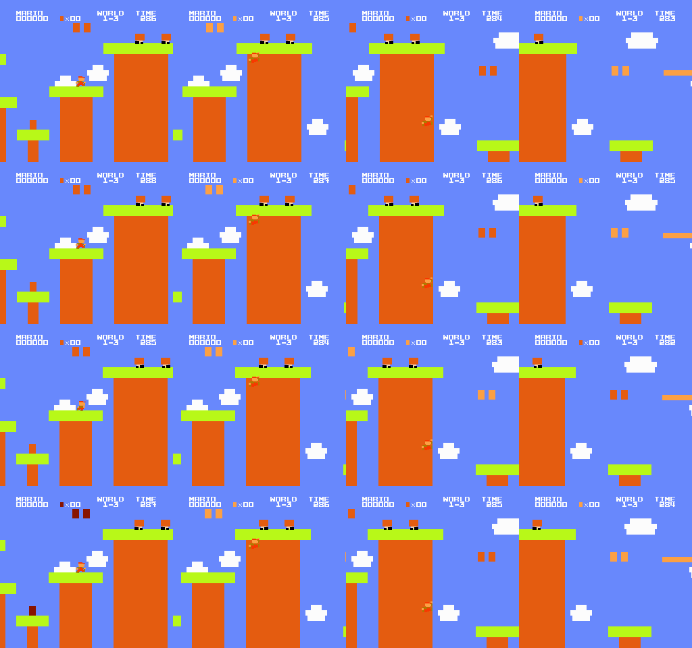
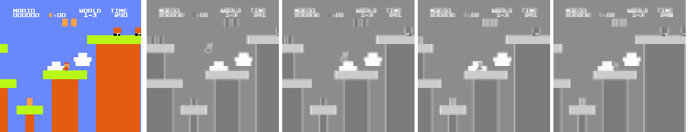
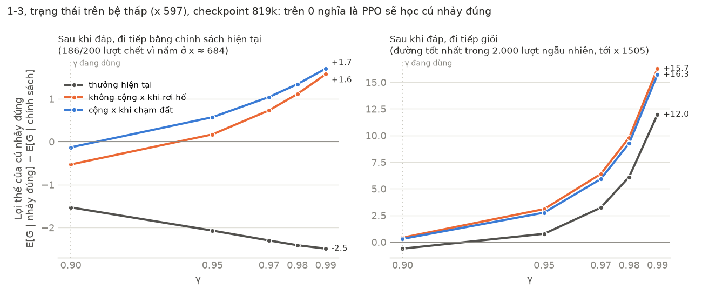

# Báo cáo màn 1-3

Cập nhật lần cuối: 28/11/2026, 19:59. Màn 1-3 có hai lượt một màn: `runs/1-3/tuning/first-819k` và `runs/1-3/tuning/gamma97-claw-819k` (phương án E).

**Trạng thái: đã dừng.** Ngày 28/11/2026 Dũng chọn dừng 1-3 và giữ bản nộp 2-3 (`docs/optimize-1-1.md`, Mục 20.4). Không có mạng 1-3 nào được nộp.

Tài liệu liên quan trong `docs/optimize-1-1.md`:
- lượt đầu: phân tích trước khi chạy, dự đoán ghi trước và cách đọc kết quả ở Mục 15; kết quả ở Mục 17;
- phân tích bằng phần thưởng và γ ở Mục 18;
- lượt E: ghi trước ở Mục 19; kết quả và hướng mới ở Mục 20.

Quy ước: **bước** là bước tác tử. **Số chấm** là kết quả của `evaluate.py` (100 lượt seed 7 để ra quyết định). **Số lúc huấn luyện** lấy từ `progress.csv`. Cờ của 1-3 ở x = 2425; ngưỡng vượt màn là 0,8.

Về điểm: 1-3 không nằm trong danh sách màn cộng điểm của đề. Nó chỉ có thể thay 2-3 ở phần "một màn ngoài danh sách", mà bản nộp 2-3 đã đạt (18/20).

## 1. Kết quả tốt nhất hiện có

Chưa có mạng nào chạm cờ ở 1-3. Cả hai lượt đều được **0/100 ở mọi checkpoint** (seed 7) và 0/100 ở seed 11 của checkpoint cuối. Trong 1.800 lượt chấm, chỉ có 3 lượt đi quá x = 783, cả ba ở checkpoint 102k của lượt E (xa nhất x 1186).

## 2. Các lượt chạy có huấn luyện 1-3

| Lượt chạy | Số màn | Tổng bước | Cấu hình | Thời gian | Chạm cờ lúc huấn luyện, cuối lượt |
|---|---|---|---|---|---|
| `runs/1-3/tuning/first-819k` (28/11) | 1 | 819.200 | `c1-e0-f1-g1`, giống hệt lượt 4-1 "ít bước": 16 × 256, γ 0,9, λ 0,95, entropy 0,01 → 0,001, luật KL mục tiêu 0,02, trần 6e-4 giảm về 0; seed 1, GPU | 62 phút | 0% |
| `runs/1-3/tuning/gamma97-claw-819k` (28/11, phương án E) | 1 | 819.200 | như lượt đầu, chỉ đổi γ thành 0,97 và bật `env.pit_fall_claw` (khi chết, trừ lại thưởng x đi được từ lần cuối đứng trên nền); seed 1, GPU | 70 phút | 0% |

Cấu hình nền là `configs/group-1-3-tuning.yaml`. Lượt đầu chạy bằng `experiments/start_1-3.sh`, lượt E bằng `experiments/start_1-3_e.sh`.

## 3. Số chấm theo checkpoint

| Bước | 102k | 205k | 307k | 410k | 512k | 614k | 717k | 819k | 819k, seed 11 |
|---|---|---|---|---|---|---|---|---|---|
| Chạm cờ /100 (seed 7) | 0 | 0 | 0 | 0 | 0 | 0 | 0 | **0** | **0** |
| x trung bình | 714 | 754 | 763 | 775 | 781 | 781 | 782 | 783 | 783 |
| x xa nhất | 781 | 783 | 783 | 783 | 783 | 783 | 783 | 783 | 783 |
| M | 2,9 | 6,6 | 10,2 | 13,8 | 17,2 | 20,4 | 23,0 | 24,8 | |

Lượt E (γ 0,97, có trừ thưởng rơi hố):

| Bước | 102k | 205k | 307k | 410k | 512k | 614k | 717k | 819k | 819k, seed 11 |
|---|---|---|---|---|---|---|---|---|---|
| Chạm cờ /100 (seed 7) | 0 | 0 | 0 | 0 | 0 | 0 | 0 | **0** | **0** |
| Đi quá x 783 /100 | **3** | 0 | 0 | 0 | 0 | 0 | 0 | **0** | **0** |
| x trung bình | 682 | 751 | 775 | 768 | 772 | 773 | 778 | 778 | 780 |
| x xa nhất | 1186 | 783 | 783 | 783 | 783 | 783 | 783 | 783 | 783 |
| M | 2,4 | 5,7 | 9,1 | 12,2 | 15,2 | 18,0 | 20,4 | 22,0 | |

Lượt E lên được bệ cao trong 1,5% số lượt chơi lấy mẫu ở 102k, rồi 0% từ 205k (`experiments/landing_rate.py`, 200 lượt mỗi checkpoint). Lợi tức lúc huấn luyện là 17,7, so với 22,7 ở lượt đầu: phần trừ chạy đúng. Explained variance đạt 1,00 từ 307k. Lý do và hướng mới ở `docs/optimize-1-1.md`, Mục 20.

**Lượt đầu: lúc huấn luyện, từ khoảng 200k bước tới hết lượt, x trung bình nằm yên ở 761–783.** Độ dài lượt 65–67 bước, lợi tức gần như không đổi (21,9–22,7). explained variance của critic là 0,98–1,00, tức mọi lượt kết thúc giống hệt nhau và critic đoán đúng. Khi đó lợi thế gần 0 nên chính sách không còn tín hiệu để đổi. Entropy vẫn còn 0,65–1,0 (tối đa ln 7 ≈ 1,95), nhưng chừng đó ngẫu nhiên không đủ để tìm ra cú nhảy cần thiết (Mục 4).

## 4. Mario hỏng ở đâu

**Mọi lượt đều chết ở cùng một chỗ:** rơi xuống hố ở x 759–783, ngay sau cú nhảy từ bệ cây thấp (x 575–640) lên bệ cây cao có hai con nấm (x 660–738). Đây là vùng V2–V3 ở Mục 15.1 của tài liệu tối ưu.

Ảnh từ `experiments/death_look.py` (40 lượt seed 7 ở checkpoint cuối: 40 lượt rơi hố, x trung bình 783), lưu ở `runs/1-3/tuning/first-819k/eval/death-look-000819200/`.

**Vì sao cú nhảy hỏng.** Phân tích bằng trình giả lập, không huấn luyện: lấy ảnh chụp trạng thái khi Mario đứng trên bệ thấp, rồi thử các chuỗi hành động.
- Chính sách nhảy ở mép bệ thấp và giữ A khoảng 3 bước. Mario chỉ lên được 38 px (y 96 → 58) rồi rơi.
- **Vành của tán cây cao chìa ra phía trên mép phải của bệ thấp.** Nhảy từ mép thì cụng đầu vào mặt dưới vành, nên cú nhảy dừng ở 38 px dù giữ A bao lâu.
- **Ngay trên giữa bệ thấp có hai viên gạch.** Nhảy từ giữa bệ thì cụng gạch.
- Bệ thấp chỉ rộng khoảng 65 px, nên cũng không đủ chỗ để lấy đà chạy.
- 5.040 chuỗi "lùi, lấy đà, nhảy giữ A từ 1 tới 12 bước, rồi đi tiếp" từ ảnh chụp đó: **không chuỗi nào lên được bệ cao.**
- Thân cây là hình nền, không đứng được. Nhảy hụt là rơi thẳng xuống hố, trong khi vẫn trôi sang phải tới x khoảng 783. Phần đường đi được khi rơi vẫn được cộng thưởng x, nên chính sách học được "nhảy và rơi xa nhất có thể".

## 5. So với dự đoán ghi trước (`docs/optimize-1-1.md`, Mục 15.4)

| | Dự đoán | Thật |
|---|---|---|
| Y (200 lượt, checkpoint cuối) | 0,30 (0,05–0,60) | **0,00** (ngoài khoảng) |
| x trung bình cuối | khoảng 1700 (1100–2300) | 783 |
| Vùng chết nhiều nhất | V5 (vực 288 px, bệ di động) | cú nhảy lên bệ cao ở x 640–660, chết ở x 759–783 |
| Chạm cờ ở 410k ≤ 0,10 | đúng | 0 |

Hai cách ước lượng ở Mục 15.4 đều coi mỗi hố là một rủi ro độc lập, học dần theo số bước. Ở 1-3, chỗ đầu tiên lại là một cú nhảy chính xác mà khám phá ngẫu nhiên không tìm ra, nên cả hai cách đều sai.

**Cú nhảy làm được** (thêm lúc 14:30):
- Từ lúc vừa đáp xuống bệ thấp, bấm A không kèm phải 1–2 bước, rồi phải+A 5–11 bước, thì lên được bệ cao.
- Hành động ngẫu nhiên đều lên được 2,8%; ngẫu nhiên không có nút trái lên được 6,5%.
- Chính sách đã học chọn A hoặc phải+A lúc đáp với xác suất ≤ 0,01 ở mọi checkpoint. Từ cùng trạng thái, nó chỉ lên được 2/300 lượt ở 205k và 0/300 ở các checkpoint khác.
- **Nguyên nhân gốc:** nhảy hụt vẫn được cộng thưởng x khi rơi trôi tới x 783. Nhảy trúng mà chưa biết qua hố kế thì cũng chết quanh đó. Vì vậy nhảy trúng không có lợi thế dương, và chính sách không học nó.

Chi tiết và các hướng sửa ở `docs/optimize-1-1.md`, Mục 17.

**Tính bằng phần thưởng** (thêm lúc 16:40; chi tiết ở `docs/optimize-1-1.md`, Mục 18; script `experiments/jump_returns.py`):
- Tại trạng thái quyết định (Mario vừa lên bệ thấp, x 597), nhảy hụt cho lợi tức 2,83 với γ = 0,9. Critic đoán 2,82.
- Giả sử nhảy đúng, rồi chạy 12 px mỗi bước mãi mãi và không chết. Lợi tức đó vẫn chỉ 2,72. **Với γ = 0,9, mục tiêu huấn luyện thật sự thích nhảy xuống hố hơn.**
  - Lý do: phạt chết 15 bước sau chỉ còn 0,34, ngang 10 px.
  - Mọi thứ sau khi đáp lên bệ cao (từ bước 12) bị nhân với hệ số không quá 0,28.
- Sau khi nhảy đúng, chính sách hiện tại chết vì hai con nấm trên bệ cao ở x khoảng 684 (186/200 lượt). Đây là đính chính cho câu "nhảy trúng mà chưa biết qua hố kế thì cũng chết quanh đó" ở trên.
- Lợi thế PPO đã tính cho cú nhảy đúng là −1,31, nên mỗi lần tình cờ nhảy đúng đều bị phạt.
- Lợi thế của cú nhảy đúng, khi sau khi đáp vẫn đi tiếp bằng chính sách hiện tại:

| Cách tính thưởng | γ 0,9 | γ 0,97 | γ 0,99 |
|---|---|---|---|
| hiện tại | −1,53 | −2,30 | −2,49 |
| không cộng x khi rơi hố | −0,53 | **+0,73** | +1,57 |

- Vì vậy chỉ tăng γ, hoặc chỉ sửa thưởng, đều không đủ. **Cần cả hai:** γ khoảng 0,97 và không cộng x khi rơi hố.
- *Thêm lúc 18:45:* lượt E đã làm cả hai mà vẫn Q = 0 (Mục 3). Cả hai là cần nhưng chưa đủ: cú nhảy đúng hiếm tới mức PPO không kịp khuếch đại (chi tiết ở `docs/optimize-1-1.md`, Mục 20).
- Mạng nhìn thấy bệ cao và hai con nấm ngay lúc quyết định, nên phần hình ảnh không thiếu:

## 6. Điều chưa biết

- Nếu qua được chỗ này thì các vùng sau (V4–V8) khó tới đâu: chưa có lượt nào tới đó.
- Mọi kết quả mới có một seed huấn luyện.
- Hướng C (bắt đầu một phần lượt từ trạng thái lưu, `docs/optimize-1-1.md`, Mục 20.3) chưa thử. Đây là điểm bắt đầu nếu quay lại 1-3.

## 7. Nhật ký cập nhật

| Ngày | Thay đổi |
|---|---|
| 28/11/2026 | Tạo báo cáo từ lượt đầu `runs/1-3/tuning/first-819k` (819.200 bước, Y 0). |
| 28/11/2026 | Thêm phân tích bằng phần thưởng và γ (Mục 4), hình trạng thái quyết định và hình lợi thế. Video lượt chết ở `runs/1-3/tuning/first-819k/eval/video/`. |
| 28/11/2026 | Thêm lượt E `runs/1-3/tuning/gamma97-claw-819k` (γ 0,97 cộng trừ thưởng rơi hố): Q = 0, Y = 0. Đọc lại: chỗ nghẽn còn lại là khám phá (Mục 20 của tài liệu tối ưu). |
| 28/11/2026 | Dũng chọn dừng 1-3, giữ bản nộp 2-3 (Mục 20.4 của tài liệu tối ưu). |
