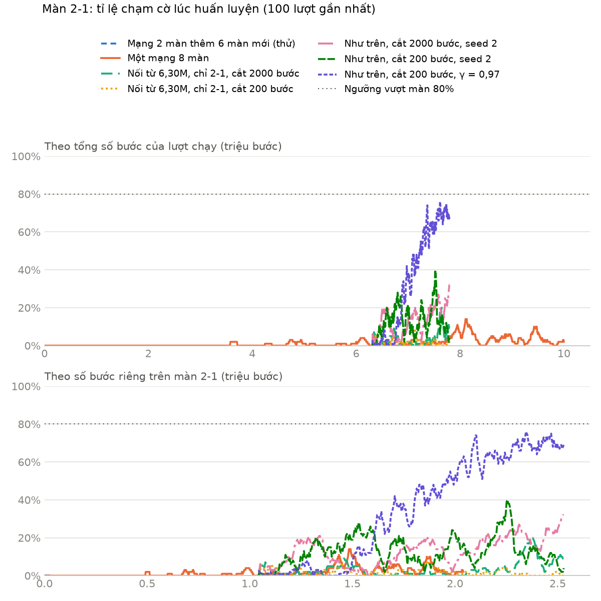

# Báo cáo màn 2-1

Cập nhật lần cuối: 27/11/2026, 03:20.
- **Lượt 8 màn** đã kết thúc ở bước 9.998.336. 10 checkpoint của nó đã được chấm 100 lượt seed 7 trên 2-1, 2 checkpoint đã được chấm theo lệnh của đề, và checkpoint cuối được chấm thêm 100 lượt seed 11.
- **Năm lượt thí nghiệm chỉ học 2-1** đều nối tiếp bước 6.303.744 và kết thúc ở bước 7.798.784. Mỗi lượt có 3 checkpoint được đo 100 lượt seed 7, cộng 100 lượt seed 11 ở checkpoint cuối:
  - `runs/2-1/wall-cut-2000`, `runs/2-1/wall-cut-200`;
  - `runs/2-1/wall-cut-2000-seed2`, `runs/2-1/wall-cut-200-seed2`;
  - `runs/2-1/gamma-0.97-cut-200`.

Quy ước: **bước** là bước tác tử. **Số chấm** là kết quả của `evaluate.py` (100 lượt seed 7 để ra quyết định, 20 lượt seed 2026 là đúng lệnh chấm của đề). **Số lúc huấn luyện** là tỉ lệ chạm cờ của 100 lượt huấn luyện gần nhất trong `progress.csv`; hai loại số có thể lệch nhau hơn 10 điểm. Cờ của 2-1 ở x = 3193; ngưỡng vượt màn là 0,8.

## 1. Kết quả tốt nhất hiện có

| Mạng | Checkpoint | 100 lượt, seed 7 | 20 lượt, seed 2026 |
|---|---|---|---|
| Một mạng 8 màn (cao nhất theo 100 lượt) | `runs/8-levels/from-scratch-10m`, bước 9.003.008 | 42/100 | chưa chấm |
| Một mạng 8 màn | `runs/8-levels/from-scratch-10m`, bước 9.900.032 | 5/100 | 0/20 |
| Một mạng 8 màn (checkpoint cuối) | `runs/8-levels/from-scratch-10m`, bước 9.998.336 | 2/100 | 3/20 |
| Thí nghiệm: nối từ bước 6.303.744, chỉ học 2-1, cắt 200 bước | `runs/2-1/wall-cut-200`, bước 7.798.784 | 39/100 | chưa chấm |
| Thí nghiệm: nối từ bước 6.303.744, chỉ học 2-1, cắt 2000 bước | `runs/2-1/wall-cut-2000`, bước 7.798.784 | 10/100 | chưa chấm |
| Thí nghiệm: như trên, cắt 200 bước, seed 2 | `runs/2-1/wall-cut-200-seed2`, bước 7.798.784 | 35/100 (seed 11: 48/100) | chưa chấm |
| Thí nghiệm: như trên, cắt 2000 bước, seed 2 | `runs/2-1/wall-cut-2000-seed2`, bước 7.798.784 | 26/100 (seed 11: 38/100) | chưa chấm |
| **Thí nghiệm: như trên, cắt 200 bước, γ = 0,97** | `runs/2-1/gamma-0.97-cut-200`, bước 7.798.784 | **78/100** (seed 11: 71/100) | chưa chấm |
| **Thí nghiệm: như trên, cắt 200 bước, γ = 0,97, seed 2** | `runs/2-1/gamma-0.97-cut-200-seed2`, bước 7.798.784 | **75/100** (seed 11: 72/100) | chưa chấm |

- **Cao nhất hiện có là lượt γ = 0,97:** 78/100 (seed 7) và 71/100 (seed 11), gộp 149/200 = 74,5%, khoảng tin cậy 95% là 68–80%. Màn 2-1 vẫn chưa vượt ngưỡng 0,8.
- **Mạng 8 màn:** checkpoint cuối (bước 9.998.336) đạt 2/100 theo 100 lượt seed 7 và 3/20 theo lệnh chấm. Checkpoint cao nhất của nó theo 100 lượt là bước 9.003.008 (42/100).
- Màn 2-1 không có checkpoint nộp; số ở đây chỉ dùng cho báo cáo.
- Các mạng thí nghiệm chỉ học 2-1 sau bước 6.303.744 nên không còn là mạng 8 màn, và chưa được chấm trên bảy màn kia.

## 2. Các lượt chạy có huấn luyện 2-1

Mọi lượt dùng 8 môi trường × 512 bước và bộ hành động `simple`. Nếu không ghi khác, lượt dùng seed 1 và γ = 0,9.

| Lượt chạy | Số màn | Tổng bước | Bước riêng trên 2-1 | Tốc độ học | Chạm cờ lúc huấn luyện, cuối lượt |
|---|---|---|---|---|---|
| `runs/multi-level/restart-test` | 8 | 372.736 (nối tiếp mạng 2 màn) | 46.592 | 1,4e-4 | 0% |
| `runs/8-levels/from-scratch-10m` | 8 | 9.998.336 | 2.039.849 | 2e-4 giảm về 0 | 2% |
| `runs/2-1/wall-cut-2000` | 1 | 1.495.040 (nối tiếp lượt 8 màn ở bước 6.303.744) | 2.529.943 | theo lịch của lượt 8 màn (7,4e-5 xuống 4,4e-5) | 9% |
| `runs/2-1/wall-cut-200` | 1 | 1.495.040 (nối tiếp lượt 8 màn ở bước 6.303.744) | 2.529.943 | theo lịch của lượt 8 màn (7,4e-5 xuống 4,4e-5) | 0% |
| `runs/2-1/wall-cut-200-seed2` (seed 2) | 1 | 1.495.040 (như trên) | 2.529.943 | như trên | 4% |
| `runs/2-1/wall-cut-2000-seed2` (seed 2) | 1 | 1.495.040 (như trên) | 2.529.943 | như trên | 32% |
| `runs/2-1/gamma-0.97-cut-200` (γ = 0,97) | 1 | 1.495.040 (như trên) | 2.529.943 | như trên | 69% |

- Ở lượt 8 màn, mỗi màn chạy trên một môi trường tới bước 2.002.944, nên 2-1 nhận 1/8 số bước đó. Sau đó phần bước chia theo tỉ lệ hỏng lúc huấn luyện (sàn 6%, trần 30%, ghi trong `allocation.csv`): 2-1 nhận 22% số bước của chặng này (14% ở triệu bước thứ 3, 24% ở triệu bước thứ 7, 30% ở triệu bước thứ 10).
- Bước riêng trên 2-1 = 1/8 của 2.002.944 bước đầu cộng dồn cột `steps_2-1` của `allocation.csv`.
- Hai lượt `runs/2-1/wall-*` là một thí nghiệm có đối chứng: cùng nối tiếp checkpoint 6.303.744 của lượt 8 màn (lúc đó 2-1 đã có 1.034.903 bước riêng), cùng chỉ học 2-1 tới bước 7.798.784, khác nhau đúng khóa `env.max_no_progress_steps` (2000 so với 200). Cấu hình ở `configs/group-2-1-experiment.yaml`.
- Ba lượt chạy đêm 26/11/2026 dùng cùng cấu hình đó, chỉ khác ở khóa ghi đè trên dòng lệnh: `seed=2` cho cặp lặp lại thí nghiệm cắt lượt, `algo.gamma=0.97` cho lượt γ. Lệnh nằm trong `experiments/run_wall_batch.sh`; thiết kế ghi trước khi chạy ở `docs/extension-directions.md`.
- Lượt thử nối tiếp lấy mạng 2 màn (1-1 và 4-1) ở bước 2.904.064 rồi cho học 8 màn 1-1, 4-1, 2-1, 3-1, 3-2, 5-1, 6-1, 8-1, mỗi màn một môi trường, tốc độ học 1,4e-4. Nó bị dừng tay sau 372.736 bước; chỉ còn `progress.csv` và `summary.txt`, checkpoint đã xóa.

## 3. Đường cong học

Hình vẽ bằng `python experiments/level_curves.py 2-1`.

- **Số lúc huấn luyện của 2-1 không bao giờ tới ngưỡng.** Nó lần đầu khác 0 ở 3,58 triệu bước (0,49 triệu bước riêng), cao nhất 14% ở 8,11 triệu bước (1,48 triệu bước riêng), và nằm trong khoảng 0–3% ở 50 dòng cuối của `progress.csv`.
- **Ở 2-1 số lúc huấn luyện và số chấm lệch nhau rất xa.** Ở bước 9.003.008, số lúc huấn luyện là 3% (x trung bình 2497) trong khi số chấm là 42/100 (x trung bình 2495). Hai loại số đo khác nhau ở chỗ lúc huấn luyện lượt bị cắt sau 200 bước không tiến, và 100 lượt gần nhất trải qua nhiều lần cập nhật mạng; chưa biết điều nào gây ra độ lệch.
- **Màn 2-1 nhận nhiều bước nhất mà vẫn thấp nhất.** Nó nhận 2.039.849 bước riêng, gấp khoảng 1,6 lần 3-1 (1.244.155) và hơn gấp đôi 1-1, 4-1, 3-2, 6-1 (0,95–1,0 triệu). Phần bước của nó tăng dần từ 14% (triệu bước thứ 3) lên chạm trần 30% (triệu bước thứ 10) vì tỉ lệ hỏng không giảm.
- **Hai lượt thí nghiệm chỉ học 2-1 cũng không tới ngưỡng lúc huấn luyện.** Nhánh cắt 2000 cao nhất 20% (bước 7.643.136), cuối lượt 9%; nhánh cắt 200 cao nhất 8% (bước 7.135.232), cuối lượt 0%. Số chấm của nhánh cắt 200 ở cuối lượt lại là 39/100 (Mục 4): mọi lượt chạm cờ khi chấm đều đứng ở tường quá 200 bước, tức là loại lượt bị cắt lúc huấn luyện.
- **Lượt γ = 0,97 là lượt đầu tiên mà số lúc huấn luyện của 2-1 lên quá 50%.** Nó đạt cao nhất 76% (bước 7.614.464) và 69% ở cuối lượt. Vì lượt bị cắt sau 200 bước không tiến, mỗi lượt chạm cờ lúc huấn luyện đều là lượt qua tường nhanh. Cặp seed 2 cao nhất 40% (cắt 200) và 32% (cắt 2000, ở cuối lượt).
- Lượt thử nối tiếp (mạng đã học 1-1 và 4-1) và lượt 8 màn ở cùng 46.592 bước riêng trên 2-1 (bước 372.736 của lượt 8 màn): x trung bình lúc huấn luyện 1133 so với 814, cả hai chưa chạm cờ.

Giới hạn: mỗi lượt chỉ một seed, và trong lượt 8 màn phần bước của từng màn đổi theo thời gian cùng lúc với tốc độ học và hệ số entropy. Các nhận xét trên là quan sát, chưa phải kết luận về nguyên nhân.

## 4. Số chấm theo checkpoint

### Một mạng 8 màn (`runs/8-levels/from-scratch-10m`)

| Bước | 1,90M | 2,00M | 3,40M | 3,50M | 6,20M | 6,30M | 8,00M | 9,00M | 9,90M | 9,998M (cuối) |
|---|---|---|---|---|---|---|---|---|---|---|
| Bước riêng trên 2-1 | 237.568 | 250.368 | 462.551 | 480.038 | 1.009.342 | 1.034.903 | 1.448.894 | 1.738.949 | 2.007.340 | 2.039.849 |
| Chạm cờ /100 (seed 7) | 0 | 0 | 0 | 0 | 2 | 8 | 16 | 42 | 5 | 2 |
| Chạm cờ /100 (seed 11) | – | – | – | – | – | – | – | – | – | 5 |
| x trung bình (seed 7) | 1414 | 1387 | 1584 | 1898 | 1951 | 2045 | 2234 | 2495 | 2684 | 2790 |
| Chạm cờ /20 (seed 2026) | – | – | – | – | – | – | – | – | 0 | 3 |

- Checkpoint cuối được chấm kiểm tra thêm 100 lượt seed 11: 5/100 (67 hết giờ, 19 chạm địch, 9 rơi hố, 5 chạm cờ). Gộp với seed 7: 7/200 = 3,5%, khoảng tin cậy 95% 1,7–7,0% (công thức Wilson). Tệp ở `runs/8-levels/from-scratch-10m/eval/step-009998336-100ep-seed11/deaths-2-1/`. Video lượt chạm cờ đầu tiên theo lệnh chấm: `runs/8-levels/from-scratch-10m/eval/step-009998336-20ep-seed2026/videos/2-1.mp4`.
- Từ bước 6,30M tới cuối lượt, số chạm cờ /100 giảm từ 8 xuống 2, sau khi lên tới 42 ở bước 9,00M.
- Hai checkpoint cách nhau khoảng 100 nghìn bước có thể chênh 6 điểm (bước 6,20M và 6,30M: 2 và 8), nên không đọc xu hướng từ một checkpoint đơn lẻ.

### Thí nghiệm cắt lượt (`runs/2-1/wall-cut-2000` và `runs/2-1/wall-cut-200`)

Đo bằng `experiments/value_trace.py`, 100 lượt seed 7, không cắt lượt. "Ở tường" là các bước có x trong 2960–3060; "qua tường" là lượt có x lớn nhất trên 3130.

| Checkpoint | Chạm cờ /100 | x cuối trung bình | Lượt tới tường | Lượt qua tường | Qua sau ≤ 200 bước ở tường | Chết vì địch | Hết giờ | Rơi hố |
|---|---|---|---|---|---|---|---|---|
| Điểm xuất phát, bước 6.303.744 | 8 | 2045 | 11 | 8 | 2 | 67 | 13 | 12 |
| Cắt 200, bước 6.803.456 | 1 | 2070 | 16 | 1 | 1 | 62 | 19 | 18 |
| Cắt 200, bước 7.303.168 | 12 | 2352 | 31 | 12 | 0 | 56 | 20 | 12 |
| Cắt 200, bước 7.798.784 (cuối) | 39 | 2587 | 60 | 39 | 0 | 34 | 21 | 6 |
| Cắt 2000, bước 6.803.456 | 1 | 1933 | 14 | 1 | 0 | 70 | 13 | 16 |
| Cắt 2000, bước 7.303.168 | 2 | 1866 | 8 | 2 | 0 | 67 | 8 | 23 |
| Cắt 2000, bước 7.798.784 (cuối) | 10 | 2407 | 44 | 10 | 3 | 46 | 38 | 6 |

- **Bỏ cắt lượt không giúp qua tường.** Nhánh cắt 2000 kết thúc ở 10/100, nhánh cắt 200 ở 39/100. Giả thuyết "mẹo cắt lượt sau 200 bước làm mạng mất cách qua tường" không được ủng hộ.
- **Ở nhánh cắt 200, cả 39 lượt chạm cờ đều đứng ở tường từ 852 bước trở lên rồi mới qua** (trung vị 1267 bước). Trong 850 bước đầu ở tường nó không qua lần nào và xác suất bấm "trái" là 0,002–0,005; sau đó xác suất này tăng tới 0,059. Lúc huấn luyện, lượt đứng quá 200 bước đã bị cắt, nên mạng chưa từng được luyện ở những trạng thái này.
- **Không nhánh nào qua tường ngay khi tới nơi:** 3 trên 44 lượt tới tường (cắt 2000) và 0 trên 60 lượt (cắt 200) qua trong 200 bước đầu.
- Cả hai nhánh đi tới tường nhiều hơn điểm xuất phát (44 và 60 lượt so với 11) và chết vì địch ít hơn (46 và 34 so với 67).
- **Xác suất bấm "trái" phụ thuộc vào vị trí bức tường trên màn hình, không phụ thuộc đồng hồ.** Khi Mario ép vào tường, màn hình vẫn cuộn dần sang phải và bức tường trôi từ cột 41–44 về cột 31 của khung hình 84x84. Ở nhánh cắt 200, xác suất "trái" là 0,002 khi bức tường ở cột 41–43 và 0,108 khi ở cột 31; ở nhánh cắt 2000 là 0,008 (cột 43) và 0,009 (cột 31); ở lượt 8 màn bước 9.003.008 là 0,005 (cột 43) và 0,176 (cột 31). Dán vùng đồng hồ khác vào khung hình không đổi xác suất này, và chấm 100 lượt với đồng hồ bị giữ đứng yên vẫn cho 37 lượt chạm cờ (so với 39). Đo bằng `experiments/clock_swap.py` và `experiments/wall_scroll.py`; tệp ở `runs/2-1/wall-cut-200/eval/clock/`.
- Bảng theo thời gian đứng ở tường, bảng theo cột của bức tường và phần bàn luận ở [`docs/extension-directions.md`](../extension-directions.md), mục "Kết quả cả hai nhánh". Seed huấn luyện thứ hai của thí nghiệm này ở mục kế tiếp.

### Đợt chạy 26/11/2026: seed 2 cho thí nghiệm cắt lượt, và γ = 0,97

Năm nhánh cùng nối tiếp bước 6.303.744 và chỉ học 2-1. Mỗi ô ghi *chạm cờ /100 · qua sớm / tới tường*, trong đó "qua sớm" là qua tường sau không quá 200 bước ở tường. Đo bằng `experiments/value_trace.py`; ba chỉ số tính bằng `experiments/wall_metrics.py`, script này cho lại đúng các số của bảng trên.

| Nhánh | γ | Cắt | Seed | 6.803.456 | 7.303.168 | 7.798.784, seed chấm 7 | 7.798.784, seed chấm 11 |
|---|---|---|---|---|---|---|---|
| `wall-cut-200` | 0,9 | 200 | 1 | 1 · 1/16 | 12 · 0/31 | 39 · 0/60 | 44 · 1/60 |
| `wall-cut-2000` | 0,9 | 2000 | 1 | 1 · 0/14 | 2 · 0/8 | 10 · 3/44 | 8 · 0/45 |
| `wall-cut-200-seed2` | 0,9 | 200 | 2 | 36 · 16/48 | 43 · 20/43 | 35 · 3/67 | 48 · 4/69 |
| `wall-cut-2000-seed2` | 0,9 | 2000 | 2 | 3 · 1/10 | 6 · 1/23 | 26 · 8/38 | 38 · 6/49 |
| **`gamma-0.97-cut-200`** | **0,97** | 200 | 1 | 17 · 1/39 | 62 · 61/70 | **78 · 78/78** | **71 · 70/71** |
| **`gamma-0.97-cut-200-seed2`** | **0,97** | 200 | 2 | chưa chấm | 66 · 62/70 | **75 · 73/75** | **72 · 68/72** |

- **γ = 0,97 giải được bức tường, ở seed này.**
  - Ở checkpoint cuối, 148 trên 149 lượt tới tường qua ngay trong 200 bước đầu; ở nhánh γ = 0,9 cùng seed chỉ 1 trên 120.
  - Chạm cờ gộp hai seed chấm: 149/200 so với 83/200 (kiểm định Fisher, p = 3·10⁻¹¹).
  - Các lượt hỏng còn lại kết thúc trước tường.
- **Lượt γ khởi đầu chậm** (17/100 ở 6.803.456). Lúc vừa đổi γ, critic sai lệch lớn: phép kiểm trước khi chạy cho thấy gradient của critic gấp khoảng 22 lần gradient của actor. Mất mát critic giảm từ 7,7 xuống khoảng 2 trong 60 lần cập nhật đầu, rồi lượt lên 62/100 ở 7.303.168.
- **Thí nghiệm cắt lượt cùng chiều ở hai seed nhưng độ lớn không lặp lại.** Gộp hai seed chấm, cắt 200 so với cắt 2000: 83 so với 18 (seed 1, p = 3·10⁻¹⁴) và 83 so với 64 (seed 2, p = 0,06). Không nhánh γ = 0,9 nào học được cách qua tường khi vừa tới (0,8–16%).
- **Đã lặp lại với seed 2 (27/11/2026).** Lượt γ = 0,97 seed 2 đạt 147/200 lượt chạm cờ, và qua sớm 141/147 lượt tới tường. Đối chứng γ = 0,9 seed 2 được 83/200 và 7/136. Hiệu ứng của γ vì vậy có ở cả hai seed huấn luyện.
- **Các nhánh chỉ học 2-1 quên gần hết bảy màn kia.** Chạm cờ trung bình trên 1-1, 3-1, 3-2, 4-1, 5-1, 5-2, 6-1 giảm từ 71,9/100 (điểm xuất phát) xuống 7,3 và 14,9 (γ 0,9, seed 1 và 2), và 3,0 (γ 0,97, seed 1). Kết quả về γ vì vậy chỉ nói về 2-1, chưa nói về mạng nhiều màn. Bảng ở `docs/extension-directions.md`, mục "Đo độ quên".

### Lượt thử nối tiếp (`runs/multi-level/restart-test`)

Chưa chấm trên 2-1, và không chấm lại được vì checkpoint đã xóa. Số lúc huấn luyện ở cuối lượt (sau 46.592 bước riêng): chạm cờ 0%, x trung bình 1133.

## 5. Mario hỏng ở đâu

### Lý do kết thúc lượt theo checkpoint (100 lượt seed 7)

| Bước | Chạm cờ | Chết vì địch | Rơi hố | Hết giờ |
|---|---|---|---|---|
| 2,00M | 0 | 66 | 29 | 5 |
| 3,40M | 0 | 53 | 40 | 7 |
| 3,50M | 0 | 50 | 39 | 11 |
| 6,20M | 2 | 75 | 17 | 6 |
| 6,30M | 8 | 67 | 12 | 13 |
| 8,00M | 16 | 55 | 7 | 22 |
| 9,00M | 42 | 37 | 7 | 14 |
| 9,90M | 5 | 23 | 10 | 62 |
| 9,998M | 2 | 19 | 6 | 73 |

Lý do đọc từ trạng thái trình giả lập bằng `experiments/death_look.py`, cùng các lượt với `evaluate.py`. "Chết vì địch" là chết khi còn trong màn hình (địch, cây ăn thịt, đạn); "hết giờ" là đồng hồ của trò chơi về 0, thường do Mario kẹt trước một vật cản. Checkpoint 1,90M chỉ có tệp của `evaluate.py`, không có lý do.

### Chỗ kết thúc ở checkpoint cuối (bước 9.998.336, 98 lượt hỏng trên 100)

| Khoảng x | Số lượt | Lý do kết thúc | x cuối cụ thể |
|---|---|---|---|
| 1600–1699 | 3 | 3 chạm địch | 1646–1647 |
| 1700–1799 | 5 | 5 rơi hố | 1731–1737 |
| 2600–2699 | 9 | 9 chạm địch | 2658–2694 |
| 3000–3099 | 73 | 73 hết giờ | 3026 |

Bảng chỉ liệt kê các khoảng 100 điểm ảnh có từ 3 lượt trở lên; 8 lượt hỏng còn lại rải ở các khoảng khác. Bảng đủ ở `runs/8-levels/from-scratch-10m/eval/step-009998336-100ep-seed7/deaths-2-1/look.txt`.

### Năm chỗ chặn Mario

Ảnh của checkpoint 6,30M (mỗi hàng một lượt, bốn cột là màn hình 61, 41, 21 và 1 khung hình trước lúc kết thúc) nằm ở `runs/8-levels/from-scratch-10m/eval/step-006303744-100ep-seed7/look-2-1/`.

| Khoảng x | Lượt hỏng ở 6,30M | Lượt hỏng ở 9,00M | Lượt hỏng ở 9,90M | Lượt hỏng ở 9,998M (cuối) | Chuyện xảy ra (xem từ ảnh ở 6,30M) | Ảnh |
|---|---|---|---|---|---|---|
| 1000–1399 | 20 (19 chạm địch, 1 hết giờ) | 10 (10 chạm địch) | 1 (1 chạm địch) | 1 (1 chạm địch) | nhóm Goomba và Koopa dưới các dãy gạch; Mario đáp xuống ngay cạnh chúng | [bin-x1000.png](../../runs/8-levels/from-scratch-10m/eval/step-006303744-100ep-seed7/look-2-1/bin-x1000.png), [bin-x1300.png](../../runs/8-levels/from-scratch-10m/eval/step-006303744-100ep-seed7/look-2-1/bin-x1300.png) |
| 1600–1699 | 15 (15 chạm địch) | 6 (6 chạm địch) | 7 (7 chạm địch) | 3 (3 chạm địch) | đáp trúng cây ăn thịt đang nhô lên khỏi ống | [bin-x1600.png](../../runs/8-levels/from-scratch-10m/eval/step-006303744-100ep-seed7/look-2-1/bin-x1600.png) |
| 2000–2099 | 13 (10 hết giờ, 3 chạm địch) | 13 (13 hết giờ) | 1 (1 hết giờ) | 0 | rơi vào khe giữa một ống thấp và một ống rất cao, rồi đứng đó tới hết giờ | [bin-x2000.png](../../runs/8-levels/from-scratch-10m/eval/step-006303744-100ep-seed7/look-2-1/bin-x2000.png), [time.png](../../runs/8-levels/from-scratch-10m/eval/step-006303744-100ep-seed7/look-2-1/time.png) |
| 2600–2699 | 18 (18 chạm địch) | 8 (8 chạm địch) | 7 (7 chạm địch) | 9 (9 chạm địch) | Koopa có cánh bay cùng các cặp Goomba | [bin-x2600.png](../../runs/8-levels/from-scratch-10m/eval/step-006303744-100ep-seed7/look-2-1/bin-x2600.png) |
| 3000–3099 | 3 (2 hết giờ, 1 chạm địch) | 1 (1 hết giờ) | 61 (61 hết giờ) | 73 (73 hết giờ) | bức tường gạch cao cần nhảy bằng lò xo; Mario đứng trước tường tới hết giờ hoặc chết | [farthest.png](../../runs/8-levels/from-scratch-10m/eval/step-006303744-100ep-seed7/look-2-1/farthest.png) |

Năm khoảng này chứa 69 trên 92 lượt hỏng ở 6,30M, 38 trên 58 lượt hỏng ở 9,00M, 77 trên 95 lượt hỏng ở 9,90M, 86 trên 98 lượt hỏng ở 9,998M. Ngoài ra có hai chỗ rơi hố nhỏ hơn ở x 1522–1530 và x 2452–2462 (mỗi chỗ 4 lượt ở 6,30M), và chỗ rơi hố ở x 1700–1799 (2 lượt ở 6,30M, 3 ở 9,00M, 5 ở checkpoint cuối).

### Số lượt tới được từng chỗ

| Bước | 1,90M | 2,00M | 3,40M | 3,50M | 6,20M | 6,30M | 8,00M | 9,00M | 9,90M | 9,998M |
|---|---|---|---|---|---|---|---|---|---|---|
| Số lượt tới x ≥ 1400 | 54 | 51 | 66 | 87 | 75 | 78 | 81 | 88 | 97 | 97 |
| Số lượt tới x ≥ 1700 | 28 | 18 | 54 | 68 | 63 | 59 | 64 | 81 | 90 | 94 |
| Số lượt tới x ≥ 2100 | 0 | 0 | 10 | 31 | 37 | 40 | 55 | 64 | 79 | 87 |
| Số lượt tới x ≥ 2700 | 0 | 0 | 1 | 4 | 14 | 13 | 40 | 49 | 69 | 77 |
| Số lượt tới x ≥ 3000 | 0 | 0 | 1 | 2 | 7 | 11 | 31 | 43 | 66 | 75 |
| Chạm cờ | 0 | 0 | 0 | 0 | 2 | 8 | 16 | 42 | 5 | 2 |

- **Checkpoint tốt nhất ở 2-1 là bước 9.003.008: 42/100.** Ở đó bức tường (x 3000–3099) chỉ giữ lại 1 lượt; các lượt hỏng nằm rải ở mọi chỗ chặn, đông nhất ở x 1000–1099 (8 lượt), x 1600–1699 (6 lượt), x 2000–2099 (13 lượt), x 2600–2699 (8 lượt), x 2800–2899 (6 lượt).
- **Ở checkpoint cuối, chỗ chặn chính là bức tường ở x = 3026.** 75 lượt tới được x ≥ 3000, nhưng 73 lượt trong số đó đứng trước tường tới hết giờ (1975–2005 bước mỗi lượt; x = 3026) và chỉ 2 lượt chạm cờ. Số lượt kẹt trước tường: 1 ở 9,00M, 61 ở 9,90M, 73 ở checkpoint cuối.
- Vì vậy số chạm cờ /100 giảm từ 42 (9,00M) xuống 5 (9,90M) và 2 (cuối), dù x trung bình gần như giữ nguyên hoặc tăng (2495, 2684, 2790). Ba checkpoint này nằm trong 1 triệu bước cuối, khi tốc độ học đã dưới 10% mức đầu.
- Lúc huấn luyện, lượt bị cắt sau 200 bước không tiến (`max_no_progress_steps: 200` trong `config.yaml`); lúc chấm thì không có mẹo đó, nên một lượt kẹt trước tường kéo dài tới khi đồng hồ của trò chơi về 0.
- Ảnh chỉ có cho checkpoint 6,30M (ở đó bức tường giữ lại 3 lượt); chưa xem khung hình các lượt ở 9,00M và các lượt kẹt ở checkpoint cuối.
- Phân tích bên trong mạng ở bức tường (critic, xác suất từng hành động, các lượt thoát được bằng lò xo, so sánh 6,30M / 9,00M / cuối lượt) nằm ở [`docs/inside-the-network.md`](../inside-the-network.md), mục 1.5, 1.6 và 1.9. Theo mục 1.9, ở bước 9,00M phần lớn các lượt chạm cờ dài từ 600 bước trở lên, tức đã đứng lâu trước khi qua.

## 6. Mạng không học 2-1 thì chơi 2-1 thế nào

| Mạng | Chạm cờ ở 2-1 (20 lượt, seed 2026) | x trung bình | x xa nhất |
|---|---|---|---|
| Chỉ học 1-1 (`runs/1-1/run-1`, bước 1.200.128) | 0/20 | 511 | 1019 |
| Chỉ học 4-1 (`runs/4-1/from-scratch`, bước 1.200.128) | chưa chấm | – | – |
| Chỉ học 2-3 (`runs/2-3/from-scratch-3m`, bước 2.801.664) | 0/20 | 532 | 1170 |
| Một mạng 2 màn 1-1 và 4-1, bước 1.503.232 | 0/20 | 554 | 919 |
| Một mạng 2 màn 1-1 và 4-1, bước 1.900.544 | 0/20 | 649 | 1356 |
| Một mạng 2 màn 1-1 và 4-1, bước 2.904.064 | 0/20 | 565 | 916 |

Không mạng nào chạm cờ ở 2-1 khi chưa học màn này; x xa nhất là 1356 (mạng 2 màn ở bước 1.900.544). Các mạng này dừng trung bình ở x 511–649, trước cả chỗ chặn đầu tiên của mạng 8 màn (nhóm Goomba và Koopa ở x 1000–1400, Mục 5).

## 7. Điều chưa biết

- Vì sao số chấm ở 2-1 đổi mạnh giữa ba checkpoint cuối (Mục 4) khi tốc độ học đã rất nhỏ. Checkpoint tốt nhất (bước 9.003.008) chưa được chấm theo lệnh của đề (20 lượt, seed 2026).
- Vì sao ở checkpoint cuối Mario đứng trước bức tường ở x = 3026 mà không dùng lò xo. Cách giải thích "do mẹo cắt lượt sau 200 bước không tiến" đã được kiểm bằng thí nghiệm (Mục 4) và không được ủng hộ: nhánh bỏ cắt lượt qua tường kém hơn nhánh giữ cắt 200.
- ~~Vì sao ở những cảnh được luyện nhiều thì mạng lại bấm "trái" rất ít.~~ **Đã kiểm một phần (27/11/2026).** Cách hiểu cũ: bấm "trái" bị trừ thưởng ngay, còn phần thưởng qua tường tới sau hàng chục bước nên gần như mất giá trị với γ = 0,9. Nhánh γ = 0,97 qua tường ngay ở 148/149 lượt tới tường, nên cách hiểu này được ủng hộ. Chưa đo trực tiếp xác suất "trái" ở tường của nhánh γ = 0,97, và mới có một seed. Cách hiểu "mạng đọc đồng hồ" đã được kiểm và sai.
- Với γ = 0,97, chỗ chặn còn lại của 2-1 nằm trước tường. Chưa phân tích nhánh này chết ở đâu.
- Vì sao 2-1 không học được dù nhận nhiều bước nhất: do năm chỗ chặn phải qua liên tiếp, do bức tường cần dùng lò xo, hay do điều khác. Chưa có thí nghiệm tách riêng.
- Lượt thử nối tiếp (mạng đã học 1-1 và 4-1) đi xa hơn trên 2-1 ở cùng số bước riêng (x 1133 so với 814), nhưng chỉ chạy 46.592 bước riêng nên chưa biết khởi tạo như vậy có giúp chạm cờ không.
- Một mạng chỉ học 2-1 từ đầu cần bao nhiêu bước để vượt ngưỡng: chưa có lượt nào như vậy. Hai lượt thí nghiệm chỉ học 2-1 nhưng nối tiếp mạng 8 màn, và sau 1,5 triệu bước riêng thêm vẫn chưa vượt ngưỡng (39/100 và 10/100).
- Thí nghiệm cắt lượt và thí nghiệm γ đã có 2 seed huấn luyện, nhưng cả hai đều nối tiếp cùng một checkpoint 6.303.744. Chưa biết γ = 0,97 có giúp khi học 2-1 từ đầu, hay khi học cả 8 màn, hay không.

Các hướng mở rộng chung cho mọi màn ở `docs/extension-directions.md`.

## 8. Nhật ký cập nhật

| Ngày | Thay đổi |
|---|---|
| 24/11/2026 | Tạo báo cáo từ lượt 8 màn (đã kết thúc), lượt thử nối tiếp và ảnh các lượt hỏng ở bước 6.303.744. |
| 24/11/2026 | Thêm lần chấm kiểm tra 100 lượt seed 11 ở checkpoint cuối của lượt 8 màn (5/100, gộp hai seed 7/200) và đường dẫn video quay bằng lệnh chấm. |
| 24/11/2026 | Thêm hai lượt thí nghiệm chỉ học 2-1 (`runs/2-1/wall-cut-2000`, `runs/2-1/wall-cut-200`): bảng số đo ở tường tại ba mốc mỗi nhánh, vẽ lại hình đường cong, sửa Mục 7. |
| 24/11/2026 | Thêm phép kiểm đồng hồ và vị trí bức tường trên màn hình (chỉ đo): xác suất bấm "trái" đi theo việc màn hình cuộn, không theo đồng hồ; sửa Mục 7. |
| 27/11/2026 | Thêm ba lượt của đợt chạy đêm 26/11/2026 (seed 2 cho thí nghiệm cắt lượt; γ = 0,97): bảng 5 nhánh × 4 lần chấm ở Mục 4, ba dòng ở Mục 1 và 2, vẽ lại hình đường cong, sửa Mục 7. |
| 27/11/2026 | Thêm lượt γ = 0,97 seed 2 (lặp lại được kết quả seed 1) và phép đo độ quên trên bảy màn kia; sửa Mục 7. Hình đường cong chưa vẽ lại cho lượt này. |
