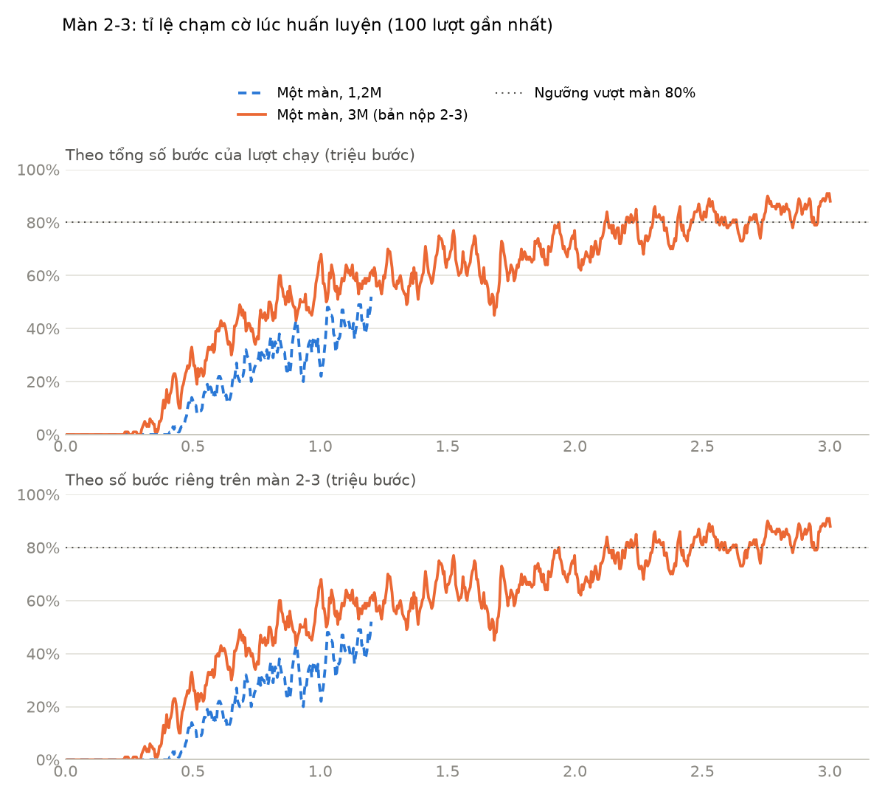
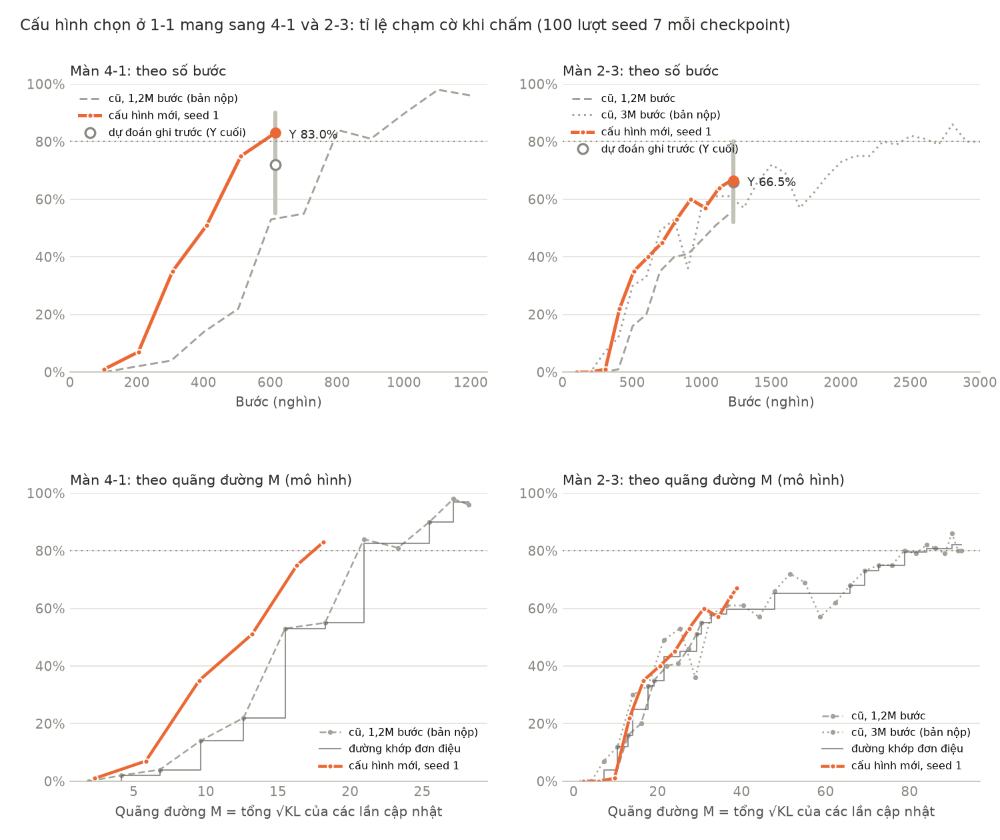

# Báo cáo màn 2-3

Cập nhật lần cuối: 29/11/2026, 01:15. Màn 2-3 có năm lượt một màn:
- hai lượt cũ;
- lượt mang cấu hình tối ưu ở 1-1 sang (`runs/2-3/tuning/best-seed1`);
- lượt B: cùng cấu hình nhưng 2.048 mẫu mỗi lần cập nhật (`runs/2-3/tuning/batch2048-seed1`);
- lượt C: cấu hình B, thêm bắt đầu lại từ chỗ hỏng (`runs/2-3/tuning/batch2048-restart-seed1`).

Lượt 8 màn không huấn luyện màn này.

Quy ước: **bước** là bước tác tử. **Số chấm** là kết quả của `evaluate.py` (100 lượt seed 7 để ra quyết định, 20 lượt seed 2026 là đúng lệnh chấm của đề). **Số lúc huấn luyện** là tỉ lệ chạm cờ của 100 lượt huấn luyện gần nhất trong `progress.csv`; hai loại số có thể lệch nhau hơn 10 điểm. Cờ của 2-3 ở x = 3593; ngưỡng vượt màn là 0,8.

## 1. Kết quả tốt nhất hiện có

| Mạng | Checkpoint | 100 lượt, seed 7 | 100 lượt, seed 11 | 20 lượt, seed 2026 |
|---|---|---|---|---|
| Chỉ học 2-3, 3 triệu bước (**bản nộp**, `submission/2-3.pt`) | `runs/2-3/from-scratch-3m`, bước 2.801.664 | 86/100 | 87/100 | 18/20 |
| Chỉ học 2-3, 1,2 triệu bước, lượt B cộng bắt đầu lại từ chỗ hỏng (lượt C) | `runs/2-3/tuning/batch2048-restart-seed1`, bước 1.228.800 | 79/100 | 77/100 | chưa chấm |
| Chỉ học 2-3, 1,2 triệu bước, cấu hình tối ưu ở 1-1 với 2.048 mẫu mỗi lần cập nhật (lượt B) | `runs/2-3/tuning/batch2048-seed1`, bước 1.228.800 | 75/100 | 66/100 | chưa chấm |
| Chỉ học 2-3, 1,2 triệu bước, cấu hình tối ưu ở 1-1 | `runs/2-3/tuning/best-seed1`, bước 1.228.800 | 67/100 | 66/100 | chưa chấm |
| Chỉ học 2-3, 1,2 triệu bước | `runs/2-3/from-scratch`, bước 1.200.128 | 55/100 | chưa chấm | 9/20 |

Màn 2-3 vượt ngưỡng ở bản nộp, nhưng sát ngưỡng hơn 1-1 và 4-1: gộp hai seed là 173/200. Ba lượt 1,2M bước mới chưa tới ngưỡng (Y = 0,665, 0,705 và 0,780), nên không thay bản nộp. Chưa có mạng nhiều màn nào học 2-3.

## 2. Các lượt chạy có huấn luyện 2-3

Mọi lượt đều dùng seed 1, γ = 0,9, bộ hành động `simple`. Hai lượt cũ dùng 8 môi trường × 512 bước trên CPU; lượt mới dùng 16 × 256 trên GPU (vẫn 4.096 mẫu mỗi lần cập nhật).

| Lượt chạy | Số màn | Tổng bước | Bước riêng trên 2-3 | Tốc độ học | Chạm cờ lúc huấn luyện, cuối lượt |
|---|---|---|---|---|---|
| `runs/2-3/from-scratch` | 1 | 1.200.128 | 1.200.128 | 2e-4 giảm về 0 | 52% |
| `runs/2-3/from-scratch-3m` | 1 | 3.002.368 | 3.002.368 | 2e-4 giảm về 0 | 88% |
| `runs/2-3/tuning/best-seed1` (28/11) | 1 | 1.228.800 | 1.228.800 | luật KL (mục tiêu 0,02), trần 4e-4 giảm về 0; λ 0,95; entropy 0,01 → 0,001 | 66% |
| `runs/2-3/tuning/batch2048-seed1` (lượt B, 28/11) | 1 | 1.228.800 | 1.228.800 | như trên nhưng trần 8e-4; 16 × 128 mẫu mỗi lần cập nhật, 8 minibatch 256 mẫu | 67% |
| `runs/2-3/tuning/batch2048-restart-seed1` (lượt C, 28/11) | 1 | 1.228.800 | 1.228.800 | như lượt B, thêm `env.failure_restart` (chỉ lúc huấn luyện) | 81% (chỉ tính lượt từ đầu màn) |

- Lượt mới dùng `configs/group-2-3-tuning.yaml` cộng các khóa ghi đè của cấu hình `c1-e0-f1-g0` (ghi trong `runs/transfer/batch.log` và `config.yaml` của lượt). Lý do chọn cấu hình và dự đoán ghi trước ở `docs/optimize-1-1.md`, Mục 9.5; kết quả ở Mục 14.

- Hai tệp `config.yaml` chỉ khác `total_steps` (1.200.000 và 3.000.000) và `run_dir`. Lịch tốc độ học và lịch hệ số entropy (0,01 giảm về 0,002) đều tính theo `total_steps`, nên ở lượt 3 triệu bước cả hai lịch giảm chậm hơn.
- Cấu hình giống lượt 4-1 học từ đầu (`configs/group-4-1.yaml`), chỉ khác màn.

## 3. Đường cong học

Hình vẽ bằng `python experiments/level_curves.py 2-3`. Cả hai lượt đều là lượt một màn nên hai khung của hình giống nhau.

- **Lượt 3 triệu bước chạm 80% lần đầu ở 1,94 triệu bước.** Nó chạm 50% ở 0,80 triệu bước, cao nhất 91% ở 2,99 triệu bước và kết thúc ở 88%. Trong 50 dòng cuối của `progress.csv` (khoảng 200 nghìn bước) số này nằm trong khoảng 78–91%.
- **Lượt 1,2 triệu bước không tới ngưỡng.** Nó kết thúc ở 52%, cũng là mức cao nhất của lượt, và vẫn đang tăng khi tốc độ học về 0.
- **Ở cùng số bước, lượt 3 triệu bước cao hơn.** Tại 0,5 triệu bước: 30% so với 13%. Tại 1,0 triệu bước: 66% so với 26%.

Giới hạn: mỗi lượt chỉ một seed. Hai lượt chỉ khác một dòng cấu hình, nhưng dòng đó kéo dài cả lịch tốc độ học lẫn lịch entropy, nên chưa tách được phần của số bước và phần của hai lịch. Các nhận xét trên là quan sát, chưa phải kết luận về nguyên nhân.

## 4. Số chấm theo checkpoint

### Lượt 1,2 triệu bước (`runs/2-3/from-scratch`)

| Bước | 100k | 200k | 300k | 400k | 500k | 600k | 700k | 800k | 900k | 1,0M | 1,1M | 1,2M |
|---|---|---|---|---|---|---|---|---|---|---|---|---|
| Chạm cờ /100 (seed 7) | 0 | 0 | 0 | 1 | 16 | 20 | 35 | 40 | 41 | 46 | 51 | **55** |
| Chạm cờ /20 (seed 2026) | 0 | 0 | 0 | 1 | 4 | 3 | 8 | 10 | 10 | 6 | 8 | **9** |
| x trung bình (seed 7) | 1192 | 1473 | 1774 | 2132 | 2509 | 2498 | 2772 | 2825 | 2799 | 2961 | 2947 | 3062 |

### Lượt 3 triệu bước (`runs/2-3/from-scratch-3m`)

| Bước | 0,5M | 1,0M | 1,5M | 2,0M | 2,3M | 2,4M | 2,5M | 2,6M | 2,7M | 2,8M | 2,9M | 3,0M |
|---|---|---|---|---|---|---|---|---|---|---|---|---|
| Chạm cờ /100 (seed 7) | 30 | 58 | 72 | 73 | 80 | 79 | 82 | 81 | 79 | **86** | 80 | 80 |
| Chạm cờ /100 (seed 11) | – | – | – | – | 80 | 82 | 86 | 81 | 84 | **87** | 84 | 88 |
| Chạm cờ /20 (seed 2026) | 2 | 13 | 14 | 14 | 16 | 17 | 18 | 16 | 14 | **18** | 17 | 18 |
| x trung bình (seed 7) | 2573 | 2897 | 3199 | 3228 | 3325 | 3270 | 3326 | 3296 | 3237 | 3358 | 3269 | 3331 |

Bảng đủ 30 checkpoint ở Mục 13 của `docs/nhat-ky-trong-tu.md`.

- Checkpoint 2.801.664 được chọn nộp vì cao nhất khi gộp hai seed (173/200) và đạt 18/20 theo lệnh chấm. Tệp `submission/ket-qua-2-3.json` ghi 18/20; hai lượt hỏng dừng ở x = 1989 và x = 3179.
- Hai checkpoint cạnh nhau có thể chênh nhiều: 53 rồi 36 ở 0,8–0,9 triệu bước, 72 rồi 57 ở 1,5–1,7 triệu bước. Với 20 lượt, checkpoint 2.703.360 được 14/20 trong khi hai checkpoint cạnh nó được 16 và 18.
- Ở cùng bước, lượt 3 triệu bước cao hơn lượt 1,2 triệu bước: 58 so với 46 ở bước 1.003.520, 61 so với 55 ở bước 1.200.128.

### Lượt mang cấu hình tối ưu ở 1-1 sang (`runs/2-3/tuning/best-seed1`, 28/11)

Mỗi checkpoint 100 lượt seed 7; checkpoint cuối thêm 100 lượt seed 11. M là quãng đường của chính sách, bằng tổng √KL qua các lần cập nhật (`docs/optimize-1-1.md`, Mục 9.1). Cột "3M cũ" là lượt `from-scratch-3m` ở checkpoint gần nhất cùng số bước.

| Bước | 102k | 205k | 307k | 410k | 512k | 614k | 717k | 819k | 922k | 1,02M | 1,13M | 1,23M |
|---|---|---|---|---|---|---|---|---|---|---|---|---|
| Chạm cờ /100 (seed 7) | 0 | 0 | 1 | 22 | 35 | 40 | 45 | 53 | 60 | 57 | 64 | **67** |
| Chạm cờ /100 (seed 11) | | | | | | | | | | | | **66** |
| x trung bình (seed 7) | 1263 | 1923 | 2095 | 2491 | 2802 | 2798 | 2847 | 2978 | 3078 | 3040 | 3163 | 3233 |
| M | 2,4 | 5,9 | 9,7 | 13,3 | 16,7 | 20,5 | 24,1 | 27,5 | 31,0 | 34,4 | 37,4 | 38,9 |
| 3M cũ: chạm cờ /100 | 0 | 0 | 7 | 12 | 30 | 33 | 49 | 53 | 36 | 58 | 61 | 61 |
| 3M cũ: M | 2,0 | 4,2 | 7,2 | 10,5 | 14,1 | 17,7 | 21,4 | 25,3 | 29,0 | 32,8 | 36,5 | 40,3 |

Hình vẽ bằng `python experiments/transfer_report.py --plot docs/reports/figures/transfer-eval.png`.

- **Dự đoán ghi trước đúng: Y 0,66 (0,52–0,80), thật 0,665.** Giả thuyết "giảm nửa số bước" (khoảng 0,80) sai ở màn này.
- **Ở cùng số bước, lượt mới gần như bằng lượt 3M cũ:** 67 so với 61 ở 1,2M, chênh ít hơn độ nhiễu (sai số chuẩn của 100 lượt ở mức 60% là khoảng 5 điểm). Lý do là M của hai lượt gần như bằng nhau (38,9 so với 40,3). Ở 4-1, cùng cấu hình mới cho 83 so với 53 ở 614k.
- **Lượt vẫn đang lên khi tốc độ học về 0.** Ở 200k bước cuối, KL rơi từ 0,015 xuống 0,004, nên M chỉ thêm 1,5.

### Lượt B: 2.048 mẫu mỗi lần cập nhật (`runs/2-3/tuning/batch2048-seed1`, 28/11)

Lượt B giữ nguyên cấu hình của `best-seed1`, chỉ đổi ba khóa: `algo.num_steps=128`, `algo.num_minibatches=8`, `algo.lr_control.lr_max=8e-4`. Mỗi mẫu vẫn được dùng 10 epoch và tổng số bước Adam vẫn như cũ, nhưng chính sách được cập nhật 600 lần thay vì 300. Lý do và dự đoán ghi trước ở `docs/optimize-1-1.md`, Mục 22; kết quả ở Mục 22.5.

| Bước | 102k | 205k | 307k | 410k | 512k | 614k | 717k | 819k | 922k | 1,02M | 1,13M | 1,23M |
|---|---|---|---|---|---|---|---|---|---|---|---|---|
| Chạm cờ /100 (seed 7) | 0 | 1 | 24 | 31 | 44 | 50 | 56 | 53 | 57 | 57 | 73 | **75** |
| Chạm cờ /100 (seed 11) | | | | | | | | | | | | **66** |
| x trung bình (seed 7) | 1327 | 1970 | 2439 | 2601 | 2783 | 2945 | 3003 | 2961 | 3000 | 2963 | 3237 | 3260 |
| M | 6,1 | 13,4 | 20,9 | 28,3 | 35,6 | 42,8 | 49,9 | 56,9 | 64,0 | 71,0 | 77,3 | 80,7 |
| `best-seed1`: chạm cờ /100 (seed 7) | 0 | 0 | 1 | 22 | 35 | 40 | 45 | 53 | 60 | 57 | 64 | 67 |

- **Y = 141/200 = 0,705**, so với 0,665 của `best-seed1`. Dự đoán ghi trước là 0,76 (khoảng 0,65–0,85). Hiệu 0,04 nhỏ hơn độ nhiễu: riêng phần lấy mẫu khi chấm 200 lượt đã có sai số chuẩn khoảng 0,046.
- **B tới sớm hơn.** B hơn `best-seed1` 9–23 điểm ở mọi checkpoint từ 307k tới 717k, đứng yên ở 53–57 trong đoạn 819k–1,02M, rồi lại hơn 8–9 điểm ở hai checkpoint cuối.
- **Quãng đường của chính sách gấp 2,07 lần** (M 80,7 so với 38,9), với KL mỗi lần cập nhật bằng nhau (0,021). Hệ số k chỉ giảm từ 0,89 xuống 0,78, tức phần lớn quãng đường đi thêm là nhiễu (Mục 22.5 của `docs/optimize-1-1.md`).
- **Critic vẫn ổn định:** explained variance 0,74 so với 0,79; mất mát giá trị có trung vị 0,08 ở cả hai lượt.

### Lượt C: bắt đầu lại từ chỗ hỏng, trên nền B (`runs/2-3/tuning/batch2048-restart-seed1`, 28/11)

Lượt C giữ cấu hình B và thêm `env.failure_restart`: khi một lượt từ đầu màn chết, trạng thái trò chơi lưu 6–48 bước trước chỗ chết được giữ lại. Nửa số lượt sau bắt đầu từ một trong các trạng thái đó; mỗi trạng thái được dùng tối đa 4 lần. Mẹo này chỉ chạy lúc huấn luyện, trong khối `if not eval_mode:` của `env.py`, và lúc chấm không có. Cách làm và dự đoán ở `docs/optimize-1-1.md`, Mục 23; kết quả ở Mục 23.5.

| Bước | 102k | 205k | 307k | 410k | 512k | 614k | 717k | 819k | 922k | 1,02M | 1,13M | 1,23M |
|---|---|---|---|---|---|---|---|---|---|---|---|---|
| Chạm cờ /100 (seed 7) | 0 | 8 | 19 | 22 | 40 | 42 | 57 | 61 | 61 | 67 | 54 | **79** |
| Chạm cờ /100 (seed 11) | | | | | | | | | | | | **77** |
| x trung bình (seed 7) | 1557 | 2183 | 2513 | 2429 | 2794 | 2949 | 3001 | 2967 | 3091 | 3219 | 2884 | 3301 |
| Lượt B: chạm cờ /100 (seed 7) | 0 | 1 | 24 | 31 | 44 | 50 | 56 | 53 | 57 | 57 | 73 | 75 |

- **Y = 156/200 = 0,780**, cao nhất trong ba lượt 1,23M bước. Theo luật đọc chốt trước, Y_C − Y_B = +0,075 ≥ +0,05 nên C tính là có lợi. Dự đoán ghi trước là 0,735 (khoảng 0,645–0,805).
- **Bằng chứng yếu hơn con số cuối.**
  - Ba checkpoint cuối của C đi 67 → 54 → 79. Trung bình ba checkpoint đó: C 66,7, B 68,3.
  - Trung bình 10 checkpoint từ 307k: C 50,2, B 52,0.
  - Tính cả đường cong, C chưa hơn B.
- **Lượt bắt đầu lại chiếm 20% số bước.** Ba vùng cuối nhận thêm khoảng 35% số lần tới, nhưng mỗi lần tới như vậy dạy được ít hơn một lần tới từ đầu màn (Mục 23.5 của `docs/optimize-1-1.md`).
- Chưa tới 0,8 nên chưa chấm 20 lượt với nhiều seed.

## 5. Mario hỏng ở đâu

### Ba lượt ở checkpoint cuối, theo vùng (chết / số lượt tới được)

Vùng lấy từ bản đồ `figures/2-3-map.png` (`experiments/level_map.py`, `docs/optimize-1-1.md` Mục 9.3).

| Vùng x | Cũ 1,2M (100 lượt seed 7) | **Mới 1,23M** | **Lượt B 1,23M** | **Lượt C 1,23M** | Bản nộp 3M |
|---|---|---|---|---|---|
| 1056–1248 | 1/98 (1,0%) | 4/200 (2,0%) | 1/198 (0,5%) | 2/199 (1,0%) | 3/199 (1,5%) |
| 1312–1408 | 1/97 (1,0%) | 0/196 (0%) | 5/197 (2,5%) | 4/197 (2,0%) | 1/196 (0,5%) |
| 1536–1600 | 2/96 (2,1%) | 2/196 (1,0%) | 0/192 (0%) | 0/192 (0%) | 1/195 (0,5%) |
| 1664–2080 (đoạn cá) | 13/94 (13,8%) | **12/194 (6,2%)** | 17/192 (8,9%) | 16/192 (8,3%) | 10/194 (5,2%) |
| 2080–2304 | 0/81 | 0/182 | 1/175 | 1/176 | 0/184 |
| 2304–2592 | 9/81 (11,1%) | **22/182 (12,1%)** | 14/174 (8,0%) | 2/175 (1,1%) | 4/184 (2,2%) |
| 2624–3040 | 8/72 (11,1%) | 10/160 (6,2%) | 16/160 (10,0%) | 5/173 (2,9%) | 7/180 (3,9%) |
| 3136–3360 | 9/64 (14,1%) | **17/150 (11,3%)** | 3/144 (2,1%) | 12/168 (7,1%) | 5/173 (2,9%) |

Các cột trừ cột đầu đều gộp 200 lượt seed 7 + 11.

- **Lượt B so với lượt mới:** ba vùng cuối gộp chết 33/174 (19,0%) so với 49/182 (26,9%), z ≈ 1,8. Vùng cuối 3136–3360 đã ngang bản nộp (2,1%). Đoạn cá thì nhích lên, 8,9% so với 6,2% (z ≈ −1,0, trong độ nhiễu).
- **Lượt C:** ba vùng cuối gộp chết 19/175 (10,9%), so với 19,0% của B (z ≈ 2,1). Ở checkpoint trước đó (1,13M) thì không như vậy: seed 7 của C có 16 lượt chết ở x ≥ 2304, B có 11. Đoạn cá vẫn như B (8,3%), và đây giờ là chỗ chết nhiều nhất của cả ba lượt mới.

- **Đoạn cá đã gần bằng bản nộp** (6,2% so với 5,2%). Dự đoán ghi trước (10–16%) sai theo hướng tốt.
- **Phần hỏng còn lại dồn về hai vùng sau:** 2304–2592 (12,1%) và 3136–3360 (11,3%). Ở bản nộp hai vùng này chỉ còn 2–3%, tức lượt 3M học được chúng nhờ thêm bước.
- Mario tới vùng sau ít hơn vùng trước (150 so với 194 lượt), nên vùng sau cũng được luyện ít hơn. Đây là lý do thêm bước giúp, và cũng là lý do bắt đầu từ ảnh chụp trạng thái có thể giúp.

### Bản nộp (bước 2.801.664, 100 lượt seed 7, 14 lượt hỏng: 13 rơi hố, 1 chạm địch)

| Vị trí x | Số lượt | Chuyện xảy ra |
|---|---|---|
| 1331–1333 | 4 | rơi hố; ở seed 11 không có lượt nào chết ở đây và khi chọn hành động xác suất cao nhất cũng không, nên là do lấy mẫu |
| 1577 | 1 | rơi hố |
| 1797 | 1 | rơi hố |
| 1956–2027 | 6 | chỗ nhảy từ bệ xanh thấp lên cầu; 5 lượt rơi hố, 1 lượt chạm địch (x = 1979) |
| 2873 | 1 | rơi hố |
| 3315 | 1 | rơi hố |

Ở seed 11 có 13 lượt hỏng (10 rơi hố, 3 chạm địch), trong đó 7 lượt dừng ở x 1859–1989. Gộp hai seed: 27 lượt hỏng trên 200, 13 lượt dừng ở x 1800–2060.

| Cách chọn hành động (100 lượt, seed 7) | Chạm cờ |
|---|---|
| Lấy mẫu, như đề chấm (T = 1) | 86 |
| T = 0,75 | 86 |
| T = 0,5 | 88 |
| T = 0,25 | 94 |
| Luôn chọn xác suất cao nhất | 96 |

- **Lấy mẫu làm mất khoảng 10 điểm.** 14,2% số hành động lấy mẫu khác hành động xác suất cao nhất (4005 trên 28.255 bước).
- **Một điểm chết cố định ở x = 1989.** Khi luôn chọn xác suất cao nhất, cả 4 lượt hỏng đều rơi hố ở x = 1989 đúng bước thứ 166.
- **Điểm chết đó đi cùng việc đạp trúng cá.** Trong 200 lượt lấy mẫu: có đạp trúng cá ở x 1800–2000 thì 11 trên 25 lượt chết ở x 1800–2060; không thì 2 trên 167. Đây là tương quan; quan hệ nhân quả chưa được kiểm chứng riêng.
- **Kết quả phụ thuộc thời điểm tới đoạn đó.** Cho Mario bắt đầu từ chín ảnh chụp trạng thái trò chơi ở x≈1500–1600 (40 lượt mỗi ảnh, lấy mẫu): số lượt chạm cờ đi từ 4/40 tới 39/40 tùy ảnh chụp (`start-from-snapshot.txt`).
- **Mạng dùng nút "trái" ở vài chỗ cố định.** 220 lần bấm trong 89 trên 100 lượt, dồn ở x 3300–3399, 2400–2499 và 3100–3199. Cấm nút này thì còn 60/100 (seed 7) và 68/100 (seed 11), phần mất chủ yếu là chạm địch ở x 2400–2499 và 3200–3299 (`left-action.txt`).
- Mọi tệp và ảnh ở `runs/2-3/from-scratch-3m/eval/failure-analysis-002801664/`.

### Checkpoint 1,2 triệu bước (`runs/2-3/from-scratch`, 100 lượt seed 7, 45 lượt hỏng)

| Đoạn x | Chết / số lượt tới được, bước 1.200.128 | Chết / số lượt tới được, bản nộp |
|---|---|---|
| 1950–2030 | 13/94 | 6/94 |
| 2442–2562 | 9/81 | 0/88 |
| 2797–2918 | 7/72 | 1/88 |
| 3193–3320 | 9/64 | 1/87 |

- Chọn hành động xác suất cao nhất ở checkpoint này đạt 76/100, so với 55/100 khi lấy mẫu. Khi đó các lượt hỏng dồn ở x = 1081, 1483, 1979–1985, 2536–2557, 3304–3305.
- Trong 20 lượt seed 2026: 10 lượt rơi hố, 1 lượt chạm địch, 9 lượt chạm cờ (`eval/death-causes-001200128/look.txt`).
- Từ 1,2 lên 2,8 triệu bước, ba đoạn sau gần hết chết; đoạn x 1950–2030 giảm ít nhất.

## 6. Mạng không học 2-3 thì chơi 2-3 thế nào

| Mạng | Chạm cờ ở 2-3 (20 lượt, seed 2026) | x trung bình | x xa nhất |
|---|---|---|---|
| Chỉ học 1-1 (`runs/1-1/run-1`, bước 1.200.128) | 0/20 | 843 | 1762 |
| Chỉ học 4-1 (`runs/4-1/from-scratch`, bước 1.200.128) | 0/20 | 1024 | 1792 |
| Một mạng 2 màn 1-1 và 4-1, bước 1.503.232 | 0/20 | 172 | 608 |
| Một mạng 2 màn 1-1 và 4-1, bước 1.900.544 | 0/20 | 244 | 873 |
| Một mạng 2 màn 1-1 và 4-1, bước 2.904.064 | 0/20 | 192 | 650 |
| Một mạng 8 màn (`runs/8-levels/from-scratch-10m`, bước 9.998.336) | 0/20 | 259 | 1081 |

- Mạng chỉ học 1-1: 10 lượt chạm địch trước x = 832, 10 lượt rơi hố ở x 1071–1762. Mạng chỉ học 4-1: 15 lượt rơi hố, 5 lượt chạm địch.
- Không mạng nào chạm cờ. Hai mạng nhiều màn đi được ngắn hơn hẳn hai mạng một màn (x trung bình 172–259 so với 843–1024). Ở mạng 2 màn, x trung vị của cả ba checkpoint là 146, tức hơn nửa số lượt dừng ở x = 146 (`runs/1-1+4-1/from-scratch/eval/all-levels/unseen-by-checkpoint.txt`). Ở mạng 8 màn, 16 trên 20 lượt dừng ở x = 146, mỗi lượt khoảng 1500 bước (`runs/8-levels/from-scratch-10m/eval/inside-network-009998336/unseen-levels/2-3.json`). Chưa xem khung hình để biết vì sao.

## 7. Điều chưa biết

- Đạp trúng cá có phải là nguyên nhân làm rơi hố ở x = 1989 hay chỉ đi cùng nhau.
- Hai cách chưa thử: cho một phần môi trường huấn luyện bắt đầu ngay trước x≈1800 để gặp đoạn đó nhiều hơn; hạ `ent_coef_final` xuống dưới 0,002.
- Học 2-3 cùng các màn khác trong một mạng thì nhanh hơn hay chậm hơn tính theo bước riêng (ở 1-1 và 4-1 đã có số; ở 2-3 chưa có lượt nào).
- Vì sao hai mạng nhiều màn dừng ở x = 146 trên 2-3 trong khi hai mạng một màn đi qua được chỗ đó.
- Mọi kết quả mới có một seed huấn luyện.
- Vì sao cấu hình mới không làm 2-3 nhanh hơn dù làm 1-1 và 4-1 nhanh hơn rõ (`docs/optimize-1-1.md`, Mục 14 và 22). Ở bốn vùng khó, mỗi lần Mario tới vùng dạy được ít hơn ở 1-1 (α ≈ 0,7 so với 1,2–1,6).
- Ba hướng đã ghi:
  - 2.048 mẫu mỗi lần cập nhật đã chạy (lượt B): sớm hơn nhưng Y chỉ tăng 0,04.
  - Bắt đầu lại từ chỗ hỏng (lượt C, trên nền B): Y 0,78 ở checkpoint cuối, nhưng tính cả đường cong thì chưa hơn B.
  - Chạy dài hơn: theo luật, cấu hình B cần khoảng 2,1M bước để tới 0,8. Phần này là ước lượng thô, và số bước do Dũng quyết.

Các hướng mở rộng chung cho mọi màn ở `docs/extension-directions.md`.

## 8. Nhật ký cập nhật

| Ngày | Thay đổi |
|---|---|
| 24/11/2026 | Tạo báo cáo từ hai lượt một màn đã có. |
| 24/11/2026 | Thêm số của mạng 8 màn (checkpoint cuối, chưa học 2-3) vào Mục 6, lấy từ `runs/8-levels/from-scratch-10m/eval/inside-network-009998336/unseen-levels/2-3.json`. |
| 28/11/2026 | Thêm lượt `runs/2-3/tuning/best-seed1` (cấu hình tối ưu ở 1-1, 1.228.800 bước, Y 0,665): Mục 1, 2, 4, bảng vùng ở Mục 5, Mục 7. |
| 29/11/2026 | Thêm lượt B `runs/2-3/tuning/batch2048-seed1` (2.048 mẫu mỗi lần cập nhật, 1.228.800 bước, Y 0,705): Mục 1, 2, 4, bảng vùng ở Mục 5, Mục 7. |
| 29/11/2026 | Thêm lượt C `runs/2-3/tuning/batch2048-restart-seed1` (nền B, bắt đầu lại từ chỗ hỏng, 1.228.800 bước, Y 0,780): Mục 1, 2, 4, bảng vùng ở Mục 5, Mục 7. |
