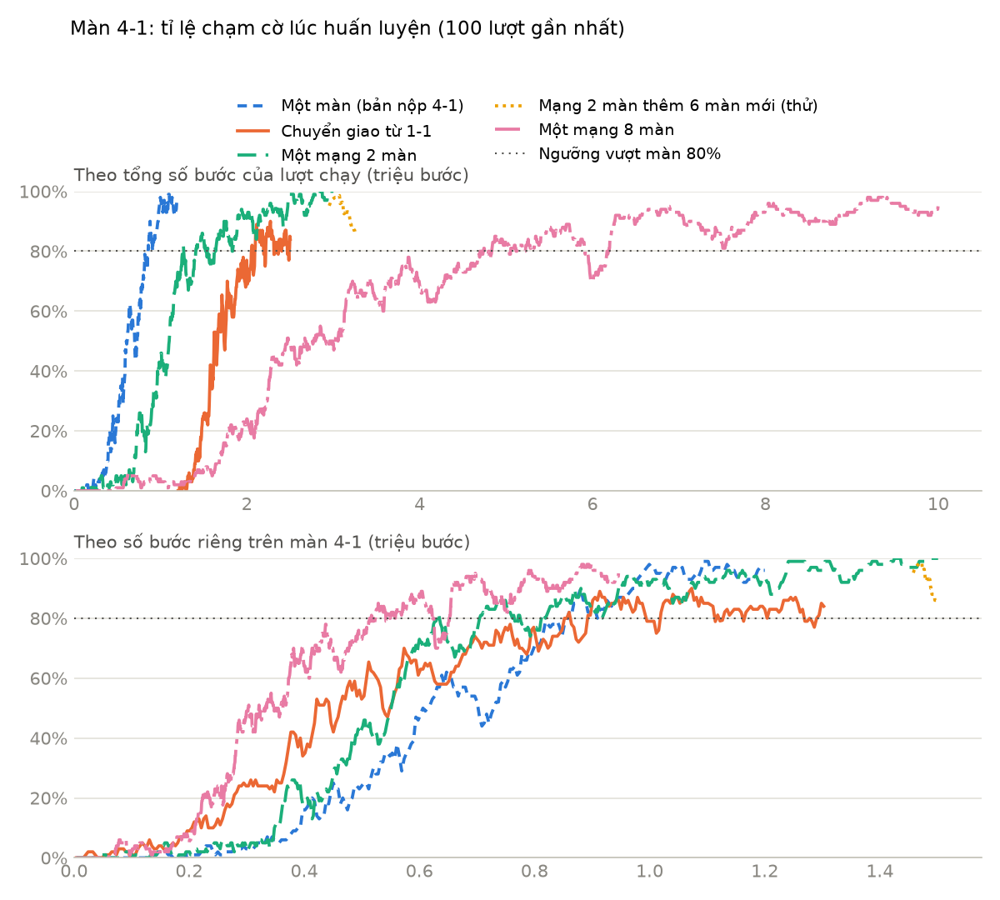
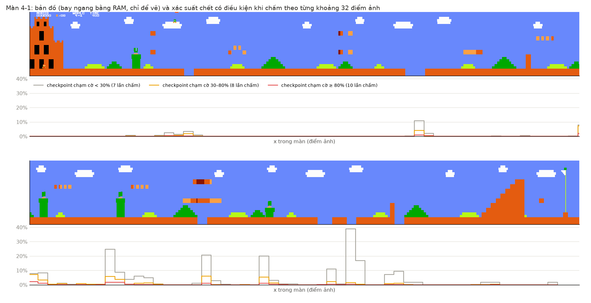

# Báo cáo màn 4-1

Cập nhật lần cuối: 29/11/2026, 03:00: **đổi bản nộp** sang lượt "ít bước" (`runs/4-1/tuning/fast-819k`). Lần trước: 28/11/2026, 12:35. Thêm lượt 4-1 "ít bước" (`runs/4-1/tuning/fast-819k`, 819.200 bước, GPU, Y 0,98). Trước đó: 28/11/2026, 07:05 (lượt `runs/4-1/tuning/best-seed1`, 614.400 bước); 24/11/2026, 10:30. Lượt 8 màn đã kết thúc ở bước 9.998.336; 10 checkpoint của nó đã được chấm 100 lượt seed 7 trên 4-1, 2 checkpoint đã được chấm theo lệnh của đề. Checkpoint cuối đã được chấm thêm 100 lượt seed 11.

Quy ước: **bước** là bước tác tử. **Số chấm** là kết quả của `evaluate.py` (100 lượt seed 7 để ra quyết định, 20 lượt seed 2026 là đúng lệnh chấm của đề). **Số lúc huấn luyện** là tỉ lệ chạm cờ của 100 lượt huấn luyện gần nhất trong `progress.csv`; hai loại số có thể lệch nhau hơn 10 điểm. Cờ của 4-1 ở x = 3593; ngưỡng vượt màn là 0,8.

## 1. Kết quả tốt nhất hiện có

| Mạng | Checkpoint | 100 lượt, seed 7 | 20 lượt, seed 2026 |
|---|---|---|---|
| Chỉ học 4-1 (bản nộp cũ, tới 28/11/2026) | `runs/4-1/from-scratch`, bước 1.200.128 | 96/100 | 20/20 |
| Chuyển giao từ mạng 1-1 | `runs/4-1/transfer`, bước 2.502.656 (1.302.528 bước trên 4-1) | 81/100 | 17/20 |
| Một mạng 2 màn (1-1 và 4-1) | `runs/1-1+4-1/from-scratch`, bước 2.904.064 | 99/100 | 20/20 |
| Một mạng 8 màn | `runs/8-levels/from-scratch-10m`, bước 9.900.032 | 100/100 | 20/20 |
| Một mạng 8 màn (checkpoint cuối) | `runs/8-levels/from-scratch-10m`, bước 9.998.336 | 100/100 | 20/20 |

| **Chỉ học 4-1, "ít bước" (`c1-e0-f1-g1`; bản nộp từ 29/11/2026, `submission/4-1.pt`, cấu hình `configs/group-4-1-fast.yaml`)** | `runs/4-1/tuning/fast-819k`, bước 819.200 | **96/100 (seed 11: 100/100)** | **19/20**; 10 seed chấm × 20 lượt: 197/200, cả 10 lần ≥ 19/20 |
| Chỉ học 4-1, cấu hình tối ưu từ 1-1 (`c1-e0-f1-g0`) | `runs/4-1/tuning/best-seed1`, bước 614.400 | 83/100 (seed 11: 83/100) | chưa chấm |

Màn 4-1 đã vượt ngưỡng ở cả sáu mạng.
- **Bản nộp mới (29/11/2026, theo quyết định của Dũng):** mạng "ít bước". Nó bằng bản nộp cũ ở seed 7 (96 so với 96) với 68% số bước, và được 100/100 ở seed 11.
- **Chấm lại bằng đúng lệnh của đề** trên `submission/4-1.pt`: 19/20, trùng với lần chấm seed 2026 trước đó. Kết quả ghi ở `submission/ket-qua-4-1.json` và `submission/4-1.mp4`.
- **So với bản nộp cũ:** bản cũ được 20/20 ở lệnh của đề. Một lượt chênh lệch nằm trong độ nhiễu của 20 lượt. Gộp 10 seed chấm, mạng mới được 98,5%.
- **Chạy lại được:** `train_joint.py`, `env.py` và `wrappers.py` được commit cùng lần đổi này. Các thay đổi sau lượt này chỉ chạy khi cấu hình có khóa tương ứng.
- Bản nộp cũ vẫn ở `runs/4-1/from-scratch/checkpoints/step_001200128.pt`.

## 2. Các lượt chạy có huấn luyện 4-1

Mọi lượt đều dùng seed 1, 8 môi trường × 512 bước, γ = 0,9, bộ hành động `simple`.

| Lượt chạy | Số màn | Tổng bước | Bước riêng trên 4-1 | Tốc độ học | Chạm cờ lúc huấn luyện, cuối lượt |
|---|---|---|---|---|---|
| `runs/4-1/transfer` | 1 | 1.302.528 (nối tiếp mạng 1-1, bộ đếm từ 1.200.128 tới 2.502.656) | 1.302.528 | 1,2e-4 giảm về 0,9e-4 | 84% |
| `runs/4-1/from-scratch` | 1 | 1.200.128 | 1.200.128 | 2e-4 giảm về 0 | 96% |
| `runs/1-1+4-1/from-scratch` | 2 | 3.002.368 | 1.501.184 | 2e-4 giảm về 0 | 100% |
| `runs/multi-level/restart-test` | 8 | 372.736 (nối tiếp mạng 2 màn) | 46.592 thêm | 1,4e-4 | 86% |
| `runs/8-levels/from-scratch-10m` | 8 | 9.998.336 | 945.995 | 2e-4 giảm về 0 | 95% |
| `runs/4-1/tuning/best-seed1` (GPU, 16 × 256, λ 0,95, entropy 0,01 → 0,001) | 1 | 614.400 | 614.400 | luật KL, trần 4e-4 giảm về 0 | 74% |
| `runs/4-1/tuning/fast-819k` (GPU, 16 × 256, λ 0,95, entropy 0,01 → 0,001) | 1 | 819.200 | 819.200 | luật KL, trần **6e-4** giảm về 0 | 97% |

- Lượt chuyển giao nạp checkpoint 1-1 ở bước 1.200.128 bằng `resume=`, nên nối tiếp cả bộ đếm bước và lịch tốc độ học (lịch tính cho 6,2 triệu bước). Nó không có lịch entropy. Trong báo cáo này "bước trên 4-1" của lượt đó bằng bộ đếm trừ 1.200.128.
- Lượt học từ đầu khác lượt chuyển giao ở bốn thứ cùng lúc: cách khởi tạo, tốc độ học, độ dài lịch, lịch entropy (0,01 giảm về 0,002).
- Ở lượt 8 màn, 4-1 nhận 1/8 số bước tới bước 2.002.944 (mỗi màn một môi trường); sau đó phần bước chia theo tỉ lệ hỏng lúc huấn luyện (sàn 6%, trần 30%, ghi trong `allocation.csv`) nên 4-1 chỉ nhận 8–11% số bước của mỗi triệu bước, 9% của cả chặng.

## 3. Đường cong học

Hình vẽ bằng `python experiments/level_curves.py 4-1`.

- **Theo tổng số bước, càng nhiều màn thì 4-1 càng chậm đạt ngưỡng.** Số lúc huấn luyện chạm 80% lần đầu ở 0,86 triệu bước (lượt một màn học từ đầu), 1,26 triệu (lượt 2 màn), 4,70 triệu (lượt 8 màn). Lượt chuyển giao chạm 80% sau 0,85 triệu bước trên 4-1.
- **Theo số bước riêng trên 4-1 thì ngược lại.** Lượt 8 màn chạm 80% sau 0,51 triệu bước riêng, lượt 2 màn sau 0,63 triệu, lượt chuyển giao sau 0,85 triệu, lượt một màn học từ đầu sau 0,86 triệu. Đây là cùng kiểu quan sát với màn 1-1 (`report-1-1.md`, Mục 3).
- **Lượt chuyển giao dừng thấp nhất.** 50 dòng cuối của nó nằm trong khoảng 77–87%, kết thúc ở 84%; tốc độ học lúc dừng còn 0,9e-4. Lượt một màn học từ đầu nằm trong khoảng 92–99% ở 50 dòng cuối và kết thúc ở 96%; lượt 2 màn kết thúc ở 100%.
- **Lượt 8 màn tới 80% muộn rồi ở yên trên đó từ 6,18 triệu bước** (0,65 triệu bước riêng). Nó kết thúc ở 95%; 50 dòng cuối nằm trong khoảng 92–95%.
- **Thêm màn mới đột ngột làm 4-1 tụt.** Ở lượt thử nối tiếp, số lúc huấn luyện của 4-1 đi từ mức cao nhất 98,6% xuống 86% sau 373 nghìn bước; số chấm từ 99/100 xuống 83/100 rồi 89/100.

Giới hạn: mỗi lượt chỉ một seed và các lượt khác nhau nhiều thứ cùng lúc (số màn, số bước, cách khởi tạo, tốc độ học, lịch entropy), nên các nhận xét trên là quan sát, chưa phải kết luận về nguyên nhân.

## 4. Số chấm theo checkpoint

### Lượt chuyển giao (`runs/4-1/transfer`)

| Bước trên 4-1 | 100k | 200k | 300k | 400k | 500k | 600k | 700k | 800k | 900k | 1,0M | 1,1M | 1,2M | 1,3M |
|---|---|---|---|---|---|---|---|---|---|---|---|---|---|
| Chạm cờ /100 (seed 7) | 1 | 10 | 31 | 54 | 60 | 56 | 80 | 71 | 84 | 82 | 83 | 74 | 81 |
| Chạm cờ /20 (seed 2026) | 2 | 1 | 9 | 7 | 9 | 13 | 13 | 14 | 15 | 15 | 16 | 17 | 17 |

### Lượt học từ đầu (`runs/4-1/from-scratch`)

| Bước | 100k | 200k | 300k | 400k | 500k | 600k | 700k | 800k | 900k | 1,0M | 1,1M | 1,2M |
|---|---|---|---|---|---|---|---|---|---|---|---|---|
| Chạm cờ /100 (seed 7) | 0 | 2 | 4 | 14 | 22 | 53 | 55 | 84 | 81 | 90 | 98 | **96** |
| Chạm cờ /20 (seed 2026) | 0 | 1 | 3 | 2 | 5 | 10 | 12 | 15 | 17 | 19 | 19 | **20** |

Tệp `submission/ket-qua-4-1.json` ghi 20/20.

### Lượt dùng cấu hình tối ưu từ 1-1 (`runs/4-1/tuning/best-seed1`)

Cấu hình `c1-e0-f1-g0` của đợt tối ưu 1-1 (`docs/optimize-1-1.md`, Mục 9.5 và 10), chỉ đổi màn: `configs/group-4-1-tuning.yaml` cộng các khóa ghi đè trong `runs/transfer/choice.log`. Seed 1, GPU, 614.400 bước, 38 phút.

| Bước | 102k | 205k | 307k | 410k | 512k | 614k | 614k, seed 11 |
|---|---|---|---|---|---|---|---|
| Lượt mới, chạm cờ /100 (seed 7) | 1 | 7 | 35 | 51 | 75 | **83** | **83** |
| Bản nộp ở bước gần nhất | 0 | 2 | 4 | 14 | 22 | 53 | – |

- Y (gộp 200 lượt) = **0,83**, qua ngưỡng 0,8 với khoảng nửa số bước của bản nộp. Bản nộp tới mức này ở khoảng 800k bước (84/100 ở 802.816).
- Dự đoán ghi trước là 0,72, khoảng 0,55–0,90; giả thuyết "giảm nửa số bước" cho khoảng 0,90. Thực tế nằm giữa hai số.
- Vùng ống có cây ăn thịt và gai Lakitu (x 1984–2272) giết 19/193 = 9,8% số lượt tới được. Dự đoán là ≤ 15%; bản nộp ở 602k là 27%. Hai vùng còn đáng kể: x 1760–1952 (7/200) và x 2592–2720 (7/173).
- Quãng đường M = 18,1 (đã tính trước 18,4). Mô hình quãng đường đoán 55%, thực tế 83%. Cấu hình mới hiệu quả hơn trên mỗi bước đi, giống ở 1-1.

### Lượt "ít bước" (`runs/4-1/tuning/fast-819k`, 28/11)

Cấu hình `c1-e0-f1-g1` (trần tốc độ học 6e-4), 819.200 bước. Số bước chọn bằng mô hình hàm mũ ở `docs/optimize-1-1.md`, Mục 13. Seed 1, GPU, huấn luyện 63 phút.

| Bước | 102k | 205k | 307k | 410k | 512k | 614k | 717k | 819k | 819k, seed 11 |
|---|---|---|---|---|---|---|---|---|---|
| Lượt "ít bước", chạm cờ /100 (seed 7) | 0 | 0 | 21 | 46 | 81 | 80 | 94 | **96** | **100** |
| x trung bình (seed 7) | 1475 | 1942 | 2548 | 2857 | 3284 | 3290 | 3467 | 3508 | |
| M | 2,7 | 6,5 | 10,3 | 14,1 | 17,8 | 21,5 | 24,7 | 26,5 | |
| Lượt 614k (`best-seed1`) | 1 | 7 | 35 | 51 | 75 | 83 | | | |
| Bản nộp ở bước gần nhất | 0 | 2 | 4 | 14 | 22 | 53 | 55 | 84 | |

- **Y (gộp 200 lượt) = 0,98.** Dự đoán ghi trước là 0,96 (0,90–0,98). Theo cách đọc đã chốt (Y ≥ 0,95), lượt này đạt chất lượng bản nộp với 68% số bước.
- **Vùng ống có cây ăn thịt và gai Lakitu (x 1984–2272): 0/198.** Dự đoán là ≤ 4%; lượt 614k là 9,8%, bản nộp ở 602k là 27%.
- Chỉ có 4 lượt hỏng trên 200: hai lượt ở x = 535 (vùng 384–576), hai lượt ở x 2406–2417 (vùng 2368–2496).
- KL mỗi đoạn 102k: 0,013 / 0,023 / 0,023 / 0,023 / 0,023 / 0,022 / 0,016 / 0,006. KL bão hòa ở 0,023 như dự kiến (Mục 9.4 của tài liệu tối ưu). Tốc độ học nằm sát trần (6e-4 giảm tuyến tính về 0) suốt lượt: trung bình từng đoạn 5,2e-4 / 4,9e-4 / 4,1e-4 / 3,4e-4 / 2,6e-4 / 1,9e-4 / 1,1e-4 / 3,9e-5.
- **Chấm đúng lệnh của đề (20 lượt) với 10 seed chấm** (`experiments/eval_seeds.sh`, `runs/eval-seeds/4-1-fast-819k/`):

  | Seed chấm | 2026 | 1 | 2 | 3 | 4 | 5 | 6 | 7 | 8 | 9 | Gộp |
  |---|---|---|---|---|---|---|---|---|---|---|---|
  | Chạm cờ /20 | 19 | 20 | 20 | 19 | 20 | 20 | 20 | 19 | 20 | 20 | **197/200 (98,5%)** |

  Cả 10 lần đều qua ngưỡng 16/20. Với tỉ lệ gộp 98,5%, xác suất một lần chấm 20 lượt đạt ≥ 16/20 là gần 1 (tính theo phân phối nhị thức). Video của lần chấm seed 2026 ở `runs/eval-seeds/4-1-fast-819k/4-1.mp4`.
- Ở 512k–614k, lượt này thấp hơn lượt 614k một chút (80–81 so với 75–83) vì lịch của nó dài hơn: entropy và tốc độ học còn cao hơn ở cùng số bước.

### Một mạng 2 màn (`runs/1-1+4-1/from-scratch`), cột 4-1

| Bước | 0,5M | 1,0M | 1,2M | 1,5M | 2,0M | 2,5M | 2,9M | 3,0M |
|---|---|---|---|---|---|---|---|---|
| Chạm cờ /100 (seed 7) | 9 | 40 | 71 | 84 | 88 | 97 | **99** | 99 |
| Chạm cờ /20 (seed 2026) | 1 | 8 | 14 | 16 | 18 | 20 | **20** | 20 |

Bảng đủ 30 checkpoint ở Mục 10 của `docs/nhat-ky-trong-tu.md`.

### Lượt thử nối tiếp (`runs/multi-level/restart-test`)

| Bước sau khi thêm 6 màn mới | 0 | 24.576 | 106.496 | 208.896 | 372.736 |
|---|---|---|---|---|---|
| Chạm cờ /100 (seed 7) | 99 | 99 | 98 | 83 | 89 |

### Một mạng 8 màn (`runs/8-levels/from-scratch-10m`)

| Bước | 1,90M | 2,00M | 3,40M | 3,50M | 6,20M | 6,30M | 8,00M | 9,00M | 9,90M | 9,998M (cuối) |
|---|---|---|---|---|---|---|---|---|---|---|
| Bước riêng trên 4-1 | 237.568 | 250.368 | 396.022 | 400.857 | 654.344 | 659.158 | 788.945 | 866.294 | 937.460 | 945.995 |
| Chạm cờ /100 (seed 7) | 26 | 30 | 58 | 68 | 91 | 77 | 94 | 95 | 100 | 100 |
| Chạm cờ /100 (seed 11) | – | – | – | – | – | – | – | – | – | 99 |
| x trung bình (seed 7) | 2572 | 2715 | 2920 | 3176 | 3474 | 3318 | 3504 | 3549 | 3593 | 3593 |
| Chạm cờ /20 (seed 2026) | – | – | – | – | – | – | – | – | 20 | 20 |

- Checkpoint cuối được chấm kiểm tra thêm 100 lượt seed 11: 99/100 (99 chạm cờ, 1 chạm địch). Gộp với seed 7: 199/200 = 99,5%, khoảng tin cậy 95% 97,2–99,9% (công thức Wilson). Tệp ở `runs/8-levels/from-scratch-10m/eval/step-009998336-100ep-seed11/deaths-4-1/`. Video lượt chạm cờ đầu tiên theo lệnh chấm: `runs/8-levels/from-scratch-10m/eval/step-009998336-20ep-seed2026/videos/4-1.mp4`.
- Từ bước 6,30M tới cuối lượt, số chạm cờ /100 tăng từ 77 lên 100.
- Hai checkpoint cách nhau khoảng 100 nghìn bước có thể chênh 14 điểm (bước 6,20M và 6,30M: 91 và 77), nên không đọc xu hướng từ một checkpoint đơn lẻ.
- Checkpoint cuối của mạng 8 màn đạt 100/100 với 945.995 bước riêng trên 4-1, ít hơn số bước của bản nộp (1.200.128). Hai mạng khác nhau ở nhiều thứ cùng lúc (số màn, cách chia bước, tổng số bước), nên đây chỉ là quan sát.

## 5. Mario hỏng ở đâu

### Bản đồ và xác suất chết theo vị trí (2.500 lượt chấm của lượt học từ đầu và lượt chuyển giao)

- Hình vẽ bằng `python experiments/level_map.py --level 4-1 --runs runs/4-1/from-scratch runs/4-1/transfer`. Bản đồ có được bằng cách cho Mario bay ngang màn qua RAM; cách này chỉ dùng để vẽ.
- Ở các checkpoint đã ≥ 80%, chỗ giết nhiều nhất là x 2048–2240 (4,4% số lượt tới được): ống có cây ăn thịt ở x ≈ 2050 cùng gai của Lakitu.
- Tiếp theo là x 1824–1888 (3,3%, ống ở x ≈ 1840), rồi 1280–1344, 2592–2688, 384–544, 2784–2912, mỗi chỗ 1–1,6%.

### Lượt chuyển giao (bước 2.502.656, 100 lượt seed 7, 19 lượt hỏng)

| Chuyện xảy ra | Số lượt |
|---|---|
| đáp trúng cây ăn thịt trên ống | 7 |
| chết vì gai của Lakitu; hai lượt ở x≈1842 do kẹt trước một ống cao vì hành động lấy mẫu nhả nút nhảy sớm | 7 |
| rơi hố | 5 |

- x cuối của 19 lượt hỏng: 337, 402, 480, 487, 1306, 1842, 1842, 1854, 2112, 2130, 2130, 2402, 2403, 2407, 2606, 2616, 2639, 2666, 2842.
- Chọn hành động xác suất cao nhất từ cùng các điểm xuất phát thì đạt 95/100, so với 81/100 khi lấy mẫu.
- Ảnh từng trường hợp ở `runs/4-1/transfer/eval/failure-analysis-002502656/`.

### Bản nộp (bước 1.200.128, 100 lượt seed 7, 4 lượt hỏng)

Bốn lượt hỏng dừng ở x = 483, 2409, 2838, 2850. Chưa xem khung hình các lượt này.

### Mạng 2 màn (bước 2.904.064, 100 lượt seed 7, 1 lượt hỏng)

Lượt hỏng dừng ở x = 2406. Chưa xem khung hình.

### Mạng 8 màn (100 lượt seed 7 mỗi checkpoint)

| Bước | Chạm cờ | Chết vì địch | Rơi hố |
|---|---|---|---|
| 2,00M | 30 | 31 | 39 |
| 3,40M | 58 | 22 | 20 |
| 3,50M | 68 | 19 | 13 |
| 6,20M | 91 | 5 | 4 |
| 6,30M | 77 | 16 | 7 |
| 8,00M | 94 | 4 | 2 |
| 9,00M | 95 | 3 | 2 |
| 9,90M | 100 | 0 | 0 |
| 9,998M | 100 | 0 | 0 |

Checkpoint cuối (bước 9.998.336) không có lượt hỏng nào trong 100 lượt.

- Ở bước 6,30M, 23 lượt hỏng dồn ở ba chỗ: x 2111–2115 (6 lượt chạm địch), x 2606–2622 (10 lượt chạm địch), x 2899–2907 (5 lượt rơi hố).
- Hai chỗ đầu cũng là chỗ hỏng của lượt chuyển giao (x = 2112, 2130, 2130 và x 2606–2666). Chỗ x≈2402–2413 có lượt hỏng ở bản nộp (2409), mạng 2 màn (2406), lượt chuyển giao (2402, 2403, 2407) và mạng 8 màn ở bước 6,20M (2413).
- Chưa xem khung hình các lượt hỏng của mạng 8 màn ở 4-1.

## 6. Mạng không học 4-1 thì chơi 4-1 thế nào

| Mạng | Chạm cờ ở 4-1 (20 lượt, seed 2026) | x trung bình | x xa nhất |
|---|---|---|---|
| Chỉ học 1-1 (`runs/1-1/run-1`, bước 1.200.128) | 0/20 | 1157 | 2111 |
| Chỉ học 2-3 (`runs/2-3/from-scratch-3m`, bước 2.801.664) | 0/20 | 628 | 1307 |

- Mạng chỉ học 1-1 cũng là điểm xuất phát của lượt chuyển giao: 0/20 ở bước 0, rồi 2/20 sau 100 nghìn bước và 17/20 sau 1,3 triệu bước chỉ học 4-1.
- Không mạng nào chạm cờ khi chưa học 4-1. Mạng chỉ học 1-1 đi xa nhất trong các màn nó chưa học (x trung bình 1157), và đó là lý do 4-1 được chọn làm màn thưởng (Mục 8 của `docs/nhat-ky-trong-tu.md`).
- Chiều ngược lại ở `report-1-1.md`, Mục 6: mạng chỉ học 4-1 chơi 1-1 được 0/20.

## 7. Điều chưa biết

- Trong bốn điểm khác nhau giữa lượt chuyển giao và lượt học từ đầu, điểm nào làm lượt học từ đầu kết thúc cao hơn. Chưa có thí nghiệm tách riêng.
- Vì sao tính theo bước riêng thì mạng nhiều màn học 4-1 nhanh hơn mạng một màn (cũng thấy ở 1-1).
- Khung hình của các lượt hỏng ở bản nộp, ở mạng 2 màn và ở mạng 8 màn chưa được xem.
- Mọi kết quả mới có một seed huấn luyện.

Các hướng mở rộng chung cho mọi màn ở `docs/extension-directions.md`.

## 8. Nhật ký cập nhật

| Ngày | Thay đổi |
|---|---|
| 24/11/2026 | Tạo báo cáo từ năm lượt chạy có huấn luyện 4-1. Số của lượt 8 màn sau khi lượt kết thúc: 100 lượt seed 7 ở các bước 8,00M, 9,00M, 9,90M, 9,998M; lệnh chấm ở các bước 9,90M, 9,998M; vẽ lại hình. |
| 24/11/2026 | Thêm lần chấm kiểm tra 100 lượt seed 11 ở checkpoint cuối của lượt 8 màn (99/100, gộp hai seed 199/200) và đường dẫn video quay bằng lệnh chấm. |
| 28/11/2026 | Thêm lượt dùng cấu hình tối ưu từ 1-1 (614.400 bước, GPU, Y 0,83) vào Mục 1, 2 và 4. Thêm bản đồ 4-1 với xác suất chết theo vị trí (`figures/4-1-map.png`, `experiments/level_map.py`) vào Mục 5. |
| 28/11/2026 | Thêm lượt "ít bước" `runs/4-1/tuning/fast-819k` (819.200 bước, trần 6e-4, Y 0,98) vào Mục 1, 2 và 4. |
| 29/11/2026 | Đổi bản nộp sang `runs/4-1/tuning/fast-819k` (819.200 bước, lệnh của đề 19/20, cấu hình `configs/group-4-1-fast.yaml`): Mục 1. |
