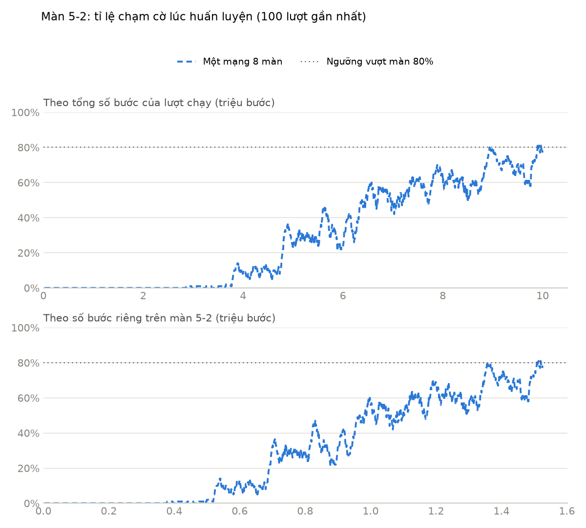

# Báo cáo màn 5-2

Cập nhật lần cuối: 24/11/2026, 10:30. Lượt 8 màn đã kết thúc ở bước 9.998.336; 10 checkpoint của nó đã được chấm 100 lượt seed 7 trên 5-2, 2 checkpoint đã được chấm theo lệnh của đề. Checkpoint cuối đã được chấm thêm 100 lượt seed 11.

Quy ước: **bước** là bước tác tử. **Số chấm** là kết quả của `evaluate.py` (100 lượt seed 7 để ra quyết định, 20 lượt seed 2026 là đúng lệnh chấm của đề). **Số lúc huấn luyện** là tỉ lệ chạm cờ của 100 lượt huấn luyện gần nhất trong `progress.csv`; hai loại số có thể lệch nhau hơn 10 điểm. Cờ của 5-2 ở x = 3193; ngưỡng vượt màn là 0,8.

## 1. Kết quả tốt nhất hiện có

| Mạng | Checkpoint | 100 lượt, seed 7 | 20 lượt, seed 2026 |
|---|---|---|---|
| Một mạng 8 màn (cao nhất theo 100 lượt) | `runs/8-levels/from-scratch-10m`, bước 9.900.032 | 71/100 | 12/20 |
| Một mạng 8 màn (checkpoint cuối) | `runs/8-levels/from-scratch-10m`, bước 9.998.336 | 68/100 | 18/20 |

Ở checkpoint cuối (bước 9.998.336), mạng 8 màn đạt 68/100 theo 100 lượt seed 7 và 18/20 theo lệnh chấm. Hai loại số chấm cho kết luận khác nhau về ngưỡng 0,8, nên chưa nói được màn 5-2 đã vượt. Checkpoint cao nhất theo 100 lượt là bước 9.900.032 (71/100). Màn 5-2 không có checkpoint nộp; số ở đây chỉ dùng cho báo cáo. Theo quy ước của các báo cáo này, quyết định dựa vào 100 lượt seed 7 (68/100), nên 5-2 được tính là chưa vượt ngưỡng. 20 lượt dao động mạnh hơn: ở bước 9,90M cùng mạng chỉ được 12/20.

Lần chấm kiểm tra bằng seed 11 ở checkpoint cuối cho 82/100, lệch 14 điểm so với seed 7. Để có con số không phụ thuộc seed, checkpoint cuối được chấm đủ 31 giá trị NOOP, mỗi giá trị 10 lượt: 228/310 = 73,5% (khoảng tin cậy 95% là 68,4–78,1%). **Kết luận: mạng 8 màn chưa vượt ngưỡng 0,8 ở 5-2**; tỉ lệ thật khoảng 74%. Chi tiết ở Mục 5.

## 2. Các lượt chạy có huấn luyện 5-2

Mọi lượt đều dùng seed 1, 8 môi trường × 512 bước, γ = 0,9, bộ hành động `simple`.

| Lượt chạy | Số màn | Tổng bước | Bước riêng trên 5-2 | Tốc độ học | Chạm cờ lúc huấn luyện, cuối lượt |
|---|---|---|---|---|---|
| `runs/8-levels/from-scratch-10m` | 8 | 9.998.336 | 1.525.487 | 2e-4 giảm về 0 | 77% |

- Ở lượt 8 màn, mỗi màn chạy trên một môi trường tới bước 2.002.944, nên 5-2 nhận 1/8 số bước đó. Sau đó phần bước chia theo tỉ lệ hỏng lúc huấn luyện (sàn 6%, trần 30%, ghi trong `allocation.csv`): 5-2 nhận 16% số bước của chặng này (15% ở triệu bước thứ 3, 17% ở triệu bước thứ 7, 16% ở triệu bước thứ 10).
- Bước riêng trên 5-2 = 1/8 của 2.002.944 bước đầu cộng dồn cột `steps_5-2` của `allocation.csv`.
- Lượt thử nối tiếp `runs/multi-level/restart-test` không có màn 5-2.

## 3. Đường cong học

Hình vẽ bằng `python experiments/level_curves.py 5-2`.

- **Màn 5-2 lên chậm nhất sau 2-1.** Số lúc huấn luyện lần đầu khác 0 ở 2,86 triệu bước (0,38 triệu bước riêng), chạm 50% ở 6,38 triệu (0,97 triệu riêng), chạm 80% lần đầu ở 8,94 triệu (1,36 triệu riêng).
- **Không ở yên trên 80%.** Cao nhất 81% ở 9,90 triệu bước, cuối lượt 77%; 50 dòng cuối nằm trong khoảng 71–81%. Đường cong vẫn đang lên khi tốc độ học về 0.
- Màn nhận nhiều bước thứ hai (1.525.487 bước riêng, 16% số bước của chặng chia theo tỉ lệ hỏng), sau 2-1.
- Lượt thử nối tiếp không có màn 5-2.

Giới hạn: mỗi lượt chỉ một seed, và trong lượt 8 màn phần bước của từng màn đổi theo thời gian cùng lúc với tốc độ học và hệ số entropy. Các nhận xét trên là quan sát, chưa phải kết luận về nguyên nhân.

## 4. Số chấm theo checkpoint

### Một mạng 8 màn (`runs/8-levels/from-scratch-10m`)

| Bước | 1,90M | 2,00M | 3,40M | 3,50M | 6,20M | 6,30M | 8,00M | 9,00M | 9,90M | 9,998M (cuối) |
|---|---|---|---|---|---|---|---|---|---|---|
| Bước riêng trên 5-2 | 237.568 | 250.368 | 461.159 | 474.680 | 926.994 | 949.447 | 1.209.520 | 1.364.545 | 1.508.628 | 1.525.487 |
| Chạm cờ /100 (seed 7) | 0 | 0 | 0 | 0 | 38 | 47 | 55 | 61 | 71 | 68 |
| Chạm cờ /100 (seed 11) | – | – | – | – | – | – | – | – | – | 82 |
| x trung bình (seed 7) | 1323 | 1319 | 2001 | 2143 | 2617 | 2641 | 2558 | 2931 | 2977 | 2985 |
| Chạm cờ /20 (seed 2026) | – | – | – | – | – | – | – | – | 12 | 18 |

- Checkpoint cuối được chấm kiểm tra thêm 100 lượt seed 11: 82/100 (82 chạm cờ, 12 chạm địch, 6 rơi hố). Gộp với seed 7: 150/200 = 75,0%, khoảng tin cậy 95% 68,6–80,5% (công thức Wilson). Tệp ở `runs/8-levels/from-scratch-10m/eval/step-009998336-100ep-seed11/deaths-5-2/`. Video lượt chạm cờ đầu tiên theo lệnh chấm: `runs/8-levels/from-scratch-10m/eval/step-009998336-20ep-seed2026/videos/5-2.mp4`.
- Từ bước 6,30M tới cuối lượt, số chạm cờ /100 tăng từ 47 lên 68.
- Hai checkpoint cách nhau khoảng 100 nghìn bước có thể chênh 9 điểm (bước 6,20M và 6,30M: 38 và 47), nên không đọc xu hướng từ một checkpoint đơn lẻ.

## 5. Mario hỏng ở đâu

### Lý do kết thúc lượt theo checkpoint (100 lượt seed 7)

| Bước | Chạm cờ | Chết vì địch | Rơi hố |
|---|---|---|---|
| 2,00M | 0 | 56 | 44 |
| 3,40M | 0 | 56 | 44 |
| 3,50M | 0 | 53 | 47 |
| 6,20M | 38 | 38 | 24 |
| 6,30M | 47 | 25 | 28 |
| 8,00M | 55 | 29 | 16 |
| 9,00M | 61 | 22 | 17 |
| 9,90M | 71 | 17 | 12 |
| 9,998M | 68 | 19 | 13 |

Lý do đọc từ trạng thái trình giả lập bằng `experiments/death_look.py`, cùng các lượt với `evaluate.py`. "Chết vì địch" là chết khi còn trong màn hình (địch, cây ăn thịt, đạn); "hết giờ" là đồng hồ của trò chơi về 0, thường do Mario kẹt trước một vật cản. Checkpoint 1,90M chỉ có tệp của `evaluate.py`, không có lý do.

### Chỗ kết thúc ở checkpoint cuối (bước 9.998.336, 32 lượt hỏng trên 100)

| Khoảng x | Số lượt | Lý do kết thúc | x cuối cụ thể |
|---|---|---|---|
| 1800–1899 | 3 | 3 chạm địch | 1858–1899 |
| 2700–2799 | 3 | 3 rơi hố | 2762–2777 |
| 2900–2999 | 13 | 9 chạm địch, 4 rơi hố | 2952–2973 |
| 3000–3099 | 5 | 5 rơi hố | 3015–3020 |

Bảng chỉ liệt kê các khoảng 100 điểm ảnh có từ 3 lượt trở lên; 8 lượt hỏng còn lại rải ở các khoảng khác. Bảng đủ ở `runs/8-levels/from-scratch-10m/eval/step-009998336-100ep-seed7/deaths-5-2/look.txt`.

- Ở checkpoint cuối, 2 chỗ chiếm 18 trên 32 lượt hỏng: x 2952–2973 (13 lượt: 9 chạm địch, 4 rơi hố) và x 3015–3020 (5 lượt rơi hố). Cả hai cách cờ (x = 3193) chưa tới 250 điểm ảnh.
- So với bước 6,30M: x 1301–1307 từ 11 lượt chạm địch xuống 0, x 2752–2777 từ 14 lượt xuống 3, x 3011–3022 từ 9 xuống 5. Chỗ x 2900–2999 tăng từ 3 lên 13 lượt, nhưng số lượt tới được x 2900 cũng tăng từ 59 lên 86; tỉ lệ hỏng trong số lượt tới được x 2900 gần như giữ nguyên (12/59 ở 6,30M, 18/86 ở cuối lượt).
- Khung hình của tám lượt hỏng ở đoạn x 2952–3019 (bốn lượt mỗi chỗ) nằm ở `runs/8-levels/from-scratch-10m/eval/step-009998336-100ep-seed7/look-5-2/`. Cả hai chỗ đều là dãy bậc thang cuối màn, ngay trước cột cờ, nơi có một con rùa xanh có cánh bay lên xuống phía trên bậc thang:
  - **x 2952 (`deaths-x2900.png`):** Mario nhảy từ nền lên bậc thang và chạm con rùa giữa không trung. Bốn lượt trong ảnh có khung hình giống hệt nhau.
  - **x 3015–3019 (`deaths-x3000.png`):** Mario rơi vào khe hẹp giữa bậc thang thấp và cột cao bên phải. Ở cả bốn lượt con rùa đang bay ngay cạnh đường nhảy.
- Chưa xem khung hình ở x 1858–1900, chỗ mà 29 bước NOOP luôn dẫn tới cái chết.

### Seed 7 và seed 11 lệch nhau ở x 2952–3020 (checkpoint cuối)

| | Seed 7 | Seed 11 |
|---|---|---|
| Chạm cờ /100 | 68 | 82 |
| Lượt tới được x 2900 | 86 | 84 |
| Lượt hỏng ở x 2952–3020 | 18 (9 chạm địch, 9 rơi hố) | 2 (1 chạm địch, 1 rơi hố) |
| Lượt hỏng ở chỗ khác | 14 | 16 |

- Chênh lệch 14 điểm giữa hai seed nằm gần hết ở một chỗ. Ngoài đoạn x 2952–3020 hai seed giống nhau (14 và 16 lượt hỏng). Trong đoạn đó là 18/86 so với 2/84; kiểm định Fisher cho p = 0,0002, tức khó là ngẫu nhiên nếu các lượt độc lập.
- Chín lượt của seed 7 chết vì địch ở x 2952–2953 đúng bước thứ 247 (không tính bước NOOP), tức cùng một đường chạy. Seed 11 có một lượt như vậy.
- Kết quả phụ thuộc vào số bước NOOP đầu lượt. Gộp hai seed: cả 7 lượt bắt đầu sau 10 bước NOOP và cả 6 lượt sau 29 bước NOOP đều hỏng; 13 lượt sau 15 bước NOOP đều chạm cờ. Các lượt vì thế không độc lập, và điểm 100 lượt còn tùy seed bốc trúng những số NOOP nào.
- Số liệu lấy từ `deaths.json` của hai thư mục `step-009998336-100ep-seed7/deaths-5-2/` và `step-009998336-100ep-seed11/deaths-5-2/`.

### Chấm đủ 31 giá trị NOOP (checkpoint cuối)

`python experiments/noop_sweep.py --ckpt <checkpoint cuối> --level 5-2 --per-noop 10 --seed 7`: mỗi giá trị NOOP từ 0 tới 30 chơi 10 lượt lấy mẫu hành động như `evaluate.py`, thêm 1 lượt luôn chọn hành động xác suất cao nhất. Kết quả ở `runs/8-levels/from-scratch-10m/eval/step-009998336-noop-sweep/5-2/sweep.txt`.

| | Kết quả |
|---|---|
| Lấy mẫu, 310 lượt | 228 chạm cờ = 73,5% (khoảng tin cậy 95% là 68,4–78,1%) |
| Chọn xác suất cao nhất, 31 lượt | 27 chạm cờ = 87% |
| Giá trị NOOP đạt 10/10 | 6 giá trị: 4, 5, 6, 9, 13, 15 |
| Giá trị NOOP đạt từ 8/10 trở lên | 16 trên 31 |
| Giá trị NOOP tệ nhất | 29 (0/10), 1 (2/10), 10 (5/10) |

- **Tỉ lệ chạm cờ khi chấm đều NOOP là 73,5%.** `evaluate.py` bốc NOOP đều trong 0..30, nên đây là giá trị mà điểm 100 lượt của mọi seed dao động quanh. Seed 7 (68) và seed 11 (82) nằm hai bên nó. Gộp cả ba lần chấm: 378/510 = 74%.
- **Số bước NOOP quyết định phần lớn kết quả.** Với 29 bước NOOP, cả 10 lượt lấy mẫu và lượt chọn xác suất cao nhất đều chết vì địch ở x 1858–1900. Với 1 bước NOOP, 8 trên 10 lượt hỏng, 5 lượt trong đó ở x 2952–2953.
- **Lấy mẫu làm hỏng thêm.** Khi luôn chọn xác suất cao nhất, 27 trên 31 giá trị NOOP chạm cờ; 4 giá trị hỏng là 1, 7, 10 và 29. Khi lấy mẫu, cũng 27 giá trị đó chỉ đạt 215/270 = 80%.
- **Chỗ hỏng nhiều nhất vẫn là x 2951–3020:** 36 trên 82 lượt hỏng (20 chạm địch ở x 2951–2953, 16 rơi hố ở x 2966–3020). Tiếp theo là x 1838–1922 (21 lượt, 10 lượt trong đó là của NOOP 29).
- Khoảng tin cậy coi 310 lượt là độc lập. Trong cùng một giá trị NOOP các lượt không độc lập, nên khoảng thật rộng hơn một chút.

## 6. Mạng không học 5-2 thì chơi 5-2 thế nào

| Mạng | Chạm cờ ở 5-2 (20 lượt, seed 2026) | x trung bình | x xa nhất |
|---|---|---|---|
| Chỉ học 1-1 (`runs/1-1/run-1`, bước 1.200.128) | 0/20 | 546 | 973 |
| Chỉ học 4-1 (`runs/4-1/from-scratch`, bước 1.200.128) | chưa chấm | – | – |
| Chỉ học 2-3 (`runs/2-3/from-scratch-3m`, bước 2.801.664) | 0/20 | 420 | 995 |
| Một mạng 2 màn 1-1 và 4-1, bước 2.904.064 | 0/20 | 483 | 971 |

Không mạng nào chạm cờ ở 5-2 khi chưa học màn này; x xa nhất là 995.

## 7. Điều chưa biết

- Vì sao mạng không học được cách tránh con rùa có cánh ở bậc thang cuối (x 2952–3020): tỉ lệ hỏng ở đó không giảm từ 6,30M tới cuối lượt (tính theo seed 7). Một giả thuyết chưa kiểm tra: vị trí con rùa lúc Mario tới phụ thuộc vào thời điểm, mạng học một đường nhảy cố định và chỉ đúng với một số thời điểm.
- Vì sao seed 7 chạm con rùa ở 9 lượt còn seed 11 chỉ 1 lượt. Số bước NOOP không giải thích hết: cùng 14 bước NOOP, seed 7 hỏng 2 trên 5 lượt ở chỗ này, seed 11 không hỏng lượt nào trên 4.
- Vì sao 29 bước NOOP luôn dẫn tới cái chết ở x 1900 (cả 11 lượt). Chưa xem khung hình.
- Đường cong lúc huấn luyện vẫn đi lên khi tốc độ học về 0; chưa thử chạy thêm.
- Một mạng chỉ học 5-2 cần bao nhiêu bước để vượt ngưỡng: chưa có lượt một màn nào cho 5-2, nên chưa so được học chung với học riêng như ở 1-1 và 4-1.
- Mọi kết quả mới có một seed huấn luyện.

Các hướng mở rộng chung cho mọi màn ở `docs/extension-directions.md`.

## 8. Nhật ký cập nhật

| Ngày | Thay đổi |
|---|---|
| 24/11/2026 | Tạo báo cáo từ lượt 8 màn (đã kết thúc). |
| 24/11/2026 | Thêm lần chấm kiểm tra 100 lượt seed 11 ở checkpoint cuối của lượt 8 màn (82/100, gộp hai seed 150/200) và đường dẫn video quay bằng lệnh chấm. |
| 24/11/2026 | Thêm phép chấm đủ 31 giá trị NOOP ở checkpoint cuối (`experiments/noop_sweep.py`): 228/310 = 73,5% khi lấy mẫu, 27/31 khi chọn xác suất cao nhất. Kết luận ở Mục 1 đổi thành: chưa vượt ngưỡng, tỉ lệ thật khoảng 74%. |
| 24/11/2026 | Thêm ảnh các lượt hỏng ở x 2952–3019 của checkpoint cuối (`look-5-2/`) và mô tả hai kiểu hỏng ở bậc thang cuối màn. |
