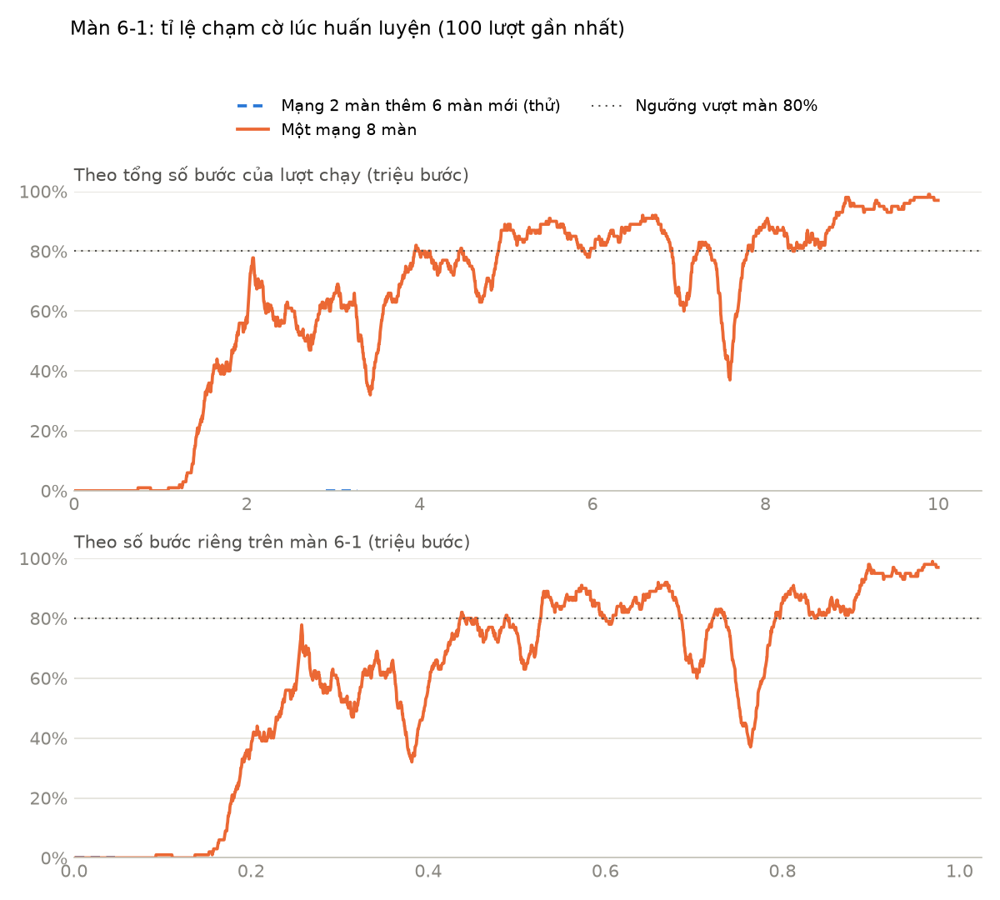

# Báo cáo màn 6-1

Cập nhật lần cuối: 24/11/2026, 10:30. Lượt 8 màn đã kết thúc ở bước 9.998.336; 10 checkpoint của nó đã được chấm 100 lượt seed 7 trên 6-1, 2 checkpoint đã được chấm theo lệnh của đề. Checkpoint cuối đã được chấm thêm 100 lượt seed 11.

Quy ước: **bước** là bước tác tử. **Số chấm** là kết quả của `evaluate.py` (100 lượt seed 7 để ra quyết định, 20 lượt seed 2026 là đúng lệnh chấm của đề). **Số lúc huấn luyện** là tỉ lệ chạm cờ của 100 lượt huấn luyện gần nhất trong `progress.csv`; hai loại số có thể lệch nhau hơn 10 điểm. Cờ của 6-1 ở x = 2969; ngưỡng vượt màn là 0,8.

## 1. Kết quả tốt nhất hiện có

| Mạng | Checkpoint | 100 lượt, seed 7 | 20 lượt, seed 2026 |
|---|---|---|---|
| Một mạng 8 màn (cao nhất theo 100 lượt) | `runs/8-levels/from-scratch-10m`, bước 9.003.008 | 100/100 | chưa chấm |
| Một mạng 8 màn | `runs/8-levels/from-scratch-10m`, bước 9.900.032 | 99/100 | 20/20 |
| Một mạng 8 màn (checkpoint cuối) | `runs/8-levels/from-scratch-10m`, bước 9.998.336 | 99/100 | 20/20 |

Ở checkpoint cuối (bước 9.998.336), mạng 8 màn đạt 99/100 theo 100 lượt seed 7 và 20/20 theo lệnh chấm. Màn 6-1 vượt ngưỡng 0,8 ở mạng này. Checkpoint cao nhất theo 100 lượt là bước 9.003.008 (100/100). Màn 6-1 không có checkpoint nộp; số ở đây chỉ dùng cho báo cáo.

## 2. Các lượt chạy có huấn luyện 6-1

Mọi lượt đều dùng seed 1, 8 môi trường × 512 bước, γ = 0,9, bộ hành động `simple`.

| Lượt chạy | Số màn | Tổng bước | Bước riêng trên 6-1 | Tốc độ học | Chạm cờ lúc huấn luyện, cuối lượt |
|---|---|---|---|---|---|
| `runs/multi-level/restart-test` | 8 | 372.736 (nối tiếp mạng 2 màn) | 46.592 | 1,4e-4 | 0% |
| `runs/8-levels/from-scratch-10m` | 8 | 9.998.336 | 975.805 | 2e-4 giảm về 0 | 97% |

- Ở lượt 8 màn, mỗi màn chạy trên một môi trường tới bước 2.002.944, nên 6-1 nhận 1/8 số bước đó. Sau đó phần bước chia theo tỉ lệ hỏng lúc huấn luyện (sàn 6%, trần 30%, ghi trong `allocation.csv`): 6-1 nhận 9% số bước của chặng này (9% ở triệu bước thứ 3, 9% ở triệu bước thứ 7, 7% ở triệu bước thứ 10).
- Bước riêng trên 6-1 = 1/8 của 2.002.944 bước đầu cộng dồn cột `steps_6-1` của `allocation.csv`.
- Lượt thử nối tiếp lấy mạng 2 màn (1-1 và 4-1) ở bước 2.904.064 rồi cho học 8 màn 1-1, 4-1, 2-1, 3-1, 3-2, 5-1, 6-1, 8-1, mỗi màn một môi trường, tốc độ học 1,4e-4. Nó bị dừng tay sau 372.736 bước; chỉ còn `progress.csv` và `summary.txt`, checkpoint đã xóa.

## 3. Đường cong học

Hình vẽ bằng `python experiments/level_curves.py 6-1`.

- **Màn 6-1 chạm 50% sớm nhất trong tám màn.** Số lúc huấn luyện lần đầu khác 0 ở 0,74 triệu bước (0,09 triệu bước riêng), chạm 50% ở 1,88 triệu (0,23 triệu riêng), chạm 80% lần đầu ở 3,94 triệu (0,44 triệu riêng).
- **Hai lần tụt sâu:** xuống 32% ở 3,43 triệu bước, sau khi đã lên tới 78% trong khoảng 2–3 triệu bước; và xuống 37% ở 7,59 triệu bước, sau khi đã lên tới 89–92% trong khoảng 4–7 triệu bước. Nó chỉ ở yên trên 80% từ 7,79 triệu bước (0,79 triệu bước riêng). Cuối lượt 97%; 50 dòng cuối nằm trong khoảng 97–99%.
- Lượt thử nối tiếp (mạng đã học 1-1 và 4-1) và lượt 8 màn ở cùng 46.592 bước riêng trên 6-1 (bước 372.736 của lượt 8 màn): x trung bình lúc huấn luyện 1640 so với 1072, cả hai chưa chạm cờ.

Giới hạn: mỗi lượt chỉ một seed, và trong lượt 8 màn phần bước của từng màn đổi theo thời gian cùng lúc với tốc độ học và hệ số entropy. Các nhận xét trên là quan sát, chưa phải kết luận về nguyên nhân.

## 4. Số chấm theo checkpoint

### Một mạng 8 màn (`runs/8-levels/from-scratch-10m`)

| Bước | 1,90M | 2,00M | 3,40M | 3,50M | 6,20M | 6,30M | 8,00M | 9,00M | 9,90M | 9,998M (cuối) |
|---|---|---|---|---|---|---|---|---|---|---|
| Bước riêng trên 6-1 | 237.568 | 250.368 | 378.374 | 391.011 | 631.829 | 639.644 | 810.568 | 902.425 | 969.506 | 975.805 |
| Chạm cờ /100 (seed 7) | 53 | 72 | 60 | 63 | 82 | 88 | 92 | 100 | 99 | 99 |
| Chạm cờ /100 (seed 11) | – | – | – | – | – | – | – | – | – | 99 |
| x trung bình (seed 7) | 2496 | 2737 | 2522 | 2666 | 2820 | 2909 | 2924 | 2969 | 2944 | 2944 |
| Chạm cờ /20 (seed 2026) | – | – | – | – | – | – | – | – | 20 | 20 |

- Checkpoint cuối được chấm kiểm tra thêm 100 lượt seed 11: 99/100 (99 chạm cờ, 1 rơi hố). Gộp với seed 7: 198/200 = 99,0%, khoảng tin cậy 95% 96,4–99,7% (công thức Wilson). Tệp ở `runs/8-levels/from-scratch-10m/eval/step-009998336-100ep-seed11/deaths-6-1/`. Video lượt chạm cờ đầu tiên theo lệnh chấm: `runs/8-levels/from-scratch-10m/eval/step-009998336-20ep-seed2026/videos/6-1.mp4`.
- Từ bước 6,30M tới cuối lượt, số chạm cờ /100 tăng từ 88 lên 99.
- Hai checkpoint cách nhau khoảng 100 nghìn bước có thể chênh 19 điểm (bước 1,90M và 2,00M: 53 và 72), nên không đọc xu hướng từ một checkpoint đơn lẻ.

### Lượt thử nối tiếp (`runs/multi-level/restart-test`)

Chưa chấm trên 6-1, và không chấm lại được vì checkpoint đã xóa. Số lúc huấn luyện ở cuối lượt (sau 46.592 bước riêng): chạm cờ 0%, x trung bình 1640.

## 5. Mario hỏng ở đâu

### Lý do kết thúc lượt theo checkpoint (100 lượt seed 7)

| Bước | Chạm cờ | Chết vì địch | Rơi hố |
|---|---|---|---|
| 2,00M | 72 | 12 | 16 |
| 3,40M | 60 | 28 | 12 |
| 3,50M | 63 | 12 | 25 |
| 6,20M | 82 | 10 | 8 |
| 6,30M | 88 | 2 | 10 |
| 8,00M | 92 | 1 | 7 |
| 9,00M | 100 | 0 | 0 |
| 9,90M | 99 | 1 | 0 |
| 9,998M | 99 | 1 | 0 |

Lý do đọc từ trạng thái trình giả lập bằng `experiments/death_look.py`, cùng các lượt với `evaluate.py`. "Chết vì địch" là chết khi còn trong màn hình (địch, cây ăn thịt, đạn); "hết giờ" là đồng hồ của trò chơi về 0, thường do Mario kẹt trước một vật cản. Checkpoint 1,90M chỉ có tệp của `evaluate.py`, không có lý do.

### Chỗ kết thúc ở checkpoint cuối (bước 9.998.336, 1 lượt hỏng trên 100)

| Khoảng x | Số lượt | Lý do kết thúc | x cuối cụ thể |
|---|---|---|---|
| 500–599 | 1 | 1 chạm địch | 513 |

Bảng đủ ở `runs/8-levels/from-scratch-10m/eval/step-009998336-100ep-seed7/deaths-6-1/look.txt`.

- Ở bước 6,30M, 9 trên 12 lượt hỏng là rơi hố ở x 2802–2810, cách cờ (x = 2969) khoảng 160 điểm ảnh. Ở checkpoint cuối không còn lượt nào hỏng ở đó; chỉ còn 1 lượt chạm địch ở x = 513.
- Chưa xem khung hình các lượt hỏng của mạng 8 màn ở 6-1.

## 6. Mạng không học 6-1 thì chơi 6-1 thế nào

| Mạng | Chạm cờ ở 6-1 (20 lượt, seed 2026) | x trung bình | x xa nhất |
|---|---|---|---|
| Chỉ học 1-1 (`runs/1-1/run-1`, bước 1.200.128) | 0/20 | 408 | 645 |
| Chỉ học 4-1 (`runs/4-1/from-scratch`, bước 1.200.128) | chưa chấm | – | – |
| Chỉ học 2-3 (`runs/2-3/from-scratch-3m`, bước 2.801.664) | 0/20 | 388 | 498 |
| Một mạng 2 màn 1-1 và 4-1, bước 2.904.064 | 0/20 | 476 | 1138 |

Không mạng nào chạm cờ ở 6-1 khi chưa học màn này; x xa nhất là 1138.

## 7. Điều chưa biết

- Vì sao số lúc huấn luyện của 6-1 tụt sâu hai lần (xuống 32% và 37%).
- Một mạng chỉ học 6-1 cần bao nhiêu bước để vượt ngưỡng: chưa có lượt một màn nào cho 6-1, nên chưa so được học chung với học riêng như ở 1-1 và 4-1.
- Mọi kết quả mới có một seed huấn luyện.

Các hướng mở rộng chung cho mọi màn ở `docs/extension-directions.md`.

## 8. Nhật ký cập nhật

| Ngày | Thay đổi |
|---|---|
| 24/11/2026 | Tạo báo cáo từ lượt 8 màn (đã kết thúc) và lượt thử nối tiếp. |
| 24/11/2026 | Thêm lần chấm kiểm tra 100 lượt seed 11 ở checkpoint cuối của lượt 8 màn (99/100, gộp hai seed 198/200) và đường dẫn video quay bằng lệnh chấm. |
